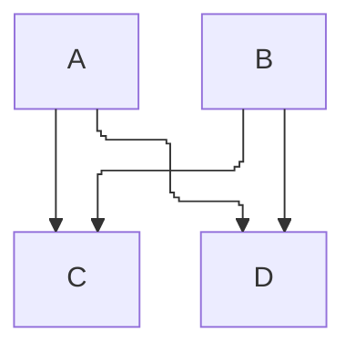

- [1. Proof style](#1-proof-style)
	- [1.1. 模板](#11-模板)
	- [1.2. 行前缀](#12-行前缀)
	- [1.3. 折叠记号](#13-折叠记号)
- [2. Mermaid style](#2-mermaid-style)
	- [2.1. 模板](#21-模板)

## 1. Proof style

适用于定理、命题、引理、推论。陈述与论证放在同一个 callout 里。外层始终展开，只放需要直接读到的结论；证明嵌在内层，默认折叠。

单个 callout 会把整段一起折叠，所以证明必须再套一层，不能把 `-` 加在外层上。

外层标题写作 `种类（……）`，种类取定理、命题、引理、推论之一。内层标题写作 `证明`。不是这四类、只是把结论和推导收在一起时，外层用结论名，内层标题写作 `推导`。

### 1.1. 模板

````markdown
> [!abstract] 命题（标题）
> 陈述。需要直接看到的公式也写在这一层。
>
> $$
> \text{结论}
> $$
>
> > [!note]- 证明
> > 论证。
> >
> > $$
> > \text{中间步骤}
> > $$
````

### 1.2. 行前缀

- 外层每一行以 `>` 开头，层内空行写成 `>`。
- 内层每一行以 `> >` 开头，层内空行写成 `> >`。
- `$$` 和公式本体同样加所在层的前缀。少一行前缀，框会从那里断开。

### 1.3. 折叠记号

- `[!type]`：不折叠。陈述用这个。
- `[!type]+`：可折叠，默认展开。
- `[!type]-`：可折叠，默认收起。证明和推导用这个。

## 2. Mermaid style

手绘流程图用 Mermaid 12。布局用 ELK，边的交叉用 line hop：交叉处画小弧，标明哪条边从上面越过。ELK 从 12 起是 flowchart 的默认布局；把 `layout` 和 `lineHops` 写进图内配置，避免以后默认值变动时图的样子跟着变。

line hop 只改直线类折线。`basis` 等曲线会被跳过，hop 不会出现。曲线用 `stepAfter`，与现有依赖图一致。

`lineHops` 取值：

- `true`：交叉处画小弧。手绘图用这个。
- `gap`：交叉处留缺口。
- `false`：普通交叉，不标越线。

### 2.1. 模板

````markdown

````