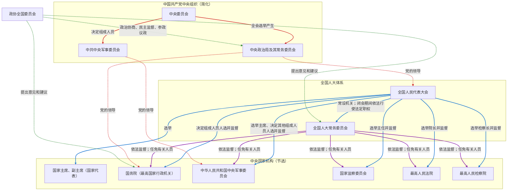
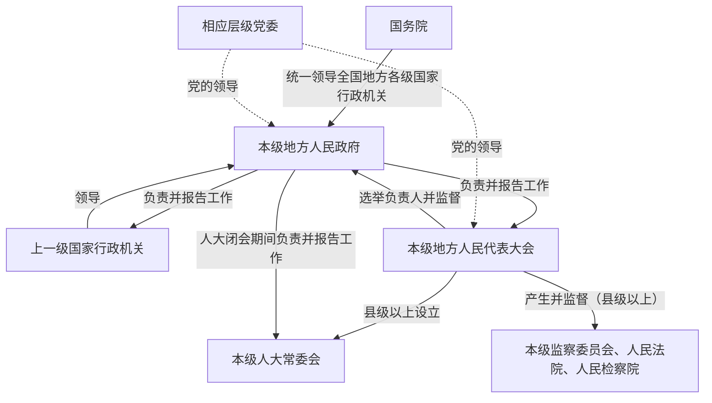
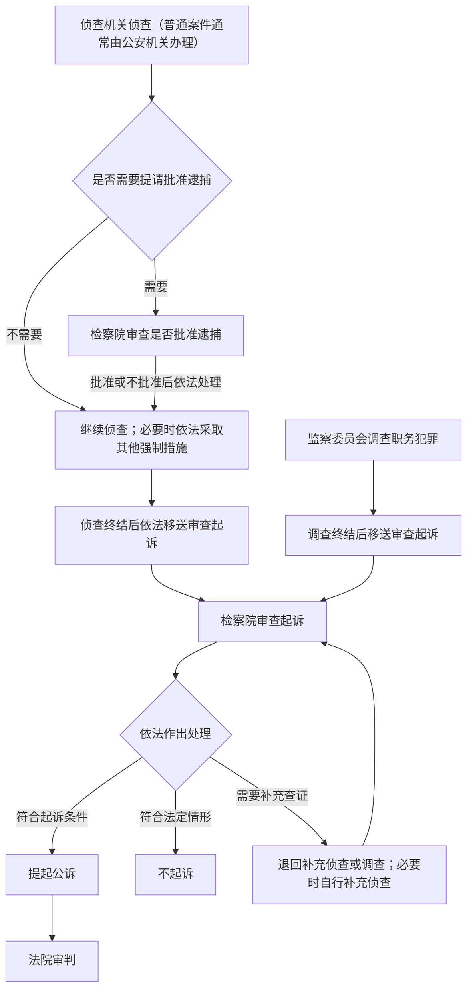

## 1. 前置

- [[故事/货币与行政]]

## 2. 结构

以下仅列出理解制度框架所需的主要关系，不是完整的机构名录。

### 2.1. 中央层面

### 2.2. 地方层面

> - 中央层面图中，红色边来自党的组织，蓝色边来自全国人大，紫色边来自全国人大常委会，绿色边来自全国政协。
> - 实线表示国家机关之间的法定关系；虚线表示党的政治领导或政协的协商关系，不表示行政隶属、选举任免或国家机关监督关系。
> - 中共中央军委与中华人民共和国中央军事委员会分属党和国家的制度序列，不应视为同一个法律主体。
> - 中央政治局及其常务委员会在中央委员会全体会议闭会期间行使中央委员会的职权。
> - 地方行政层级因行政区划和管理体制而异。图中表示一般关系，并非所有地区都遵循“省—市—县—乡镇”的固定链条。

## 3. 四个机关

- **行政机关**
  - 国务院和地方各级人民政府等国家行政机关，依法管理国家行政事务，执行法律和有关国家权力机关的决议
- **监察机关**
  - 国家监察委员会和地方各级监察委员会，依法对行使公权力的公职人员进行监察，调查职务违法和职务犯罪
- **审判机关**
  - 人民法院，依法行使审判权，审理刑事、民事、行政等案件
- **检察机关**
  - 人民检察院是国家的法律监督机关，依法开展审查批准逮捕、审查起诉、提起公诉以及抗诉等工作

### 3.1. 刑事诉讼

## 4. 两会

### 4.1. 全国两会

- 通常指全国人民代表大会会议和中国人民政治协商会议全国委员会会议。
- 两个会议一般在每年 **3 月初** 基本同期召开，这是长期形成的惯例，并非法律规定的固定开幕日期。
- 全国人大是最高国家权力机关，全国政协是中国人民爱国统一战线的组织、实行中国共产党领导的多党合作和政治协商制度的重要政治形式和组织形式。

### 4.2. 地方两会

- 通常指同一行政区划、同一级别的人民代表大会会议与政协地方委员会会议在相近时间举行。
- 地方两会一般在每年年初召开；具体时间由各地安排。

### 4.3. 地方人大

- **县级以上**：省、自治区、直辖市，自治州，设区的市，县、自治县、不设区的市和市辖区均设人民代表大会，并设本级人大常委会。
- **乡级**：乡、民族乡、镇设人民代表大会，不设本级人大常委会。

### 4.4. 地方政协

- 省、自治区、直辖市设政协委员会。
- 自治州、设区的市、县、自治县、不设区的市和市辖区，**凡有条件的地方，可以设立**政协地方委员会，并非每个地方都必然设立。
- 乡、民族乡、镇不设乡级政协委员会，因此不形成通常意义上的乡级“两会”。

## 5. 全会

### 5.1. “全会”的含义

- **全会**是“全体会议”的简称，本节特指中国共产党中央委员会全体会议。
- 中央委员会全体会议由中央政治局召集，**每年至少举行一次**。
- 全会须有半数以上中央委员会委员到会方可举行。候补中央委员参加会议，但不参加表决；递补为中央委员后，才取得中央委员相应的表决权。
- 表决时，赞成票超过应到会中央委员会委员半数方可通过；未到会委员的意见不计入票数。
- 中央委员会全体会议闭会期间，由中央政治局及其常务委员会行使中央委员会的职权。

### 5.2. “几中”的含义

“几中”表示某一届中央委员会召开的第几次全体会议：

- **一中全会**：该届中央委员会第一次全体会议。
- **二中全会**：该届中央委员会第二次全体会议。
- **三中全会**：该届中央委员会第三次全体会议。
- 依此类推。

### 5.3. 总结公式

> **“第 X 届中央委员会 + 第 N 次全体会议” = “X 届 N 中全会”**

- “届”表示中央委员会的任期届次。中央委员会每届任期五年；全国代表大会提前或延期举行时，任期相应改变。
- “N 中”表示该届中央委员会第 N 次全体会议。
- “全会”表示中央委员会按照党内法规举行的全体会议，不表示每一位委员都必须实际到会。

## 6. 主要依据

- [《中华人民共和国宪法》](https://www.samr.gov.cn/zw/zfxxgk/fdzdgknr/bgt/art/2025/art_175349a7be7e4765a8bbe77b6d161232.html)
- [《中国共产党章程》](https://www.12371.cn/2022/10/26/ARTI1666788342244946.shtml)
- [《中国共产党中央委员会工作条例》](https://www.12371.cn/2020/10/12/ARTI1602498113740862.shtml)
- [《中国人民政治协商会议章程》](http://www.cppcc.gov.cn/zxww/2023/03/20/ARTI1679275255601112.shtml)
- [《中华人民共和国刑事诉讼法》](https://www.spp.gov.cn/zdgz/201810/t20181027_396818.shtml)
