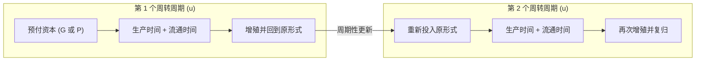

## 1. 前置

- [[故事/资本论-第二卷/资本形态变化及其循环]]

---

## 2. 资本周转与周转时间的定义

### 2.1. 资本周转的含义

单个资本家投在任何一个生产部门的总资本价值，在完成一次运动的循环后，就重新回到它原来的形式上，并能够重复同一过程。资本价值要作为自行增殖的价值永久保持和增殖，就必须不断重复这一过程。

单个循环在资本的生活中只形成一个不断重复的段落，即一个**周期**：

- 在 $G \ldots G'$ 周期的末尾，资本重新处在**货币资本**形式上，再次通过包含再生产或价值增殖过程的形式转化序列。
- 在 $P \ldots P$ 周期的末尾，资本重新处在**生产要素**形式上，构成新一轮循环的前提。

**当资本的循环不是当作孤立的行为，而是当作周期性的、不断重复的过程时，就叫做资本的周转。**

### 2.2. 总流通时间（周转时间）

资本周转的持续时间，由资本的生产时间和流通时间之和决定。这一时间总和构成资本的**周转时间**（即总流通时间）：

$$
\text{周转时间（总流通时间）} = \text{生产时间} + \text{流通时间}
$$

- **起止界限**：从资本价值以一定形式（货币形式或生产要素形式）预付时起，到处在过程中的资本价值实现增殖并重新回到同一形式时止的一段时间。
- **对资本家的意义**：周转时间就是资本家必须预付其资本，以便使它增殖并回到原来形式所必须等待的间隔时间；它衡量了同一资本价值的增殖过程或生产过程更新、重复的周期。
- **部门差异**：撇开可以加速或缩短单个资本周转时间的个别冒险行为不说，不同投资部门的资本周转时间各不相同。

### 2.3. 预付价值的增殖与同一性

资本主义生产的决定目的，始终是**预付价值的增殖**。无论预付价值采取独立的形式（货币形式），还是采取商品形式（其价值形式在预付商品的价格中仅具有观念上的独立性），资本价值在循环中都要经过不同的存在形式（货币、生产要素、商品）。

尽管外在表现形式不断变换，这个资本价值自身的**同一性**，始终在资本家的账簿上或以计算货币的形式得到证实。无论考察 $G \ldots G'$ 还是 $P \ldots P$，都包含两个基本要素：

1. 预付价值已经作为资本价值执行职能，并且已经实现了**价值增殖**；
2. 预付价值通过运动过程之后，又**回到它开始过程时的形式**。

---

## 3. 三种循环形式在考察资本周转时的区别

| 循环形式 | 出发点与复归点 | 再生产的表现 | 在周转与再生产研究中的适用性 |
| --- | --- | --- | --- |
| 形式Ⅰ：$G \ldots G'$ | 预付货币资本 $G$（复归于 $G' = G + g$） | 只表现为**可能的**再生产 | 适用于研究**周转对剩余价值形成的影响** |
| 形式Ⅱ：$P \ldots P$ | 预付生产要素 $P$（扩大再生产时为 $P'$） | 表现为**现实的**再生产过程 | 适用于研究**周转对产品形成（生产规模）的影响** |
| 形式Ⅲ：$W' \ldots W'$ | 已增殖的商品总价值 $W'$（非预付资本） | 包含生产消费与个人消费的总体联系 | **不适用于考察单个资本周转**；适用于第三篇研究**各单个资本与社会总资本的联系** |

### 3.1. 形式Ⅰ（$G \ldots G'$）与形式Ⅱ（$P \ldots P$）

形式Ⅰ和形式Ⅱ的共同点在于：**预付的资本价值**（无论是货币形式还是物质的生产要素形式）既是出发点，也是复归点。

- **在 $G \ldots G'$ 中**：预付价值 $G$ 的增殖以及回到货币形式是一目了然的，复归点是 $G' = G + g$。如果过程按同一规模更新，$G$ 重新成为出发点，剩余价值 $g$ 则被抛开、不进入下一轮过程，只表示 $G$ 作为资本已经生产出剩余价值。
- **在 $P \ldots P$ 中**：起点是具有一定价值的商品即生产要素 $P$。该形式同样包含价值增殖（经过 $W'$ 和 $G'$）并回到原来的生产要素形式。
  - 若进行**简单再生产**，同一资本价值以同一形式 $P$ 重新开始过程；
  - 若进行**积累（扩大再生产）**，$P'$（按价值量 $= G' = W'$）就作为已经增大的资本价值开始过程，但过程依然以原来形式的预付资本价值（生产要素）开端。

因此，在考察资本周转时：
- 当主要研究**周转对剩余价值形成的影响**时，应抓住形式Ⅰ（$G \ldots G'$）；
- 当主要研究**周转对产品形成的影响**时，应抓住形式Ⅱ（$P \ldots P$）。

### 3.2. 形式Ⅲ（$W' \ldots W'$）为何不适用于资本周转分析

在形式Ⅲ（$W' \ldots W'$）中，开始过程的资本价值不是预付的资本价值，而是**已经增殖的资本价值**，即处在商品形式上的社会总财富，预付资本价值只是其中的一部分。

因为资本的周转总是以货币形式或商品形式的**资本价值的预付**开始，并且总是使循环中的资本价值回到它预付时的形式，所以形式Ⅲ不适用于单个资本周转的考察，而主要服务于第三篇将单个资本运动与社会总资本运动联系起来的分析。

---

## 4. 周转时间的自然计量单位与周转次数

### 4.1. 自然计量单位：年

正如**工作日**是衡量劳动力执行职能的自然计量单位一样，**年**是衡量处在过程中的资本周转的自然计量单位。

这一计量单位的自然基础在于：在资本主义生产的祖国——温带地区，最重要的农产品都是一年收获一次。

### 4.2. 周转次数的计算公式

设：
- $U$ 表示周转时间的计量单位——**年**（按 12 个月计）；
- $u$ 表示一定资本完成一次周转所需的**周转时间**；
- $n$ 表示资本在一年内的**周转次数**。

则周转次数 $n$ 的计算公式为：

$$
n = \frac{U}{u}
$$
