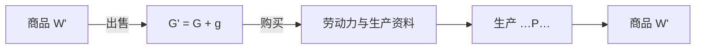

## 前置

- [[故事/资本论-第二卷/生产资本的循环]]

---

## 商品资本的循环

商品资本的循环从已经增殖的商品出发，又回到商品：

$$
W' - G' - W \ldots P \ldots W'
$$

$W'$ 含有原预付资本的价值和剩余价值。售出以后成为 $G'$，$G' = G + g$。资本价值再买进生产要素 $W$，即劳动力和生产资料。这些要素进入生产过程 $P$，产出新的商品资本 $W'$。

价值先在出售中实现，生产要素再进入生产，结果仍是包含剩余价值的商品。

---

## 已经增殖的起点

货币资本的循环是 $G \ldots G'$，两端都是货币，标明资本价值的增殖。生产资本的循环是 $P \ldots P$，两端都是生产，标明生产过程的重复。商品资本的循环是 $W' \ldots W'$，两端都是已经增殖的商品，标明含有剩余价值的总产品不断实现，又不断被再生产出来。

$W'$ 进入这个循环时，资本价值和剩余价值都已经在里面。它是上一轮生产的结果，也是下一轮的起点。

---

## 商品资本的二重性

$W'$ 作为使用价值，是生产过程的产物。作为价值，它包含原有资本价值和剩余价值：

$$
W' = W + w
$$

出售补偿生产中消耗的资本，并实现剩余价值。

商品可以分批出售。售出一部分，补偿资本的货币就逐步流回；全部商品售完之前，循环已经能够继续。

---

## 与前两种循环

| 循环 | 公式 | 标明的内容 |
| --- | --- | --- |
| 货币资本 | $G \ldots G'$ | 资本价值的增殖 |
| 生产资本 | $P \ldots P$ | 生产和再生产 |
| 商品资本 | $W' \ldots W'$ | 商品总产品的实现与再生产 |

商品资本的循环把单个资本同其他资本、社会总产品和个人消费连在一起。

---

## 社会总资本

一个资本购买生产资料和劳动力，完成的是 $G - W$。向它提供这些商品的另一个资本，完成的是 $W' - G'$。购买的一方和出售的一方是同一次交换。单个资本从其他资本那里取得生产要素，也把自己的商品卖出去。资本的循环互相交织，成为社会生产的整体运动。

$W' \ldots W'$ 中的商品属于社会总产品。总产品进入生产消费、个人消费和积累。生产消费补偿生产资料和劳动力，生产得以继续。个人消费是工人和资本家的生活资料。积累把一部分剩余价值变成追加资本，生产规模扩大。单个资本的循环由此写进社会总资本的运动。

剩余价值转化为追加资本时，要有生产资料和劳动力与它配合。这些物质要素来自剩余产品。价值上的积累和追加生产所需的物质条件一起具备，扩大再生产才进行得下去。

资本通过商品的出售实现价值和剩余价值。补偿、消费与积累使单个资本的再生产同社会总资本的再生产连在一起。
