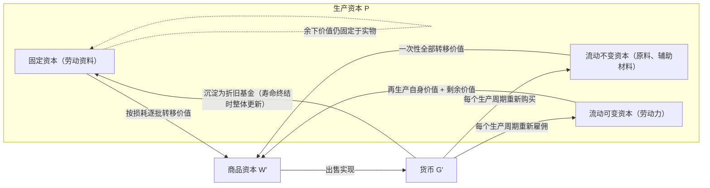

## 1. 前置

- [[故事/资本论-第二卷/周转时间和周转次数]]

---

## 2. 固定资本与流动资本的形式区别

生产资本的不同组成部分，按照各自在劳动过程中的职能，以不同的方式把价值转移到产品中去，从而形成不同的价值流通方式与周转方式。以此为依据，生产资本划分为**固定资本**和**流动资本**。

### 2.1. 固定资本：价值逐步转移与双重存在

固定资本主要由真正的**劳动资料**（厂房、机器、工具、铁路、船舶等）构成。这类生产资料一旦进入生产领域就不再离开，在反复进行的多个劳动过程中始终保持原有的独立使用形式。

固定资本在周转上具有以下特征：

1. **价值的逐步转移**：劳动资料不会在单次生产中被全部消耗，而是按照使用价值的平均损耗程度，把自身价值一部分一部分地转移到它协助生产的产品中。劳动资料越耐用，损耗越慢，价值固定在该使用形式上的时间就越长；单位时间内转移的价值量与其全部执行职能的时间成反比。
2. **价值的双重存在**：在劳动资料执行职能的期间，其价值分裂为两部分——一部分继续束缚在生产领域的实物形态上，随磨损不断减少；另一部分脱离实物形态，作为商品价值的组成部分进入流通并转化为货币，随时间推移一滴一滴地沉淀下来，直到劳动资料寿命完结、全部价值转化为货币为止。
3. **一次预付、分批收回、到期集中更新**：资本家在购置劳动资料时一次性预付全部资本价值，随后通过商品出售分批从流通中取回货币（形成货币准备金）。但在劳动资料寿命终结之前，流回的货币并不会重新转化为同种实物，劳动资料本身也不需要重新购买。

### 2.2. 流动资本：价值全部转移与不断更新

与固定资本相对立，生产资本的其余部分构成**流动资本**，包括两类要素：

- **由原料和辅助材料构成的不变资本**：主料在物质上加入产品；燃料（如蒸汽机消耗的煤炭）、照明煤气等辅助材料虽不在物质上加入产品，但在单次劳动过程中被全部消费掉，其价值同样一次性全部转移到产品中。
- **投在劳动力上的可变资本**：资本家购买并生产地消费的是工人的劳动力（而非工人的生活资料）。劳动力在生产中再生产出自身价值的等价物（撇开剩余价值不说）并加入产品，随产品出售转化为货币后，必须按支付期限不断重新雇佣，才能维持连续生产。

流动资本与固定资本在周转方式上的全面对比如下：

| 比较维度 | 固定资本 | 流动资本 |
| --- | --- | --- |
| 物质承担者 | 劳动资料（机器、厂房、生产设施等） | 原料、辅助材料、劳动力 |
| 实物与产品的关系 | 与产品相对立，保持独立使用形式（运输工具等除外） | 原材料全部消耗；劳动力不断重新并入生产过程 |
| 价值转移方式 | 按平均损耗程度逐步、分批转移 | 在一个生产期间内全部转移或再生产入产品 |
| 价值回流方式 | 随各批商品出售一部分一部分地流回 | 随单批产品出售全部从流通中返回 |
| 实物更新与再预付 | 一次预付，在寿命期内无需更新购买，到期一次性替换 | 每次从市场取出的量较小，但必须频繁再购买、不断更新 |
| 周转周期关系 | 周转时间长，固定资本周转一次包含流动资本的多次周转 | 周转时间短，在固定资本的一次周转内反复完成全部循环 |

### 2.3. 两组资本范畴的严格区分

政治经济学常将“固定资本与流动资本”同“不变资本与可变资本”混为一谈，或将货币资本、商品资本误归入流动资本。马克思对这些范畴作了严格界定：

| 范畴划分 | 划分依据 | 包含内容 | 核心理论指向 |
| --- | --- | --- | --- |
| 不变资本（$c$）与可变资本（$v$） | 在**价值增殖过程**中所起的不同作用 | **不变资本**：劳动资料 + 原料、辅助材料 **可变资本**：劳动力 | 揭示剩余价值的唯一源泉（活劳动创造新价值，生产资料仅转移旧价值） |
| 固定资本与流动资本 | 在**生产资本周转**中价值转移与流通的不同方式 | **固定资本**：劳动资料 **流动资本**：原料、辅助材料 + 劳动力 | 考察资本不同部分的周转速度，同时掩盖了可变资本创造剩余价值的特殊性质 |
| 生产资本与流通资本 | 在**产业资本循环**中所处的领域与职能 | **生产资本**：固定资本 + 流动资本 **流通资本**：货币资本 + 商品资本 | 区分生产领域的价值创造与流通领域的形态变化 |

由此可见：

1. **交叉归属关系**：原料和辅助材料在价值增殖中属于不变资本，但在周转方式上与可变资本（劳动力）一样，同属流动资本。把二者合称为流动资本，使劳动力创造价值的特殊性与原材料转移价值的性质混在一起，掩盖了资本主义剥削的秘密。
2. **仅限于生产资本内部**：固定资本与流动资本的对立**只存在于生产资本内部**。货币资本与商品资本处于流通领域，是与生产资本相对立的**流通资本**；只有当它们转化为生产要素后，其中的原料和劳动力部分才成为与固定资本相对立的流动资本。

### 2.4. 经济形式规定性取决于职能而非物理属性

一种物品是否属于固定资本，完全取决于它在劳动过程中是否**作为劳动资料执行职能**，从而采取价值逐步转移的独特流通方式，而绝非取决于物品的天然物理属性（如耐用性、物理不动性）或停留时间的长短：

- **同一物品因所处循环阶段不同而改变性质**：机器在机器制造厂手中是待售产品，属于**商品资本**；只有进入买者的工厂作为劳动资料使用时，才成为**固定资本**。
- **同一物品因生产职能不同而改变性质**：牲畜作为役畜耕作时是劳动资料，属于**固定资本**；作为育肥后宰杀出售的肉牛时则是原料，属于**流动资本**。
- **部分非劳动资料因价值分批转移而取得固定资本形式**：农业中投入土壤改良的化学物质，其作用和价值跨越数个生产年度分批进入农产品，未转移的价值仍固定在土地中，因而同样构成**固定资本**。
- **长期停留在生产中不等于固定资本**：种子在土壤中停留近一年才产出谷物，需要较长期的预付，但它在这一生产期间内被全部消耗并把全部价值转入新谷物，未保留独立的旧使用形式，因此只是**流动资本（原料）**。
- **物理不动性与可动性不影响资本性质**：房屋、运河、铁路等扎根于土地的设施是固定资本，不断移动位置的机车、船舶、役畜同样是固定资本。不动的固定资本虽无法作为商品运往国外市场，但是其所有权证书（如股票）可以在世界市场上作观念上的流通，只是所有主的变换并不会改变一国财富中不动部分与可动部分的客观比例。

---

## 3. 固定资本的损耗、更新与局部扩大

### 3.1. 组成部分的寿命差异与三种损耗来源

在同一个投资项目中，固定资本的不同组成部分往往具有截然不同的自然寿命，从而具有不同的周转时间。以铁路工程为例，路基、桥梁、隧道、车站建筑等技术工程可维持数十年甚至上百年无需更新，而轨道和车辆则磨损极快

固定资本的损耗来自三个方面：

| 损耗类型 | 产生机制 |
| --- | --- |
| 使用损耗 | 在生产运行中直接摩擦与消耗 |
| 自然力损耗 | 暴露于自然环境中受大气、气候侵蚀，或因闲置不用而退化 |
| 无形损耗 | 产业技术进步产生更先进的替代设备，或同类设备再生产费用下降 |

### 3.2. 补偿方式与技术革新

劳动资料大多随产业技术进步而不断革新，因此在寿命到期时，通常不是按原有形式，而是以**革新的、效率更高的形式**进行物质补偿。这里存在着两种相反的力量：

- **阻碍技术普及的惰性**：巨额固定资本已沉淀在特定实物形式上，在平均寿命结束前提前报废意味着价值损失，这成为企业迟疑采用新机器的障碍。
- **强制提前更新的压力**：激烈的市场竞争（尤其是技术发生决定性变革时）迫使资本家在旧设备自然寿命完结前就换用新设备；而迫使企业设备提前按更大社会规模实行全面更新的决定性力量，主要是**经济危机和灾祸**。

在具体的物质替换上，固定资本因构造不同而采取三种补偿方式：

1. **到期整体替换**：活的劳动资料（如役畜马匹）寿命由自然规律决定，不能分批局部替换，只能在寿命终结时用新个体整体替换。
2. **同类要素周期性分批替换**：由大量同质部件构成的设施（如铁路上的铁轨和枕木），各区段损耗快慢不一，每年按一定比例（如比利时铁路枕木每年更新约 8%）分批以实物形式补偿，而其余部分保持原状。
3. **异质部件按各自寿命分别替换**：同一台机器由寿命各异的零件组装而成，各组成部分按各自的磨损周期分别进行补偿。

### 3.3. 折旧准备金与不依赖剩余价值的企业扩大

固定资本在实物寿命终结前，其逐年转移并流回的货币形成**折旧准备金（折旧基金）**。在实际经营中，资本家不必等这笔货币攒满整个寿命周期才动用，而可以利用这一时间差，将已经从固定资本本体分离出来的货币先行投入生产，实现**局部更新中的企业扩大**：

- **外延扩大**：扩建生产场所
- **内含扩大**：局部改良现有机器构造，提高生产资料的效率。

这一机制揭示了一个重要原理：**即使没有任何剩余价值转化为追加资本（即没有狭义的资本积累），单纯依靠原有固定资本折旧基金的再投入，社会也能够实现规模扩大的再生产。**

从社会货币流通看，资本家购置固定资本时将大笔贮藏货币一次性投入流通，随后又通过折旧基金将流通货币一点一滴重新抽回为贮藏货币，形成社会贮藏货币在不同资本家之间的动态再分配。随着资本主义**信用制度**的发展，这笔沉淀的折旧基金不再作为闲置的贮藏货币停留在原所有者手中，而是通过银行转化为借贷资本，在其他资本家手中继续执行资本职能。

---

## 4. 固定资本的维持、修理与保险

要使固定资本在平均寿命期内正常发挥作用，除了对正常损耗进行价值补偿外，还必须围绕设备的日常保存、故障修复和意外灾害作出不同性质的经济安排。

| 支出/保存形式 | 产生原因与性质 | 资本范畴归属 | 价值补偿来源与计价方式 |
| --- | --- | --- | --- |
| 劳动过程的自然保存 | 劳动资料在正常使用中免于荒废 | 活劳动的无偿自然恩惠 | 不耗费额外资本，通过保存使用价值而保存价值 |
| 日常维持（清洁保养） | 擦洗机器、清扫场地，预防有害自然影响 | 流动资本（弥补一般非生产费用） | 按年平均计算分摊入产品价格（工厂常无偿侵占工人休息时间以转嫁该费用） |
| 真正的修理 | 纠正制造缺陷（幼年期病患）及修复老化损伤（中老年期病患） | 事后追加的独特资本，作为经常支出归入流动资本 | 按生产部门社会平均维修支出分摊到寿命期，计入商品价格 |
| 异常灾害保险 | 应对火灾、水灾等不可抗力造成的毁灭性破坏 | 剩余价值的扣除 | 由剩余价值补偿；在全社会层面要求保持超额生产能力以备物资替补 |

### 4.1. 日常维持费用

固定资本的日常维持依靠两条途径：

1. **劳动过程本身的保存作用**：活劳动在生产中正常使用劳动资料，能使其免于闲置损坏，在把原料价值转移到产品中的同时，无偿保存了劳动资料的使用价值与交换价值。
2. **直接追加的维护劳动**：为预防有害自然影响、使设备保持可工作状态而进行的日常清洁与保养。这类追加劳动属于**流动资本**支出，需按年平均分摊入产品价格并由产品价值不断补偿（资本家也常通过侵占工人休息时间来无偿转嫁这笔费用）。

### 4.2. 修理费用与正常损耗补偿的区别

真正的修理需要事后追加劳动资料和劳动力，这笔支出**不包含在最初预付的固定资本价值之内**。

#### 4.2.1. 偶然性支出的社会平均化

设备损坏虽然具有偶然性，但主要集中在投入初期（纠正制造缺陷）和中后期（材料老化磨损）两个阶段。

单次修理支出在时间上是不规则的，但计入商品价格的修理费不能按个别企业的偶然事故计算，而是由该生产部门在固定资本平均寿命期内的**社会平均维修费用**决定，并均匀分摊到产品价格中。由于价格补偿按社会平均数统一决定，而各企业的实际损耗与维修开支各不相同，同一部门的资本家会因此获得高于或低于实际耗费的补偿，进一步掩盖了剩余价值的真实来源。

#### 4.2.2. 修理与更新的弹性边界及会计操纵

在现实经营与簿记实践中，日常修理、局部更新与折旧补偿之间的界限具有伸缩性：

- **折旧与修理的合并核算**：将实际损耗与修理预算合在一起，通过缩短名义折旧年限一并摊入产品价格。
- **以修代换的连续再生产**：通过不断更换磨损部件、拆解复用旧零件，使固定资本的局部更新与日常修理融为一体。
- **资本账户与收入账户的账面操纵**：企业常利用修理与补偿界限的模糊性，在**收入账户**（经常性开支）与**资本账户**（基本投资）之间违规腾挪费用，以此人为调节账面利润和股息。
- **极耐久工程的特殊处理**：极坚固耐久的工程年度正常损耗近乎为零，财务上无需计提折旧，只需将常年维修的年平均费用计入产品或服务价格。

### 4.3. 异常灾害保险

由自然灾害等异常事件造成的固定资本毁灭，不属于正常损耗或日常维修。为此支付的**保险费**必须由**剩余价值**补偿，是对剩余价值的直接扣除。从社会总再生产来看，这要求社会必须保持超越简单再生产规模的**超额生产**，储备必要的生产资料以消除偶然灾害带来的破坏。
