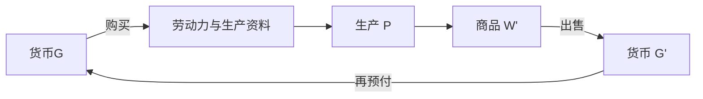

## 前置

- [[故事/资本论-第二卷/商品资本的循环]]

---

## 三个公式

货币资本、生产资本、商品资本，是同一个产业资本的三种循环。起点不同，运动是一个：价值经过这些形态，保存下来，并增殖。

| 循环 | 公式 | 标明的内容 |
| --- | --- | --- |
| 货币资本 | $G - W \ldots P \ldots W' - G'$ | 预付的货币如何回到一个更大的货币额 |
| 生产资本 | $P \ldots C_k \ldots P$ | 生产条件如何得到补偿，生产如何重新开始 |
| 商品资本 | $W' \ldots C_k \ldots P \ldots W'$ | 已经增殖的商品如何实现，并进入下一轮生产 |

$G$ 是货币，$W$ 是商品，$P$ 是生产过程，$W'$ 是包含剩余价值的商品，$G'$ 是增殖后的货币。$C_k$ 是总流通过程，把出售和再购买收在一起。

从 $G$ 看到 $G'$，是货币资本的循环。从 $P$ 回到 $P$，是生产资本的循环。从 $W'$ 回到 $W'$，是商品资本的循环。共同的目的是价值增殖。

---

## 相继进行与并列存在

单个资本部分依次转换。它从货币变成生产资料，进入生产，再变成商品，最后售出，回到货币。每个部分都要走完这些阶段。

资本总体同时处在不同阶段。同一笔资本可以分成若干部分：

- 一部分正在购买生产资料。
- 一部分正在生产。
- 一部分商品已经生产出来，正在销售。
- 回款的部分又进入下一轮购买。

各部分依次运动，总体才同时停在购买、生产和出售上。这种并列把生产维持下去。

商品卖不出去，货币不能收回，生产资料就无法补偿，下一批生产受到限制。一个环节停住，会传到其余环节。连续性靠各部分的分割和衔接。

---

## 不是单纯的商品交换

一个资本家的购买，不一定是另一个资本家的资本形态变化。

- 购买生产资料，买到的可以是另一个产业资本家的商品资本。
- 购买劳动力，货币在这里转化为资本；劳动力此前只是工人的商品。
- 商品售出以后，买方可以把它用于个人消费，而不再投入生产。

社会总资本各部分如何互相补偿，要在不同资本的生产、销售、消费和再生产里看。这些过程在社会整体上形成一定的比例。单个资本的循环由此转向社会总资本的再生产。

---

## 自然经济、货币经济与信用经济

自然经济里，生产者较多直接消费自己的产品，较少经过市场。货币经济用货币和商品交换，把生产者之间的交易组织起来。信用经济是货币经济进一步的形式。

---

## 商业与世界市场

大规模生产要有大规模的销售。商人资本承担流通和销售，产业资本不必自己完成全部出售。

产业资本的循环是 $G - W \ldots P \ldots W' - G'$。剩余价值在生产中形成。商人资本的循环是 $G - W - G'$，不经过生产。商人取得的，是已经生产出来的剩余价值的一部分。

商人按低于价值的价格向产业资本购买，再按价值卖给最终购买者。售价仍是商品价值。差价从剩余价值里分出：产业资本实现其中一部分，商人取得其余部分。

产业资本先按全部价值卖出、商人再高于价值出售时，多出的货币来自购买者多付。那不是新生产出来的价值，同一笔剩余价值也没有再实现一次。

产业资本让出这一部分，是因为商人承担寻找购买者、储存和销售。流通资本不必全部由生产者垫付。商品在流通中停留的时间缩短，产业资本的周转加快。

| | 产业资本 | 商人资本 |
| --- | --- | --- |
| 循环 | $G - W \ldots P \ldots W' - G'$ | $G - W - G'$ |
| 职能 | 生产商品和剩余价值 | 组织商品流通 |
| 利润 | 生产中形成的剩余价值里自己保留的部分 | 购销差价，即让出的那一部分剩余价值 |

市场上还有来自其他生产方式的商品。资本主义生产吸收这些商品，并推动它们所从出的生产走向商品化和雇佣劳动。
