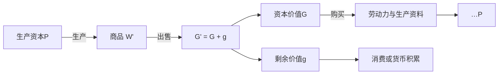

## 前置

- [[故事/资本论-第二卷/资本形态变化及其循环]]

---

## 生产资本的循环

生产资本的循环从生产出发，又回到生产：

$$
P \ldots W' - G' - W \ldots P
$$

$P$ 是已经结合在一起的生产资料和劳动力。它们在生产中被消费，产出商品 $W'$；$W'$ 售出，成为 $G'$；资本价值再买进生产要素 $W$，生产重新开始。

两端都是 $P$，标明的是再生产：资本再取得生产要素，按原有规模或更大的规模继续下去。回到后一个 $P$ 的是资本价值。$G'$ 里的剩余价值可以进入资本家的消费，也可以再转化为资本。

流通中的货币执行货币的职能，商品执行商品的职能。它们作为资本，是因为处在产业资本的这些阶段上。剩余价值在 $P$ 中形成，到出售时实现为货币。

---

## 简单再生产

剩余价值全部用于资本家的个人消费，生产规模不变。

资本价值走 $W - G - W$：商品形式的资本价值实现为货币，再买回劳动力和生产资料，生产条件按原规模恢复。剩余价值走 $w - g - w$：剩余产品实现为货币，再买消费品，离开这个资本的循环。两笔钱来自同一次出售，随后分成两条流通。

对这个资本来说，商品一旦售出，循环就可以继续，即便先卖给商人、还留在转卖过程里。

商品持续卖不出去，就会积压、跌价，支付也随之中断，各资本的购买和再生产一起缩小。

---

## 扩大再生产

剩余价值的一部分再转化为资本，循环末端便是已经扩大的生产资本：

$$
P \ldots W' - G' - W \ldots P'
$$

$P'$ 大于原来的 $P$。追加的货币先要达到一定最低额，机器、原料和劳动力才能按技术比例配齐；配齐以后，这笔货币才成为追加的生产资本。够不上这个比例的余额，改变不了生产的规模。

---

## 潜在的货币资本

已经实现的剩余价值，常常还不到这个最低额，追加的要素也还不能按比例配齐。它先以货币形式存放下来。

这是潜在的货币资本。它停在货币形式上，要进入生产才增殖。积到追加投资所需要的规模，才与追加的劳动力、生产资料一起转化为生产资本。

货币形式的积累，是生产规模扩大之前的准备。

---

## 准备金

尚未转化为追加生产资本的货币，也可以暂时作为准备金，用来应对资本循环中的支付困难。

例如，商品出售所需的时间超过预期，货款迟迟不能收回，导致下一轮生产的支付受到影响；或者生产资料涨价，原有的货币资本不足以购买维持原有生产规模所需的生产要素。这时，资本家可以动用准备金，垫付暂时的资金缺口，使生产得以按原有规模继续进行。

准备金与购买和支付基金的区别在于：

|  | 购买和支付基金 | 准备金 |
| --- | --- | --- |
| 来源 | 正在执行职能的货币资本 | 尚未资本化的剩余价值 |
| 作用 | 满足资本循环正常进行中的购买和支付需要 | 应对商品出售延迟、生产资料涨价等造成的临时资金缺口 |

因此，准备金的作用不是扩大生产，而是维持原有生产规模，避免资本循环因暂时的支付困难而中断。