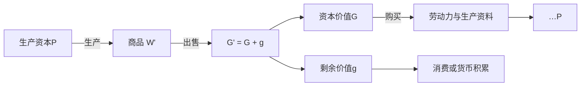
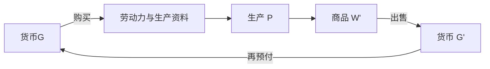

## 前置

-

---

## 货币资本的循环

产业资本的循环从货币开始，也以货币结束：

$$
G - W \ldots P \ldots W' - G'
$$

$G$ 是预付的货币，$W$ 是用它买到的商品，$P$ 是生产过程。$W'$ 是含有剩余价值的商品，$G'$ 是增殖后的货币，$G' = G + g$。

横线与省略号标两种过程：

| 符号 | 过程 | 含义 |
| --- | --- | --- |
| $-$ | 流通 | 商品与货币的形态变化，即买卖 |
| $\ldots$ | 生产 | 生产要素的结合、生产性消费，以及商品的生产 |

公式两端用 $-$，属于流通。中间的 $\ldots P \ldots$ 是流通的中断：资本离开市场，在生产中停留，再作为商品回到市场。

---

## $G-W$

货币买进生产的两个因素：劳动力 $A$，生产资料 $Pm$。

$$
G - W = G - A + G - Pm
$$

二者按生产的技术比例结合。生产资料要足以吸收这些劳动，劳动力也要足以推动这些生产资料。比例不合，多出的一方就不能进入生产。

劳动力能被买到，是因为劳动者已经与生产资料分离。生产资料在资本家手中，工人按时出卖劳动力。这个关系在购买之前已经存在。货币在这里执行资本的职能，因为它买下的是这样一组要素，并要在生产中消费它们。

---

## 生产资本

要素买齐，资本处于生产形式。劳动力与生产资料被消费，产品是新的商品。

生产资料把自身的价值转入产品。活劳动加进新价值：先补偿劳动力的价值，越过这一点以后形成剩余价值。剩余价值在生产中形成。

---

## $W'-G'$

商品再进入流通，价值实现为货币，循环才回到货币形式。

$$
W' = W + w \qquad G' = G + g
$$

$W$ 与 $G$ 是原预付资本的价值，$w$ 与 $g$ 是剩余价值的商品形式和货币形式。同一次出售中，预付资本的价值流回为货币；剩余价值也第一次成为货币。前者是已经支出的货币回到起点，后者是一个新价值额初次表现为货币。

商品须按它的价值售出。只卖掉一部分，流回的货币就小于 $G'$，下一轮能购买的劳动力和生产资料随之减少。售出越慢，同一笔资本重新进入生产就越迟。$G'$ 再次作为 $G$ 投入购买，循环重开。

---

## 三种职能形式

货币资本、生产资本、商品资本，是同一个产业资本在循环中依次采取的三种职能形式。

| 阶段 | 资本形态 | 职能 |
| --- | --- | --- |
| $G-W$ | 货币资本 | 购买劳动力与生产资料 |
| $\ldots P \ldots$ | 生产资本 | 形成剩余价值 |
| $W'-G'$ | 商品资本 | 实现资本价值与剩余价值 |

每种形式都要占据一段时间。购买、生产、出售都依赖这段停留；停留不再过渡到下一形式，循环便中断。

1. $G-W$ 停住：货币闲置，生产要素买不进来。
2. $P$ 停住：生产资料闲置，劳动力不被使用。
3. $W'-G'$ 停住：商品积压，资本不能流回货币。

---

## 货币循环的外观

1. 起点和终点都是货币，而且 $G' > G$。增殖是这个循环直接标明的目的。
2. 生产夹在两次流通之间。公式把 $P$ 排成由 $G$ 到 $G'$ 的中介；剩余价值正是在这个中介里形成的。
3. $G$ 的流回与 $g$ 的初次货币化发生在同一次 $W'-G'$ 里。一次销售完成两种流通。
4. $G' = G + g$ 把资本价值与剩余价值都写成货币。剩余劳动留在生产过程里，结果表现为一个更大的货币额。

---
title: 生产资本的循环
tags:
 - 资本循环
 - 资本积累
---

## 前置

-

---

## 生产资本的循环

生产资本的循环从生产出发，又回到生产：

$$
P \ldots W' - G' - W \ldots P
$$

$P$ 是已经结合在一起的生产资料和劳动力。它们在生产中被消费，产出商品 $W'$；$W'$ 售出，成为 $G'$；资本价值再买进生产要素 $W$，生产重新开始。

两端都是 $P$，标明的是再生产：资本再取得生产要素，按原有规模或更大的规模继续下去。回到后一个 $P$ 的是资本价值。$G'$ 里的剩余价值可以进入资本家的消费，也可以再转化为资本。

流通中的货币执行货币的职能，商品执行商品的职能。它们作为资本，是因为处在产业资本的这些阶段上。剩余价值在 $P$ 中形成，到出售时实现为货币。

---

## 简单再生产

剩余价值全部用于资本家的个人消费，生产规模不变。

资本价值走 $W - G - W$：商品形式的资本价值实现为货币，再买回劳动力和生产资料，生产条件按原规模恢复。剩余价值走 $w - g - w$：剩余产品实现为货币，再买消费品，离开这个资本的循环。两笔钱来自同一次出售，随后分成两条流通。

对这个资本来说，商品一旦售出，循环就可以继续，即便先卖给商人、还留在转卖过程里。

商品持续卖不出去，就会积压、跌价，支付也随之中断，各资本的购买和再生产一起缩小。

---

## 扩大再生产

剩余价值的一部分再转化为资本，循环末端便是已经扩大的生产资本：

$$
P \ldots W' - G' - W \ldots P'
$$

$P'$ 大于原来的 $P$。追加的货币先要达到一定最低额，机器、原料和劳动力才能按技术比例配齐；配齐以后，这笔货币才成为追加的生产资本。够不上这个比例的余额，改变不了生产的规模。

---

## 潜在的货币资本

已经实现的剩余价值，常常还不到这个最低额，追加的要素也还不能按比例配齐。它先以货币形式存放下来。

这是潜在的货币资本。它停在货币形式上，要进入生产才增殖。积到追加投资所需要的规模，才与追加的劳动力、生产资料一起转化为生产资本。

货币形式的积累，是生产规模扩大之前的准备。

---

## 准备金

尚未转化为追加生产资本的货币，也可以暂时作为准备金，用来应对资本循环中的支付困难。

例如，商品出售所需的时间超过预期，货款迟迟不能收回，导致下一轮生产的支付受到影响；或者生产资料涨价，原有的货币资本不足以购买维持原有生产规模所需的生产要素。这时，资本家可以动用准备金，垫付暂时的资金缺口，使生产得以按原有规模继续进行。

准备金与购买和支付基金的区别在于：

| | 购买和支付基金 | 准备金 |
| --- | --- | --- |
| 来源 | 正在执行职能的货币资本 | 尚未资本化的剩余价值 |
| 作用 | 满足资本循环正常进行中的购买和支付需要 | 应对商品出售延迟、生产资料涨价等造成的临时资金缺口 |

因此，准备金的作用不是扩大生产，而是维持原有生产规模，避免资本循环因暂时的支付困难而中断。

---
title: 商品资本的循环
tags:
 - 资本循环
 - 社会总资本
---

## 前置

-

---

## 商品资本的循环

商品资本的循环从已经增殖的商品出发，又回到商品：

$$
W' - G' - W \ldots P \ldots W'
$$

$W'$ 含有原预付资本的价值和剩余价值。售出以后成为 $G'$，$G' = G + g$。资本价值再买进生产要素 $W$，即劳动力和生产资料。这些要素进入生产过程 $P$，产出新的商品资本 $W'$。

价值先在出售中实现，生产要素再进入生产，结果仍是包含剩余价值的商品。

---

## 已经增殖的起点

货币资本的循环是 $G \ldots G'$，两端都是货币，标明资本价值的增殖。生产资本的循环是 $P \ldots P$，两端都是生产，标明生产过程的重复。商品资本的循环是 $W' \ldots W'$，两端都是已经增殖的商品，标明含有剩余价值的总产品不断实现，又不断被再生产出来。

$W'$ 进入这个循环时，资本价值和剩余价值都已经在里面。它是上一轮生产的结果，也是下一轮的起点。

---

## 商品资本的二重性

$W'$ 作为使用价值，是生产过程的产物。作为价值，它包含原有资本价值和剩余价值：

$$
W' = W + w
$$

出售补偿生产中消耗的资本，并实现剩余价值。

商品可以分批出售。售出一部分，补偿资本的货币就逐步流回；全部商品售完之前，循环已经能够继续。

---

## 与前两种循环

| 循环 | 公式 | 标明的内容 |
| --- | --- | --- |
| 货币资本 | $G \ldots G'$ | 资本价值的增殖 |
| 生产资本 | $P \ldots P$ | 生产和再生产 |
| 商品资本 | $W' \ldots W'$ | 商品总产品的实现与再生产 |

商品资本的循环把单个资本同其他资本、社会总产品和个人消费连在一起。

---

## 社会总资本

一个资本购买生产资料和劳动力，完成的是 $G - W$。向它提供这些商品的另一个资本，完成的是 $W' - G'$。购买的一方和出售的一方是同一次交换。单个资本从其他资本那里取得生产要素，也把自己的商品卖出去。资本的循环互相交织，成为社会生产的整体运动。

$W' \ldots W'$ 中的商品属于社会总产品。总产品进入生产消费、个人消费和积累。生产消费补偿生产资料和劳动力，生产得以继续。个人消费是工人和资本家的生活资料。积累把一部分剩余价值变成追加资本，生产规模扩大。单个资本的循环由此写进社会总资本的运动。

剩余价值转化为追加资本时，要有生产资料和劳动力与它配合。这些物质要素来自剩余产品。价值上的积累和追加生产所需的物质条件一起具备，扩大再生产才进行得下去。

资本通过商品的出售实现价值和剩余价值。补偿、消费与积累使单个资本的再生产同社会总资本的再生产连在一起。

---
title: 循环过程的三个公式
tags:
 - 资本循环
 - 社会总资本
---

## 前置

-

---

## 三个公式

货币资本、生产资本、商品资本，是同一个产业资本的三种循环。起点不同，运动是一个：价值经过这些形态，保存下来，并增殖。

| 循环 | 公式 | 标明的内容 |
| --- | --- | --- |
| 货币资本 | $G - W \ldots P \ldots W' - G'$ | 预付的货币如何回到一个更大的货币额 |
| 生产资本 | $P \ldots C_k \ldots P$ | 生产条件如何得到补偿，生产如何重新开始 |
| 商品资本 | $W' \ldots C_k \ldots P \ldots W'$ | 已经增殖的商品如何实现，并进入下一轮生产 |

$G$ 是货币，$W$ 是商品，$P$ 是生产过程，$W'$ 是包含剩余价值的商品，$G'$ 是增殖后的货币。$C_k$ 是总流通过程，把出售和再购买收在一起。

从 $G$ 看到 $G'$，是货币资本的循环。从 $P$ 回到 $P$，是生产资本的循环。从 $W'$ 回到 $W'$，是商品资本的循环。共同的目的是价值增殖。

---

## 相继进行与并列存在

单个资本部分依次转换。它从货币变成生产资料，进入生产，再变成商品，最后售出，回到货币。每个部分都要走完这些阶段。

资本总体同时处在不同阶段。同一笔资本可以分成若干部分：

- 一部分正在购买生产资料。
- 一部分正在生产。
- 一部分商品已经生产出来，正在销售。
- 回款的部分又进入下一轮购买。

各部分依次运动，总体才同时停在购买、生产和出售上。这种并列把生产维持下去。

商品卖不出去，货币不能收回，生产资料就无法补偿，下一批生产受到限制。一个环节停住，会传到其余环节。连续性靠各部分的分割和衔接。

---

## 不是单纯的商品交换

一个资本家的购买，不一定是另一个资本家的资本形态变化。

- 购买生产资料，买到的可以是另一个产业资本家的商品资本。
- 购买劳动力，货币在这里转化为资本；劳动力此前只是工人的商品。
- 商品售出以后，买方可以把它用于个人消费，而不再投入生产。

社会总资本各部分如何互相补偿，要在不同资本的生产、销售、消费和再生产里看。这些过程在社会整体上形成一定的比例。单个资本的循环由此转向社会总资本的再生产。

---

## 自然经济、货币经济与信用经济

自然经济里，生产者较多直接消费自己的产品，较少经过市场。货币经济用货币和商品交换，把生产者之间的交易组织起来。信用经济是货币经济进一步的形式。

---

## 商业与世界市场

大规模生产要有大规模的销售。商人资本承担流通和销售，产业资本不必自己完成全部出售。

产业资本的循环是 $G - W \ldots P \ldots W' - G'$。剩余价值在生产中形成。商人资本的循环是 $G - W - G'$，不经过生产。商人取得的，是已经生产出来的剩余价值的一部分。

商人按低于价值的价格向产业资本购买，再按价值卖给最终购买者。售价仍是商品价值。差价从剩余价值里分出：产业资本实现其中一部分，商人取得其余部分。

产业资本先按全部价值卖出、商人再高于价值出售时，多出的货币来自购买者多付。那不是新生产出来的价值，同一笔剩余价值也没有再实现一次。

产业资本让出这一部分，是因为商人承担寻找购买者、储存和销售。流通资本不必全部由生产者垫付。商品在流通中停留的时间缩短，产业资本的周转加快。

| | 产业资本 | 商人资本 |
| --- | --- | --- |
| 循环 | $G - W \ldots P \ldots W' - G'$ | $G - W - G'$ |
| 职能 | 生产商品和剩余价值 | 组织商品流通 |
| 利润 | 生产中形成的剩余价值里自己保留的部分 | 购销差价，即让出的那一部分剩余价值 |

市场上还有来自其他生产方式的商品。资本主义生产吸收这些商品，并推动它们所从出的生产走向商品化和雇佣劳动。

---
title: 流通时间
tags:
 - 资本循环
 - 流通时间
---

## 前置

-

---

## 总循环时间

资本依次经过生产领域和流通领域。总循环时间是这两段时间之和：

$$
\text{总循环时间} = \text{生产时间} + \text{流通时间}
$$

生产时间是资本停留在生产领域的时间。流通时间是资本停留在流通领域的时间。

| 阶段 | 资本形式 | 职能 |
| -------- | ------------------ | ---------------------------- |
| 生产领域 | 生产资本 | 生产商品和剩余价值 |
| 流通领域 | 商品资本、货币资本 | 实现商品价值，并购买生产要素 |

---

## 生产时间与劳动时间

生产时间是生产资本停留在生产领域的全部时间。劳动时间只是其中实际进行劳动的部分。

生产资料从进入生产领域到形成商品，还会经过准备、停顿和自然变化。生产时间因此长于劳动时间：

$$
\text{生产时间} > \text{劳动时间}
$$

多出的部分有三类：

- 生产资料已经备好，尚未进入实际生产，作为储备留在生产领域。
- 生产过程暂时中断。生产资料停止发挥作用，仍留在生产场所。
- 劳动已经停止，自然过程仍在进行，产品继续形成。

这三类时间往往仍是产品得以完成、生产得以连续的条件。

---

## 哪些时间形成新价值

新价值和剩余价值只在吸收活劳动时形成。

| 时间 | 形成的价值 |
| ------------------------ | ------------------------------------ |
| 实际劳动 | 新价值；其中无酬劳动形成剩余价值 |
| 生产资本闲置 | 不形成新价值 |
| 劳动停止后的自然过程 | 不形成新价值；产品仍在这段时间里完成 |
| 保存生产储备所必要的劳动 | 新价值；其中无酬劳动形成剩余价值 |

储备在进入生产之前，既不形成产品，也不形成新价值。自然过程使产品逐渐完成。新价值仍只由劳动形成。

在生产中发挥作用的生产资料，把原有价值转移到产品上。原料和辅助材料随消耗转移价值。间歇期间的机器、建筑物等劳动资料仍会损耗，损耗的价值分摊到产品上。转移原有价值和创造新价值是两件事。闲置不创造新价值。

生产资本在吸收劳动时增殖。生产时间越接近劳动时间，一定期间内吸收的劳动越多。超出劳动时间的部分越长，实际吸收劳动的时间越少。资本主义生产趋向于缩短这个差额。差额又常常仍是产品得以完成的条件。

---

## 流通时间限制生产

流通时间包括商品出售和购买生产要素：

$$
W - G \qquad G - W
$$

$W - G$ 把商品资本转化为货币资本，实现已经包含在商品中的价值和剩余价值。$G - W$ 把货币资本转化为生产资本，为下一轮生产准备生产要素。买卖是再生产的条件。买卖本身不创造价值和剩余价值。

资本处在流通领域时，不能同时以生产资本的形式执行职能。流通时间越长，资本重新进入生产越慢。

资本整体依次通过各阶段时，流通延长，生产过程就中断得更久，价值增殖也停得更久。资本各部分并列运动时，留在流通中的部分越多，同时留在生产中执行职能的部分越少。流通时间越短，可用于生产的资本越多。

流通时间越接近于零，资本的生产职能越大，一定期间内自行增殖的能力越高。提高的是投入生产的时间。流通时间缩短后，同一资本在一定期间内完成更多循环，吸收更多活劳动，从而生产更多剩余价值。流通行为本身仍然不创造价值。

---

## 流通劳动

流通中有劳动。纯粹由买卖、议价、结算、记账引起的劳动，完成的是价值形式的变化。$W - G$ 使商品形式变为货币形式，$G - W$ 使货币形式变为生产要素的商品形式。价值量不变。实现已经存在的价值，和生产新价值是两件事。

这类劳动帮助实现剩余价值。它的工资从已经生产出来的剩余价值中支付。

判断标准是劳动做了什么，不是它发生在市场、仓库还是商业企业。运输改变商品的位置，是生产过程，形成新价值，其中的剩余劳动形成剩余价值。改变使用价值的加工和包装，以及为维持使用价值所必需的保存，也形成新价值。

| 活动 | 是否形成新价值 | 作用 |
| -------------------------- | -------------- | ---------------------------------- |
| 生产劳动 | 是 | 创造价值和剩余价值 |
| 纯粹出售与购买 | 否 | 实现价值，或把资本转化为生产要素 |
| 记账与结算 | 否 | 处理价值形式的变化 |
| 运输 | 是 | 改变商品的位置，形成运输过程的价值 |
| 生产性质的加工、包装与保存 | 是 | 改变或维持商品的使用价值 |

---

## 出售与购买

$W' - G'$ 是商品出售，并实现其中的剩余价值。这一段通常更难，停留也更久。商品要找到购买者，进入能够售出的市场，并在使用价值丧失之前售出。货币已经可以直接交换，转化为商品通常比商品转化为货币容易。

$G - W$ 购买的是符合生产要求的生产要素。所需生产资料尚未生产出来、要到远处购买、供给中断、价格变动、采购地与销售地相距很远，都会延长购买时间。

出售和购买可以在时间上分开，也可以在空间上分开。采购和销售可以由不同的人、在不同的地点进行。生产当事人生产商品和价值。流通当事人完成买卖和资本的形态变化。纯粹买卖的报酬从已经生产出来的剩余价值中支付。

出售实现剩余价值。购买把已经实现的资本价值重新转化为生产要素，为下一轮生产准备条件。

---

## 易腐性

商品资本以使用价值的形式存在，不能无限期留在流通中。使用价值一旦丧失，它承担交换价值的属性随之丧失，其中的资本价值和剩余价值也遭受损失。商品要在一定时间内售出，并进入生产消费或个人消费。

商品越容易腐坏，允许停留在流通中的时间越短。这是使用价值规定的界限。商品必须尽快售出，不宜运到过远的地方，销售范围随之缩小，市场也更受地点限制。易腐性既限制流通时间，也限制空间上的流通范围。

运输缩短产地与消费地之间的时间。人口集中的地方形成较大的消费市场，可以吸收大量易腐商品。运输、市场规模和人口集中发展以后，一些原本难以远销的商品，也可以按资本主义方式生产和销售。

---
title: 流通费用
tags:
 - 资本循环
 - 流通费用
---

## 前置

-

---

## 三种费用

流通过程会消耗劳动和物质资料。根据这些消耗的作用，流通费用分为三类：

| 费用 | 作用 | 对价值的影响 |
| ------------ | ------------------ | ------------------------------------------ |
| 纯粹流通费用 | 改变价值形式 | 不形成新价值 |
| 保管费用 | 保存商品的使用价值 | 正常保管追加价值，积压造成的费用不加入价值 |
| 运输费用 | 改变商品的空间位置 | 形成新价值和剩余价值 |

---

## 纯粹的流通费用

纯粹流通费用服务于价值形式的转化，不改变使用价值，也不增加社会总价值。它们最终由已经生产出来的剩余价值补偿。

### 买卖时间

资本循环包含两次形式转化：

$$
W - G \qquad G - W
$$

$W-G$ 是商品转化为货币，$G-W$ 是货币转化为商品。完成转化所耗费的时间和劳动，就是买卖时间。

买卖只改变价值形式，不改变价值量。一方在交换中获得的额外利益，对应另一方的损失，社会总价值不变。

买卖劳动是再生产得以进行的必要条件，却不生产商品，也不形成新价值。专业化可以降低单个资本的流通费用，但不能改变这种劳动的性质。

### 簿记

簿记用于记录和控制资本在生产与流通中的运动，是复杂生产不可缺少的管理活动。它消耗劳动和物质资料，却不生产商品，也不形成商品价值。

随着生产社会化和复杂化，簿记趋于专业化和集中化。统一管理可以减少重复劳动、降低费用，但不会使簿记成为价值的来源。

### 货币

商品价值要通过货币形式实现。货币承担流通、支付、储备和贮藏职能，使一部分社会劳动和财富固定在流通领域。

维持货币职能所需的财富不进入生产消费或个人消费，也不形成新的社会财富。流通规模越大，这部分社会消耗通常也越大。

---

## 保管费用

商品从生产完成到进入消费之间通常会停留一段时间，由此形成商品储备。维持储备所需的劳动和物质资料构成保管费用。

买卖作用于价值形式，保管则作用于使用价值。

对持有者而言，储备意味着资本暂时停留；对购买者而言，储备又是生产和消费得以连续进行的条件。

### 储备的三种形式

任何社会生产都需要储备，其形式分为：

| 形式 | 内容 |
| -------------- | ---------------------------------- |
| 生产资本的储备 | 为维持生产连续性而储备的生产资料 |
| 个人消费基金 | 尚未进入个人消费的生活资料 |
| 商品储备 | 以商品形式等待出售或购买的社会产品 |

三种储备可以并存，其比例随生产方式而变化。商品生产越发展，社会储备越多地采取商品储备的形式。

资本主义生产扩大后，更多产品通过市场进入生产和消费，商品储备在社会产品中的规模也随之扩大。

### 储备的分布

社会储备增加，不等于每个生产者持有的储备同比增加。储备可以在生产者与流通部门之间转移，其分布受以下条件影响：

| 条件 | 影响 |
| -------------- | ---------------------------- |
| 供应更稳定 | 生产者可以减少储备 |
| 运输效率提高 | 补充速度加快，储备可以减少 |
| 信用发展 | 采购较少受当前销售状况限制 |
| 生产周期延长 | 连续生产所需的储备通常会增加 |

### 正常储备与非正常储备

一定规模的商品储备是连续流通和再生产的必要条件。超过这一需要、因出售受阻而形成的积压，则属于非正常储备。

| | 正常储备 | 非正常储备 |
| ------ | -------------------------- | ------------------ |
| 形成 | 流通和再生产所需的停留 | 出售受阻形成的积压 |
| 状态 | 储备与流通同时进行 | 商品停滞 |
| 价值 | 必要保管费用加入商品价值 | 保管费用不加入价值 |

储备会发生数量损耗、质量损失，并消耗物化劳动和活劳动。前两者是已有财富的减少；正常储备中必要的生产资料把自身价值转移到商品上，保管劳动形成新价值，其中的无酬劳动形成剩余价值。

正常保管虽然保存了使用价值，但没有增加使用价值的数量。因此，追加价值仍需从社会产品中补偿。非正常积压造成的费用和损失，则由相应资本自行承担。

---

## 运输费用

交换改变商品的所有权和价值形式，运输改变商品实体的空间位置。空间位置的改变是使用价值得以实现的条件，因此运输是生产过程在流通领域中的继续。

投入运输的生产资料把价值转移到商品上，运输劳动形成新价值。新价值的一部分补偿劳动力价值，其余形成剩余价值。

在其他条件不变时，运输追加的价值与运输距离成正比，与运输生产力成反比：

$$
\text{单位商品追加的价值} \propto \frac{\text{运输距离}}{\text{运输生产力}}
$$

| 因素 | 对单位商品运输价值的影响 |
| ---------- | ------------------------ |
| 距离 | 距离越长，追加价值越多 |
| 体积和重量 | 占用资源越多，追加价值越多 |
| 商品性质 | 保护要求越高，追加价值越多 |
| 运输技术 | 生产力越高，追加价值越少 |
| 运输规模 | 规模扩大可降低单位费用 |
