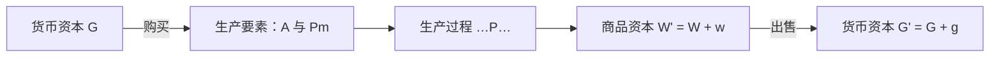
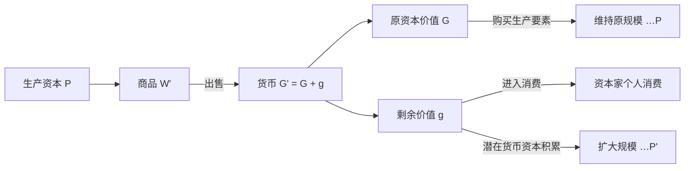

## 1. 前置

- [[故事/资本论/资本论-第一卷(代理)]]

---

## 2. 三个阶段与三种职能形式

产业资本在运动中依次经过三个阶段，采取三种职能形式：

$$
G - W \begin{cases} A \\ Pm \end{cases} \ldots P \ldots W' - G'
$$

| 符号 | 含义 |
| --- | --- |
| $G$ | 预付货币资本 |
| $W$ | 生产要素商品（劳动力 $A$ 与生产资料 $Pm$） |
| $P$ | 生产资本（生产过程） |
| $W'$ | 包含剩余价值的商品资本，$W' = W + w$ |
| $G'$ | 增殖后的货币资本，$G' = G + g$ |
| $-$ | 流通过程（商品与货币的形态变化，即买卖） |
| $\ldots$ | 流通过程的中断（资本离开市场进入生产过程） |

### 2.1. 第一阶段：$G - W$（货币资本）

货币转化为商品，买进生产所需的两个因素：劳动力 $A$ 与生产资料 $Pm$。

二者必须按生产的技术比例结合：生产资料要足以吸收这一定量的劳动，劳动力也要足以推动这些生产资料。比例失调时，多出的一方就无法进入实际生产。

劳动力能够作为商品被买到，前提是劳动者已经与生产资料分离——生产资料掌握在资本家手中，工人只能出卖劳动力。这种雇佣关系在购买之前已经存在。货币在这里执行货币资本的职能，不仅因为它充当购买手段和支付手段，更因为它买下的是能够生产剩余价值的要素组合。

### 2.2. 第二阶段：$\ldots P \ldots$（生产资本）

生产要素买齐后，资本离开流通领域，采取生产资本的形式。劳动力与生产资料在生产中被消费，结合成新的商品 $W'$。

生产资料把自身原有的价值转移到产品上；活劳动创造新价值，先补偿劳动力的价值，超过这一界限的部分形成剩余价值 $w$。价值增殖在这一阶段发生。

### 2.3. 第三阶段：$W' - G'$（商品资本）

包含剩余价值的商品重新进入市场，通过出售转化为货币：

$$
W' - G' = (W + w) - (G + g)
$$

同一次出售同时完成两重转化：原预付资本的价值流回货币形式（$W - G$），生产中形成的剩余价值第一次表现为货币（$w - g$）。

商品必须按价值售出。若只卖掉一部分，流回的货币小于 $G'$，下一轮能购买的生产要素随之缩减；售出越慢，同一笔资本重新投入生产就越迟。$G'$ 再次作为 $G$ 投入购买，循环重新开始。

### 2.4. 三种职能形式的总结

货币资本、生产资本、商品资本是同一个产业资本在循环中依次采取的三种职能形式：

| 阶段 | 资本形态 | 职能 | 停滞后果 |
| --- | --- | --- | --- |
| $G - W$ | 货币资本 | 购买劳动力与生产资料，为生产准备条件 | 货币闲置（贮藏），生产要素无法购入 |
| $\ldots P \ldots$ | 生产资本 | 生产商品，形成剩余价值 | 生产资料闲置，劳动力不被使用 |
| $W' - G'$ | 商品资本 | 出售商品，实现资本价值与剩余价值 | 商品积压，资本不能流回货币形式 |

每种形式都要停留一段时间以完成其职能；一旦停留不能向下一形式过渡，整个循环便中断。

---

## 3. 三种循环公式

产业资本的运动是连续不断的循环，从不同阶段切入，呈现为三个循环公式：

| 循环 | 公式 | 简写 | 标明的核心内容 |
| --- | --- | --- | --- |
| 货币资本的循环 | $G - W \ldots P \ldots W' - G'$ | $G \ldots G'$ | 预付货币的价值增殖（资本运动的目的） |
| 生产资本的循环 | $P \ldots W' - G' - W \ldots P$ | $P \ldots C_k \ldots P$ | 生产过程的周期更新（简单或扩大再生产） |
| 商品资本的循环 | $W' - G' - W \ldots P \ldots W'$ | $C_k \ldots P (W')$ | 商品总产品的价值实现与物质补偿（社会总资本联系） |

其中 $C_k$ 表示总流通过程（$W' - G' - W$）。三个公式起点不同，但描述的是同一个产业资本的连续运动。

### 3.1. 货币资本的循环（$G \ldots G'$）

1. **直接标明增殖目的**：起点和终点都是货币，质上相同，只有量上的差别（$G' > G$），直接表明价值增殖是资本运动的唯一动机。
2. **生产表现为中介**：生产过程 $P$ 夹在两次流通（$G - W$ 与 $W' - G'$）之间，充当由 $G$ 到 $G'$ 的媒介，而剩余价值正是在这个媒介中创造的。
3. **货币拜物教的外观**：终点 $G' = G + g$ 中，原资本价值与剩余价值都表现为同质的货币，掩盖了生产过程中的剩余劳动来源，呈现出“货币生出更多货币”的假象。

### 3.2. 生产资本的循环（$P \ldots P$）

从生产出发又回到生产，标明生产过程不是一次性的行为，而是周期反复的**再生产**。流通过程 $W' - G' - W$ 在这里成为再生产的媒介。根据剩余价值 $g$ 的去向，分为两种再生产：

#### 3.2.1. 简单再生产（$P \ldots P$）

剩余价值全部用于资本家的个人消费，生产按原有规模重复。出售得到 $G'$ 后，货币分成两条流通轨迹：

- **资本流通（$W - G - W$）**：原资本价值实现为货币，再买回劳动力和生产资料，恢复原有生产条件。
- **一般商品流通（$w - g - w$）**：剩余产品实现为货币后，用于购买消费品，离开该资本的循环。

对单个产业资本而言，只要商品卖给商人换回货币，本轮再生产即可继续；但若商品在市场上持续滞销，导致积压和跌价，支付链条就会中断，各资本的购买和再生产都会随之萎缩。

#### 3.2.2. 扩大再生产（$P \ldots P'$）

剩余价值的一部分或全部转化为追加资本，循环终点成为更大规模的生产资本 $P'$。

追加的货币要转化为实际执行职能的生产资本，必须先达到一定的**最低投资规模**，使追加的机器、原料和劳动力能够按技术比例配齐。够不上这一比例的余额，暂时无法扩大生产规模。

#### 3.2.3. 潜在货币资本与准备金

已实现但尚未达到追加投资最低额的剩余价值，先以货币形式沉淀下来，形成**潜在的货币资本**（货币积累基金）。它停留在货币形态上时不发生增殖，只有积攒到所需规模、购入追加生产要素后，才转化为现实的生产资本。

这笔闲置的货币在转化为追加生产资本之前，也可以临时充当**货币准备金**，用来应对资本循环中的周转阻碍——例如商品出售迟延导致回款滞后，或生产资料涨价导致原预付货币不足以维持原有生产规模。

| 货币形态 | 职能定位 | 作用 |
| --- | --- | --- |
| 购买与支付基金 | 正在执行职能的货币资本 | 满足正常循环中的要素采购与日常支付 |
| 潜在货币资本（积累基金） | 待资本化的剩余价值 | 积聚到最低投资规模后用于扩大再生产 |
| 货币准备金 | 应对流通异常的缓冲资金（可由预付资本预留，或由潜在货币资本临时充当） | 填补出售延迟、要素涨价造成的资金缺口，维持原有再生产不中断 |

### 3.3. 商品资本的循环（$W' \ldots W'$）

1. **以已增殖的总产品为起点**：货币循环起点 $G$ 和生产循环起点 $P$ 尚未包含本轮剩余价值，而商品循环的起点 $W' = W + w$ 已经是包含预付资本价值与剩余价值的商品总产品。
2. **消费进入循环视野**：循环以 $W' - G' - W$ 开端，不仅要求原资本价值补偿生产要素（生产消费），而且显式包含剩余产品 $w$ 的去向（个人消费或积累）。商品可以分批出售，随货款分批流回，再生产在全部商品售罄前即可陆续接续。
3. **连接社会总资本**：一个资本的购买（$G - W$）正是另一个资本的出售（$W' - G'$）。单个资本从其他资本取得生产资料，工人在市场上购买生活资料，各资本的循环互相咬合。扩大再生产不仅需要货币形式的价值积累，还要求社会总产品中具备相应的追加生产资料和生活资料。因此，$W' \ldots W'$ 是研究**社会总资本再生产**的出发点。

---

## 4. 循环的连续性与外部交织

### 4.1. 相继进行与并列存在

为了使生产不因流通过程而中断，产业资本不能以整体依次走完单个阶段，而必须按比例分割为三个部分，使三种职能形式在空间上**并列存在**：

- 一部分作为**货币资本**，正在购买生产要素；
- 一部分作为**生产资本**，正在生产领域运作；
- 一部分作为**商品资本**，正在市场上出售。

各部分在时间上**相继进行**，是由各部分在空间上**并列存在**所维持的；反过来，并列存在又是各部分依次转换的结果。任何一部分在某一阶段停滞（如商品卖不出去导致货币无法流回），并列关系就会被打破，生产补给随之受阻。

### 4.2. 与社会一般流通及商人资本的交织

产业资本的循环并非封闭在资本家内部，而是与多种交换形式交织：

- **与工人个人消费交织**：资本家购买劳动力（$G - A$），对资本家是货币资本转化为生产资本，对工人则是出售商品换取货币以购买生活资料（$A - G - W$）。
- **与不同生产方式交织**：市场上既有资本主义生产的商品，也有小生产者或其他生产方式提供的原料和产品，资本主义流通不断吸收并改造这些生产方式。
- **与商人资本交织**：大规模生产需要大规模销售。商人资本独立承担买卖职能，其循环公式为 $G - W - G'$，不经过生产过程。

| 维度 | 产业资本 | 商人资本 |
| --- | --- | --- |
| 循环公式 | $G - W \ldots P \ldots W' - G'$ | $G - W - G'$ |
| 核心职能 | 生产商品，创造价值与剩余价值 | 专门组织商品买卖与流通 |
| 利润来源 | 生产中创造并由自己保留的剩余价值 | 产业资本让渡的一部分剩余价值（购销差价） |

商人按低于价值的价格从产业资本家处进货，再按商品价值卖给最终买者。差价来自产业工人在生产中已经创造出来的剩余价值（若商人高于价值出售，多出部分只是对买者的额外索取，并未创造新价值）。产业资本之所以让渡这部分剩余价值，是因为商人垫付了流通资本、集中承担了储存和销售，从而缩短了产业资本的流通时间，加快了资本周转。

---

## 5. 生产时间与流通时间

资本完成一次循环所经历的全部时间，是生产时间与流通时间之和：

$$
\text{总循环时间} = \text{生产时间} + \text{流通时间}
$$

### 5.1. 生产时间与劳动时间

**生产时间**是资本停留在生产领域的全部时间，**劳动时间**只是其中实际耗费活劳动、生产使用价值并创造新价值的时间。生产时间通常长于劳动时间：

$$
\text{生产时间} > \text{劳动时间}
$$

生产时间超出劳动时间的差额包括三类：

1. **生产储备时间**：原料、煤炭等生产资料已进入生产场所备好，但尚未投入加工。
2. **生产间歇时间**：劳动过程因夜间休息、工序切换等暂时中断，劳动资料仍留在生产场所。
3. **自然作用时间**：劳动已经停止，但产品仍需经历物理、化学或生物的自然过程（如谷物生长、木材干燥、酒类发酵、陶器晾干）。

| 时间段 | 价值变化 | 说明 |
| --- | --- | --- |
| 实际劳动时间 | 转移旧价值，创造新价值与剩余价值 | 生产资料随消耗转移价值；活劳动创造新价值 |
| 生产储备停留时间 | 不创造新价值 | 生产资料作为潜在生产要素待命（维护储备的必要耗费见下文“保管费用”） |
| 生产间歇时间 | 固定资产损耗转移旧价值，不创造新价值 | 机器、厂房在间歇期发生的自然损耗按比例分摊到产品中 |
| 自然作用时间 | 不创造新价值 | 使用价值在自然过程中继续形成，但无活劳动注入 |

这些非劳动时间往往是生产连续进行或产品产出的必要条件，但新价值和剩余价值只在吸收活劳动的期间形成。因此，生产时间与劳动时间的差额越小，资本在给定时期内吸收的活劳动就越多，增殖效率越高。资本主义生产总是力图通过改进技术和排班来压缩这一差额。

### 5.2. 流通时间对增殖的限制

**流通时间**是资本停留在流通领域的时间，包括出售时间（$W' - G'$）和购买时间（$G - W$）：

- **出售（$W' - G'$）**：商品转化为货币、实现剩余价值，是资本形态变化中最困难的一跃，通常耗时更长。
- **购买（$G - W$）**：货币转化为生产要素。货币是一般等价物，购买通常比出售容易；但若原料产地遥远、供给紧缺或价格剧烈波动，购买时间也会延长。

流通时间与生产时间互相排斥。资本留在流通领域的时间越长，留在生产领域执行增殖职能的部分就越少。流通本身不创造一分一毫的新价值；缩短流通时间的意义在于减少流通过程对生产的羁绊，使同一资本在一定时期内完成更多次循环、吸收更多活劳动。

### 5.3. 使用价值的易腐性

商品资本以特定的使用价值为物质承担者。使用价值一旦损坏丧失，附着其上的资本价值与剩余价值也随之消失。

商品越容易腐坏，允许停留在流通中的时间上限就越短，能够运达的销售半径也越窄。因此，易腐性从时间与空间两个维度限制了商品的流通范围。只有当快速运输工具、保鲜技术和人口密集的大型消费市场发展起来后，易腐商品才具备大规模资本主义生产和远距离销售的条件。

---

## 6. 流通费用

资本在流通过程中耗费的劳动和物质资料构成**流通费用**。判断一项流通耗费是否形成价值，取决于它只改变价值形式，还是参与保存或实现商品的使用价值：

| 费用类型 | 具体活动 | 作用对象 | 对价值与剩余价值的影响 | 补偿来源 |
| --- | --- | --- | --- | --- |
| 纯粹流通费用 | 买卖、簿记、货币制造与磨损 | 价值形式（商品 $\leftrightarrow$ 货币） | 不创造新价值，也不追加价值 | 从已生产的剩余价值中扣除 |
| 保管费用 | 仓储、防潮防虫、维护整理 | 使用价值的保存（防止损耗） | 正常储备追加价值；滞销积压不追加价值 | 正常部分加入售价由社会产品补偿；积压部分由该资本亏损承担 |
| 运输费用 | 跨空间搬运与投递 | 使用价值的空间位置 | 转移生产资料价值，创造新价值与剩余价值 | 直接加入商品价值并通过售价实现 |

### 6.1. 纯粹的流通费用

1. **买卖时间**：资本家或商业雇员耗费在议价、推销、采购、结算上的时间和劳动，只把价值从商品形式转变为货币形式，或从货币形式转变为商品形式。这种形式转化不改变价值量；一方通过贱买贵卖多得的利益，只是另一方的损失，社会总价值不变。商业分工和专业化可以降低全社会的买卖费用，但不能使买卖劳动变成创造价值的劳动。
2. **簿记**：记录、核算和监督资本运动的记账劳动以及账册、办公场所等消耗。随着生产社会化和规模扩大，簿记从生产者的附带工作独立为专门职能，集中记账能够节省开支，但它处理的对象仍是价值的观念核算，不生产使用价值，也不创造新价值。
3. **货币**：充当流通手段、支付手段和准备金的金银，以及铸币在流通中的磨损补充。这部分金银被固定在流通领域，既不进入生产消费，也不进入个人消费，是社会为维持商品交换机制而从直接生产中抽出的财富扣除。

### 6.2. 保管费用

商品从生产完成到进入消费之间需要停留，由此形成储备。保存储备需要仓库、容器、养护材料以及保管人员的劳动。

#### 6.2.1. 储备的三种形式与分布

| 储备形式 | 内容 |
| --- | --- |
| 生产资本的储备 | 企业为保证生产连续而预先备下的原料、煤炭、辅助材料等生产资料 |
| 个人消费基金 | 消费者手中尚未消耗的生活资料 |
| 商品储备 | 停留在市场上等待出售或购买的商品 |

在自给自足的自然经济中，储备主要直接表现为生产资料储备和个人消费基金；随着商品生产和资本主义市场的发展，社会储备中采取**商品储备**形式的比重日益扩大。

储备在生产企业与商业部门之间的分布取决于市场条件：

- 原料供应越及时稳定、交通运输越便捷、信用制度越发达，生产企业自身持有的生产储备就可以越少；
- 若生产周期较长或原料产供受季节限制，企业所需的储备则相应增加。
- 工厂少存的原料往往转移为商人手中的商品储备，社会总储备只是改变了持有主体。

#### 6.2.2. 正常储备与非正常储备

市场上必须经常保持一定量的商品储备，持续发生的购买需求才有物可买。这种为维持流通连续性所必需的停留是**正常储备**；因销售受阻、投机失败而造成的商品滞留则是**非正常储备（积压）**。

保管费用的价值性质具有两重性：

- **从社会总财富（使用价值）看**：储备期间会发生自然损耗（如面粉散失、粮食受潮变质）。保管的作用只是防止或减少既有使用价值的损失，并不会增加使用价值的数量（入库时的粮食在出库时不会变多）。因此，用于保管的社会劳动和物资消耗，始终是对社会生产性财富的扣除。
- **从商品价值看**：在**正常储备**限度内，保管是保存使用价值的必要条件，所耗费的仓储资料将价值转移到商品上，保管工人的活劳动形成新价值（其中无酬劳动形成剩余价值），从而使商品售价相应提高。而在**非正常储备**中，因滞销积压多支出的仓储费不能加入商品价值，只能归结为该资本家的亏损。

### 6.3. 运输费用

商品的所有权可以通过买卖转移而实物原地不动（如房屋交易，或停留在仓库中多次易手的棉花、生铁）；反之，即使没有商品交换，生产也需要将产品从一地运往另一地。买卖改变所有权与价值形式，**运输则改变商品实体的空间位置**。

使用价值只有在消费中才能实现，把煤炭从矿山运到工厂、把粮食从产地运到消费市场，是完成使用价值生产的必要环节。因此，运输业是**生产过程在流通领域内的继续，并且是为了流通而进行的继续**。

投在运输业上的资本属于生产资本。运输工具等生产资料把自身价值转移到所运商品中，运输工人的活劳动创造新价值（一部分补偿工资，其余为剩余价值）。在其他条件不变时，单位商品上追加的运输价值量与运输距离成正比，与运输业的生产力成反比：

$$
\text{单位商品追加的运输价值} \propto \frac{\text{运输距离}}{\text{运输生产力}}
$$

| 影响因素 | 对单位商品运输价值的作用 |
| --- | --- |
| 运输距离 | 距离越远，耗费的运输劳动和资料越多，追加价值越大 |
| 体积与重量 | 体积越大、重量越重，占用的运力越多，分摊价值越大 |
| 商品自然性质 | 易碎、易腐、危险品需要特殊防护设备，增加运输耗费 |
| 运输技术与规模 | 运输技术进步、装载规模扩大，可降低单位商品的运输耗费 |
| 商品自身价值高低 | 在同等重量和距离下，商品自身价值越低，运费占其最终售价的比重越高 |
