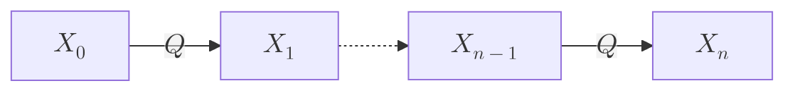

## 转移矩阵与边缘演化

设时间 $n\in\mathbb Z_{\ge 0}$，状态空间为有限集 $E=\{1,\dots,K\}$，自然信息流为 $\mathcal F_n^X:=\sigma(X_0,\dots,X_n)$。随机过程 $(X_n)_{n\ge 0}$ 称为**时齐有限状态离散时间马尔可夫链**（FSDTMC），如果存在矩阵 $Q=(Q_{ij})_{K\times K}$，使得对任意 $n\in\mathbb Z_{\ge 0}$ 与 $j\in E$，

$$
\mathbb P(X_{n+1}=j\mid\mathcal F_n^X)
= \mathbb P(X_{n+1}=j\mid X_n)
= Q_{X_n,j}
\qquad\mathbb P\text{-a.s.}
$$

当 $\mathbb P(X_n=i)>0$ 时，$Q_{ij}=\mathbb P(X_{n+1}=j\mid X_n=i)$。转移矩阵 $Q$ 是**行随机矩阵**：

$$
Q_{ij}\ge 0,
\qquad
\sum_{j=1}^K Q_{ij}=1,
\qquad
Q\mathbf 1=\mathbf 1,
$$

其中 $\mathbf 1=(1,\dots,1)^\top\in\mathbb R^K$。

由 Markov 性，有限维联合分布为

$$
\mathbb P(X_0=i_0,\dots,X_n=i_n)
= \mathbb P(X_0=i_0)\prod_{k=1}^n Q_{i_{k-1},i_k}.
$$

将时刻 $n$ 的边缘分布写成行向量 $\nu_n\in\mathbb R^{1\times K}$，$(\nu_n)_i=\mathbb P(X_n=i)$。由全概率公式

$$
\mathbb P(X_n=j)
= \sum_{i=1}^K \mathbb P(X_{n-1}=i)\,Q_{ij},
$$

得

$$
\nu_n=\nu_{n-1}Q,
\qquad
\nu_n=\nu_0 Q^n.
$$

## 平稳分布

记概率单纯形为

$$
\Delta_{K-1}
:=
\{\nu\in\mathbb R^{1\times K}:\nu_i\ge 0,\ \nu\mathbf 1=1\}.
$$

若行向量 $\pi\in\Delta_{K-1}$ 满足

$$
\pi Q=\pi,
$$

则称 $\pi$ 为 $Q$ 的**平稳分布**。当初始分布 $\nu_0=\pi$ 时，对任意 $n\ge 0$ 有 $\nu_n=\pi Q^n=\pi$。

## 可达、沟通类与周期

若存在 $n\ge 0$ 使 $(Q^n)_{ij}>0$，称 $j$ 由 $i$ **可达**，记作 $i\to j$（当 $i\neq j$ 时，因 $(Q^0)_{ij}=I_{ij}=0$，必有 $n\ge 1$）。若 $i\to j$ 且 $j\to i$，称 $i$ 与 $j$ **沟通**，记作 $i\leftrightarrow j$。

**命题。** 沟通关系 $\leftrightarrow$ 是 $E$ 上的等价关系。

> [!note]- 证明
> - **自反性**：对任意 $i\in E$，取 $n=0$，有 $(Q^0)_{ii}=I_{ii}=1>0$，故 $i\to i$，从而 $i\leftrightarrow i$。
> - **对称性**：若 $i\leftrightarrow j$，则 $i\to j$ 且 $j\to i$，由定义即有 $j\leftrightarrow i$。
> - **传递性**：设 $i\leftrightarrow j$ 且 $j\leftrightarrow k$。由 $i\to j$ 与 $j\to k$，存在 $m,n\ge 0$ 使 $(Q^m)_{ij}>0$ 且 $(Q^n)_{jk}>0$。由矩阵乘法及 $Q$ 的非负性
> 
>   $$
>   (Q^{m+n})_{ik}
>   = \sum_{\ell=1}^K (Q^m)_{i\ell}(Q^n)_{\ell k}
>   \ge (Q^m)_{ij}(Q^n)_{jk}
>   > 0,
>   $$
>   故 $i\to k$。同理，由 $k\to j$ 与 $j\to i$ 可得 $k\to i$。因此 $i\leftrightarrow k$。
>
> 综上，$\leftrightarrow$ 满足自反性、对称性与传递性，是 $E$ 上的等价关系。$\square$

等价关系 $\leftrightarrow$ 将 $E$ 划分为互不相交的等价类，称为**沟通类**。当 $E$ 只有一个沟通类时，称链**不可约**。

沟通类 $C$ 称为**闭沟通类**，如果

$$
i\in C,\ j\notin C
\implies
Q_{ij}=0.
$$

若存在 $j\in C$ 使 $i\to j$（由类内状态互通及传递性，这等价于对任意 $j\in C$ 均有 $i\to j$），称状态 $i$ **可到达沟通类** $C$。

**命题。** 有限状态链至少存在一个闭沟通类，且每个状态都能到达某个闭沟通类。

> [!note]- 证明
> 任取初始状态 $y_0\in E$，记其所在的沟通类为 $C^{(0)}$。按如下方式归纳构造状态序列 $y_0,y_1,\dots$ 及其所在的沟通类 $C^{(0)},C^{(1)},\dots$：
>
> 设已得到 $y_0,y_1,\dots,y_k$ 及沟通类 $C^{(0)},C^{(1)},\dots,C^{(k)}$（$y_p\in C^{(p)}$），满足
>
> $$
> y_0\to y_1\to\cdots\to y_k.
> $$
>
> - 若 $C^{(k)}$ 是闭沟通类，则构造终止。此时由可达关系的传递性有 $y_0\to y_k\in C^{(k)}$，即 $y_0$ 可到达闭沟通类 $C^{(k)}$。
> - 若 $C^{(k)}$ 不是闭沟通类，由定义知存在 $x_k\in C^{(k)}$ 与 $y_{k+1}\notin C^{(k)}$ 使 $Q_{x_k y_{k+1}}>0$（从而 $x_k\to y_{k+1}$）。记 $y_{k+1}$ 所在的沟通类为 $C^{(k+1)}$。因 $y_k,x_k\in C^{(k)}$，有 $y_k\to x_k$，故 $y_k\to y_{k+1}$。
>
> 下证新沟通类 $C^{(k+1)}$ 与已有的 $C^{(0)},\dots,C^{(k)}$ 均不相同。若存在 $0\le p\le k$ 使 $C^{(k+1)}=C^{(p)}$，则 $y_{k+1}$ 与 $y_p$ 属于同一沟通类，故 $y_{k+1}\to y_p$；结合 $y_p\to\cdots\to y_k$ 得 $y_{k+1}\to y_k$。又已知 $y_k\to y_{k+1}$，故 $y_k\leftrightarrow y_{k+1}$，即 $y_{k+1}\in C^{(k)}$，与 $y_{k+1}\notin C^{(k)}$ 的选取矛盾。
>
> 因此，构造每延续一步都会产生一个新的沟通类。由于有限集 $E=\{1,\dots,K\}$ 至多划分为 $K$ 个互不相交的沟通类，该构造至多进行 $K-1$ 步必终止于某个闭沟通类 $C^{(r)}$（$0\le r\le K-1$），且 $y_0\to y_r\in C^{(r)}$。
>
> 由 $y_0\in E$ 的任意性，每个状态都能到达某个闭沟通类；特别地，因 $E\neq\emptyset$，至少存在一个闭沟通类。$\square$

记全部闭沟通类为 $C_1,\dots,C_m$（$m\ge 1$），其余状态构成的集合

$$
T:=E\setminus\bigcup_{k=1}^m C_k
$$

称为**暂态集**，$T$ 中的状态称为**暂态**。

对状态 $i$，若返回步数集合 $\{n\ge 1:(Q^n)_{ii}>0\}$ 非空，定义其**周期**为

$$
d(i):=\gcd\{n\ge 1:(Q^n)_{ii}>0\}.
$$

$d(i)=1$ 时称 $i$ 非周期，$d(i)>1$ 时称 $i$ 为周期状态。在有限不可约链中，每个状态的返回步数集合都非空（$|E|=1$ 时 $Q_{11}=1$；$|E|\ge 2$ 时取 $j\neq i$，由 $i\to j\to i$ 即得正长度返回路径）。

**命题。** 同一沟通类中的状态具有相同的周期。

> [!note]- 证明
> 设 $i\leftrightarrow j$，且 $i$ 的返回步数集合非空。取 $r,s\ge 1$ 使 $(Q^r)_{ij}>0$、$(Q^s)_{ji}>0$。因 $Q$ 的各次幂均为非负矩阵，由矩阵乘法 $Q^{s+r}=Q^s Q^r$ 并只保留求和中的 $k=i$ 项，得
>
> $$
> (Q^{s+r})_{jj}
> = \sum_{k=1}^K (Q^s)_{jk}(Q^r)_{kj}
> \ge (Q^s)_{ji}(Q^r)_{ij}
> > 0,
> $$
>
> 故 $j$ 的返回步数集合非空，且 $d(j)\mid(s+r)$。对任意满足 $(Q^n)_{ii}>0$ 的 $n\ge 1$，由 $Q^{s+n+r}=Q^s Q^n Q^r$ 并只保留双重求和中的 $(k,\ell)=(i,i)$ 项，有
>
> $$
> \begin{aligned}
> (Q^{s+n+r})_{jj}
> &= \sum_{\ell=1}^K (Q^{s+n})_{j\ell}(Q^r)_{\ell j} \\
> &= \sum_{k=1}^K\sum_{\ell=1}^K (Q^s)_{jk}(Q^n)_{k\ell}(Q^r)_{\ell j} \\
> &\ge (Q^s)_{ji}(Q^n)_{ii}(Q^r)_{ij}
> > 0,
> \end{aligned}
> $$
>
> 故 $d(j)\mid(s+n+r)$。结合 $d(j)\mid(s+r)$ 得 $d(j)\mid n$。由 $n$ 的任意性知 $d(j)\mid d(i)$。交换 $i,j$ 得 $d(i)\mid d(j)$，故 $d(i)=d(j)$。$\square$

不可约链的所有状态具有共同周期 $d$；$d=1$ 时称链**非周期**。

例如二状态交替链

$$
Q=
\begin{pmatrix}
0&1\\
1&0
\end{pmatrix}
$$

不可约，周期 $d=2$，由 $\pi Q=\pi$ 与 $\pi\mathbf 1=1$ 得唯一平稳分布 $\pi=(1/2,1/2)$。对任意初始分布 $\nu_0=(a,b)$（$a,b\ge 0$，$a+b=1$），有

$$
\nu_1
= \nu_0 Q
= (a,b)
\begin{pmatrix}
0&1\\
1&0
\end{pmatrix}
= (b,a),
\qquad
\nu_2
= \nu_1 Q
= (b,a)
\begin{pmatrix}
0&1\\
1&0
\end{pmatrix}
= (a,b).
$$

一般地，$\nu_{2k}=(a,b)$，$\nu_{2k+1}=(b,a)$。当 $a\neq b$ 时，$\nu_n$ 在 $(a,b)$ 与 $(b,a)$ 之间交替，极限不存在。

## 平稳分布的存在性

**命题。** 每个有限状态行随机矩阵 $Q$ 都至少有一个平稳分布。

> [!note]- 证明一：左特征向量
> 由 $Q\mathbf 1=\mathbf 1$ 知 $\det(Q-I)=0$，从而 $\det(Q^\top-I)=0$。故存在非零实向量 $\mathbf v\in\mathbb R^{1\times K}$ 满足
>
> $$
> \mathbf v Q=\mathbf v.
> $$
>
> 对第 $j$ 个分量应用三角不等式及 $Q_{ij}\ge 0$：
>
> $$
> |v_j|
> = \left|\sum_{i=1}^K v_i Q_{ij}\right|
> \le \sum_{i=1}^K |v_i| Q_{ij}.
> $$
>
> 记 $|\mathbf v|=(|v_1|,\dots,|v_K|)$，则逐分量有 $|\mathbf v|\le|\mathbf v|Q$。两边右乘 $\mathbf 1$，由 $Q\mathbf 1=\mathbf 1$ 得
>
> $$
> |\mathbf v|\mathbf 1
> \le |\mathbf v|Q\mathbf 1
> = |\mathbf v|\mathbf 1.
> $$
>
> 因 $|\mathbf v|Q-|\mathbf v|$ 各分量非负且分量之和为 $0$，故
>
> $$
> |\mathbf v|Q=|\mathbf v|.
> $$
>
> 由 $\mathbf v\neq\mathbf 0$ 知 $S:=|\mathbf v|\mathbf 1>0$。令 $\pi:=S^{-1}|\mathbf v|$，则 $\pi\in\Delta_{K-1}$ 且 $\pi Q=\pi$。$\square$

> [!note]- 证明二：Cesàro 平均
> 任取 $\nu_0\in\Delta_{K-1}$，定义
>
> $$
> \bar\nu_N
> :=
> \frac1N\sum_{n=0}^{N-1}\nu_0 Q^n\in\Delta_{K-1}.
> $$
>
> 右乘 $Q$ 作差：
>
> $$
> \begin{aligned}
> \bar\nu_N Q-\bar\nu_N
> &=
> \frac1N\sum_{n=0}^{N-1}
> \bigl(\nu_0 Q^{n+1}-\nu_0 Q^n\bigr)
> \\
> &=
> \frac1N(\nu_0 Q^N-\nu_0).
> \end{aligned}
> $$
>
> 因 $\nu_0 Q^N,\nu_0\in\Delta_{K-1}$，对每个分量 $j$ 有
>
> $$
> \bigl|(\bar\nu_N Q-\bar\nu_N)_j\bigr|
> = \frac1N\bigl|(\nu_0 Q^N)_j-(\nu_0)_j\bigr|
> \le \frac1N,
> $$
>
> 故 $\bar\nu_N Q-\bar\nu_N\to\mathbf 0$。由于 $\Delta_{K-1}$ 是 $\mathbb R^{1\times K}$ 中的有界闭集（紧集），序列 $(\bar\nu_N)$ 存在收敛子列 $\bar\nu_{N_k}\to\pi\in\Delta_{K-1}$（$k\to\infty$）。沿该子列取极限，由矩阵乘法的连续性得
>
> $$
> \mathbf 0
> = \lim_{k\to\infty}(\bar\nu_{N_k}Q-\bar\nu_{N_k})
> = \Bigl(\lim_{k\to\infty}\bar\nu_{N_k}\Bigr)Q - \lim_{k\to\infty}\bar\nu_{N_k}
> = \pi Q-\pi,
> $$
>
> 即 $\pi Q=\pi$。$\square$

## 平稳分布的唯一性

**定理。** 若 $Q$ 不可约，则平稳分布 $\pi$ 唯一，并且对所有 $i\in E$ 有 $\pi_i>0$。

> [!note]- 证明
> 平稳分布的存在性已由上一节命题保证。先证一个基本性质：若非负行向量 $\mathbf u\in\mathbb R^{1\times K}$（$\mathbf u\ge\mathbf 0$）满足 $\mathbf u Q=\mathbf u$，且存在 $i\in E$ 使 $u_i>0$，则对所有 $j\in E$ 均有 $u_j>0$。事实上，由 $\mathbf u Q=\mathbf u$ 归纳可得对任意 $n\ge 0$ 有 $\mathbf u Q^n=\mathbf u$。对任意 $j\in E$，由不可约性（$i\to j$）存在 $n\ge 0$ 使 $(Q^n)_{ij}>0$。因 $\mathbf u$ 与 $Q^n$ 的各分量均非负，只保留求和中的 $k=i$ 项即得
>
> $$
> u_j
> = (\mathbf u Q^n)_j
> = \sum_{k=1}^K u_k(Q^n)_{kj}
> \ge u_i(Q^n)_{ij}
> > 0.
> $$
>
> 换言之，满足 $\mathbf u\ge\mathbf 0$ 与 $\mathbf u Q=\mathbf u$ 的向量要么恒为 $\mathbf 0$，要么每个分量严格为正。
>
> - **严格正性**：设 $\pi\in\Delta_{K-1}$ 是平稳分布，则 $\pi\ge\mathbf 0$ 且 $\pi Q=\pi$。由 $\sum_{i=1}^K\pi_i=1$ 知 $\pi\neq\mathbf 0$，故由上述性质得对所有 $i\in E$ 有 $\pi_i>0$。
> - **唯一性**：设 $\pi,\tilde\pi\in\Delta_{K-1}$ 均为平稳分布。由严格正性知对所有 $i\in E$ 有 $\tilde\pi_i>0$，又 $E$ 为有限集，故可定义
>
>   $$
>   c := \max_{i\in E}\frac{\pi_i}{\tilde\pi_i}>0,
>   \qquad
>   \mathbf u := c\tilde\pi-\pi.
>   $$
>
>   对任意 $i\in E$，由 $c\ge\pi_i/\tilde\pi_i$ 及 $\tilde\pi_i>0$ 知 $u_i=c\tilde\pi_i-\pi_i\ge 0$，即 $\mathbf u\ge\mathbf 0$；且存在达到最大值的指标 $j\in E$ 使 $u_j=0$。同时由线性性有
>
>   $$
>   \mathbf u Q
>   = (c\tilde\pi-\pi)Q
>   = c\tilde\pi Q-\pi Q
>   = c\tilde\pi-\pi
>   = \mathbf u.
>   $$
>
>   若 $\mathbf u\neq\mathbf 0$，由开头所证性质必有对所有 $i\in E$ 成立 $u_i>0$，这与 $u_j=0$ 矛盾。因此 $\mathbf u=\mathbf 0$，即 $\pi=c\tilde\pi$。两边右乘 $\mathbf 1$，由 $\pi\mathbf 1=\tilde\pi\mathbf 1=1$ 得 $c=1$，故 $\pi=\tilde\pi$。$\square$

**定理。** 设闭沟通类为 $C_1,\dots,C_m$，$T$ 为暂态集。

1. 每个 $C_k$ 上的限制子矩阵 $Q_k$ 是有限不可约行随机矩阵，有唯一且处处为正的平稳分布 $\pi^{(k)}$。将其在 $C_k$ 外补 $0$，得到全空间上的平稳分布 $\tilde\pi^{(k)}$。
2. $Q$ 的全体平稳分布为
   $$
   \pi = \sum_{k=1}^m\alpha_k\tilde\pi^{(k)},
   \qquad
   \alpha_k\ge 0,
   \qquad
   \sum_{k=1}^m\alpha_k=1,
   $$
   其中系数 $\alpha_k=\sum_{i\in C_k}\pi_i$ 由 $\pi$ 唯一确定。
3. 平稳分布唯一当且仅当 $m=1$。

> [!note]- 证明
> 按 $T,C_1,\dots,C_m$ 排列状态。因闭沟通类 $C_k$ 无流出边（$i\in C_k,\ j\notin C_k\implies Q_{ij}=0$），在 $C_k$ 所在行块中，除对角块 $Q_k:=(Q_{ij})_{i,j\in C_k}$ 外其余块均为 $0$，转移矩阵呈分块上三角形式：
>
> $$
> Q =
> \begin{pmatrix}
> Q_{TT}&A_1&A_2&\cdots&A_m\\
> 0&Q_1&0&\cdots&0\\
> 0&0&Q_2&\cdots&0\\
> \vdots&\vdots&\vdots&\ddots&\vdots\\
> 0&0&0&\cdots&Q_m
> \end{pmatrix},
> $$
>
> 其中 $Q_{TT}=(Q_{ij})_{i,j\in T}$，$A_k=(Q_{ij})_{i\in T,\,j\in C_k}$。以下依次证明定理的三项结论：
>
> **证明结论 1：** 固定 $k\in\{1,\dots,m\}$。
>
> - **$Q_k$ 是行随机矩阵**：对任意 $i\in C_k$，有 $(Q_k)_{ij}=Q_{ij}\ge 0$（$\forall j\in C_k$）；又当 $j\notin C_k$ 时 $Q_{ij}=0$，故
>
>   $$
>   \sum_{j\in C_k}(Q_k)_{ij}
>   = \sum_{j\in C_k}Q_{ij} + \sum_{j\notin C_k}Q_{ij}
>   = \sum_{j\in E}Q_{ij}
>   = 1.
>   $$
>
> - **$Q_k$ 不可约**：由分块结构归纳可知，对任意 $n\ge 0$，$Q^n$ 在 $C_k\times C_k$ 上的子块恰为 $Q_k^n$，即 $(Q_k^n)_{ij}=(Q^n)_{ij}$（$\forall i,j\in C_k$）。因 $C_k$ 是沟通类，对任意 $i,j\in C_k$ 存在 $n\ge 0$ 使 $(Q^n)_{ij}>0$，从而 $(Q_k^n)_{ij}>0$，故 $Q_k$ 不可约。
> - **$\pi^{(k)}$ 的存在唯一性与 $\tilde\pi^{(k)}$ 的平稳性**：由不可约链的唯一性定理，有限不可约行随机矩阵 $Q_k$ 存在唯一平稳分布 $\pi^{(k)}\in\mathbb R^{1\times|C_k|}$，满足 $\pi^{(k)}Q_k=\pi^{(k)}$、$\pi^{(k)}\mathbf 1_{|C_k|}=1$ 且对所有 $i\in C_k$ 有 $\pi^{(k)}_i>0$。定义补零行向量 $\tilde\pi^{(k)}\in\mathbb R^{1\times K}$：在分块顺序 $(T,C_1,\dots,C_m)$ 下，其第 $k$ 个闭类分块为 $\pi^{(k)}$，其余分块均为 $\mathbf 0$，即
>
>   $$
>   \tilde\pi^{(k)} := (\mathbf 0,\mathbf 0,\dots,\pi^{(k)},\dots,\mathbf 0).
>   $$
>
>   显然 $\tilde\pi^{(k)}_i\ge 0$（$\forall i\in E$），且 $\tilde\pi^{(k)}\mathbf 1=\pi^{(k)}\mathbf 1_{|C_k|}=1$，故 $\tilde\pi^{(k)}\in\Delta_{K-1}$。按分块矩阵乘法计算 $\tilde\pi^{(k)}Q$：
>   - 在 $T$ 分块上为 $\mathbf 0\,Q_{TT}=\mathbf 0$；
>   - 在 $C_\ell$（$\ell\neq k$）分块上为 $\mathbf 0\,A_\ell+\mathbf 0\,Q_\ell=\mathbf 0$；
>   - 在 $C_k$ 分块上为 $\mathbf 0\,A_k+\pi^{(k)}Q_k=\pi^{(k)}$。
>
>   因此 $\tilde\pi^{(k)}Q=\tilde\pi^{(k)}$，即 $\tilde\pi^{(k)}$ 是 $Q$ 的平稳分布。结论 1 得证。
>
> **证明结论 2：** 分“必要性（任意平稳分布均可表为凸组合）”、“充分性（任意凸组合均为平稳分布）”与“系数唯一性”三步。
>
> - **必要性**：设 $\pi=(\mathbf x,\mathbf y_1,\dots,\mathbf y_m)\in\Delta_{K-1}$ 是 $Q$ 的任一平稳分布，其中 $\mathbf x=(\pi_i)_{i\in T}$，$\mathbf y_k=(\pi_i)_{i\in C_k}$。展开 $\pi Q=\pi$ 得块方程组
>
>   $$
>   \mathbf x = \mathbf x Q_{TT},
>   \qquad
>   \mathbf y_k = \mathbf x A_k + \mathbf y_k Q_k
>   \quad(k=1,\dots,m).
>   $$
>
>   先证 $\mathbf x=\mathbf 0$（若 $T=\emptyset$ 则无需此步）。设 $T\neq\emptyset$，由 $\mathbf x=\mathbf x Q_{TT}$ 归纳可得对任意 $n\ge 1$ 有 $\mathbf x=\mathbf x Q_{TT}^n$。对每个 $i\in T$，由前文命题知 $i$ 可到达某个闭类，设到达 $T^{\mathrm c}:=\bigcup_{k=1}^m C_k$ 的最短正概率路径为 $i=i_0\to i_1\to\cdots\to i_{n_i}\in T^{\mathrm c}$。由最短性，$i_0,\dots,i_{n_i-1}$ 均在 $T$ 内且两两不同，故步数满足 $1\le n_i\le|T|$，且
>
>   $$
>   \delta_i := \sum_{j\notin T}(Q^{n_i})_{ij} \ge (Q^{n_i})_{i,i_{n_i}} > 0.
>   $$
>
>   取 $N:=|T|$。因闭类无返回 $T$ 的边，当 $j\notin T$ 时，第 $j$ 行的非零元全在 $T^{\mathrm c}$ 中，故对任意 $r\ge 0$ 有 $\sum_{\ell\notin T}(Q^r)_{j\ell}=1$。由 $Q^N=Q^{n_i}Q^{N-n_i}$ 得
>
>   $$
>   \begin{aligned}
>   \sum_{\ell\notin T}(Q^N)_{i\ell}
>   &= \sum_{j\in E}(Q^{n_i})_{ij}\sum_{\ell\notin T}(Q^{N-n_i})_{j\ell} \\
>   &\ge \sum_{j\notin T}(Q^{n_i})_{ij}\underbrace{\sum_{\ell\notin T}(Q^{N-n_i})_{j\ell}}_{=1} \\
>   &= \delta_i.
>   \end{aligned}
>   $$
>
>   由分块上三角乘法知 $Q^N$ 的左上块恰为 $Q_{TT}^N$，故 $Q_{TT}^N$ 的第 $i$ 行和满足
>
>   $$
>   (Q_{TT}^N\mathbf 1_{|T|})_i
>   = \sum_{\ell\in T}(Q^N)_{i\ell}
>   = 1 - \sum_{\ell\notin T}(Q^N)_{i\ell}
>   \le 1 - \delta_i.
>   $$
>
>   令 $\varepsilon:=\min_{i\in T}\delta_i>0$，则 $\|Q_{TT}^N\|_\infty=\max_{i\in T}(Q_{TT}^N\mathbf 1_{|T|})_i\le 1-\varepsilon<1$。结合 $\mathbf x=\mathbf x Q_{TT}^N$ 与 $\mathbf x\ge\mathbf 0$，两边右乘 $\mathbf 1_{|T|}$ 得
>
>   $$
>   \mathbf x\mathbf 1_{|T|}
>   = \mathbf x Q_{TT}^N\mathbf 1_{|T|}
>   = \sum_{i\in T} x_i(Q_{TT}^N\mathbf 1_{|T|})_i
>   \le (1-\varepsilon)\,\mathbf x\mathbf 1_{|T|}.
>   $$
>
>   因 $\varepsilon>0$ 且 $\mathbf x\mathbf 1_{|T|}\ge 0$，必有 $\mathbf x\mathbf 1_{|T|}=0$，故 $\mathbf x=\mathbf 0$。
>
>   将 $\mathbf x=\mathbf 0$ 代入块方程组，得 $\mathbf y_k=\mathbf y_k Q_k$（$k=1,\dots,m$）。对每个 $k$，定义
>
>   $$
>   \alpha_k := \mathbf y_k\mathbf 1_{|C_k|} = \sum_{i\in C_k}\pi_i \ge 0.
>   $$
>
>   - 若 $\alpha_k=0$，由 $\mathbf y_k\ge\mathbf 0$ 知 $\mathbf y_k=\mathbf 0=\alpha_k\pi^{(k)}$；
>   - 若 $\alpha_k>0$，令 $\hat{\mathbf y}_k:=\alpha_k^{-1}\mathbf y_k$，则 $\hat{\mathbf y}_k\ge\mathbf 0$、$\hat{\mathbf y}_k\mathbf 1_{|C_k|}=1$ 且 $\hat{\mathbf y}_k Q_k=\hat{\mathbf y}_k$，即 $\hat{\mathbf y}_k$ 是 $Q_k$ 的平稳分布。由结论 1 中 $\pi^{(k)}$ 的唯一性得 $\hat{\mathbf y}_k=\pi^{(k)}$，故亦有 $\mathbf y_k=\alpha_k\pi^{(k)}$。
>
>   因此
>
>   $$
>   \pi
>   = (\mathbf 0,\alpha_1\pi^{(1)},\dots,\alpha_m\pi^{(m)})
>   = \sum_{k=1}^m\alpha_k\tilde\pi^{(k)},
>   $$
>
>   且由 $\pi\mathbf 1=1$ 与 $\mathbf x=\mathbf 0$ 得
>
>   $$
>   \sum_{k=1}^m\alpha_k
>   = \sum_{k=1}^m\sum_{i\in C_k}\pi_i + \sum_{i\in T}\pi_i
>   = \sum_{i\in E}\pi_i
>   = 1.
>   $$
>
> - **充分性**：任取满足 $\alpha_k\ge 0$ 与 $\sum_{k=1}^m\alpha_k=1$ 的系数，令 $\pi:=\sum_{k=1}^m\alpha_k\tilde\pi^{(k)}$。由 $\tilde\pi^{(k)}\ge\mathbf 0$ 及 $\alpha_k\ge 0$ 知 $\pi\ge\mathbf 0$；同时
>
>   $$
>   \pi\mathbf 1
>   = \sum_{k=1}^m\alpha_k(\tilde\pi^{(k)}\mathbf 1)
>   = \sum_{k=1}^m\alpha_k
>   = 1,
>   \qquad
>   \pi Q
>   = \sum_{k=1}^m\alpha_k(\tilde\pi^{(k)}Q)
>   = \sum_{k=1}^m\alpha_k\tilde\pi^{(k)}
>   = \pi,
>   $$
>
>   故 $\pi$ 是 $Q$ 的平稳分布。
> - **系数唯一性**：设 $\pi=\sum_{\ell=1}^m\alpha_\ell\tilde\pi^{(\ell)}$。因当 $i\in C_k$ 时，对所有 $\ell\neq k$ 有 $\tilde\pi^{(\ell)}_i=0$，而 $\tilde\pi^{(k)}_i=\pi^{(k)}_i$，故在 $C_k$ 上对分量求和得
>
>   $$
>   \sum_{i\in C_k}\pi_i
>   = \sum_{\ell=1}^m\alpha_\ell\sum_{i\in C_k}\tilde\pi^{(\ell)}_i
>   = \alpha_k\sum_{i\in C_k}\pi^{(k)}_i
>   = \alpha_k.
>   $$
>
>   因此系数 $\alpha_k=\sum_{i\in C_k}\pi_i$ 由 $\pi$ 唯一确定。结论 2 得证。
>
> **证明结论 3：**
>
> - **充分性（$m=1\implies$ 平稳分布唯一）**：若 $m=1$，由结论 2 知任意平稳分布 $\pi$ 必满足 $\pi=\alpha_1\tilde\pi^{(1)}$ 且 $\alpha_1=1$，故 $Q$ 有唯一平稳分布 $\tilde\pi^{(1)}$。
> - **必要性（平稳分布唯一 $\implies m=1$）**：若 $m\ge 2$，由结论 1 知 $\tilde\pi^{(1)}$ 与 $\tilde\pi^{(2)}$ 均为 $Q$ 的平稳分布。取 $i\in C_1$，因 $C_1\cap C_2=\emptyset$，有 $\tilde\pi^{(1)}_i=\pi^{(1)}_i>0$ 而 $\tilde\pi^{(2)}_i=0$，故 $\tilde\pi^{(1)}\neq\tilde\pi^{(2)}$，平稳分布不唯一（事实上，对任意 $\alpha\in[0,1]$，$\alpha\tilde\pi^{(1)}+(1-\alpha)\tilde\pi^{(2)}$ 均为互不相同的平稳分布）。
>
> 因此平稳分布唯一当且仅当 $m=1$。结论 3 得证。$\square$

当 $m=1$ 且 $T\neq\emptyset$ 时，平稳分布唯一但在暂态上取 $0$。例如

$$
Q=
\begin{pmatrix}
1&0\\
1&0
\end{pmatrix}
$$

中，$C_1=\{1\}$，$T=\{2\}$，唯一平稳分布为 $(1,0)$。而

$$
Q=
\begin{pmatrix}
1&0\\
0&1
\end{pmatrix}
$$

有两个闭类 $C_1=\{1\}$、$C_2=\{2\}$，平稳分布全体为 $(\alpha,1-\alpha)$（$0\le\alpha\le 1$）。

## 分布的收敛

非负方阵 $Q$ 称为**本原矩阵**，如果存在整数 $m\ge 1$ 使 $Q^m$ 的所有元素严格为正（记作 $Q^m>0$）。

**引理。** 有限不可约非周期行随机矩阵是本原矩阵。

> [!note]- 证明
> 固定 $i\in E$，令 $G:=\{n\ge 1:(Q^n)_{ii}>0\}$。由有限不可约性知 $G$ 非空，且对加法封闭（$a,b\in G\implies a+b\in G$）。由非周期性知 $\gcd(G)=1$，故存在有限个 $g_1,\dots,g_\ell\in G$ 使 $\gcd(g_1,\dots,g_\ell)=1$，从而存在整数 $z_1,\dots,z_\ell$ 使 $\sum_{s=1}^\ell z_s g_s=1$。令
>
> $$
> G_+
> :=
> \sum_{z_s>0}z_s g_s,
> \qquad
> G_-
> :=
> \sum_{z_s<0}(-z_s)g_s,
> $$
>
> 则 $G_+=G_-+1\ge 1$。
>
> 若 $G_-=0$，则 $1\in G$，从而一切正整数均属于 $G$。若 $G_-\ge 1$，则 $G_+,G_-\in G$ 且 $G_+\equiv 1\pmod{G_-}$。对任意整数 $n\ge\max\{1,(G_--1)G_+\}$，取 $r=n\bmod G_-\in\{0,\dots,G_--1\}$，则 $rG_+\equiv n\pmod{G_-}$，且
>
> $$
> n-rG_+
> \ge
> n-(G_--1)G_+
> \ge
> 0.
> $$
>
> 记 $s:=(n-rG_+)/G_-\ge 0$，则 $n=rG_++sG_-\in G$。
>
> 因此存在 $N_i\ge 1$，使一切 $n\ge N_i$ 均满足 $(Q^n)_{ii}>0$。对每个 $j\in E$，取 $r_j\ge 0$ 使 $(Q^{r_j})_{ij}>0$（其中 $r_i=0$），令 $R_i:=\max_{j\in E}r_j$。当 $m\ge N_i+R_i$ 时，对任意 $j\in E$ 有 $m-r_j\ge N_i$，故
>
> $$
> (Q^m)_{ij}
> \ge
> (Q^{m-r_j})_{ii}(Q^{r_j})_{ij}
> >0.
> $$
>
> 取 $m:=\max_{i\in E}(N_i+R_i)$，即得 $Q^m>0$。$\square$

**定理。** 设 $Q$ 恰好有一个闭沟通类，且该闭类非周期，$\pi$ 为唯一平稳分布。则

$$
Q^n\longrightarrow\mathbf 1\pi.
$$

从而对任意初始分布 $\nu_0\in\Delta_{K-1}$，都有 $\nu_0 Q^n\to\pi$。

> [!note]- 证明
> 先设 $Q$ 不可约且非周期（即 $T=\emptyset$）。由上引理知 $Q$ 为本原矩阵。由 $Q\mathbf 1=\mathbf 1$ 及 $\|Q\|_\infty=1$ 知谱半径 $\rho(Q)=1$。由本原非负矩阵的 Perron--Frobenius 定理，特征值 $1$ 的代数重数为 $1$，且其余特征值均满足 $|\lambda|<1$。特征值 $1$ 的右特征向量为 $\mathbf 1$，左特征向量为 $\pi$，且 $\pi\mathbf 1=1$，故对应的谱投影为 $\mathbf 1\pi$。对任一满足 $|\lambda|<1$ 的 $r$ 阶 Jordan 块 $J=\lambda I+N$（$N^r=0$），有
>
> $$
> J^n
> = \sum_{s=0}^{r-1}\binom{n}{s}\lambda^{n-s}N^s
> \longrightarrow 0
> \qquad(n\to\infty),
> $$
>
> 故 $Q^n\to\mathbf 1\pi$。左乘 $\nu_0$ 得 $\nu_0 Q^n\to\nu_0\mathbf 1\,\pi=\pi$。
>
> 再设唯一闭沟通类 $C_1$ 非周期，而 $T$ 可能非空。限制矩阵 $Q_1$ 不可约且非周期，故对每个 $j\in C_1$，
>
> $$
> \delta_n
> := \max_{i\in C_1}\bigl|(Q_1^n)_{ij}-\pi^{(1)}_j\bigr|
> \longrightarrow 0.
> $$
>
> 由前面暂态逃逸的估计，存在 $N\ge 1$ 与 $\varepsilon\in(0,1]$ 使 $\|Q_{TT}^N\|_\infty\le 1-\varepsilon$，故 $\|Q_{TT}^{kN}\|_\infty\le(1-\varepsilon)^k$，从而 $Q_{TT}^n\to 0$。当 $j\in T$ 时，$\pi_j=0$，且对任意 $i\in E$ 有 $(Q^n)_{ij}\le\mathbb P_i(X_n\in T)\to 0=\pi_j$。
>
> 当 $j\in C_1$ 时，若 $i\in C_1$，则 $(Q^n)_{ij}=(Q_1^n)_{ij}\to\pi_j$。若 $i\in T$，记进入 $C_1$ 的首达时为 $\sigma$，则
>
> $$
> \mathbb P_i(X_n=j)
> = \sum_{t=1}^n\sum_{a\in C_1}\mathbb P_i(\sigma=t,X_t=a)\,(Q_1^{n-t})_{aj}.
> $$
>
> 因 $\{\sigma>n\}=\{X_n\in T\}$，有 $\mathbb P_i(\sigma>kN)\le(1-\varepsilon)^k$，故 $\mathbb P_i(\sigma>n)\to 0$。又
>
> $$
> \bigl|
> \mathbb P_i(X_n=j)-\pi_j\mathbb P_i(\sigma\le n)
> \bigr|
> \le
> \sum_{t=1}^n\mathbb P_i(\sigma=t)\,\delta_{n-t}.
> $$
>
> 对任意 $\eta>0$，取 $M$ 使 $n\ge M$ 时 $\delta_n<\eta$，再取 $n>M$ 使 $\mathbb P_i(\sigma>n-M)<\eta$。由于 $\delta_{n-t}\le 1$，将和式按 $t\le n-M$ 与 $t>n-M$ 拆开可得上式右端小于 $2\eta$，且 $\pi_j\mathbb P_i(\sigma>n)<\eta$。故当 $n$ 充分大时 $\bigl|(Q^n)_{ij}-\pi_j\bigr|<3\eta$，即 $(Q^n)_{ij}\to\pi_j$。因此 $Q^n\to\mathbf 1\pi$。$\square$

### 算例：均匀重置链

设 $E=\{1,\dots,K\}$，$\alpha\in(0,1)$。每一步以概率 $1-\alpha$ 留在当前状态，以概率 $\alpha$ 从 $E$ 中均匀抽取下一状态：

$$
Q_{ij} =
\begin{cases}
1-\alpha+\alpha/K & j=i, \\
\alpha/K & j\neq i.
\end{cases}
$$

令 $J:=\frac1K\mathbf 1\mathbf 1^\top$，则 $Q=(1-\alpha)I+\alpha J$。由 $\mathbf 1^\top\mathbf 1=K$ 知 $J^2=J$，$(I-J)^2=I-J$，且 $J(I-J)=(I-J)J=0$。将 $Q$ 写为互补投影之和

$$
Q = J+(1-\alpha)(I-J),
$$

则对任意 $n\ge 1$，

$$
Q^n
= \bigl(J+(1-\alpha)(I-J)\bigr)^n
= J^n+(1-\alpha)^n(I-J)^n
= J+(1-\alpha)^n(I-J).
$$

均匀分布 $\pi=\frac1K\mathbf 1^\top$ 满足 $\pi J=\pi$，故 $\pi Q=(1-\alpha)\pi+\alpha\pi=\pi$。对任意初始分布 $\nu_0\in\Delta_{K-1}$，由 $\nu_0\mathbf 1=1$ 得

$$
\nu_0 J
= \frac1K(\nu_0\mathbf 1)\mathbf 1^\top
= \pi,
\qquad
\nu_0(I-J) = \nu_0-\pi,
$$

从而

$$
\nu_n
= \nu_0 Q^n
= \pi+(1-\alpha)^n(\nu_0-\pi)
\xrightarrow[n\to\infty]{} \pi.
$$

### 算例：环上惰性随机游走

设 $K\ge 3$，$\alpha\in(0,1)$，状态空间取环 $E=\mathbb Z_K=\{0,1,\dots,K-1\}$。每一步以概率 $1-\alpha$ 停留原地，以概率 $\alpha/2$ 移至左邻或右邻：

$$
Q_{ij} =
\begin{cases}
1-\alpha & j=i, \\
\alpha/2 & j\equiv i\pm 1\pmod{K}, \\
0 & \text{其他}.
\end{cases}
$$

$Q$ 由首行 $(1-\alpha,\alpha/2,0,\dots,0,\alpha/2)$ 循环生成，故为双随机矩阵（行和与列和均为 $1$），均匀分布 $\pi=\frac1K\mathbf 1^\top$ 满足 $\pi Q=\pi$。沿环逐步转移可到达任意状态，故链不可约；又 $Q_{ii}=1-\alpha>0$，故周期 $d=1$。由收敛定理知 $Q^n\to\mathbf 1\pi$，对任意初始分布 $\nu_0$ 均有 $\nu_n\to\pi$。

### Cesàro 平均收敛

当唯一闭沟通类有周期时，$\nu_n=\nu_0 Q^n$ 未必逐时刻收敛，但其 Cesàro 平均仍然收敛。

**定理。** 若 $\pi$ 是 $Q$ 的唯一平稳分布，则对任意 $\nu_0\in\Delta_{K-1}$，

$$
\frac1N\sum_{n=0}^{N-1}\nu_0 Q^n
\longrightarrow
\pi.
$$

> [!note]- 证明
> 记 $\bar\nu_N:=N^{-1}\sum_{n=0}^{N-1}\nu_0 Q^n\in\Delta_{K-1}$。由存在性证明二知 $\|\bar\nu_N Q-\bar\nu_N\|_\infty\le 1/N$。对 $\bar\nu_N$ 的任一收敛子列 $\bar\nu_{N_k}\to\mu$，有 $\mu\in\Delta_{K-1}$ 且 $\mu Q=\mu$；由平稳分布唯一性得 $\mu=\pi$。
>
> 若 $\bar\nu_N$ 不收敛于 $\pi$，则存在 $\varepsilon>0$ 及子列使 $\|\bar\nu_{N_k}-\pi\|_\infty\ge\varepsilon$。因 $\Delta_{K-1}$ 紧，该子列存在收敛子列，其极限与 $\pi$ 的距离至少为 $\varepsilon$，矛盾。故 $\bar\nu_N\to\pi$。$\square$

从谱上看，周期链在单位圆上除 $1$ 外的特征值 $\lambda$（$|\lambda|=1,\ \lambda\neq 1$）满足

$$
\frac1N\sum_{n=0}^{N-1}\lambda^n
= \frac{1-\lambda^N}{N(1-\lambda)}
\longrightarrow 0,
$$

Cesàro 平均消去了单位圆上非 $1$ 特征值对应的振荡分量。

## 样本路径的时间平均

**定理（遍历定理）。** 设链有限且不可约，$\pi$ 为唯一平稳分布。则对任意函数 $f:E\to\mathbb R$ 和任意初始分布 $\nu_0$，

$$
\frac1N\sum_{n=0}^{N-1}f(X_n)
\xrightarrow[N\to\infty]{\text{a.s.}}
\sum_{i=1}^K\pi_i f(i).
$$

特别地，取 $f=\mathbf 1_{\{j\}}$，得状态 $j$ 的长期访问频率：

$$
\frac1N\sum_{n=0}^{N-1}\mathbf 1_{\{X_n=j\}}
\xrightarrow[N\to\infty]{\text{a.s.}}
\pi_j.
$$

> [!note]- 证明
> 记 $\mathbb P_i$、$\mathbb E_i$ 为从 $X_0=i$ 出发的概率与期望。固定状态 $r\in E$，定义首次正返回时
>
> $$
> \tau
> :=
> \inf\{n\ge 1:X_n=r\}.
> $$
>
> 先证 $\mathbb E_r[\tau]<\infty$。由不可约性，对每个 $i\neq r$ 存在步数 $n_i\le K-1$ 使 $\mathbb P_i(X_{n_i}=r)>0$；对 $r$ 存在最短正返回路径，步数 $n_r\le K$，满足 $\mathbb P_r(\tau\le n_r)>0$。取 $\ell:=\max_{i\in E}n_i\le K$，并令
>
> $$
> \varepsilon
> :=
> \min\Bigl(
> \{\mathbb P_r(\tau\le\ell)\}
> \cup
> \{\mathbb P_i(X_{n_i}=r):i\neq r\}
> \Bigr)
> >0,
> $$
>
> 则对任意 $i\neq r$，由 $1\le n_i\le\ell$ 知 $\mathbb P_i(\exists\,m\in\{1,\dots,\ell\},\ X_m=r)\ge\mathbb P_i(X_{n_i}=r)\ge\varepsilon$。因 $\{\tau>n\}=\{X_1\neq r,\dots,X_n\neq r\}\in\mathcal F_n^X$，且在事件 $\{\tau>k\ell\}$（$k\ge 1$）上有 $X_{k\ell}\neq r$，由 Markov 性知在该事件上
>
> $$
> \mathbb P_r\bigl(\tau>(k+1)\ell\bigm|\mathcal F_{k\ell}^X\bigr)
> \le
> 1-\varepsilon.
> $$
>
> 两边取期望并结合 $k=0$ 时的 $\mathbb P_r(\tau>\ell)\le 1-\varepsilon$，归纳得 $\mathbb P_r(\tau>k\ell)\le(1-\varepsilon)^k$（$\forall k\ge 0$）。故 $\mathbb P_r(\tau<\infty)=1$，且
>
> $$
> \mathbb E_r[\tau]
> = \sum_{n=0}^\infty\mathbb P_r(\tau>n)
> \le \sum_{k=0}^\infty\ell\,\mathbb P_r(\tau>k\ell)
> \le \frac\ell\varepsilon
> < \infty.
> $$
>
> 定义单循环内各状态的期望访问次数 $\mathbf m=(m_1,\dots,m_K)$：
>
> $$
> m_j
> := \mathbb E_r\Biggl[\sum_{n=0}^{\tau-1}\mathbf 1_{\{X_n=j\}}\Biggr]
> = \sum_{n=0}^\infty\mathbb P_r(X_n=j,\tau>n).
> $$
>
> 显然 $m_r=1$，且 $\sum_{j=1}^K m_j=\mathbb E_r[\tau]$。由 $\{\tau>n\}\in\mathcal F_n^X$ 及 Markov 性，
>
> $$
> \mathbb P_r(X_n=i,\tau>n,X_{n+1}=j)
> = \mathbb P_r(X_n=i,\tau>n)\,Q_{ij}.
> $$
>
> 对 $i$ 与 $n$ 求和得
>
> $$
> \sum_{i=1}^K m_i Q_{ij}
> = \sum_{n=0}^\infty\mathbb P_r(\tau>n,X_{n+1}=j)
> = \sum_{n=1}^\infty\mathbb P_r(\tau\ge n,X_n=j).
> $$
>
> 当 $j\neq r$ 时，$X_n=j$ 蕴含 $\tau\neq n$，且 $X_0=r\neq j$，故右端等于 $\sum_{n=0}^\infty\mathbb P_r(\tau>n,X_n=j)=m_j$；当 $j=r$ 时，$n\ge 1$ 且 $X_n=r$ 蕴含 $\tau\le n$，故 $\{\tau\ge n,X_n=r\}=\{\tau=n\}$，右端等于
>
> $$
> \sum_{n=1}^\infty\mathbb P_r(\tau=n)
> = \mathbb P_r(\tau<\infty)
> = 1
> = m_r.
> $$
>
> 因此 $\mathbf m Q=\mathbf m$。由平稳分布唯一性及 $\mathbf m\mathbf 1=\mathbb E_r[\tau]$，得
>
> $$
> m_j=\pi_j\,\mathbb E_r[\tau].
> $$
>
> 令 $R:=\sum_{n=0}^{\tau-1}f(X_n)$，则 $\mathbb E_r|R|\le\|f\|_\infty\mathbb E_r[\tau]<\infty$，且
>
> $$
> \mathbb E_r[R]
> = \sum_{j=1}^K f(j)m_j
> = \mathbb E_r[\tau]\sum_{j=1}^K\pi_j f(j).
> $$
>
> 设 $X_0=r$，定义依次返回 $r$ 的停时列 $\tau_0:=0$，$\tau_{k+1}:=\inf\{n>\tau_k:X_n=r\}$，以及循环长度 $L_k:=\tau_k-\tau_{k-1}$、循环累计和 $R_k:=\sum_{n=\tau_{k-1}}^{\tau_k-1}f(X_n)$。由强 Markov 性，$(L_k,R_k)_{k\ge 1}$ 在 $\mathbb P_r$ 下独立同分布，且与 $(\tau,R)$ 同分布。由强大数定律，在 $\mathbb P_r$ 下几乎必然有
>
> $$
> \frac1M\sum_{k=1}^M R_k
> \longrightarrow
> \mathbb E_r[R],
> \qquad
> \frac1M\sum_{k=1}^M L_k
> \longrightarrow
> \mathbb E_r[\tau],
> $$
>
> 从而
>
> $$
> \frac{\sum_{k=1}^M R_k}{\sum_{k=1}^M L_k}
> \longrightarrow
> \sum_{j=1}^K\pi_j f(j).
> $$
>
> 对时刻 $N$，令 $M(N):=\max\{M\ge 0:\tau_M\le N\}$，$S_M:=\sum_{k=1}^M L_k=\tau_M$。则 $S_{M(N)}\le N<S_{M(N)+1}$，$M(N)\to\infty$（$\mathbb P_r$-a.s.），且
>
> $$
> \sum_{n=0}^{N-1}f(X_n)
> = \sum_{k=1}^{M(N)}R_k + \rho_N,
> \qquad
> |\rho_N| \le \|f\|_\infty L_{M(N)+1}.
> $$
>
> 由 $S_M/M\to\mathbb E_r[\tau]$ 及 $S_{M(N)}\le N<S_{M(N)+1}$ 得 $N/M(N)\to\mathbb E_r[\tau]$，$S_{M(N)}/N\to 1$。又 $L_M/M=S_M/M-S_{M-1}/M\to 0$，故
>
> $$
> \frac{|\rho_N|}N
> \le \|f\|_\infty\frac{L_{M(N)+1}}{M(N)+1}\cdot\frac{M(N)+1}N
> \longrightarrow 0.
> $$
>
> 于是
>
> $$
> \frac1N\sum_{n=0}^{N-1}f(X_n)
> = \frac{S_{M(N)}}N\cdot\frac{\sum_{k=1}^{M(N)}R_k}{S_{M(N)}} + \frac{\rho_N}N
> \xrightarrow[N\to\infty]{\mathbb P_r\text{-a.s.}} \sum_{j=1}^K\pi_j f(j).
> $$
>
> 若 $X_0=i\neq r$，令首达时 $\sigma:=\inf\{n\ge 0:X_n=r\}$，同样有 $\mathbb P_i(\sigma>k\ell)\le(1-\varepsilon)^k$，故 $\sigma<\infty$（$\mathbb P_i$-a.s.）。$\sigma$ 之前的有限和满足 $\bigl|\sum_{n=0}^{\sigma-1}f(X_n)\bigr|/N\le\|f\|_\infty\sigma/N\to 0$；对 $N>\sigma$，
>
> $$
> \frac1N\sum_{n=\sigma}^{N-1}f(X_n)
> = \frac{N-\sigma}N\cdot\frac1{N-\sigma}\sum_{t=0}^{N-\sigma-1}f(X_{\sigma+t})
> \xrightarrow[N\to\infty]{\mathbb P_i\text{-a.s.}} \sum_{j=1}^K\pi_j f(j).
> $$
>
> 对一般初始分布 $\nu_0$，由 $\mathbb P_{\nu_0}=\sum_{i=1}^K(\nu_0)_i\mathbb P_i$ 即得结论。$\square$

若链恰有一个闭沟通类 $C_1$（允许暂态集 $T\neq\emptyset$），由于从任意状态进入 $C_1$ 的首达时几乎必然有限，且唯一平稳分布 $\pi$ 在 $T$ 上为 $0$，上述遍历定理对任意初始分布仍然成立。

## 条件汇总

对有限状态离散时间时齐马尔可夫链（转移矩阵 $Q$ 行随机）：

1. **平稳分布存在**：无额外条件。每个闭沟通类 $C_k$ 对应唯一一个支撑在 $C_k$ 上的平稳分布 $\tilde\pi^{(k)}$，全体平稳分布为其凸组合，暂态上的平稳概率恒为 $0$。
2. **平稳分布唯一**：当且仅当闭沟通类恰好有一个（$m=1$）。若链不可约（$m=1$ 且 $T=\emptyset$），则唯一平稳分布满足 $\pi_i>0$（$\forall i\in E$）。
3. **Cesàro 平均与样本时间平均收敛**：当 $m=1$ 时，对任意初始分布 $\nu_0$ 有 $\frac1N\sum_{n=0}^{N-1}\nu_0 Q^n\to\pi$，且对任意 $f:E\to\mathbb R$ 有 $\frac1N\sum_{n=0}^{N-1}f(X_n)\xrightarrow{\text{a.s.}}\sum_{i=1}^K\pi_i f(i)$（无需非周期）。
4. **逐时刻分布收敛**：当 $m=1$ 且该唯一闭沟通类非周期时，$Q^n\to\mathbf 1\pi$，从而对任意初始分布 $\nu_0$ 有 $\nu_0 Q^n\to\pi$。
