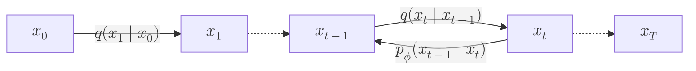

## 前置

- [[机器学习/VAE|变分自编码器]]

标准 [[机器学习/VAE|VAE]] 仅使用单层潜变量 $\mathbf{z}$，难以捕捉多级抽象特征。分层变分自编码器（HVAE）引入多层潜变量 $\mathbf{z}_1, \mathbf{z}_2, \ldots, \mathbf{z}_L$，但需要联合学习多层推断分布和生成分布，优化往往比单层模型更复杂，且容易退化为主要依赖低层潜变量重构、未能充分利用高层潜变量。

既然 VAE / HVAE 训练后理想上有聚合后验 $q_\theta(\mathbf{z}) \approx p_{\mathrm{prior}}(\mathbf{z})$，当仅以逼近真实数据分布为目标时，不必强求学习一个可训练的编码器——我们可以直接将前向编码过程固定为确定性的逐步高斯噪声注入，而只用神经网络学习逆向去噪生成过程。这就是去噪扩散概率模型（Denoising Diffusion Probabilistic Models, DDPM）。

## 前向扩散过程

给定真实数据样本 $\mathbf{x}_0 \sim p_{\mathrm{data}}(\mathbf{x}_0)$，前向过程在 $L$ 个时间步内逐步向数据注入高斯噪声。设方差调度参数 $\beta_i \in (0, 1)$ 单调递增，定义 $\alpha_i := 1 - \beta_i$。单步前向转移核定义为

$$
q(\mathbf{x}_i \mid \mathbf{x}_{i-1}) := \mathcal{N}\!\left(\mathbf{x}_i; \sqrt{\alpha_i}\,\mathbf{x}_{i-1}, \beta_i\mathbf{I}\right).
\tag{1}
$$

其等价的重参数化单步递推更新方程为

$$
\mathbf{x}_i = \sqrt{\alpha_i}\,\mathbf{x}_{i-1} + \sqrt{\beta_i}\,\boldsymbol{\epsilon}_i,
\qquad
\boldsymbol{\epsilon}_i \sim \mathcal{N}(\mathbf{0}, \mathbf{I}).
\tag{2}
$$

### 过渡核的递归合并

定义累积乘积 $\bar{\alpha}_i := \prod_{k=1}^i \alpha_k$。通过对单步高斯过渡核进行递归合并，可以不经逐步迭代，直接从 $\mathbf{x}_0$ 一步采样任意第 $i$ 步的带噪样本：

$$
q(\mathbf{x}_i \mid \mathbf{x}_0) = \mathcal{N}\!\left(\mathbf{x}_i; \sqrt{\bar{\alpha}_i}\,\mathbf{x}_0, (1 - \bar{\alpha}_i)\mathbf{I}\right).
\tag{3}
$$

> [!note]- 证明
> 对步数 $i$ 使用数学归纳法。
>
> **归纳起点（$i = 1$）：** 此时 $\bar{\alpha}_1 = \alpha_1$，$1 - \bar{\alpha}_1 = 1 - \alpha_1 = \beta_1$，与单步转移核 (1) 的定义一致：
>
> $$
> q(\mathbf{x}_1 \mid \mathbf{x}_0)
> = \mathcal{N}\!\left(\mathbf{x}_1; \sqrt{\alpha_1}\,\mathbf{x}_0, \beta_1\mathbf{I}\right)
> = \mathcal{N}\!\left(\mathbf{x}_1; \sqrt{\bar{\alpha}_1}\,\mathbf{x}_0, (1 - \bar{\alpha}_1)\mathbf{I}\right).
> $$
>
> **归纳假设：** 假设第 $i-1$ 步已合并为
>
> $$
> q(\mathbf{x}_{i-1} \mid \mathbf{x}_0)
> = \mathcal{N}\!\left(\mathbf{x}_{i-1}; \sqrt{\bar{\alpha}_{i-1}}\,\mathbf{x}_0, (1 - \bar{\alpha}_{i-1})\mathbf{I}\right),
> $$
>
> 其重参数化形式为
>
> $$
> \mathbf{x}_{i-1} = \sqrt{\bar{\alpha}_{i-1}}\,\mathbf{x}_0 + \sqrt{1 - \bar{\alpha}_{i-1}}\,\boldsymbol{\epsilon},
> \qquad
> \boldsymbol{\epsilon} \sim \mathcal{N}(\mathbf{0}, \mathbf{I}).
> $$
>
> **归纳递推：** 将上式代入第 $i$ 步的更新式 $\mathbf{x}_i = \sqrt{\alpha_i}\,\mathbf{x}_{i-1} + \sqrt{\beta_i}\,\boldsymbol{\epsilon}_i$，其中 $\boldsymbol{\epsilon}_i \sim \mathcal{N}(\mathbf{0}, \mathbf{I})$ 且与 $\boldsymbol{\epsilon}$ 相互独立：
>
> $$
> \begin{aligned}
> \mathbf{x}_i
> &= \sqrt{\alpha_i}\!\left(\sqrt{\bar{\alpha}_{i-1}}\,\mathbf{x}_0 + \sqrt{1 - \bar{\alpha}_{i-1}}\,\boldsymbol{\epsilon}\right) + \sqrt{\beta_i}\,\boldsymbol{\epsilon}_i \\
> &= \sqrt{\bar{\alpha}_i}\,\mathbf{x}_0 + \sqrt{\alpha_i(1 - \bar{\alpha}_{i-1})}\,\boldsymbol{\epsilon} + \sqrt{\beta_i}\,\boldsymbol{\epsilon}_i.
> \end{aligned}
> $$
>
> 两个相互独立的各向同性高斯随机变量的线性组合仍服从高斯分布，其方差等于各自方差之和：
>
> $$
> \alpha_i(1 - \bar{\alpha}_{i-1}) + \beta_i
> = \alpha_i - \alpha_i\bar{\alpha}_{i-1} + (1 - \alpha_i)
> = 1 - \bar{\alpha}_i,
> $$
>
> 其中用到了 $\beta_i = 1 - \alpha_i$ 与 $\bar{\alpha}_i = \alpha_i\bar{\alpha}_{i-1}$。因此存在标准正态噪声 $\boldsymbol{\epsilon}' \sim \mathcal{N}(\mathbf{0}, \mathbf{I})$，使得
>
> $$
> \mathbf{x}_i = \sqrt{\bar{\alpha}_i}\,\mathbf{x}_0 + \sqrt{1 - \bar{\alpha}_i}\,\boldsymbol{\epsilon}',
> $$
>
> 即 $q(\mathbf{x}_i \mid \mathbf{x}_0) = \mathcal{N}\!\left(\mathbf{x}_i; \sqrt{\bar{\alpha}_i}\,\mathbf{x}_0, (1 - \bar{\alpha}_i)\mathbf{I}\right)$。由数学归纳法，(3) 对任意步数 $i$ 成立。$\square$

当总步数 $L \to \infty$ 时，$\bar{\alpha}_L \to 0$，终端分布收敛到标准正态先验：

$$
q(\mathbf{x}_L \mid \mathbf{x}_0) \to \mathcal{N}(\mathbf{0}, \mathbf{I}) =: p_{\mathrm{prior}}.
$$

## 逆向去噪过程与条件后验核

生成阶段的目标是从先验噪声 $\mathbf{x}_L \sim \mathcal{N}(\mathbf{0}, \mathbf{I})$ 出发，近似真实的逆向转移核 $p(\mathbf{x}_{i-1} \mid \mathbf{x}_i)$ 逐步去噪。为此引入可学习的参数化模型 $p_\phi(\mathbf{x}_{i-1} \mid \mathbf{x}_i)$，通过最小化期望 KL 散度来拟合真实逆向核：

$$
\mathbb{E}_{\mathbf{x}_i \sim p_i(\mathbf{x}_i)}\!\left[
D_{\mathrm{KL}}\!\left(p(\mathbf{x}_{i-1} \mid \mathbf{x}_i) \,\middle\|\, p_\phi(\mathbf{x}_{i-1} \mid \mathbf{x}_i)\right)
\right].
\tag{4}
$$

然而，真实的无条件逆向核 $p(\mathbf{x}_{i-1} \mid \mathbf{x}_i)$ 无法直接计算。由贝叶斯公式，

$$
p(\mathbf{x}_{i-1} \mid \mathbf{x}_i)
= q(\mathbf{x}_i \mid \mathbf{x}_{i-1})\,\underbrace{\frac{p(\mathbf{x}_{i-1})}{p(\mathbf{x}_i)}}_{\text{intractable}}.
\tag{5}
$$

其中前向核 $q(\mathbf{x}_i \mid \mathbf{x}_{i-1})$ 已知，但边际分布之比 $p(\mathbf{x}_{i-1})/p(\mathbf{x}_i)$ 需要对全空间数据分布积分，不可计算。

### 条件化逆向核

训练阶段我们持有真实的清晰样本 $\mathbf{x}_0$。若将逆向转移核条件化于 $\mathbf{x}_0$：

$$
p(\mathbf{x}_{i-1} \mid \mathbf{x}_i) \longrightarrow p(\mathbf{x}_{i-1} \mid \mathbf{x}_i, \mathbf{x}_0),
$$

则由贝叶斯公式及前向过程的马尔可夫性 $q(\mathbf{x}_i \mid \mathbf{x}_{i-1}, \mathbf{x}_0) = q(\mathbf{x}_i \mid \mathbf{x}_{i-1})$，条件逆向核中的三项全部都是已知的高斯分布：

$$
p(\mathbf{x}_{i-1} \mid \mathbf{x}_i, \mathbf{x}_0)
= \frac{q(\mathbf{x}_i \mid \mathbf{x}_{i-1}, \mathbf{x}_0)\,q(\mathbf{x}_{i-1} \mid \mathbf{x}_0)}{q(\mathbf{x}_i \mid \mathbf{x}_0)}
= \frac{q(\mathbf{x}_i \mid \mathbf{x}_{i-1})\,q(\mathbf{x}_{i-1} \mid \mathbf{x}_0)}{q(\mathbf{x}_i \mid \mathbf{x}_0)}.
\tag{6}
$$

为求得 (6) 的闭式解，先给出多元高斯密度二次型系数的对应关系。

### 引理：二次型与高斯分布的统计特征

若 $D$ 维随机变量 $\mathbf{x}$ 的概率密度指数项可写为关于 $\mathbf{x}$ 的标准二次型

$$
p(\mathbf{x}) \propto \exp\!\left(-\frac{1}{2}\!\left[\mathbf{x}^\top\mathbf{A}\mathbf{x} - 2\mathbf{b}^\top\mathbf{x} + c\right]\right),
\tag{7}
$$

其中 $\mathbf{A}$ 为对称正定矩阵，$c$ 为与 $\mathbf{x}$ 无关的常数，则 $\mathbf{x} \sim \mathcal{N}(\mathbf{x}; \boldsymbol{\mu}, \boldsymbol{\Sigma})$，且其协方差矩阵与均值满足

$$
\boldsymbol{\Sigma} = \mathbf{A}^{-1},
\qquad
\boldsymbol{\mu} = \mathbf{A}^{-1}\mathbf{b}.
\tag{8}
$$

> [!note]- 证明
> $D$ 维多元高斯分布 $\mathcal{N}(\mathbf{x}; \boldsymbol{\mu}, \boldsymbol{\Sigma})$ 的概率密度满足
>
> $$
> p(\mathbf{x}) \propto \exp\!\left(-\frac{1}{2}(\mathbf{x} - \boldsymbol{\mu})^\top\boldsymbol{\Sigma}^{-1}(\mathbf{x} - \boldsymbol{\mu})\right).
> $$
>
> 将指数中的二次型展开：
>
> $$
> \begin{aligned}
> -\frac{1}{2}(\mathbf{x} - \boldsymbol{\mu})^\top\boldsymbol{\Sigma}^{-1}(\mathbf{x} - \boldsymbol{\mu})
> &= -\frac{1}{2}\!\left[
> \mathbf{x}^\top\boldsymbol{\Sigma}^{-1}\mathbf{x}
> - \mathbf{x}^\top\boldsymbol{\Sigma}^{-1}\boldsymbol{\mu}
> - \boldsymbol{\mu}^\top\boldsymbol{\Sigma}^{-1}\mathbf{x}
> + \boldsymbol{\mu}^\top\boldsymbol{\Sigma}^{-1}\boldsymbol{\mu}
> \right].
> \end{aligned}
> $$
>
> 由于精度矩阵 $\boldsymbol{\Sigma}^{-1}$ 对称，中间两项互为转置且均为标量，故彼此相等：
>
> $$
> \mathbf{x}^\top\boldsymbol{\Sigma}^{-1}\boldsymbol{\mu} = \boldsymbol{\mu}^\top\boldsymbol{\Sigma}^{-1}\mathbf{x} = (\boldsymbol{\Sigma}^{-1}\boldsymbol{\mu})^\top\mathbf{x}.
> $$
>
> 整理可得
>
> $$
> -\frac{1}{2}(\mathbf{x} - \boldsymbol{\mu})^\top\boldsymbol{\Sigma}^{-1}(\mathbf{x} - \boldsymbol{\mu})
> = -\frac{1}{2}\!\left[
> \mathbf{x}^\top\boldsymbol{\Sigma}^{-1}\mathbf{x}
> - 2(\boldsymbol{\Sigma}^{-1}\boldsymbol{\mu})^\top\mathbf{x}
> + \boldsymbol{\mu}^\top\boldsymbol{\Sigma}^{-1}\boldsymbol{\mu}
> \right].
> $$
>
> 与标准形式 $-\frac{1}{2}\!\left[\mathbf{x}^\top\mathbf{A}\mathbf{x} - 2\mathbf{b}^\top\mathbf{x} + c\right]$ 逐项比对系数：
>
> - **二次项：** $\mathbf{A} = \boldsymbol{\Sigma}^{-1} \implies \boldsymbol{\Sigma} = \mathbf{A}^{-1}$；
> - **一次项：** $\mathbf{b} = \boldsymbol{\Sigma}^{-1}\boldsymbol{\mu} \implies \boldsymbol{\mu} = \boldsymbol{\Sigma}\mathbf{b} = \mathbf{A}^{-1}\mathbf{b}$。$\square$

### 条件逆向核的闭式解

利用上述引理，条件逆向核 $p(\mathbf{x}_{i-1} \mid \mathbf{x}_i, \mathbf{x}_0)$ 仍是一个各向同性的高斯分布：

$$
\begin{aligned}
p(\mathbf{x}_{i-1} \mid \mathbf{x}_i, \mathbf{x}_0)
&= \mathcal{N}\!\left(
\mathbf{x}_{i-1};
\frac{\sqrt{\bar{\alpha}_{i-1}}\,\beta_i}{1 - \bar{\alpha}_i}\mathbf{x}_0
+ \frac{\sqrt{\alpha_i}(1 - \bar{\alpha}_{i-1})}{1 - \bar{\alpha}_i}\mathbf{x}_i,
\frac{1 - \bar{\alpha}_{i-1}}{1 - \bar{\alpha}_i}\beta_i\mathbf{I}
\right) \\
&=: \mathcal{N}\!\left(\mathbf{x}_{i-1}; \boldsymbol{\mu}(\mathbf{x}_i, \mathbf{x}_0, i), \sigma^2(i)\mathbf{I}\right).
\end{aligned}
\tag{9}
$$

> [!note]- 证明
> 由 (6) 可知，分母 $q(\mathbf{x}_i \mid \mathbf{x}_0)$ 不含变量 $\mathbf{x}_{i-1}$，关于 $\mathbf{x}_{i-1}$ 仅起归一化常数的作用。分子是两个高斯分布的乘积：
>
> $$
> \begin{aligned}
> q(\mathbf{x}_i \mid \mathbf{x}_{i-1}) &= \mathcal{N}\!\left(\mathbf{x}_i; \sqrt{\alpha_i}\,\mathbf{x}_{i-1}, \beta_i\mathbf{I}\right), \\
> q(\mathbf{x}_{i-1} \mid \mathbf{x}_0) &= \mathcal{N}\!\left(\mathbf{x}_{i-1}; \sqrt{\bar{\alpha}_{i-1}}\,\mathbf{x}_0, (1 - \bar{\alpha}_{i-1})\mathbf{I}\right).
> \end{aligned}
> $$
>
> 两个高斯密度相乘时指数相加，两个二次型之和仍是关于 $\mathbf{x}_{i-1}$ 的二次型，因此条件后验 $p(\mathbf{x}_{i-1} \mid \mathbf{x}_i, \mathbf{x}_0)$ 仍是高斯分布。分别展开分子两项的指数部分：
>
> **① 展开 $q(\mathbf{x}_i \mid \mathbf{x}_{i-1})$ 的指数项：**
>
> $$
> \begin{aligned}
> \text{指数项}_1
> &= -\frac{1}{2}\cdot\frac{1}{\beta_i}\|\mathbf{x}_i - \sqrt{\alpha_i}\,\mathbf{x}_{i-1}\|^2 \\
> &= -\frac{1}{2}\!\left[
> \frac{\alpha_i}{\beta_i}\mathbf{x}_{i-1}^\top\mathbf{x}_{i-1}
> - \frac{2\sqrt{\alpha_i}}{\beta_i}\mathbf{x}_i^\top\mathbf{x}_{i-1}
> + \frac{1}{\beta_i}\mathbf{x}_i^\top\mathbf{x}_i
> \right].
> \end{aligned}
> $$
>
> **② 展开 $q(\mathbf{x}_{i-1} \mid \mathbf{x}_0)$ 的指数项：**
>
> $$
> \begin{aligned}
> \text{指数项}_2
> &= -\frac{1}{2}\cdot\frac{1}{1 - \bar{\alpha}_{i-1}}\|\mathbf{x}_{i-1} - \sqrt{\bar{\alpha}_{i-1}}\,\mathbf{x}_0\|^2 \\
> &= -\frac{1}{2}\!\left[
> \frac{1}{1 - \bar{\alpha}_{i-1}}\mathbf{x}_{i-1}^\top\mathbf{x}_{i-1}
> - \frac{2\sqrt{\bar{\alpha}_{i-1}}}{1 - \bar{\alpha}_{i-1}}\mathbf{x}_0^\top\mathbf{x}_{i-1}
> + \frac{\bar{\alpha}_{i-1}}{1 - \bar{\alpha}_{i-1}}\mathbf{x}_0^\top\mathbf{x}_0
> \right].
> \end{aligned}
> $$
>
> 将两部分相加，把所有不含 $\mathbf{x}_{i-1}$ 的项合并入常数 $c$，整理成标准二次型 $-\frac{1}{2}\!\left[\mathbf{x}_{i-1}^\top\mathbf{A}\mathbf{x}_{i-1} - 2\mathbf{b}^\top\mathbf{x}_{i-1} + c\right]$：
>
> **提取二次项系数 $\mathbf{A}$（精度矩阵）：**
>
> $$
> \mathbf{A} = \left(\frac{\alpha_i}{\beta_i} + \frac{1}{1 - \bar{\alpha}_{i-1}}\right)\mathbf{I}.
> $$
>
> 代入 $\alpha_i = 1 - \beta_i$ 并通分：
>
> $$
> \frac{1 - \beta_i}{\beta_i} + \frac{1}{1 - \bar{\alpha}_{i-1}}
> = \frac{(1 - \beta_i)(1 - \bar{\alpha}_{i-1}) + \beta_i}{\beta_i(1 - \bar{\alpha}_{i-1})}
> = \frac{1 - \beta_i - \bar{\alpha}_{i-1} + \beta_i\bar{\alpha}_{i-1} + \beta_i}{\beta_i(1 - \bar{\alpha}_{i-1})}.
> $$
>
> 注意到 $\bar{\alpha}_i = \alpha_i\bar{\alpha}_{i-1} = (1 - \beta_i)\bar{\alpha}_{i-1} = \bar{\alpha}_{i-1} - \beta_i\bar{\alpha}_{i-1}$，分子化简为
>
> $$
> 1 - \bar{\alpha}_{i-1} + \beta_i\bar{\alpha}_{i-1} = 1 - \bar{\alpha}_i.
> $$
>
> 因此精度矩阵为
>
> $$
> \mathbf{A} = \frac{1 - \bar{\alpha}_i}{\beta_i(1 - \bar{\alpha}_{i-1})}\mathbf{I}.
> $$
>
> **提取一次项系数 $\mathbf{b}$：**
>
> $$
> \mathbf{b}^\top = \frac{\sqrt{\alpha_i}}{\beta_i}\mathbf{x}_i^\top + \frac{\sqrt{\bar{\alpha}_{i-1}}}{1 - \bar{\alpha}_{i-1}}\mathbf{x}_0^\top
> \implies
> \mathbf{b} = \frac{\sqrt{\alpha_i}}{\beta_i}\mathbf{x}_i + \frac{\sqrt{\bar{\alpha}_{i-1}}}{1 - \bar{\alpha}_{i-1}}\mathbf{x}_0.
> $$
>
> **求解方差 $\sigma^2(i)\mathbf{I}$ 与均值 $\boldsymbol{\mu}(\mathbf{x}_i, \mathbf{x}_0, i)$：**
>
> 由 (8) 对 $\mathbf{A}$ 求逆，即得协方差矩阵：
>
> $$
> \boldsymbol{\Sigma}_{\mathrm{new}} = \mathbf{A}^{-1} = \frac{1 - \bar{\alpha}_{i-1}}{1 - \bar{\alpha}_i}\beta_i\mathbf{I} =: \sigma^2(i)\mathbf{I}.
> $$
>
> 再计算均值 $\boldsymbol{\mu}_{\mathrm{new}} = \mathbf{A}^{-1}\mathbf{b}$：
>
> $$
> \begin{aligned}
> \boldsymbol{\mu}_{\mathrm{new}}
> &= \frac{\beta_i(1 - \bar{\alpha}_{i-1})}{1 - \bar{\alpha}_i}
> \left(\frac{\sqrt{\alpha_i}}{\beta_i}\mathbf{x}_i + \frac{\sqrt{\bar{\alpha}_{i-1}}}{1 - \bar{\alpha}_{i-1}}\mathbf{x}_0\right) \\
> &= \frac{\sqrt{\alpha_i}(1 - \bar{\alpha}_{i-1})}{1 - \bar{\alpha}_i}\mathbf{x}_i
> + \frac{\sqrt{\bar{\alpha}_{i-1}}\,\beta_i}{1 - \bar{\alpha}_i}\mathbf{x}_0.
> \end{aligned}
> $$
>
> 这就得到了 (9)。$\square$

## 训练目标

虽然单步边际逆向核 $p(\mathbf{x}_{i-1} \mid \mathbf{x}_i)$ 未知，但下面的定理表明：最小化模型 $p_\phi(\mathbf{x}_{i-1} \mid \mathbf{x}_i)$ 与边际逆向核 $p(\mathbf{x}_{i-1} \mid \mathbf{x}_i)$ 之间的 KL 散度，等价于最小化它与条件逆向核 $p(\mathbf{x}_{i-1} \mid \mathbf{x}_i, \mathbf{x}_0)$ 之间的期望 KL 散度。

### 边际 KL 与条件 KL 最小化的等价性

对任意第 $i$ 步，下列恒等式成立：

$$
\begin{aligned}
&\mathbb{E}_{\mathbf{x}_i \sim p_i(\mathbf{x}_i)}\!\left[
D_{\mathrm{KL}}\!\left(p(\mathbf{x}_{i-1} \mid \mathbf{x}_i) \,\middle\|\, p_\phi(\mathbf{x}_{i-1} \mid \mathbf{x}_i)\right)
\right] \\
&\quad=
\mathbb{E}_{\mathbf{x}_0 \sim p_{\mathrm{data}}(\mathbf{x}_0)}
\mathbb{E}_{\mathbf{x}_i \sim p(\mathbf{x}_i \mid \mathbf{x}_0)}\!\left[
D_{\mathrm{KL}}\!\left(p(\mathbf{x}_{i-1} \mid \mathbf{x}_i, \mathbf{x}_0) \,\middle\|\, p_\phi(\mathbf{x}_{i-1} \mid \mathbf{x}_i)\right)
\right] + C,
\end{aligned}
\tag{10}
$$

其中 $C = -\mathbb{E}_{p(\mathbf{x}_i)}\!\left[\mathbb{E}_{p(\mathbf{x}_0 \mid \mathbf{x}_i)}\!\left[D_{\mathrm{KL}}\!\left(p(\mathbf{x}_{i-1} \mid \mathbf{x}_i, \mathbf{x}_0) \,\middle\|\, p(\mathbf{x}_{i-1} \mid \mathbf{x}_i)\right)\right]\right]$ 是与模型参数 $\phi$ 无关的常数。此外，(10) 的理论最优解满足

$$
p^*(\mathbf{x}_{i-1} \mid \mathbf{x}_i)
= p(\mathbf{x}_{i-1} \mid \mathbf{x}_i)
= \mathbb{E}_{\mathbf{x}_0 \sim p(\mathbf{x}_0 \mid \mathbf{x}_i)}\!\left[p(\mathbf{x}_{i-1} \mid \mathbf{x}_i, \mathbf{x}_0)\right],
\qquad
\mathbf{x}_i \sim p_i.
\tag{11}
$$

> [!note]- 证明
> **第一部分：等式 (10) 的推导。** 从右端的条件 KL 期望出发，将其改写为积分形式：
>
> $$
> \mathbb{E}_{p(\mathbf{x}_0, \mathbf{x}_i)}\!\left[
> D_{\mathrm{KL}}\!\left(p(\mathbf{x}_{i-1} \mid \mathbf{x}_i, \mathbf{x}_0) \,\middle\|\, p_\phi(\mathbf{x}_{i-1} \mid \mathbf{x}_i)\right)
> \right]
> = \iint p(\mathbf{x}_0, \mathbf{x}_i)\,
> D_{\mathrm{KL}}\!\left(p(\mathbf{x}_{i-1} \mid \mathbf{x}_i, \mathbf{x}_0) \,\middle\|\, p_\phi(\mathbf{x}_{i-1} \mid \mathbf{x}_i)\right)
> d\mathbf{x}_0\,d\mathbf{x}_i.
> $$
>
> 按照 KL 散度的定义展开内层：
>
> $$
> D_{\mathrm{KL}}\!\left(p(\mathbf{x}_{i-1} \mid \mathbf{x}_i, \mathbf{x}_0) \,\middle\|\, p_\phi(\mathbf{x}_{i-1} \mid \mathbf{x}_i)\right)
> = \int p(\mathbf{x}_{i-1} \mid \mathbf{x}_i, \mathbf{x}_0)
> \log\frac{p(\mathbf{x}_{i-1} \mid \mathbf{x}_i, \mathbf{x}_0)}{p_\phi(\mathbf{x}_{i-1} \mid \mathbf{x}_i)}\,d\mathbf{x}_{i-1}.
> $$
>
> 代回期望，得到三重积分：
>
> $$
> \iiint p(\mathbf{x}_0, \mathbf{x}_i)\,p(\mathbf{x}_{i-1} \mid \mathbf{x}_i, \mathbf{x}_0)
> \log\frac{p(\mathbf{x}_{i-1} \mid \mathbf{x}_i, \mathbf{x}_0)}{p_\phi(\mathbf{x}_{i-1} \mid \mathbf{x}_i)}
> \,d\mathbf{x}_{i-1}\,d\mathbf{x}_0\,d\mathbf{x}_i.
> $$
>
> 利用概率链式法则 $p(\mathbf{x}_0, \mathbf{x}_i) = p(\mathbf{x}_i)\,p(\mathbf{x}_0 \mid \mathbf{x}_i)$，将积分写为嵌套形式：
>
> $$
> \int p(\mathbf{x}_i) \int p(\mathbf{x}_0 \mid \mathbf{x}_i) \int p(\mathbf{x}_{i-1} \mid \mathbf{x}_i, \mathbf{x}_0)
> \log\frac{p(\mathbf{x}_{i-1} \mid \mathbf{x}_i, \mathbf{x}_0)}{p_\phi(\mathbf{x}_{i-1} \mid \mathbf{x}_i)}
> \,d\mathbf{x}_{i-1}\,d\mathbf{x}_0\,d\mathbf{x}_i,
> $$
>
> 即嵌套期望：
>
> $$
> \mathbb{E}_{p(\mathbf{x}_i)}\!\left[
> \mathbb{E}_{p(\mathbf{x}_0 \mid \mathbf{x}_i)}\!\left[
> \mathbb{E}_{p(\mathbf{x}_{i-1} \mid \mathbf{x}_i, \mathbf{x}_0)}\!\left[
> \log\frac{p(\mathbf{x}_{i-1} \mid \mathbf{x}_i, \mathbf{x}_0)}{p_\phi(\mathbf{x}_{i-1} \mid \mathbf{x}_i)}
> \right]
> \right]
> \right].
> $$
>
> 接下来，引入中间分布 $p(\mathbf{x}_{i-1} \mid \mathbf{x}_i)$ 对对数项进行插项分解：
>
> $$
> \log\frac{p(\mathbf{x}_{i-1} \mid \mathbf{x}_i, \mathbf{x}_0)}{p_\phi(\mathbf{x}_{i-1} \mid \mathbf{x}_i)}
> = \log\frac{p(\mathbf{x}_{i-1} \mid \mathbf{x}_i, \mathbf{x}_0)}{p(\mathbf{x}_{i-1} \mid \mathbf{x}_i)}
> + \log\frac{p(\mathbf{x}_{i-1} \mid \mathbf{x}_i)}{p_\phi(\mathbf{x}_{i-1} \mid \mathbf{x}_i)}.
> $$
>
> 代回嵌套期望，拆成两项之和：
>
> $$
> \begin{aligned}
> &\mathbb{E}_{p(\mathbf{x}_i)}\!\left[
> \mathbb{E}_{p(\mathbf{x}_0 \mid \mathbf{x}_i)}\!\left[
> \mathbb{E}_{p(\mathbf{x}_{i-1} \mid \mathbf{x}_i, \mathbf{x}_0)}\!\left[
> \log\frac{p(\mathbf{x}_{i-1} \mid \mathbf{x}_i, \mathbf{x}_0)}{p(\mathbf{x}_{i-1} \mid \mathbf{x}_i)}
> \right]
> \right]
> \right] \\
> &\quad+
> \mathbb{E}_{p(\mathbf{x}_i)}\!\left[
> \mathbb{E}_{p(\mathbf{x}_0 \mid \mathbf{x}_i)}\!\left[
> \mathbb{E}_{p(\mathbf{x}_{i-1} \mid \mathbf{x}_i, \mathbf{x}_0)}\!\left[
> \log\frac{p(\mathbf{x}_{i-1} \mid \mathbf{x}_i)}{p_\phi(\mathbf{x}_{i-1} \mid \mathbf{x}_i)}
> \right]
> \right]
> \right].
> \end{aligned}
> $$
>
> 对于第二项，由于对数内的被积函数 $\log\frac{p(\mathbf{x}_{i-1} \mid \mathbf{x}_i)}{p_\phi(\mathbf{x}_{i-1} \mid \mathbf{x}_i)}$ 不依赖于 $\mathbf{x}_0$，由全概率公式 $\int p(\mathbf{x}_0 \mid \mathbf{x}_i)\,p(\mathbf{x}_{i-1} \mid \mathbf{x}_i, \mathbf{x}_0)\,d\mathbf{x}_0 = p(\mathbf{x}_{i-1} \mid \mathbf{x}_i)$，内层两个期望合并为
>
> $$
> \mathbb{E}_{p(\mathbf{x}_0 \mid \mathbf{x}_i)}\!\left[
> \mathbb{E}_{p(\mathbf{x}_{i-1} \mid \mathbf{x}_i, \mathbf{x}_0)}\!\left[
> \log\frac{p(\mathbf{x}_{i-1} \mid \mathbf{x}_i)}{p_\phi(\mathbf{x}_{i-1} \mid \mathbf{x}_i)}
> \right]
> \right]
> = \mathbb{E}_{p(\mathbf{x}_{i-1} \mid \mathbf{x}_i)}\!\left[
> \log\frac{p(\mathbf{x}_{i-1} \mid \mathbf{x}_i)}{p_\phi(\mathbf{x}_{i-1} \mid \mathbf{x}_i)}
> \right]
> = D_{\mathrm{KL}}\!\left(p(\mathbf{x}_{i-1} \mid \mathbf{x}_i) \,\middle\|\, p_\phi(\mathbf{x}_{i-1} \mid \mathbf{x}_i)\right).
> $$
>
> 对于第一项，内层关于 $p(\mathbf{x}_{i-1} \mid \mathbf{x}_i, \mathbf{x}_0)$ 的期望恰好是 KL 散度
>
> $$
> \mathbb{E}_{p(\mathbf{x}_0 \mid \mathbf{x}_i)}\!\left[
> D_{\mathrm{KL}}\!\left(p(\mathbf{x}_{i-1} \mid \mathbf{x}_i, \mathbf{x}_0) \,\middle\|\, p(\mathbf{x}_{i-1} \mid \mathbf{x}_i)\right)
> \right],
> $$
>
> 它完全不含参数 $\phi$。将两项合在一起，得到分解恒等式：
>
> $$
> \begin{aligned}
> &\mathbb{E}_{p(\mathbf{x}_0, \mathbf{x}_i)}\!\left[
> D_{\mathrm{KL}}\!\left(p(\mathbf{x}_{i-1} \mid \mathbf{x}_i, \mathbf{x}_0) \,\middle\|\, p_\phi(\mathbf{x}_{i-1} \mid \mathbf{x}_i)\right)
> \right] \\
> &\quad=
> \mathbb{E}_{p(\mathbf{x}_i)}\!\left[
> \mathbb{E}_{p(\mathbf{x}_0 \mid \mathbf{x}_i)}\!\left[
> D_{\mathrm{KL}}\!\left(p(\mathbf{x}_{i-1} \mid \mathbf{x}_i, \mathbf{x}_0) \,\middle\|\, p(\mathbf{x}_{i-1} \mid \mathbf{x}_i)\right)
> \right]
> \right]
> + \mathbb{E}_{p(\mathbf{x}_i)}\!\left[
> D_{\mathrm{KL}}\!\left(p(\mathbf{x}_{i-1} \mid \mathbf{x}_i) \,\middle\|\, p_\phi(\mathbf{x}_{i-1} \mid \mathbf{x}_i)\right)
> \right].
> \end{aligned}
> $$
>
> 移项即得 (10)。
>
> **第二部分：最优性 (11) 的证明。** 在参数化族足够丰富的假设下，KL 散度 $D_{\mathrm{KL}}\!\left(p(\mathbf{x}_{i-1} \mid \mathbf{x}_i) \,\middle\|\, p_\phi(\mathbf{x}_{i-1} \mid \mathbf{x}_i)\right)$ 当且仅当 $p^*(\mathbf{x}_{i-1} \mid \mathbf{x}_i) = p(\mathbf{x}_{i-1} \mid \mathbf{x}_i)$ 时取得最小值 $0$，这给出了 (11) 的第一个等号；第二个等号直接由全概率公式
>
> $$
> p(\mathbf{x}_{i-1} \mid \mathbf{x}_i)
> = \int p(\mathbf{x}_{i-1} \mid \mathbf{x}_i, \mathbf{x}_0)\,p(\mathbf{x}_0 \mid \mathbf{x}_i)\,d\mathbf{x}_0
> = \mathbb{E}_{\mathbf{x}_0 \sim p(\mathbf{x}_0 \mid \mathbf{x}_i)}\!\left[p(\mathbf{x}_{i-1} \mid \mathbf{x}_i, \mathbf{x}_0)\right]
> $$
>
> 得到。$\square$

### 同方差高斯下的均值匹配损失

对所有时间步 $i = 1, \ldots, L$ 求和，扩散模型的变分训练目标写为

$$
\mathcal{L}_{\mathrm{diffusion}}(\mathbf{x}_0; \phi)
:= \sum_{i=1}^L \mathbb{E}_{\mathbf{x}_i \sim q(\mathbf{x}_i \mid \mathbf{x}_0)}\!\left[
D_{\mathrm{KL}}\!\left(p(\mathbf{x}_{i-1} \mid \mathbf{x}_i, \mathbf{x}_0) \,\middle\|\, p_\phi(\mathbf{x}_{i-1} \mid \mathbf{x}_i)\right)
\right].
\tag{12}
$$

DDPM 将每个逆向转移核 $p_\phi(\mathbf{x}_{i-1} \mid \mathbf{x}_i)$ 建模为高斯分布，并将其方差固定为条件后验 (9) 的真实方差 $\sigma^2(i)\mathbf{I}$，仅用神经网络学习均值：

$$
p_\phi(\mathbf{x}_{i-1} \mid \mathbf{x}_i)
:= \mathcal{N}\!\left(\mathbf{x}_{i-1}; \boldsymbol{\mu}_\phi(\mathbf{x}_i, i), \sigma^2(i)\mathbf{I}\right).
\tag{13}
$$

对于两个具有相同各向同性方差的 $D$ 维高斯分布 $P = \mathcal{N}(\boldsymbol{\mu}_1, \sigma^2\mathbf{I})$ 与 $Q = \mathcal{N}(\boldsymbol{\mu}_2, \sigma^2\mathbf{I})$，其 KL 散度化简为均值的欧氏距离平方：

$$
D_{\mathrm{KL}}(P \| Q) = \frac{1}{2\sigma^2}\|\boldsymbol{\mu}_1 - \boldsymbol{\mu}_2\|_2^2.
\tag{14}
$$

因此，DDPM 的损失函数化简为加权的均值匹配误差：

$$
\mathcal{L}_{\mathrm{DDPM}}(\phi)
:= \sum_{i=1}^L \frac{1}{2\sigma^2(i)}
\mathbb{E}_{\mathbf{x}_0, \mathbf{x}_i \sim p(\mathbf{x}_0, \mathbf{x}_i)}\!\left[
\left\|\boldsymbol{\mu}_\phi(\mathbf{x}_i, i) - \boldsymbol{\mu}(\mathbf{x}_i, \mathbf{x}_0, i)\right\|_2^2
\right].
\tag{15}
$$

## 模型参数化：$\boldsymbol{\epsilon}$-Prediction 与 $\mathbf{x}$-Prediction

### $\boldsymbol{\epsilon}$-Prediction（噪声预测）

由前向边际分布 (3) 的重参数化关系：

$$
\mathbf{x}_i = \sqrt{\bar{\alpha}_i}\,\mathbf{x}_0 + \sqrt{1 - \bar{\alpha}_i}\,\boldsymbol{\epsilon},
\qquad
\boldsymbol{\epsilon} \sim \mathcal{N}(\mathbf{0}, \mathbf{I}),
$$

反解出 $\mathbf{x}_0 = \frac{1}{\sqrt{\bar{\alpha}_i}}\!\left(\mathbf{x}_i - \sqrt{1 - \bar{\alpha}_i}\,\boldsymbol{\epsilon}\right)$ 并代入条件后验均值 (9)，消去 $\mathbf{x}_0$ 可得：

$$
\boldsymbol{\mu}(\mathbf{x}_i, \mathbf{x}_0, i)
= \frac{1}{\sqrt{\alpha_i}}\!\left(\mathbf{x}_i - \frac{\beta_i}{\sqrt{1 - \bar{\alpha}_i}}\boldsymbol{\epsilon}\right).
\tag{16}
$$

> [!note]- 证明
> 将 $\mathbf{x}_0 = \frac{1}{\sqrt{\bar{\alpha}_i}}\!\left(\mathbf{x}_i - \sqrt{1 - \bar{\alpha}_i}\,\boldsymbol{\epsilon}\right)$ 代入 (9) 中的 $\boldsymbol{\mu}(\mathbf{x}_i, \mathbf{x}_0, i)$：
>
> $$
> \begin{aligned}
> \boldsymbol{\mu}(\mathbf{x}_i, \mathbf{x}_0, i)
> &= \frac{\sqrt{\bar{\alpha}_{i-1}}\,\beta_i}{1 - \bar{\alpha}_i}
> \cdot \frac{1}{\sqrt{\bar{\alpha}_i}}\!\left(\mathbf{x}_i - \sqrt{1 - \bar{\alpha}_i}\,\boldsymbol{\epsilon}\right)
> + \frac{\sqrt{\alpha_i}(1 - \bar{\alpha}_{i-1})}{1 - \bar{\alpha}_i}\mathbf{x}_i \\
> &= \left[
> \frac{\beta_i}{\sqrt{\alpha_i}(1 - \bar{\alpha}_i)}
> + \frac{\sqrt{\alpha_i}(1 - \bar{\alpha}_{i-1})}{1 - \bar{\alpha}_i}
> \right]\mathbf{x}_i
> - \frac{\beta_i}{\sqrt{\alpha_i}\sqrt{1 - \bar{\alpha}_i}}\boldsymbol{\epsilon},
> \end{aligned}
> $$
>
> 其中用到了 $\frac{\sqrt{\bar{\alpha}_{i-1}}}{\sqrt{\bar{\alpha}_i}} = \frac{1}{\sqrt{\alpha_i}}$。化简 $\mathbf{x}_i$ 前的系数，通分并代入 $\beta_i = 1 - \alpha_i$：
>
> $$
> \frac{\beta_i + \alpha_i(1 - \bar{\alpha}_{i-1})}{\sqrt{\alpha_i}(1 - \bar{\alpha}_i)}
> = \frac{1 - \alpha_i + \alpha_i - \bar{\alpha}_i}{\sqrt{\alpha_i}(1 - \bar{\alpha}_i)}
> = \frac{1 - \bar{\alpha}_i}{\sqrt{\alpha_i}(1 - \bar{\alpha}_i)}
> = \frac{1}{\sqrt{\alpha_i}}.
> $$
>
> 代回即得 (16)。$\square$

由于给定 $\mathbf{x}_i$ 时真实后验均值仅取决于注入的噪声 $\boldsymbol{\epsilon}$，我们可以不直接用神经网络预测均值 $\boldsymbol{\mu}_\phi$，而是用网络 $\boldsymbol{\epsilon}_\phi(\mathbf{x}_i, i)$ 预测注入的随机噪声 $\boldsymbol{\epsilon}$，并将模型均值参数化为

$$
\boldsymbol{\mu}_\phi(\mathbf{x}_i, i)
= \frac{1}{\sqrt{\alpha_i}}\!\left(\mathbf{x}_i - \frac{\beta_i}{\sqrt{1 - \bar{\alpha}_i}}\boldsymbol{\epsilon}_\phi(\mathbf{x}_i, i)\right).
\tag{17}
$$

将 (16) 与 (17) 代入 $\mathcal{L}_{\mathrm{DDPM}}$ 的均值匹配项，两者的 $L_2$ 距离直接化为预测噪声与真实噪声的平方误差：

$$
\left\|\boldsymbol{\mu}_\phi(\mathbf{x}_i, i) - \boldsymbol{\mu}(\mathbf{x}_i, \mathbf{x}_0, i)\right\|_2^2
= \frac{\beta_i^2}{\alpha_i(1 - \bar{\alpha}_i)}\left\|\boldsymbol{\epsilon}_\phi(\mathbf{x}_i, i) - \boldsymbol{\epsilon}\right\|_2^2
\propto \left\|\boldsymbol{\epsilon}_\phi(\mathbf{x}_i, i) - \boldsymbol{\epsilon}\right\|_2^2.
\tag{18}
$$

在实践中，去掉随时间步变化的复杂权重系数后，可以得到尺度更一致、训练更稳定的简化损失函数：

$$
\mathcal{L}_{\mathrm{simple}}(\phi)
:= \mathbb{E}_{i, \mathbf{x}_0, \boldsymbol{\epsilon}}\!\left[
\left\|\boldsymbol{\epsilon}_\phi(\mathbf{x}_i, i) - \boldsymbol{\epsilon}\right\|_2^2
\right].
\tag{19}
$$

### $\mathbf{x}$-Prediction（干净样本预测）

另一种等价视角是让神经网络 $\mathbf{x}_\phi(\mathbf{x}_i, i)$ 直接预测清晰原图 $\mathbf{x}_0$。将真实后验均值公式 (9) 中的 $\mathbf{x}_0$ 替换为网络预测值 $\mathbf{x}_\phi(\mathbf{x}_i, i)$：

$$
\boldsymbol{\mu}_\phi(\mathbf{x}_i, i)
= \frac{\sqrt{\bar{\alpha}_{i-1}}\,\beta_i}{1 - \bar{\alpha}_i}\mathbf{x}_\phi(\mathbf{x}_i, i)
+ \frac{\sqrt{\alpha_i}(1 - \bar{\alpha}_{i-1})}{1 - \bar{\alpha}_i}\mathbf{x}_i.
\tag{20}
$$

此时均值匹配损失等价于预测原图与真实原图之间的 $L_2$ 误差：

$$
\left\|\boldsymbol{\mu}_\phi(\mathbf{x}_i, i) - \boldsymbol{\mu}(\mathbf{x}_i, \mathbf{x}_0, i)\right\|_2^2
= \frac{\bar{\alpha}_{i-1}\beta_i^2}{(1 - \bar{\alpha}_i)^2}\left\|\mathbf{x}_\phi(\mathbf{x}_i, i) - \mathbf{x}_0\right\|_2^2
\propto \left\|\mathbf{x}_\phi(\mathbf{x}_i, i) - \mathbf{x}_0\right\|_2^2.
\tag{21}
$$

对应的加权训练目标写为

$$
\mathbb{E}_{i, \mathbf{x}_0, \boldsymbol{\epsilon}}\!\left[
\omega_i\left\|\mathbf{x}_\phi(\mathbf{x}_i, i) - \mathbf{x}_0\right\|_2^2
\right].
\tag{22}
$$

### 两种参数化的统一性

$\boldsymbol{\epsilon}$-prediction 与 $\mathbf{x}$-prediction 通过前向加噪过程 (3) 一一对应、相互转化：

$$
\mathbf{x}_i
= \sqrt{\bar{\alpha}_i}\,\mathbf{x}_\phi(\mathbf{x}_i, i)
+ \sqrt{1 - \bar{\alpha}_i}\,\boldsymbol{\epsilon}_\phi(\mathbf{x}_i, i).
\tag{23}
$$

无论预测噪声 $\boldsymbol{\epsilon}_\phi$ 还是预测干净样本 $\mathbf{x}_\phi$，线性组合后都能重建当前步的带噪观测 $\mathbf{x}_i$。实践中，由于目标噪声 $\boldsymbol{\epsilon} \sim \mathcal{N}(\mathbf{0}, \mathbf{I})$ 在所有时间步始终服从零均值、单位方差的标准高斯分布，相比具有复杂流形结构的 $\mathbf{x}_0$，预测噪声的数值尺度更加稳定（无需繁琐的步长权重平衡），因此 $\boldsymbol{\epsilon}$-prediction 成为经典 DDPM 的主流选择。
