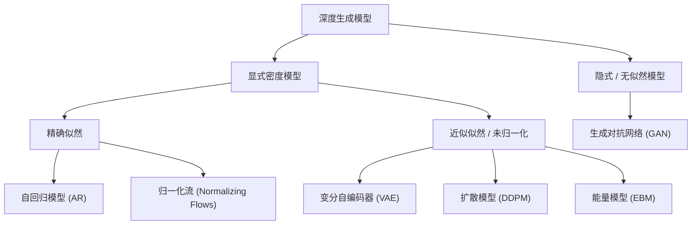

## 概率空间与随机变量

### 事件与概率测度

- **样本空间 $\Omega$**：随机试验所有基本结果构成的底层集合。
- **$\sigma$-代数 $\mathcal{F} \subseteq \mathcal{P}(\Omega)$**：满足以下三条性质的子集族：
  1. $\Omega \in \mathcal{F}$；
  2. 对补运算封闭：若 $A \in \mathcal{F}$，则 $A^c = \Omega \setminus A \in \mathcal{F}$；
  3. 对（至多）可数并运算封闭：若 $A_1, A_2, \ldots \in \mathcal{F}$，则 $\bigcup_{i \in \mathbb{N}} A_i \in \mathcal{F}$。

二元组 $(\Omega, \mathcal{F})$ 称为**可测空间**，$\mathcal{F}$ 中的元素称为**事件**——事件是 $\mathcal{F}$ 里的集合，而不是 $\Omega$ 的任意子集。

**定义（概率测度）：** 映射 $P: \mathcal{F} \to [0, 1]$ 给每个事件分配一个概率，若满足以下三条公理，则称 $P$ 为概率测度，三元组 $(\Omega, \mathcal{F}, P)$ 称为**概率空间**：

1. **非负性**：$\forall A \in \mathcal{F},\; P(A) \ge 0$；
2. **可数可加性**：对两两不相交的事件序列 $\{A_i\}_{i \in \mathbb{N}} \subseteq \mathcal{F}$，有
   $$
   P\!\left(\bigsqcup_{i \in \mathbb{N}} A_i\right) = \sum_{i \in \mathbb{N}} P(A_i);
   \tag{1}
   $$
3. **全空间测度为 1**：$P(\Omega) = 1$。

#### 例 1：抛硬币（$\mathcal{F}$ 取幂集）

抛一枚硬币，样本空间为 $\Omega = \{H, T\}$（$H$ 表示正面，$T$ 表示反面）。有限样本空间上通常取 $\mathcal{F} = \mathcal{P}(\Omega)$，即所有子集都是事件：

$$
\mathcal{F} = \{\varnothing, \{H\}, \{T\}, \Omega\}.
$$

- $\{H\}$：出现正面；$\{T\}$：出现反面；
- $\Omega$：必然事件；$\varnothing$：不可能事件；
- 公平硬币下，$P(\{H\}) = P(\{T\}) = \frac{1}{2}$，$P(\Omega) = 1$，$P(\varnothing) = 0$。

#### 例 2：只观测骰子的奇偶（$\mathcal{F}$ 不必是幂集）

掷一枚六面骰子，但只记录点数的奇偶性：

$$
\Omega = \{1, 2, 3, 4, 5, 6\},
\qquad
\mathcal{F} = \{\varnothing, \{1, 3, 5\}, \{2, 4, 6\}, \Omega\}.
$$

容易验证 $\mathcal{F}$ 是 $\sigma$-代数：包含 $\Omega$，对补封闭（奇数的补集是偶数），对可数并封闭。

- $\{1, 3, 5\} \in \mathcal{F}$ 是事件“点数为奇数”；
- $\{1\} \notin \mathcal{F}$ **不是事件**——当前观测信息无法把点数 $1$ 与 $3, 5$ 区分开；
- 公平骰子下，$P(\{1, 3, 5\}) = P(\{2, 4, 6\}) = \frac{1}{2}$。

#### 例 3：连续样本空间与均匀分布

考虑区间上的连续均匀分布：

$$
\Omega = [0, 1],
\qquad
\mathcal{F} = \mathcal{B}([0, 1]),
\qquad
P((a, b]) = b - a,
$$

其中 $\mathcal{B}([0, 1])$ 是由开集生成的 Borel $\sigma$-代数，$P$ 为限制在 $[0, 1]$ 上的 Lebesgue 测度。

- 区间 $(1/3, 2/3) \in \mathcal{F}$，且 $P((1/3, 2/3)) = 1/3$；
- 单点集 $\{x\} \in \mathcal{F}$，但 $P(\{x\}) = 0$；
- 此时 $\mathcal{F} \neq \mathcal{P}(\Omega)$：连续空间上存在不可测子集，不能将幂集中的所有子集都赋予满足平移不变与可数可加性的测度。在深度生成建模中，通常取 $\Omega = \mathbb{R}^d$、$\mathcal{F} = \mathcal{B}(\mathbb{R}^d)$，数据分布即其上的概率测度 $P$。

### Vitali 不可测集及其群作用推广

Lebesgue 测度 $m$ 满足两条基本性质：

- **可数可加性**：可数个互不相交的可测集之并，测度等于各集合测度之和；
- **平移不变性**：对任意可测集 $E$ 与实数 $t$，有 $m(E + t) = m(E)$。

在 $[0, 1]$ 上定义等价关系：

$$
x \sim y \iff x - y \in \mathbb{Q},
$$

即两个实数等价当且仅当它们之差为有理数。该关系将 $[0, 1]$ 划分为互不相交的等价类，每个等价类形如 $\{x + q \mid q \in \mathbb{Q},\; x + q \in [0, 1]\}$。由于 $\mathbb{Q}$ 可数而 $[0, 1]$ 不可数，每个等价类是可数集，而等价类的个数不可数。

**定义（Vitali 集）：** 由选择公理，从每个等价类中恰好选出一个代表元，这些代表元构成的集合 $V \subseteq [0, 1]$ 与每个等价类恰好交于一点，称 $V$ 为 **Vitali 集**。

**定理（Vitali 集不可测）：** Vitali 集 $V$ 不是 Lebesgue 可测集。

> [!note]- 证明
> 反设 $V$ 是 Lebesgue 可测集。对每个有理数 $q \in \mathbb{Q} \cap [-1, 1]$，定义平移集
>
> $$
> V_q := V + q = \{v + q \mid v \in V\}.
> $$
>
> 集合族 $\{V_q\}_{q \in \mathbb{Q} \cap [-1, 1]}$ 具有以下两条性质：
>
> 1. **两两互不相交：** 若 $V_q \cap V_{q'} \neq \varnothing$，则存在 $v, v' \in V$ 使得 $v + q = v' + q'$，从而 $v - v' = q' - q \in \mathbb{Q}$，即 $v \sim v'$。由于 $V$ 在每个等价类中仅含唯一代表元，必有 $v = v'$，进而 $q = q'$。
> 2. **夹逼 $[0, 1]$：** 对任意 $x \in [0, 1]$，设 $v \in V$ 是 $x$ 所在等价类的代表元，则 $q := x - v \in \mathbb{Q}$。因为 $x, v \in [0, 1]$，必有 $q \in [-1, 1]$，且 $x = v + q \in V_q$。另一方面，由 $V \subseteq [0, 1]$ 与 $q \in [-1, 1]$ 可知 $V_q \subseteq [-1, 2]$。因此
>    $$
>    [0, 1] \subseteq \bigsqcup_{q \in \mathbb{Q} \cap [-1, 1]} V_q \subseteq [-1, 2].
>    $$
>
> 由 Lebesgue 测度的平移不变性，每个 $V_q$ 均可测且 $m(V_q) = m(V)$。再由可数可加性与单调性：
>
> $$
> 1 = m([0, 1]) \le m\!\left(\bigsqcup_{q \in \mathbb{Q} \cap [-1, 1]} V_q\right) = \sum_{q \in \mathbb{Q} \cap [-1, 1]} m(V_q) = \sum_{q \in \mathbb{Q} \cap [-1, 1]} m(V) \le m([-1, 2]) = 3.
> $$
>
> 然而 $\mathbb{Q} \cap [-1, 1]$ 是可数无穷集：若 $m(V) = 0$，则无穷级数之和为 $0$，与 $\ge 1$ 矛盾；若 $m(V) > 0$，则无穷级数之和为 $+\infty$，与 $\le 3$ 矛盾。因此 $V$ 不可测。$\square$

上述构造可以推广到一般群作用下的测度空间。

**定义（轨道与横截面）：** 设群 $G$ 作用于集合 $X$。点 $x \in X$ 的**轨道**定义为 $G \cdot x := \{g \cdot x \mid g \in G\}$。全体轨道构成 $X$ 的一个划分，商集记为 $X / G$。若子集 $V \subseteq X$ 与每条轨道恰好交于一点（等价地，商映射 $X \to X / G$ 限制在 $V$ 上是双射），则称 $V$ 为该作用的**横截面**（transversal）。Vitali 集即有理平移作用下的横截面。

**定理（群作用下的不可测横截面）：** 设 $(X, \mathcal{M}, \mu)$ 为测度空间，可数无限群 $G$ 自由地作用于 $X$。假设对每个 $g \in G$：

1. 映射 $x \mapsto g \cdot x$ 保持可测性，即 $E \in \mathcal{M} \implies gE \in \mathcal{M}$；
2. 测度 $\mu$ 在群作用下不变，即 $\mu(gE) = \mu(E)$。

设 $V$ 为该作用的横截面。若存在可数无限子集 $H \subseteq G$ 以及可测集 $B, C \in \mathcal{M}$，使得

$$
B \subseteq \bigcup_{g \in H} gV \subseteq C,
\qquad
0 < \mu(B) \le \mu(C) < +\infty,
$$

则横截面 $V \notin \mathcal{M}$。

> [!note]- 证明
> 先证集合族 $\{gV : g \in G\}$ 两两不相交。若 $gV \cap hV \neq \varnothing$，则存在 $v, w \in V$ 使得 $g \cdot v = h \cdot w$，说明 $v$ 与 $w$ 位于同一轨道；由横截面定义得 $v = w$，再由群作用的自由性得 $g = h$。
>
> 反设 $V \in \mathcal{M}$。则对每个 $g \in H$，$gV \in \mathcal{M}$ 且 $\mu(gV) = \mu(V)$。因 $H$ 可数无穷且 $\{gV\}_{g \in H}$ 两两不交，由可数可加性得
>
> $$
> \mu\!\left(\bigsqcup_{g \in H} gV\right) = \sum_{g \in H} \mu(gV) = \sum_{g \in H} \mu(V).
> $$
>
> 由夹逼条件，上式左端落在 $[\mu(B), \mu(C)] \subseteq (0, +\infty)$ 内。但 $H$ 是可数无限集：若 $\mu(V) = 0$ 则右端为 $0$；若 $\mu(V) > 0$ 则右端为 $+\infty$，均产生矛盾。故 $V \notin \mathcal{M}$。$\square$

### 随机变量与随机向量

**定义（可测映射与随机变量）：** 设 $(\Omega, \mathcal{F})$ 与 $(S, \mathcal{S})$ 是可测空间。若映射 $X: \Omega \to S$ 满足

$$
\forall B \in \mathcal{S},
\qquad
X^{-1}(B) := \{\omega \in \Omega : X(\omega) \in B\} \in \mathcal{F},
\tag{2}
$$

则称 $X$ 为**可测映射**。

- 当 $(S, \mathcal{S}) = (\mathbb{R}, \mathcal{B}(\mathbb{R}))$ 时，$X$ 称为**随机变量**（random variable）；
- 当 $(S, \mathcal{S}) = (\mathbb{R}^d, \mathcal{B}(\mathbb{R}^d))$ 时，$\mathbf{x}$ 称为 **$d$ 维随机向量**（random vector）。

随机变量的本质不是“随机的数”，而是将抽象样本空间中的元素映射为可观测数值的确定性可测函数。可测性保证了观测空间中任意事件 $B \in \mathcal{S}$ 的原像都是 $\mathcal{F}$ 中的事件，从而由

$$
P_X(B) := P\!\left(X^{-1}(B)\right)
\tag{3}
$$

在观测空间 $(S, \mathcal{S})$ 上良定义了 $X$ 的诱导概率分布。

- **抛硬币中的随机变量**：在 $\Omega = \{H, T\}$、$\mathcal{F} = \mathcal{P}(\Omega)$ 上定义 $X(H) = 1, X(T) = 0$。事件“出现正面”即 $\{H\} = X^{-1}(\{1\})$；公平硬币下 $P(X = 1) = P(X = 0) = 1/2$，即 $X \sim \mathrm{Bernoulli}(1/2)$。
- **骰子奇偶中的可测性辨析**：沿用 $\Omega = \{1,2,3,4,5,6\}$ 与 $\mathcal{F} = \{\varnothing, \{1,3,5\}, \{2,4,6\}, \Omega\}$。定义
  $$
  Y(\omega) = \begin{cases} 1, & \omega \text{ 为奇数}, \\ 0, & \omega \text{ 为偶数}, \end{cases}
  $$
  则 $Y$ 是关于 $\mathcal{F}$ 的可测随机变量；但恒等映射 $X(\omega) = \omega$ **不是**从 $(\Omega, \mathcal{F})$ 到 $(\mathbb{R}, \mathcal{B}(\mathbb{R}))$ 的可测映射，因为单点原像 $X^{-1}(\{1\}) = \{1\} \notin \mathcal{F}$。
- **图像作为随机向量**：连续数据样本通常建模为随机向量 $\mathbf{x}: \Omega \to \mathbb{R}^d$。例如灰度图像可表示为 $\mathbf{x} \in [0, 1]^{H \times W}$，而“图像平均亮度大于 $1/2$”对应样本空间中的事件
  $$
  \left\{\omega \in \Omega : \frac{1}{HW}\sum_{i=1}^{HW} x_i(\omega) > \frac{1}{2}\right\}.
  $$

## 采样基础与逆变换采样

### 生成模型采样的评价维度

用来近似真实数据分布的代理模型通常需要兼顾以下五个维度：

1. **逼真性（Fidelity）**：生成样本符合真实数据的结构与语义，难以与真实样本区分；
2. **多样性（Diversity）**：覆盖真实分布中的不同模式（modes），而非简单记忆训练样本或坍缩在少数模式上；
3. **可控性（Controllability）**：能够根据类别、文本或属性等条件引导生成内容；
4. **计算效率（Efficiency）**：训练与采样在时间和存储开销上可承受，能够扩展到高维数据；
5. **似然可评估性（Likelihood Evaluation）**：能够精确或近似计算 $\log p_\phi(\mathbf{x})$，用于模型比较或异常检测。

### 均匀分布伪随机采样

计算机中的随机采样建立在均匀分布伪随机数生成器（PRNG, Pseudo-Random Number Generator）之上：通过确定性的递推公式，产生一个周期极长、统计性质接近 $\mathrm{Uniform}(0, 1)$ 的数列（如线性同余生成器 LCG、梅森旋转算法 Mersenne Twister）。

以**线性同余生成器（LCG）**为例，其内部整数状态由以下同余方程递推更新（常以系统时钟作为初始种子 $X_0$）：

$$
X_{n+1} = (a X_n + c) \bmod m,
\qquad
U_n = \frac{X_n}{m} \in [0, 1).
\tag{4}
$$

### 累积分布函数与逆变换采样

**定义（累积分布函数，CDF）：** 设 $X: \Omega \to \mathbb{R}$ 是概率空间 $(\Omega, \mathcal{F}, P)$ 上的实值随机变量，其累积分布函数定义为

$$
F_X(x) := P(X \le x) = P\!\left(X^{-1}((-\infty, x])\right),
\qquad
x \in \mathbb{R}.
\tag{5}
$$

累积分布函数唯一确定 $X$ 的概率分布，且满足：

1. $F_X$ 单调不减且右连续；
2. $\lim_{x \to -\infty} F_X(x) = 0$，$\lim_{x \to +\infty} F_X(x) = 1$。

当目标分布的 CDF $F(x)$ 不严格单调递增（存在水平平台期）或不连续（如离散分布）时，普通反函数不存在。为此引入**广义逆函数（分位数函数）**：

$$
F^{-1}(u) := \inf\{x \in \mathbb{R} : F(x) \ge u\},
\qquad
u \in (0, 1).
\tag{6}
$$

**命题（广义逆函数的单调保序性质）：** 对任意累积分布函数 $F$、任意 $u \in (0, 1)$ 与 $x \in \mathbb{R}$，有

$$
F^{-1}(u) \le x \iff u \le F(x).
\tag{7}
$$

> [!note]- 证明
> 记集合 $A_u := \{y \in \mathbb{R} : F(y) \ge u\}$，则广义逆定义为下确界 $F^{-1}(u) = \inf A_u$。
>
> - **充分性（$\implies$）：** 设 $F^{-1}(u) = \inf A_u \le x$。由下确界的定义，对任意正整数 $n \ge 1$，存在 $y_n \in A_u$ 使得 $y_n < x + \frac{1}{n}$。因为 $y_n \in A_u$，故 $F(y_n) \ge u$；又由 $F$ 的单调不减性，有
>   $$
>   u \le F(y_n) \le F\!\left(x + \frac{1}{n}\right).
>   $$
>   令 $n \to \infty$，由 $F$ 的**右连续性**及极限保序性，即得 $u \le F(x)$。
> - **必要性（$\Longleftarrow$）：** 设 $u \le F(x)$。由 $A_u$ 的定义可知 $x \in A_u$。既然 $x$ 属于集合 $A_u$，它必然大于或等于该集合的下确界，即 $\inf A_u = F^{-1}(u) \le x$。$\square$

**定理（逆变换采样）：** 设 $U \sim \mathrm{Uniform}(0, 1)$，令随机变量 $X = F^{-1}(U)$，则 $X$ 的累积分布函数恰好为 $F$。

> [!note]- 证明
> 对任意 $x \in \mathbb{R}$，由广义逆函数的保序性质 (7) 及 $U$ 在 $(0, 1)$ 上的均匀分布性质，有
>
> $$
> P(X \le x) = P\!\left(F^{-1}(U) \le x\right) = P\!\left(U \le F(x)\right) = F(x).
> $$
>
> 第一步由均匀分布提供基础概率质量，第二步通过分位数函数将其重排为目标分布。$\square$

### Box-Muller 变换

逆变换采样在一维情形需要已知 $F^{-1}$。对于标准正态分布，虽然一维高斯 CDF 没有初等函数闭式逆，但可以通过二维极坐标变换实现精确采样。

**定理（Box-Muller 变换）：** 设 $U_1, U_2 \sim \mathrm{Uniform}(0, 1)$ 独立同分布，定义

$$
\begin{cases}
Z_1 = \sqrt{-2\ln U_1}\cos(2\pi U_2), \\[4pt]
Z_2 = \sqrt{-2\ln U_1}\sin(2\pi U_2),
\end{cases}
\tag{8}
$$

则 $Z_1, Z_2 \sim \mathcal{N}(0, 1)$ 且相互独立。

> [!note]- 证明
> 分四步推导该变换。
>
> **第一步：极坐标变换与雅可比行列式。** 设 $(Z_1, Z_2)$ 是两个相互独立的标准正态随机变量，其联合概率密度函数为
>
> $$
> f_{Z_1, Z_2}(z_1, z_2) = \frac{1}{2\pi}e^{-(z_1^2 + z_2^2)/2}.
> $$
>
> 引入极坐标变换 $g: (r, \theta) \mapsto (z_1, z_2)$，其中 $z_1 = r\cos\theta,\; z_2 = r\sin\theta$（$r \ge 0,\; \theta \in [0, 2\pi)$）。其雅可比矩阵与行列式为
>
> $$
> Dg(r, \theta) = \begin{pmatrix}
> \dfrac{\partial z_1}{\partial r} & \dfrac{\partial z_1}{\partial \theta} \\[6pt]
> \dfrac{\partial z_2}{\partial r} & \dfrac{\partial z_2}{\partial \theta}
> \end{pmatrix}
> = \begin{pmatrix}
> \cos\theta & -r\sin\theta \\
> \sin\theta & r\cos\theta
> \end{pmatrix},
> \qquad
> |J| = |\det Dg(r, \theta)| = r(\cos^2\theta + \sin^2\theta) = r.
> $$
>
> 因此极坐标随机变量 $(R, \Theta)$ 的联合密度为
>
> $$
> f_{R, \Theta}(r, \theta)
> = f_{Z_1, Z_2}(r\cos\theta, r\sin\theta)\cdot |J|
> = \frac{r}{2\pi}e^{-r^2/2},
> \qquad
> r \ge 0,\; \theta \in [0, 2\pi).
> $$
>
> **第二步：边缘分布分解与独立性。** 联合密度可以拆成仅含 $r$ 与仅含 $\theta$ 的两个归一化密度的乘积：
>
> $$
> f_{R, \Theta}(r, \theta)
> = \underbrace{\left(r e^{-r^2/2}\right)}_{f_R(r)} \cdot \underbrace{\left(\frac{1}{2\pi}\right)}_{f_\Theta(\theta)}.
> $$
>
> 这说明径向变量 $R$ 与角度变量 $\Theta$ 相互独立，其中：
>
> - $\Theta \sim \mathrm{Uniform}(0, 2\pi)$，密度为 $f_\Theta(\theta) = \frac{1}{2\pi}$；
> - $R$ 服从瑞利分布（Rayleigh distribution），密度为 $f_R(r) = r e^{-r^2/2}\;(r \ge 0)$。
>
> **第三步：对 $R$ 与 $\Theta$ 分别做逆变换采样。**
>
> - 对 $\Theta$，其 CDF 为 $F_\Theta(\theta) = \frac{\theta}{2\pi}$。取 $U_2 \sim \mathrm{Uniform}(0, 1)$，令 $\frac{\Theta}{2\pi} = U_2$，得 $\Theta = 2\pi U_2$；
> - 对 $R$，其 CDF 为
>   $$
>   F_R(r) = \int_0^r x e^{-x^2/2}\,dx = 1 - e^{-r^2/2}.
>   $$
>   取独立于 $U_2$ 的 $\tilde{U}_1 \sim \mathrm{Uniform}(0, 1)$，令 $1 - e^{-R^2/2} = \tilde{U}_1$。由于 $U_1 := 1 - \tilde{U}_1$ 仍服从 $\mathrm{Uniform}(0, 1)$，直接令 $e^{-R^2/2} = U_1$，反解即得 $R = \sqrt{-2\ln U_1}$。
>
> **第四步：反向映射回直角坐标。** 将采样得到的 $R = \sqrt{-2\ln U_1}$ 与 $\Theta = 2\pi U_2$ 代回 $Z_1 = R\cos\Theta,\; Z_2 = R\sin\Theta$，即得两个相互独立的标准正态随机变量 (8)。$\square$

## 深度生成建模：神经网络作为推前测度

逆变换采样和 Box-Muller 变换解决了简单分布（如一维分布、高斯分布）的采样问题。然而，面对图像、音频等高维且几何流形极度复杂的未知多峰分布 $P_{\mathrm{data}}$，我们既无法得知其显式的累积分布函数，也无法直接求逆。

深度生成模型的核心思想是：用神经网络学习一个复杂的可测映射 $G_\phi: \mathbb{R}^k \to \mathbb{R}^d$，把易于采样的基础分布变换为目标分布：

$$
\mathbf{z} \sim P_Z = \mathcal{N}(\mathbf{0}, \mathbf{I}),
\qquad
\mathbf{x} = G_\phi(\mathbf{z}).
\tag{9}
$$

**定义（推前测度，Pushforward Measure）：** 设 $(S, \mathcal{S})$ 与 $(Y, \mathcal{Y})$ 是可测空间，$\mu$ 是 $(S, \mathcal{S})$ 上的测度，$f: S \to Y$ 是可测映射。定义在 $(Y, \mathcal{Y})$ 上的测度

$$
(f_* \mu)(B) := \mu\!\left(f^{-1}(B)\right),
\qquad
\forall B \in \mathcal{Y},
\tag{10}
$$

称为测度 $\mu$ 经映射 $f$ 的**推前测度**。直观上，目标空间中集合 $B$ 分配到的测度质量，等于其原像 $f^{-1}(B)$ 在源空间中的测度质量。特别地，随机变量 $X: \Omega \to \mathbb{R}^d$ 的分布正是概率测度 $P$ 的推前测度 $P_X = X_* P$。

在深度生成模型中：

- **确定性来自网络**：参数 $\phi$ 固定后，相同的潜变量 $\mathbf{z}$ 总是映射为相同的 $\mathbf{x}$，网络本身不产生随机性；
- **随机性来自输入**：反复独立采样 $\mathbf{z} \sim P_Z$ 并经过 $G_\phi$，从而产生多样化的样本；
- **模型分布来自推前**：$G_\phi$ 将基础分布 $P_Z$ 的概率质量在数据空间重新排列，诱导模型分布
  $$
  P_\phi = (G_\phi)_* P_Z,
  \qquad
  P_\phi(B) = P_Z\!\left(G_\phi^{-1}(B)\right).
  \tag{11}
  $$

训练的目标是调节参数 $\phi$ 使得 $(G_\phi)_* P_Z \approx P_{\mathrm{data}}$；采样则是先抽取基础噪声，再执行一次或多次神经网络变换。

## 度量分布差异与参数学习

### 总体目标与经验训练

设观测数据集为独立同分布样本 $\mathcal{D} = \{\mathbf{x}^{(i)}\}_{i=1}^N$，其中 $\mathbf{x}^{(i)} \sim P_{\mathrm{data}}$。我们只能访问有限样本 $\mathcal{D}$，无法直接访问真实的 $P_{\mathrm{data}}$。参数 $\phi \in \Phi$ 定义了候选模型分布族 $\{P_\phi : \phi \in \Phi\}$（当概率密度存在时记为 $p_\phi(\mathbf{x})$）。

在总体层面，学习目标可写为最小化某种分布差异准则 $D$：

$$
\phi^* \in \operatorname*{arg\,min}_{\phi \in \Phi} D(P_{\mathrm{data}}, P_\phi).
\tag{12}
$$

“学习分布”不是背诵训练集，而是学习能够生成新样本的概率规律。由于 $P_{\mathrm{data}}$ 未知，实际训练中必须利用数据集 $\mathcal{D}$（必要时结合模型生成样本）构造可计算的经验损失，并通过梯度下降求得近似解 $\hat{\phi}$。

### 前向 KL 散度与最大似然估计（MLE）

设 $P_{\mathrm{data}}$ 与 $P_\phi$ 相对于同一基准测度分别具有密度 $p_{\mathrm{data}}$ 与 $p_\phi$。**前向 KL 散度**定义为

$$
\begin{aligned}
D_{\mathrm{KL}}(P_{\mathrm{data}} \parallel P_\phi)
&:= \int p_{\mathrm{data}}(\mathbf{x}) \ln\frac{p_{\mathrm{data}}(\mathbf{x})}{p_\phi(\mathbf{x})}\,d\mathbf{x} \\
&= \mathbb{E}_{\mathbf{x} \sim P_{\mathrm{data}}}\!\left[\ln p_{\mathrm{data}}(\mathbf{x}) - \ln p_\phi(\mathbf{x})\right].
\end{aligned}
\tag{13}
$$

- **非负性**：$D_{\mathrm{KL}}(P_{\mathrm{data}} \parallel P_\phi) \ge 0$，且等号成立当且仅当 $P_{\mathrm{data}} = P_\phi$（几乎处处）；
- **非对称性**：一般而言，$D_{\mathrm{KL}}(P_{\mathrm{data}} \parallel P_\phi) \neq D_{\mathrm{KL}}(P_\phi \parallel P_{\mathrm{data}})$。

#### 例：两个伯努利分布的 KL 散度

设 $P_{\mathrm{data}} = \mathrm{Bernoulli}(p)$，$P_\phi = \mathrm{Bernoulli}(q)$，其中 $p, q \in (0, 1)$，即 $p_{\mathrm{data}}(1) = p,\; p_{\mathrm{data}}(0) = 1 - p$，$p_\phi(1) = q,\; p_\phi(0) = 1 - q$。离散情形下积分化为求和：

$$
D_{\mathrm{KL}}(P_{\mathrm{data}} \parallel P_\phi)
= \sum_{x \in \{0, 1\}} p_{\mathrm{data}}(x) \ln\frac{p_{\mathrm{data}}(x)}{p_\phi(x)}
= p\ln\frac{p}{q} + (1 - p)\ln\frac{1 - p}{1 - q}.
$$

取具体数值 $p = \frac{1}{2}$，$q = \frac{1}{4}$，正向与反向 KL 分别为：

$$
\begin{aligned}
D_{\mathrm{KL}}(P_{\mathrm{data}} \parallel P_\phi)
&= \frac{1}{2}\ln\frac{1/2}{1/4} + \frac{1}{2}\ln\frac{1/2}{3/4}
= \frac{1}{2}\ln 2 + \frac{1}{2}\ln\frac{2}{3}
= \frac{1}{2}\ln\frac{4}{3}, \\[6pt]
D_{\mathrm{KL}}(P_\phi \parallel P_{\mathrm{data}})
&= \frac{1}{4}\ln\frac{1/4}{1/2} + \frac{3}{4}\ln\frac{3/4}{1/2}
= \frac{3}{4}\ln\frac{3}{2} - \frac{1}{4}\ln 2.
\end{aligned}
$$

可以看到两个方向均严格为正，但 $\frac{1}{2}\ln\frac{4}{3} \neq \frac{3}{4}\ln\frac{3}{2} - \frac{1}{4}\ln 2$，体现了 KL 散度的非对称性。

#### 模式覆盖倾向（Mass-Covering）

前向 KL 的期望取在真实分布 $P_{\mathrm{data}}$ 下，因此凡是真实分布具有正概率质量的区域都会对损失产生贡献。特别地，若存在事件 $A$ 使得

$$
P_{\mathrm{data}}(A) > 0,
\qquad
P_\phi(A) = 0,
$$

则 $P_{\mathrm{data}}$ 不绝对连续于 $P_\phi$，此时 $D_{\mathrm{KL}}(P_{\mathrm{data}} \parallel P_\phi) = +\infty$。这意味着前向 KL 会强烈惩罚“漏掉真实数据模式”的行为，迫使模型分布向外铺开以覆盖所有真实模式（具有质量覆盖倾向）。

#### 最小化前向 KL 等价于最大似然估计

定义真实分布相对于模型的交叉熵 $H(P_{\mathrm{data}}, P_\phi) := -\mathbb{E}_{\mathbf{x} \sim P_{\mathrm{data}}}[\ln p_\phi(\mathbf{x})]$，以及真实分布自身的熵 $H(P_{\mathrm{data}}) := -\mathbb{E}_{\mathbf{x} \sim P_{\mathrm{data}}}[\ln p_{\mathrm{data}}(\mathbf{x})]$。由 (13) 可知：

$$
D_{\mathrm{KL}}(P_{\mathrm{data}} \parallel P_\phi) = H(P_{\mathrm{data}}, P_\phi) - H(P_{\mathrm{data}}).
\tag{14}
$$

由于 $H(P_{\mathrm{data}})$ 与模型参数 $\phi$ 无关，最小化前向 KL 散度等价于最大化真实数据的期望对数似然：

$$
\operatorname*{arg\,min}_\phi D_{\mathrm{KL}}(P_{\mathrm{data}} \parallel P_\phi)
= \operatorname*{arg\,max}_\phi \mathbb{E}_{\mathbf{x} \sim P_{\mathrm{data}}}[\ln p_\phi(\mathbf{x})].
\tag{15}
$$

在实际训练中，用有限样本 $\{\mathbf{x}^{(i)}\}_{i=1}^N$ 对期望做蒙特卡洛近似，即得到经验最大似然估计（MLE）的负对数似然损失：

$$
\hat{\mathcal{L}}_{\mathrm{MLE}}(\phi) = -\frac{1}{N}\sum_{i=1}^N \ln p_\phi(\mathbf{x}^{(i)}).
\tag{16}
$$

### $f$-散度与 Fisher 散度

**定义（$f$-散度）：** 设 $p(\mathbf{x})$ 和 $q(\mathbf{x})$ 是样本空间 $\Omega$ 上的两个概率密度函数。给定满足：

1. $f: \mathbb{R}_+ \to \mathbb{R}$ 是凸函数；
2. $f(1) = 0$

的生成函数 $f$，定义 $p$ 相对于 $q$ 的 **$f$-散度**为

$$
\mathcal{D}_f(p \parallel q) := \int q(\mathbf{x})\,f\!\left(\frac{p(\mathbf{x})}{q(\mathbf{x})}\right) d\mathbf{x}
= \mathbb{E}_{\mathbf{x} \sim q}\!\left[f\!\left(\frac{p(\mathbf{x})}{q(\mathbf{x})}\right)\right].
\tag{17}
$$

**定理（$f$-散度的非负性）：** 若 $f(u)$ 是凸函数且 $f(1) = 0$，则对任意两个概率分布 $p$ 和 $q$，都有

$$
\mathcal{D}_f(p \parallel q) \ge 0.
\tag{18}
$$

若进一步假设 $f$ 在 $u = 1$ 处严格凸，则 $\mathcal{D}_f(p \parallel q) = 0$ 当且仅当 $p(\mathbf{x}) = q(\mathbf{x})$ 几乎处处成立。

> [!note]- 证明
> 设 $p \ll q$，记似然比随机变量 $U(\mathbf{x}) := \frac{p(\mathbf{x})}{q(\mathbf{x})}$。因为 $f$ 是凸函数，由 Jensen 不等式 $\mathbb{E}[f(U)] \ge f(\mathbb{E}[U])$，可将期望移入 $f$ 内部：
>
> $$
> \mathcal{D}_f(p \parallel q)
> = \mathbb{E}_{\mathbf{x} \sim q}[f(U)]
> \ge f\!\left(\mathbb{E}_{\mathbf{x} \sim q}\!\left[\frac{p(\mathbf{x})}{q(\mathbf{x})}\right]\right).
> $$
>
> 计算 $f$ 内部的期望值：
>
> $$
> \mathbb{E}_{\mathbf{x} \sim q}\!\left[\frac{p(\mathbf{x})}{q(\mathbf{x})}\right]
> = \int q(\mathbf{x})\frac{p(\mathbf{x})}{q(\mathbf{x})}\,d\mathbf{x}
> = \int p(\mathbf{x})\,d\mathbf{x}
> = 1.
> $$
>
> 代入即得 $\mathcal{D}_f(p \parallel q) \ge f(1) = 0$。当 $f$ 在 $1$ 处严格凸时，Jensen 不等式取等号当且仅当 $U(\mathbf{x}) = \frac{p(\mathbf{x})}{q(\mathbf{x})}$ 几乎处处为常数 $1$，即 $p = q$ 几乎处处成立。$\square$

**特例（由 $f$-散度导出 KL 散度）：** 取生成函数 $f(u) := u\ln u$（在 $(0, +\infty)$ 上二阶导数 $f''(u) = 1/u > 0$ 严格凸，且 $f(1) = 0$），代入 (17) 即还原出 KL 散度：

$$
\mathcal{D}_f(p \parallel q)
= \int q(\mathbf{x})\frac{p(\mathbf{x})}{q(\mathbf{x})}\ln\frac{p(\mathbf{x})}{q(\mathbf{x})}\,d\mathbf{x}
= \mathbb{E}_{\mathbf{x} \sim p}\!\left[\ln\frac{p(\mathbf{x})}{q(\mathbf{x})}\right]
= D_{\mathrm{KL}}(p \parallel q).
$$

**定义（Fisher 散度）：** 除基于密度比的 $f$-散度外，还可以通过对数密度梯度（即分数函数，score function）之差定义 **Fisher 散度**：

$$
\mathcal{D}_{\mathrm{F}}(p \parallel q)
:= \mathbb{E}_{\mathbf{x} \sim p}\!\left[\left\|\nabla_{\mathbf{x}} \ln p(\mathbf{x}) - \nabla_{\mathbf{x}} \ln q(\mathbf{x})\right\|_2^2\right].
\tag{19}
$$

由于对 $\mathbf{x}$ 求梯度消去了归一化常数，Fisher 散度是分数匹配（Score Matching）与扩散模型的重要理论基础。

### 可观测属性与积分概率度量（IPM）

在同一可测空间 $(\Omega, \mathcal{F})$ 上，两个分布相等 $P = Q$ 当且仅当 $\forall A \in \mathcal{F},\; P(A) = Q(A)$，也等价于对所有有界可测测试函数 $g$ 都有期望相等：

$$
\mathbb{E}_{\mathbf{x} \sim P}[g(\mathbf{x})] = \mathbb{E}_{\mathbf{x} \sim Q}[g(\mathbf{x})].
$$

每个测试函数 $g$ 对应分布的一种**可观测属性**，两个分布在该属性上的差异为

$$
\Delta_g(P, Q) := \left|\mathbb{E}_{\mathbf{x} \sim P}[g(\mathbf{x})] - \mathbb{E}_{\mathbf{x} \sim Q}[g(\mathbf{x})]\right|.
\tag{20}
$$

- 取 $g(\mathbf{x}) = x_i$：比较第 $i$ 个分量的均值；
- 取 $g(\mathbf{x}) = x_i x_j$：比较二阶矩；
- 取指示函数 $g = \mathbf{1}_A$：比较事件 $A$ 的概率 $|P(A) - Q(A)|$。

分布由全部可测属性共同唯一确定；仅匹配有限个低阶矩不能保证两个分布相同。

#### 例 1：同均值、同方差但分布不同

设 $P = \mathcal{N}(0, 1)$ 为标准正态分布，$Q = \mathrm{Uniform}[-a, a]$ 为区间 $[-a, a]$ 上的均匀分布（其中 $a = \sqrt{3}$，$Q$ 的密度为 $q(x) = \frac{1}{2a},\; |x| \le a$）。

> [!note]- 各阶矩的计算与比较
> **一阶矩与二阶矩：** 标准正态分布满足 $\mathbb{E}_{x \sim P}[x] = 0,\; \mathbb{E}_{x \sim P}[x^2] = 1$。对于均匀分布 $Q$，由于 $x q(x)$ 是对称区间 $[-a, a]$ 上的奇函数，有
>
> $$
> \mathbb{E}_{x \sim Q}[x] = \frac{1}{2a}\int_{-a}^a x\,dx = 0,
> \qquad
> \mathbb{E}_{x \sim Q}[x^2] = \frac{1}{2a}\int_{-a}^a x^2\,dx = \frac{1}{2a}\cdot\frac{2a^3}{3} = \frac{a^2}{3} = \frac{3}{3} = 1.
> $$
>
> 因此对测试函数 $g(x) = x$ 与 $g(x) = x^2$，均有 $\Delta_g(P, Q) = 0$。
>
> **四阶矩：** 对于均匀分布 $Q$，直接积分得
>
> $$
> \mathbb{E}_{x \sim Q}[x^4] = \frac{1}{2a}\int_{-a}^a x^4\,dx = \frac{1}{2a}\cdot\frac{2a^5}{5} = \frac{a^4}{5} = \frac{9}{5}.
> $$
>
> 对于标准正态分布 $P$，其密度 $p(x) = \frac{1}{\sqrt{2\pi}}e^{-x^2/2}$ 满足导数恒等式 $p'(x) = -x p(x)$，利用分部积分法可得
>
> $$
> \begin{aligned}
> \mathbb{E}_{x \sim P}[x^4]
> &= \int_{\mathbb{R}} x^3 \bigl(x p(x)\bigr)\,dx
> = \int_{\mathbb{R}} x^3 \bigl(-p'(x)\bigr)\,dx \\
> &= -\Bigl[x^3 p(x)\Bigr]_{-\infty}^{+\infty} + 3\int_{\mathbb{R}} x^2 p(x)\,dx \\
> &= 3\mathbb{E}_{x \sim P}[x^2] = 3.
> \end{aligned}
> $$
>
> 由此可见 $\Delta_{x^4}(P, Q) = \left|3 - \frac{9}{5}\right| = \frac{6}{5} \neq 0$，证得 $P \neq Q$。$\square$

#### 例 2：有限样本与不可观测属性

- **有限样本的局限**：用 $N$ 个独立样本可以稳定估计均值、方差等低阶矩；但如果稀有事件 $A$ 的概率 $P(A) \ll 1/N$，则 $A$ 在有限样本中几乎不会出现，$P(A)$ 无法被可靠估计。
- **不可测属性**：回到只记录骰子奇偶的设定 $\mathcal{F} = \{\varnothing, \{1,3,5\}, \{2,4,6\}, \Omega\}$，指示函数 $g = \mathbf{1}_{\{1\}}$ 不是 $\mathcal{F}$-可测函数，因此 $P(\{1\})$ 在当前信息结构下是不可观测属性。

#### 积分概率度量（IPM）

选择一个可计算的测试函数族 $\mathcal{G}$，可通过在 $\mathcal{G}$ 上取最坏情况（最能拆穿 $P = Q$ 的测试函数）定义**积分概率度量（Integral Probability Metric, IPM）**：

$$
d_{\mathcal{G}}(P, Q)
:= \sup_{g \in \mathcal{G}} \left|\mathbb{E}_{\mathbf{x} \sim P}[g(\mathbf{x})] - \mathbb{E}_{\mathbf{x} \sim Q}[g(\mathbf{x})]\right|.
\tag{21}
$$

- **上确界的意义**：它不是把不同属性上的差异平均掉，而是在允许提问的函数族 $\mathcal{G}$ 内找出最能区分 $P$ 与 $Q$ 的最强证据；
- **表达力与优化的权衡**：函数族 $\mathcal{G}$ 越丰富，区分能力越强（例如取全体指示函数族时给出总变差距离 Total Variation Distance，取 1-Lipschitz 函数族时给出 Wasserstein-1 距离），但经验估计和对抗优化也往往越困难。

## 深度生成模型分类

在抽象层面，可以把采样器使用的全部基础随机性合并为 $\boldsymbol{\epsilon} \sim P_0$，将生成过程统一写为

$$
\mathbf{x} = S_\phi(\boldsymbol{\epsilon}).
\tag{22}
$$

这里的 $S_\phi$ 既可能是一次前向神经网络映射，也可能是包含多步条件抽样、MCMC 或迭代去噪的随机算法。不同生成模型家族的本质差异体现在三个相互关联的问题上：

1. **如何表示分布？** 是显式归一化密度、未归一化能量函数，还是隐变量/推前生成过程；
2. **如何学习分布？** 是精确最大似然、变分下界（ELBO）推断、分数匹配，还是极小极大对抗博弈；
3. **如何产生样本？** 是单步直接映射、逐维自回归祖先采样、MCMC，还是多步迭代去噪。

### 1. 能量模型（Energy-Based Models, EBMs）

- **核心思想**：利用参数化能量函数 $E_\phi(\mathbf{x})$ 定义概率分布，样本越符合真实数据流形，对应的能量越低。
- **数学表达**：

$$
p_\phi(\mathbf{x}) = \frac{\exp(-E_\phi(\mathbf{x}))}{Z(\phi)},
\qquad
Z(\phi) = \int \exp(-E_\phi(\mathbf{x}))\,d\mathbf{x}.
\tag{23}
$$

由于配分函数 $Z(\phi)$ 在高维空间中难以积分，EBM 的训练通常借助对比散度（Contrastive Divergence）或分数匹配，采样则依赖朗之万动力学（Langevin Dynamics）等 MCMC 方法。

### 2. 自回归模型（Autoregressive Models, AR）

- **核心思想**：利用概率链式法则，将高维联合概率分布精确拆解为按固定顺序排列的一维条件概率的乘积。
- **数学表达**：

$$
p_\phi(\mathbf{x}) = \prod_{i=1}^D p_\phi(x_i \mid \mathbf{x}_{<i}).
\tag{24}
$$

自回归模型支持精确计算对数似然并直接通过最大似然训练，但采样时必须按维度 $x_1 \to x_2 \to \cdots \to x_D$ 串行生成。

### 3. 变分自编码器（Variational Autoencoders, VAEs）

- **核心思想**：引入潜变量 $\mathbf{z}$ 捕捉数据的潜在表示，由近似推断编码器 $q_\theta(\mathbf{z} \mid \mathbf{x})$ 和生成解码器 $p_\phi(\mathbf{x} \mid \mathbf{z})$ 共同组成（详见 [[机器学习/VAE|变分自编码器]]）。
- **数学表达**：通过最大化证据下界（ELBO）进行联合优化：

$$
\begin{aligned}
\mathcal{L}_{\mathrm{ELBO}}(\theta, \phi; \mathbf{x})
&:= \underbrace{\mathbb{E}_{\mathbf{z} \sim q_\theta(\mathbf{z} \mid \mathbf{x})}[\ln p_\phi(\mathbf{x} \mid \mathbf{z})]}_{\text{重构项 (Reconstruction)}} \\
&\quad - \underbrace{D_{\mathrm{KL}}\!\left(q_\theta(\mathbf{z} \mid \mathbf{x}) \parallel p_{\mathrm{prior}}(\mathbf{z})\right)}_{\text{正则化项 (Regularization)}}.
\end{aligned}
\tag{25}
$$

若将固定前向加噪过程作为多层隐变量推断链，则进一步演进为 [[机器学习/ddpm|去噪扩散概率模型 (DDPM)]]。

### 4. 归一化流（Normalizing Flows, NFs）

- **核心思想**：利用可微且可逆的双射变换 $f_\phi$，将简单的基础先验分布 $\mathbf{z} \sim p_{\mathrm{prior}}(\mathbf{z})$ 精确变换为复杂的数据分布 $\mathbf{x} = f_\phi(\mathbf{z})$。
- **数学表达**：由多元随机变量替换公式，模型对数似然可以精确计算：

$$
\ln p_\phi(\mathbf{x})
= \ln p_{\mathrm{prior}}\!\left(f_\phi^{-1}(\mathbf{x})\right)
+ \ln\left|\det\frac{\partial f_\phi^{-1}(\mathbf{x})}{\partial \mathbf{x}}\right|.
\tag{26}
$$

### 5. 生成对抗网络（Generative Adversarial Networks, GANs）

- **核心思想**：放弃显式定义概率密度函数（属于无似然 / Likelihood-free 模型），通过生成器 $G_\phi$ 与判别器 $D_\zeta$ 的二人零和博弈来逼近真实分布。
- **数学表达**：

$$
\min_{G_\phi} \max_{D_\zeta}\;
\mathbb{E}_{\mathbf{x} \sim p_{\mathrm{data}}}[\ln D_\zeta(\mathbf{x})]
+ \mathbb{E}_{\mathbf{z} \sim p_{\mathrm{prior}}}\!\left[\ln\bigl(1 - D_\zeta(G_\phi(\mathbf{z}))\bigr)\right].
\tag{27}
$$

在最优判别器下，训练生成器等价于最小化真实分布与生成分布之间的 Jensen-Shannon 散度（或推广为基于 IPM 的 Wasserstein GAN）。
