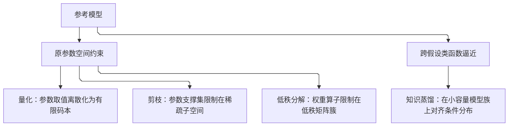

## 基本框架

给定训练好的参考模型 $f(\cdot;\boldsymbol{\theta}^\star)$，模型压缩要在更严格的存储或计算预算下构造替代模型，同时尽量保持原有的任务损失或输出分布。

设样本 $(\mathbf{x},y)$ 服从数据分布 $\mathcal{D}$，点损失为 $\ell$，参数 $\boldsymbol{\theta}\in\mathbb{R}^P$。定义期望风险

$$
\mathcal{L}(\boldsymbol{\theta})
:=
\mathbb{E}_{(\mathbf{x},y)\sim\mathcal{D}}
\big[
\ell\big(f(\mathbf{x};\boldsymbol{\theta}), y\big)
\big].
$$

设泛函 $C(\boldsymbol{\theta})$ 度量参数占用的资源（总比特数、非零参数个数或单次前向乘加次数），给定预算上限 $c$，可行集记作

$$
\mathcal{C}
:=
\{\boldsymbol{\theta}\in\mathbb{R}^P : C(\boldsymbol{\theta})\le c\}.
$$

在同一参数空间内，模型压缩可以写为约束优化问题

$$
\min_{\boldsymbol{\theta}\in\mathcal{C}}\mathcal{L}(\boldsymbol{\theta}),
$$

评价标准是相对参考参数 $\boldsymbol{\theta}^\star$ 的超额风险 $\mathcal{L}(\boldsymbol{\theta})-\mathcal{L}(\boldsymbol{\theta}^\star)$。

## 四种压缩方法

