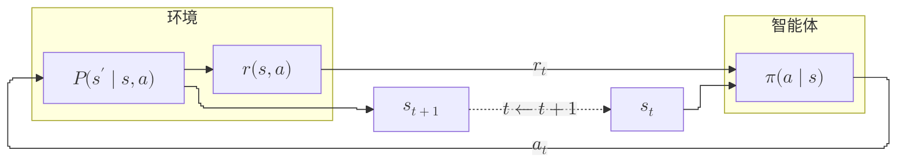

- [前置](#前置)
- [基本概念](#基本概念)
- [价值函数与优势](#价值函数与优势)
- [GAE](#gae)
  - [单步 TD 残差](#单步-td-残差)
  - [$k$ 步优势与 GAE 的动机](#k-步优势与-gae-的动机)
  - [GAE (Generalized Advantage Estimation)](#gae-generalized-advantage-estimation)
  - [GAE递归形式（工程实现）](#gae递归形式工程实现)

## 前置

- [[机器学习的分类]]

## 基本概念

强化学习不逐步提供「标准答案」，而是让**智能体**在与**环境**的反复交互中，根据奖励信号调整行为，目标是最大化长期累积回报。

- **智能体 Agent**：根据当前信息做决策的主体；在算法里通常体现为策略 $\pi(a\mid s)$ 或其参数化形式 $\pi_\theta(a\mid s)$。
- **环境 Environment**：接收智能体动作、按动力学演化并返回反馈的外部系统；步 $t$ 的转移为 $P(s_{t+1}\mid s_t,a_t)$，即时奖励 $r_t=r(s_t,a_t)$。
- **状态 State** $s_t$：时刻 $t$ 用于决策的环境信息；在马尔可夫决策过程中，未来只依赖当前 $s_t$ 而与更早历史无关。
- **动作 Action** $a_t$：智能体在步 $t$ 输出的行为。
- **奖励 Reward** $r_t$：环境给出的标量反馈；
- **策略 Policy** $\pi$：在 $s_t$ 下按 $a_t\sim\pi(\cdot\mid s_t)$ 采样动作；
- **轨迹 Trajectory** $\tau$：一次交互记录 $(s_0,a_0,s_1,a_1,\ldots)$；初始状态常记 $s_0\sim\mu(s_0)$。
- **回合 episode**：从 $s_0$ 到终止时刻 $s_T$ 的一段轨迹，后文有限步 horizon 中的 $T$ 即回合长度。

单步上，智能体观测 $s_t$、采样 $a_t$，环境据此产生奖励与新状态：

$$
s_t \xrightarrow{\;a_t\sim\pi(\cdot\mid s_t)\;} (r_t, s_{t+1}),\quad s_{t+1}\sim P(\cdot\mid s_t,a_t),\; r_t=r(s_t,a_t).
$$

令 $t\leftarrow t+1$ 并重复直至回合结束，得到轨迹 $\tau$。常用 **马尔可夫决策过程（MDP）** 五元组 $(\mathcal{S},\mathcal{A},P,r,\gamma)$ 概括问题：状态集 $\mathcal{S}$、动作集 $\mathcal{A}$、转移核 $P$、奖励函数 $r$、折扣因子 $\gamma$。

**交互循环**

在固定策略 $\pi$ 下，需用价值函数与优势度量各状态下动作的好坏；下一节给出 $G_t$、$V^\pi$、$Q^\pi$、$A^\pi$ 及策略梯度，并由此导出 PPO。

## 价值函数与优势

- **折扣累积回报** $G_t$：累计折扣回报（Discounted Cumulative Return）是指智能体从当前时间步 $t$ 开始，未来所能获得的、经过折扣衰减的所有即时奖励的总和。它的数学定义形式为：
  $$
  G_t = r_{t} + \gamma r_{t+1} + \gamma^2 r_{t+2} + \dots = \sum_{k=0}^{\infty} \gamma^k r_{t+k}
  $$
  或者在有限步任务中写到终止时刻 $T$：
  $$
  G_t = \sum_{k=0}^{T-t} \gamma^k r_{t+k}
  $$
  $G_t$ 的折扣是**相对 $t$ 的**（$r_t$ 权重为 1）
- **轨迹总回报** $R(\tau)=\sum_{t=0}^{T}\gamma^t r_t$：整条轨迹上、按绝对时间 $t$ 折扣的回报之和。
- **状态价值** $V^\pi(s)=\mathbb{E}_\pi[G_t\mid s_t=s]$ 表示从 $s$ 出发、此后按 $\pi$ 行动的期望累计回报；
- **动作价值** $Q^\pi(s,a)=\mathbb{E}_\pi[G_t\mid s_t=s,a_t=a]$ 表示在 $s$ 下先执行 $a$ 再按 $\pi$ 行动的期望回报。
- **优势函数**定义为
  $$
  A^\pi(s,a)=Q^\pi(s,a)-V^\pi(s).
  $$
  其表示在状态 $s$ 下，动作 $a$ 比策略 $\pi$ 的“平均水平”好多少或差多少。
- **策略回报** （记作 $J(\theta)$）：智能体从初始状态出发，遵循该策略与环境交互所获得的“期望累积折扣回报”。
  $$
  J(\theta) = \mathbb{E}_{\tau \sim \pi_\theta} [R(\tau)] = \mathbb{E}_{\tau \sim \pi_\theta} \left[ \sum_{t=0}^{T} \gamma^t r(s_t, a_t) \right]
  $$
- **策略梯度**：
  $$
  \nabla_\theta J(\theta)=\mathbb{E}_{\tau\sim\pi_\theta}\left[\sum_{t=0}^{T}\gamma^t\nabla_\theta\log\pi_\theta(a_t\mid s_t)\,A^\pi(s_t,a_t)\right],
  $$
  $A_t>0$ 倾向提高该动作概率，$A_t<0$ 倾向降低；$A_t\approx 0$ 表示与平均表现相近。

> [!abstract] 引理（得分函数零均值）
> 对任意状态 $s$、可微策略 $\pi_\theta(\cdot\mid s)>0$，
>
> $$
> \mathbb{E}_{a\sim\pi_\theta(\cdot\mid s)}\left[\nabla_\theta\log\pi_\theta(a\mid s)\right]=\mathbf{0}.
> $$
>
> 更一般地，对归一化族 $p(x;\theta)$ 有 $\mathbb{E}_{x\sim p}[\nabla_\theta\log p(x;\theta)]=\mathbf{0}$（得分函数期望，Score Function Expectation）。
>
> > [!note]- 证明
> > $$
> > \begin{aligned}
> > \mathbb{E}_{a}\!\left[\nabla_\theta\log\pi_\theta(a\mid s)\right]
> > &=\int \pi_\theta(a\mid s)\,\nabla_\theta\log\pi_\theta(a\mid s)\,da\\
> > &=\int \nabla_\theta\pi_\theta(a\mid s)\,da
> > =\nabla_\theta\int \pi_\theta(a\mid s)\,da
> > =\nabla_\theta(1)=\mathbf{0}.\quad\square
> > \end{aligned}
> > $$

> [!abstract] 引理（因果信用分配）
> 记 $G^{\mathrm{past}}_t=\sum_{k=0}^{t-1}\gamma^k r_k$（$t$ 之前奖励的绝对时间折扣前缀和），$r_t=r(s_t,a_t)$。由 $\sum_{k=t}^{T}\gamma^k r_k=\gamma^t G_t$ 有 $R(\tau)=G^{\mathrm{past}}_t+\gamma^t G_t$（$G_t$ 见上文定义）。则
>
> $$
> \mathbb{E}_\tau\!\left[G^{\mathrm{past}}_t\,\nabla_\theta\log\pi_\theta(a_t\mid s_t)\right]=0,
> $$
>
> 从而
>
> $$
> \mathbb{E}\!\left[\nabla_\theta\log\pi_\theta(a_t\mid s_t)\,R(\tau)\right]=\mathbb{E}\!\left[\nabla_\theta\log\pi_\theta(a_t\mid s_t)\,\gamma^t G_t\right].
> $$
>
> > [!note]- 证明
> > 给定 $s_t$ 时，$G^{\mathrm{past}}_t$ 与 $a_t$ 无关，故
> >
> > $$
> > \mathbb{E}\!\left[G^{\mathrm{past}}_t\,\nabla_\theta\log\pi_\theta(a_t\mid s_t)\right]=\mathbb{E}_{s_t}\!\left[G^{\mathrm{past}}_t\,\mathbb{E}_{a_t\sim\pi_\theta}\!\left[\nabla_\theta\log\pi_\theta(a_t\mid s_t)\right]\right]=0,
> > $$
> >
> > 后一等号由得分函数零均值得。代入 $R(\tau)=G^{\mathrm{past}}_t+\gamma^t G_t$ 即得第二式。 $\square$

> [!abstract] 引理（Baseline 无偏性）
> 若 $b(s_t)$ 只依赖 $s_t$（例如 $V^\pi(s_t)$），则
>
> $$
> \mathbb{E}\!\left[\gamma^t\nabla_\theta\log\pi_\theta(a_t\mid s_t)\,b(s_t)\right]=0.
> $$
>
> > [!note]- 证明
> > $$
> > \mathbb{E}\!\left[\gamma^t b(s_t)\,\nabla_\theta\log\pi_\theta(a_t\mid s_t)\right]=\mathbb{E}_{s_t}\!\left[\gamma^t b(s_t)\,\mathbb{E}_{a_t\sim\pi_\theta}\!\left[\nabla_\theta\log\pi_\theta(a_t\mid s_t)\right]\right]=0,
> > $$
> >
> > 仍由得分函数零均值得。 $\square$

> [!abstract] 命题（策略梯度定理）
> 设有限步轨迹 $\tau=(s_0,a_0,\ldots,s_T,a_T)$，记 $r_t=r(s_t,a_t)$，轨迹总回报 $R(\tau)=\sum_{t=0}^{T}\gamma^t r_t$（与上式 $J(\theta)$ 一致），策略 $\pi_\theta$ 可微且 $\pi_\theta(a\mid s)>0$ 于采样支撑。则
>
> $$
> \nabla_\theta J(\theta)=\mathbb{E}_{\tau\sim\pi_\theta}\left[\sum_{t=0}^{T}\gamma^t\nabla_\theta\log\pi_\theta(a_t\mid s_t)\,A^\pi(s_t,a_t)\right].
> $$
>
> 亦常写作 $\mathbb{E}_t\big[\gamma^t\nabla_\theta\log\pi_\theta(a_t\mid s_t)\,A^\pi(s_t,a_t)\big]$：先对轨迹取样、逐步求和，再与对 $t$ 的期望合并为同一期望。后文 PPO 中的 $\hat{\mathbb{E}}_t[\cdots]$ 按时间步采样，与带 $\gamma^t$ 的逐步加权属同一族目标。
>
> > [!note]- 证明
> > **1. 目标函数的梯度展开。**
> > 目标为 $J(\theta)=\mathbb{E}_{\tau\sim\pi_\theta}[R(\tau)]=\int P(\tau;\theta)R(\tau)\,d\tau$，其中 $P(\tau;\theta)$ 为在参数 $\theta$ 下整条轨迹出现的概率。在常规正则性下可将求导移入积分：
> >
> > $$
> > \nabla_\theta J(\theta)=\int \nabla_\theta P(\tau;\theta)\,R(\tau)\,d\tau.
> > $$
> >
> > **2. 对数导数技巧（Score Function Trick）。**
> > 恒等式 $\nabla_\theta f(\theta)=f(\theta)\nabla_\theta\log f(\theta)$ 给出
> >
> > $$
> > \nabla_\theta P(\tau;\theta)=P(\tau;\theta)\nabla_\theta\log P(\tau;\theta).
> > $$
> >
> > 代回并写成期望：
> >
> > $$
> > \nabla_\theta J(\theta)=\mathbb{E}_{\tau\sim\pi_\theta}\left[\nabla_\theta\log P(\tau;\theta)\,R(\tau)\right].
> > $$
> >
> >
> > **3. 拆解轨迹概率：消去环境未知项。**
> > 轨迹概率由初始分布、环境转移与策略相乘：
> >
> > $$
> > P(\tau;\theta)=\mu(s_0)\prod_{t=0}^{T}P(s_{t+1}\mid s_t,a_t)\,\pi_\theta(a_t\mid s_t).
> > $$
> >
> > 取对数后对 $\theta$ 求梯度，$\mu(s_0)$ 与 $P(s_{t+1}\mid s_t,a_t)$ 不含 $\theta$，故
> >
> > $$
> > \nabla_\theta\log P(\tau;\theta)=\sum_{t=0}^{T}\nabla_\theta\log\pi_\theta(a_t\mid s_t).
> > $$
> >
> > 代入第 2 步，得 **REINFORCE** 形式：
> >
> > $$
> > \nabla_\theta J(\theta)=\mathbb{E}\left[\sum_{t=0}^{T}\nabla_\theta\log\pi_\theta(a_t\mid s_t)\,R(\tau)\right].
> > $$
> >
> > **4. 因果律与 baseline：演进到优势函数。**
> >
> > **4.1 全期望。** 第 3 步对 $t$ 求和可逐项处理。对固定 $t$，由全期望公式，
> >
> > $$
> > \mathbb{E}_\tau\left[\nabla_\theta\log\pi_\theta(a_t\mid s_t)\,R(\tau)\right]=\mathbb{E}_{s_t,a_t}\left[\nabla_\theta\log\pi_\theta(a_t\mid s_t)\,\mathbb{E}\left[R(\tau)\mid s_t,a_t\right]\right],
> > $$
> >
> > 其中内层在固定 $s_t,a_t$ 后对轨迹其余随机性求条件期望。
> >
> > **4.2 因果与 $Q^\pi$。** 由因果信用分配引理，
> >
> > $$
> > \mathbb{E}\!\left[\nabla_\theta\log\pi_\theta(a_t\mid s_t)\,R(\tau)\right]=\mathbb{E}\!\left[\nabla_\theta\log\pi_\theta(a_t\mid s_t)\,\gamma^t G_t\right].
> > $$
> >
> > 又 $\mathbb{E}[\gamma^t G_t\mid s_t,a_t]=\gamma^t Q^\pi(s_t,a_t)$，故
> >
> > $$
> > \mathbb{E}_{s_t,a_t}\!\left[\nabla_\theta\log\pi_\theta(a_t\mid s_t)\,\mathbb{E}[\gamma^t G_t\mid s_t,a_t]\right]=\mathbb{E}\!\left[\gamma^t\nabla_\theta\log\pi_\theta(a_t\mid s_t)\,Q^\pi(s_t,a_t)\right].
> > $$
> >
> > 对 $t=0,\ldots,T$ 求和代回第 3 步得
> >
> > $$
> > \nabla_\theta J(\theta)=\mathbb{E}\!\left[\sum_{t=0}^{T}\gamma^t\nabla_\theta\log\pi_\theta(a_t\mid s_t)\,Q^\pi(s_t,a_t)\right].
> > $$
> >
> > **4.3 优势。** 
> >
> > 由 $A^\pi(s_t,a_t)=Q^\pi(s_t,a_t)-V^\pi(s_t)$，
> >
> > $$
> > \begin{aligned}
> > &\mathbb{E}\!\left[\sum_{t=0}^{T}\gamma^t\nabla_\theta\log\pi_\theta(a_t\mid s_t)\,A^\pi(s_t,a_t)\right] \\
> > &=\mathbb{E}\!\left[\sum_{t=0}^{T}\gamma^t\nabla_\theta\log\pi_\theta(a_t\mid s_t)\,Q^\pi(s_t,a_t)\right] \\
> > &\quad-\mathbb{E}\!\left[\sum_{t=0}^{T}\gamma^t\nabla_\theta\log\pi_\theta(a_t\mid s_t)\,V^\pi(s_t)\right].
> > \end{aligned}
> > $$
> >
> > 只需证明减去的第二项为 $0$。对固定的 $t$，取 $b(s_t)=V^\pi(s_t)$，由 **Baseline 无偏性引理**，
> >
> > $$
> > \mathbb{E}\!\left[\gamma^t\nabla_\theta\log\pi_\theta(a_t\mid s_t)\,V^\pi(s_t)\right]=0.
> > $$
> >
> > 对 $t=0,\ldots,T$ 求和得 $\mathbb{E}\!\big[\sum_t\gamma^t\nabla_\theta\log\pi_\theta(a_t\mid s_t)\,V^\pi(s_t)\big]=0$。
> > 因此
> > $$
> > \mathbb{E}\!\left[\sum_{t=0}^{T}\gamma^t\nabla_\theta\log\pi_\theta(a_t\mid s_t)\,Q^\pi(s_t,a_t)\right]=\mathbb{E}\!\left[\sum_{t=0}^{T}\gamma^t\nabla_\theta\log\pi_\theta(a_t\mid s_t)\,A^\pi(s_t,a_t)\right].
> > $$
> > 因此
> > $$
> > \nabla_\theta J(\theta)=\mathbb{E}\!\left[\sum_{t=0}^{T}\gamma^t\nabla_\theta\log\pi_\theta(a_t\mid s_t)\,A^\pi(s_t,a_t)\right],
> > $$
> >
> > $\square$

- **优化目标**：最大化回报（梯度上升）。最大化策略的期望累积回报 $J(\theta)$。而公式 $\nabla_\theta J(\theta)$ 正是目标函数 $J(\theta)$ 关于参数 $\theta$ 的梯度，它指向了回报增加最快的方向。因此，我们需要进行梯度上升（Gradient Ascent），更新公式为：$$\theta \leftarrow \theta + \alpha \nabla_\theta J(\theta)$$

## GAE

### 单步 TD 残差

真值 $Q^\pi,V^\pi$ 未知时，用 Critic $V_\phi(s_t)\approx V^\pi(s_t)$，并由采样构造优势。**单步 TD 残差**（即时奖励为上文约定的 $r_t$）为

$$
\delta_t=r_t+\gamma V_\phi(s_{t+1})(1-done_t)-V_\phi(s_t).
$$

### $k$ 步优势与 GAE 的动机

动作的影响往往延续多步。**$k$ 步优势估计**把未来 $k$ 个 TD 残差折扣相加：

$$
\hat{A}_t^{(k)}=\sum_{j=0}^{k-1}\gamma^j\delta_{t+j}
=\sum_{j=0}^{k-1}\gamma^j r_{t+j}+\gamma^k V(s_{t+k})-V(s_t).
$$

**广义优势估计**（GAE）不固定单一 $k$，而对各 $\hat{A}_t^{(k)}$ 做指数加权平均：

$$
\hat{A}_t^{GAE}=(1-\lambda)\sum_{k=1}^{\infty}\lambda^{k-1}\hat{A}_t^{(k)},\quad 0\le\lambda<1.
$$

对各步长 $k$，权重 $w_k=(1-\lambda)\lambda^{k-1}$ 构成公比为 $\lambda$ 的等比数列，且

$$
\sum_{k=1}^{\infty}w_k=(1-\lambda)\sum_{k=1}^{\infty}\lambda^{k-1}=1.
$$

### GAE (Generalized Advantage Estimation)

GAE 通过指数加权平均来平衡优势估计的方差与偏差。

> [!abstract] 命题（广义优势估计 GAE）
> 记单步 TD 残差为 $\delta_t = r_t + \gamma V(s_{t+1})(1-done_t) - V(s_t)$，$k$ 步优势估计为 $\hat{A}_t^{(k)} = \sum_{j=0}^{k-1} \gamma^j \delta_{t+j}$。GAE 对所有步长的优势估计作参数为 $\lambda \in [0, 1]$ 的指数加权平均，可化简为 TD 残差的幂级数求和：
>
> $$
> \hat{A}_t^{GAE} = (1-\lambda) \sum_{k=1}^{\infty} \lambda^{k-1} \hat{A}_t^{(k)} = \sum_{l=0}^{\infty} (\gamma \lambda)^l \delta_{t+l}.
> $$
>
> > [!note]- 证明
> > 将 $k$ 步优势估计 $\hat{A}_t^{(k)} = \sum_{j=0}^{k-1} \gamma^j \delta_{t+j}$ 代入指数加权平均定义，交换双重求和次序（满足 $0 \le l < k < \infty$，即 $k \ge l+1$）并计算等比级数：
> >
> > $$
> > \begin{aligned}
> > \hat{A}_t^{GAE}
> > &= (1-\lambda) \sum_{k=1}^{\infty} \lambda^{k-1} \left( \sum_{l=0}^{k-1} \gamma^l \delta_{t+l} \right) \\
> > &= (1-\lambda) \sum_{l=0}^{\infty} \gamma^l \delta_{t+l} \left( \sum_{k=l+1}^{\infty} \lambda^{k-1} \right) \\
> > &= (1-\lambda) \sum_{l=0}^{\infty} \gamma^l \delta_{t+l} \cdot \frac{\lambda^l}{1-\lambda} \\
> > &= \sum_{l=0}^{\infty} (\gamma \lambda)^l \delta_{t+l}. \quad \square
> > \end{aligned}
> > $$

### GAE递归形式（工程实现）

> [!abstract] 命题（GAE 递推形式）
> 在上一命题的记号下，令 $\hat{A}_t \equiv \hat{A}_t^{GAE}$。同一 episode 内（形式推导中暂不考虑 episode 边界）有
>
> $$
> \hat{A}_t = \delta_t + \gamma\lambda\hat{A}_{t+1}.
> $$
>
> 工程实现时防止跨 episode 传播未来信息，并取轨迹末端的边界 $\hat{A}_T = 0$（与 $V(s_{T+1})$ 的 bootstrap 约定一致；后文 PPO 伪代码中的倒序递推与此相同）：
>
> $$
> \hat{A}_t = \delta_t + (\gamma\lambda)(1-done_t)\hat{A}_{t+1}.
> $$
>
> > [!note]- 证明
> > 由已证 $\hat{A}_t = \sum_{l=0}^{\infty}(\gamma\lambda)^l\delta_{t+l}$，将 $l=0$ 与 $l \ge 1$ 拆开：
> >
> > $$
> > \begin{aligned}
> > \hat{A}_t &= \delta_t + \sum_{l=1}^{\infty}(\gamma\lambda)^l\delta_{t+l} \\
> > &= \delta_t + \gamma\lambda\sum_{l=0}^{\infty}(\gamma\lambda)^l\delta_{t+1+l}.
> > \end{aligned}
> > $$
> >
> > 换指标可见 $\hat{A}_{t+1} = \sum_{l=0}^{\infty}(\gamma\lambda)^l\delta_{t+1+l}$，故 $\hat{A}_t = \delta_t + \gamma\lambda\hat{A}_{t+1}$。
