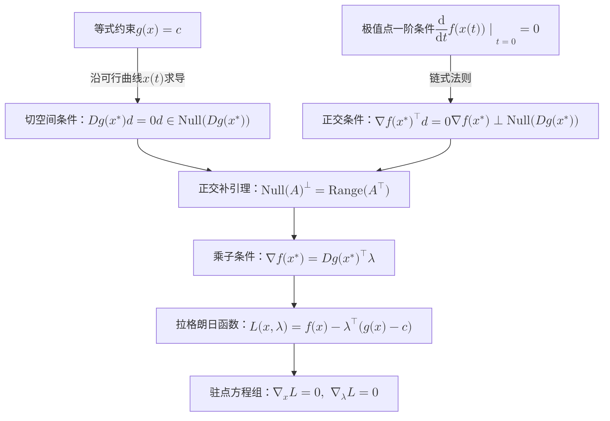

考虑含 $n$ 个变量、$m$ 个等式约束的优化问题：

$$
\begin{aligned}
\max/\min\quad & f(x_1,x_2,\ldots,x_n)\\
\text{s.t.}\quad
&g_1(x_1,x_2,\ldots,x_n)=c_1,\\
&g_2(x_1,x_2,\ldots,x_n)=c_2,\\
&\vdots\\
&g_m(x_1,x_2,\ldots,x_n)=c_m,
\end{aligned}
$$

其中 $f(x)$ 为目标函数，$g_i(x)=c_i$（$i=1,\ldots,m$）为第 $i$ 个等式约束。

将变量与约束函数写成向量形式：

$$
x=
\begin{pmatrix}
x_1\\
x_2\\
\vdots\\
x_n
\end{pmatrix}
\in\mathbb{R}^n,
\qquad
g(x)=
\begin{pmatrix}
g_1(x)\\
g_2(x)\\
\vdots\\
g_m(x)
\end{pmatrix}
\in\mathbb{R}^m,
\qquad
c=
\begin{pmatrix}
c_1\\
c_2\\
\vdots\\
c_m
\end{pmatrix}
\in\mathbb{R}^m.
$$

原问题简写为：

$$
\boxed{
\max/\min\ f(x) \qquad \text{s.t.}\quad g(x)=c
}
$$

设 $x^*$ 是一个局部约束极值点，$f$ 与 $g$ 在 $x^*$ 的某个邻域内连续可微，且满足**正则性条件**：约束函数的梯度在 $x^*$ 处线性无关。
---

## 1. 核心推导：从可行方向出发

### 1.1. 1 可行方向与切向量

变量 $x$ 的取值受限于可行集 $\{x\in\mathbb{R}^n : g(x)=c\}$。从极值点 $x^*$ 出发进行微小移动时，路径必须始终保持在可行集内。

设 $x(t)$ 为可行集上经过 $x^*$ 的一条光滑曲线，满足：

$$
x(0)=x^*,
\qquad
g(x(t))=c.
$$

记曲线在 $t=0$ 处的切向量（即移动的瞬时方向）为：

$$
d = x'(0) \in \mathbb{R}^n.
$$

由于可行集一般是弯曲流形而非平坦子空间，沿直线 $x^*+td$ 移动通常会脱离可行集，因此需要通过光滑可行曲线 $x(t)$ 在 $t=0$ 处的导数来刻画局部可行方向。

### 1.2. 2 对约束条件求导

由于沿可行曲线恒有 $g(x(t))=c$，两边对 $t$ 求导：

$$
\frac{\mathrm{d}}{\mathrm{d}t}g(x(t))=0.
$$

由多元函数链式法则：

$$
Dg(x(t))x'(t)=0.
$$

在 $t=0$ 处代入 $x(0)=x^*$ 与 $x'(0)=d$，得：

$$
\boxed{Dg(x^*)d=0}
$$

其中 $Dg(x^*)\in\mathbb{R}^{m\times n}$ 是约束映射 $g$ 在 $x^*$ 处的雅可比矩阵（Jacobian matrix），其第 $i$ 行即为 $\nabla g_i(x^*)^\top$：

$$
Dg(x^*)=
\begin{pmatrix}
\dfrac{\partial g_1}{\partial x_1} & \dfrac{\partial g_1}{\partial x_2} & \cdots & \dfrac{\partial g_1}{\partial x_n} \\[6pt]
\dfrac{\partial g_2}{\partial x_1} & \dfrac{\partial g_2}{\partial x_2} & \cdots & \dfrac{\partial g_2}{\partial x_n} \\[4pt]
\vdots & \vdots & \ddots & \vdots \\[4pt]
\dfrac{\partial g_m}{\partial x_1} & \dfrac{\partial g_m}{\partial x_2} & \cdots & \dfrac{\partial g_m}{\partial x_n}
\end{pmatrix}_{x=x^*}.
$$

从线性代数的角度看，所有可行切向量 $d$ 都属于雅可比矩阵的零空间（核空间）：

$$
\boxed{d\in\operatorname{Null}(Dg(x^*))}
$$

### 1.3. 3 极值点处目标函数沿可行方向的变化率

考虑复合函数 $t \mapsto f(x(t))$。由于 $x^*=x(0)$ 是约束极值点，单变量函数 $f(x(t))$ 在 $t=0$ 处取得局部极值，其一阶导数必为零：

$$
\left.\frac{\mathrm{d}}{\mathrm{d}t}f(x(t))\right|_{t=0}=0.
$$

由链式法则展开：

$$
\nabla f(x^*)^\top x'(0)=0 \implies \boxed{\nabla f(x^*)^\top d=0}
$$

联立约束条件与极值条件，对任意可行方向 $d$ 均有：

$$
\begin{cases}
Dg(x^*)d=0,\\
\nabla f(x^*)^\top d=0.
\end{cases}
$$

几何上，这意味着**在约束极值点处，目标函数的梯度与所有可行切方向正交**——沿着任何满足约束的切向作无穷小移动，目标函数的一阶变化率均为零。

---

## 2. 由正交补关系导出拉格朗日乘子

由第 2 节的结论，对任意 $d\in\operatorname{Null}(Dg(x^*))$，都有 $\nabla f(x^*)^\top d=0$，即：

$$
\nabla f(x^*) \perp \operatorname{Null}(Dg(x^*))
\iff
\nabla f(x^*) \in \operatorname{Null}(Dg(x^*))^\perp.
$$

利用线性代数中的基本子空间正交补定理：对任意矩阵 $A\in\mathbb{R}^{m\times n}$，其零空间的正交补等于其转置的列空间（值域）：

$$
\boxed{\operatorname{Null}(A)^\perp = \operatorname{Range}(A^\top)}
$$

令 $A=Dg(x^*)$，立即得到：

$$
\nabla f(x^*) \in \operatorname{Range}(Dg(x^*)^\top).
$$

因此，必然存在向量 $\lambda = (\lambda_1,\lambda_2,\ldots,\lambda_m)^\top \in \mathbb{R}^m$，使得：

$$
\boxed{\nabla f(x^*) = Dg(x^*)^\top \lambda = \sum_{i=1}^m \lambda_i \nabla g_i(x^*)}
$$

这就是一般形式的**拉格朗日乘子条件**：在约束极值点处，目标函数的梯度可以表示为各约束函数梯度的线性组合，组合系数 $\lambda_1,\ldots,\lambda_m$ 即为拉格朗日乘子。

---

## 3. 构造拉格朗日函数与方程组求解

为了将一阶必要条件 $\nabla f(x)=Dg(x)^\top\lambda$ 与原约束 $g(x)=c$ 统一为无约束形式的驻点方程组，定义**拉格朗日函数（Lagrangian）** $L : \mathbb{R}^n \times \mathbb{R}^m \to \mathbb{R}$：

$$
\boxed{
L(x,\lambda) = f(x) - \lambda^\top(g(x)-c) = f(x) - \sum_{i=1}^{m}\lambda_i(g_i(x)-c_i)
}
$$

### 3.1. 1 对原变量 $x$ 求梯度

对 $L(x,\lambda)$ 关于 $x$ 求梯度并令其为零：

$$
\nabla_x L(x,\lambda) = \nabla f(x) - Dg(x)^\top\lambda = 0
\iff
\boxed{\nabla f(x) = Dg(x)^\top\lambda}
$$

这直接给出了极值点的一阶必要条件（目标函数梯度由约束梯度线性表出）。

### 3.2. 2 对乘子 $\lambda$ 求梯度

对 $L(x,\lambda)$ 关于 $\lambda$ 求梯度并令其为零：

$$
\nabla_\lambda L(x,\lambda) = -(g(x)-c) = 0
\iff
\boxed{g(x) = c}
$$

这恰好恢复了原问题的等式约束。

### 3.3. 3 一般形式的完整方程组

将 $\nabla_x L = 0$ 与 $\nabla_\lambda L = 0$ 联立，得到含 $n+m$ 个未知数 $(x_1,\ldots,x_n,\lambda_1,\ldots,\lambda_m)$ 与 $n+m$ 个方程的非线性方程组：

$$
\boxed{
\begin{cases}
\nabla f(x) = Dg(x)^\top\lambda,\\
g(x) = c.
\end{cases}
}
$$

按分量展开即为：

$$
\begin{cases}
\displaystyle \frac{\partial f}{\partial x_j}(x) = \sum_{i=1}^m \lambda_i \frac{\partial g_i}{\partial x_j}(x), & j=1,2,\ldots,n, \\[10pt]
g_i(x) = c_i, & i=1,2,\ldots,m.
\end{cases}
$$

方程组的解 $(x^*,\lambda^*)$ 给出约束优化的**极值候选点（驻点）**。具体是极大值、极小值还是鞍点，需进一步借助二阶充分条件（如切空间上的投影海森矩阵正定性）或问题本身的凸性/紧性加以判定。

## 4. 总结

### 4.1. 1 完整推导逻辑链

