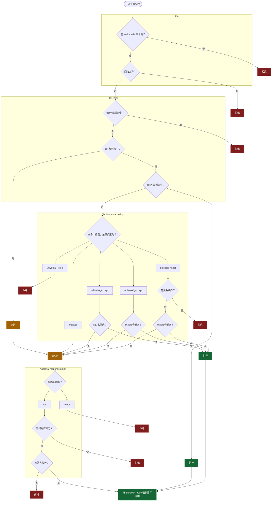

## 核心概念

- **LLM (Large Language Model)**：Agent 的“控制中心（Controller）”，负责逻辑推理、意图识别与文本生成。
- **Function Call / Tool Use**：一种连接机制。LLM 输出结构化指令（如 JSON），由宿主环境转化为具体的函数执行，使 LLM 具备操作外部世界的能力。
- **MCP (Model Context Protocol)**：由 Anthropic 发起的标准化工具调用与数据交互协议，旨在消除不同工具间的集成壁垒。

---

- **State (状态机)**：持久化存储 Agent 的长短期记忆、执行上下文及变量状态。
- **Graph (拓扑图)**：
  - **Node (节点)**：执行单元。可以是 **LLM 节点**（决策/生成）或 **Tool 节点**（执行/计算）。
  - **Edge / Route (路由)**：
    - **Hard Route (静态路由)**：基于预设条件（如 `if/else` 或状态码）的确定性跳转。
    - **Soft Route (动态路由)**：由 LLM 充当“路由器”，根据当前 State 语义化决定下一个目标节点。
- **Subgraph (子图)**：逻辑封装单元。将复杂的局部流程抽象为一个独立节点，实现架构的模块化与复用。

---

- **Skill (技能)**：针对特定业务目标封装的逻辑闭环。
  - **Soft Skill (Declarative / 声明式技能)**
    - **表现形式**：详尽的 SOP 文档、System Prompt 或带有元数据的 README。
    - **核心逻辑**：基于“提示词工程”。通过自然语言告知 LLM 执行步骤、约束条件与目标策略。
    - **运行方式**：LLM 依靠上下文理解能力（In-context Learning）在运行时动态构建执行路径。
  - **Hard Skill (Procedural / 过程式技能)**
    - **表现形式**：封装好的 **Subgraph**。拥有明确的代码逻辑、节点定义与拓扑连线。
    - **核心逻辑**：基于“工作流工程”。将复杂任务拆解为高可靠性的确定性步骤。
    - **运行方式**：Agent 以调用子程序的方式进入子图，严格遵循定义的拓扑结构执行。

---

## 提示词 (Prompt) 组织架构

- **Message (消息)**：最小交互单元，包含 `System` (系统级指令)、`User` (用户输入)、`Assistant` (AI 响应) 及 `Tool` (工具返回)。
- **Prompt (提示词)**：有序的 Message 序列，构成模型理解任务的基准。
- **Preset (预置指令)**：Agent 的“元配置”。定义核心人格、全局 MCP 规范、输出约束（如 JSON 强制格式）及底层逻辑。
- **Chat (会话)**：由时间序排列的 Message 组成的上下文窗口（Context Window）。
- **LoreBook (知识书/规则书)**：**动态上下文注入机制**。
  - 触发式加载：当用户输入命中关键词或特定场景时，自动将相关 Prompt 片段注入 Preset 或当前 Context。
  - 用途：实现 Soft Skill 的按需加载，节省上下文 Token。
- **Character Card (角色卡)**：Agent 的逻辑实体。一个角色可挂载多个 LoreBook 和 Skill（包括子图形式的 Hard Skill），形成完备的能力画像。

---

## 编程语言嵌入 (Template Engine)

为了实现 Prompt 的高度动态化与逻辑控制，采用 **EJS** 作为模板引擎：

- **转义机制**：采用 EJS 标签实现从“静态文本模式”向“逻辑执行模式”的切换。
  - `<% %>`：脚本执行（条件判断、循环等，不直接输出）。
  - `<%= %>`：输出表达式结果（HTML 转义）。
  - `<%- %>`：输出表达式结果（不转义，适用于 Prompt 原文）。
- **嵌入逻辑**：
  - **初始状态**：文本模式（Raw String）。
  - **执行状态**：遇到 EJS 标签时，引擎执行其中的 JavaScript 代码。
  - **渲染产物**：脚本执行与插值结果将被序列化并替换回原文本位置。
- **实现方案**：在 Prompt 渲染阶段接入 EJS，实时处理业务逻辑与变量插值。

## 运行时策略

一次工具调用按顺序经过能力、网络、用户规则、Tool approval policy、Approval response policy 和 Sandbox mode。拒绝在给出它的那一道结束。用户规则一旦命中，就由该规则给出结果：`deny` 拒绝，`ask` 询问，`allow` 执行。仅当三条都未命中时，Tool approval policy 才决定拒绝、询问或执行。该策略给出的询问进入 Approval response policy。规则或策略给出的执行进入 Sandbox mode，由沙箱限定这一次调用的读写范围。

这些策略各自持久保存。后一道只处理已经放行的调用，授予的能力保持在 Work mode 之内。

| 用户可见名 | 取值 |
|---|---|
| Work mode | `chat`、`ro`、`sw`、`aw`、`pl` |
| Network access policy | `on`、`off` |
| User rule | `deny`、`ask`、`allow` 三条列表 |
| Tool approval policy | `manual`、`whitelist_accept`、`blacklist_reject`、`universal_accept`、`universal_reject` |
| Approval response policy | `ask`、`never` |
| Sandbox mode | `workspace-read`、`read-only`、`workspace-write`、`danger-full-access` |

---



---

### Work mode

Work mode 划定本次会话的能力集合。工具在注册时声明自己的 capability，mode 只授予其中一部分；未授予的能力既不进模型请求，也不能执行。

| mode | `ro` | `rw` | `rw_plan` | `shell_ro` | `shell_test` | `shell_rw` |
|---|---|---|---|---|---|---|
| `chat` | – | – | – | – | – | – |
| `ro` | ✓ | – | – | ✓ | – | – |
| `sw` | ✓ | ✓ | – | ✓ | ✓ | – |
| `aw` | ✓ | ✓ | ✓ | ✓ | ✓ | ✓ |
| `pl` | ✓ | – | ✓ | ✓ | – | – |

- `chat`（chat only）不暴露任何能力工具。
- `ro`（read-only）只读文件与只读 shell。
- `sw`（semi-write）可以写文件，可以运行只读 shell 与 scratch 测试 shell，但不提供可写工作区的 shell。
- `aw`（full access）授予全部能力。
- `pl`（plan）授予只读能力与计划文件写入；它只是一个能力集合，是否进入计划模式由 `dsh-plan-mode` 等插件单独决定。

### Network access policy

- on: 允许工具访问网络
- off: 拒绝工具访问网络

### User rule

```json
{
  "deny": [
  ],
  "ask": [
  ],
  "allow": [
}
```

### Tool approval policy

Tool approval policy 处理一次已经被 mode 放行的调用，决定它直接执行、先询问还是拒绝。

| 策略 | 直接执行 | 先询问 | 拒绝 |
|---|---|---|---|
| `manual` | – | 全部调用 | – |
| `whitelist_accept` | 白名单能力，默认 `ro`、`shell_ro`、`rw_plan` | 其余调用 | – |
| `blacklist_reject` | 黑名单之外的能力 | 仅危险命令形态 | 黑名单能力，默认 `rw`、`shell_test`、`shell_rw`、`rw_plan` |
| `universal_accept` | 全部调用 | 仅危险命令形态 | – |
| `universal_reject` | – | – | 全部调用 |

### Approval response policy

Approval response policy 只处理已经发出的审批请求，取值只有两个：

- `ask`：把请求交给组合中的应答方。UI 应答方只回答自己拥有 agent 的请求，ACP 等其他应答方按组合各自裁决；没有可用应答方时请求失败关闭（按拒绝处理），不会默认放行。
- `never`：不询问任何人，所有审批请求直接判为拒绝。

### Sandbox mode

Sandbox mode 约束已经获准执行的读写。执行器在每次调用时解析本次调用的策略，由 OS 级沙箱强制：

- `workspace-read`：工作区只读，工作区之外不可读。
- `read-only`：文件读取放行，修改一律拒绝。
- `workspace-write`：工作区可写，工作区之外只读。
- `danger-full-access`：不施加文件沙箱限制。

## Decision Trace and Authorization Audit

运行时策略管线不仅需要决定一次工具调用是被拒绝、需要审批还是获准执行，还应支持在事后还原该决策的形成过程。

为此，引入 Decision Trace（决策链）机制。决策链记录一次工具调用经过的策略节点及其决策关系，并在拒绝或开始执行等关键节点生成带时间戳的终点事件。审计时，从终点事件关联的决策节点出发，沿 `parent_id` 回溯，即可重建本次调用实际经过的决策路径。

该机制无需在终点事件中重复保存整条管线的所有策略信息。各策略节点分别保存自身的决策事实，终点事件只需引用对应的决策链。

### 决策链模型

每次工具调用都有独立的 `call_id`，并关联一条由策略决策节点组成的链。各节点根据实际发生的决策关系建立父子关联；尚未执行的后续阶段无需生成节点。

### 记录结构

决策节点至少需要包含以下信息：

- `node_id`：当前决策节点的唯一标识。
- `parent_id`：直接前置的决策节点；根节点为空。
- `call_id`：所属工具调用的标识。
- `layer`：产生决策的策略层。
- `decision`：该层的决策结果，例如 `allow`、`ask`、`deny` 或 `no_match`。
- `matched_rule`：命中的规则或策略条目标识；未命中时为空。
- `policy_revision`：本次决策实际使用的策略版本。

### 终点事件与时间戳

终点事件至少需要包含以下信息：

- `event_id`：终点事件的唯一标识。
- `call_id`：所属工具调用的标识。
- `trace_head_id`：作出终止决定的节点；当调用开始分发时，指向最后一个适用的决策节点。
- `event`：拒绝时为 `denied`；获准并进入分发时为 `dispatch_started`。
- `timestamp`：事件发生的时间。

## Subagent

Subagent 沿用现有六层运行时策略。管线顺序不变，策略来源换成子级自己的有效策略。有效策略在创建时由父级有效策略与本次委派的收紧条件共同决定，并写入子会话。Spawn 与 Fork 共用这套继承；二者只在上下文上不同，权限行为相同。

### 继承

子级的每一项策略都落在父级有效范围之内。委派时附带的过滤、网络开关和沙箱限制只用于进一步收紧。

| 策略 | 子级得到的策略 |
|---|---|
| Work mode | 父级有效能力集合再经本次过滤。以能力集合为准，而不是继承 mode 的枚举值 |
| Network | 父级网络开关，且本次委派可以把它关掉 |
| User rule | 全部祖先规则，父级只能在其上再增加限制。优先级为 `deny` > `ask` > `allow` |
| Tool approval policy | 本次委派单独指定的审批策略，与父级当前策略分开。默认 `whitelist_accept`，也可改用其他策略 |
| Approval response policy | 固定为 `never`：审批请求直接拒绝 |
| Sandbox mode | 父级有效沙箱再经本次收紧 |
| 持久化 | 子会话保存完整的委派策略快照 |

创建时先取父级的有效策略，再与本次委派求交，得到子级有效策略。能力取交集，网络在父级允许且本次委派未关闭时才打开，用户规则合并全部祖先，工具审批采用本次单独指定的策略，审批应答固定为直接拒绝，沙箱取父级与本次收紧的交集。随后初始化工具范围、审批应答和沙箱，写入快照，再启动子 Agent。

### Spawn 与 Fork

| 创建方式 | 上下文 | 策略 |
|---|---|---|
| Spawn | 全新会话 | 同一套继承 |
| Fork | 带上已完成的对话历史 | 同一套继承 |

### 持久化与收紧

子会话保存委派当时的完整有效策略，并记下父会话、策略版本和创建时间。快照涵盖能力、工具、网络、用户规则、工具审批、审批应答和沙箱。

运行中父级可以继续收紧子级。收紧立即生效，并提高快照版本；已经在执行的任务同样受新约束。父级事后放宽自己的权限时，子级保持已收紧的范围。子 Agent 冷恢复时读回这份快照。

### 执行

一次子级工具调用仍按原顺序经过各层，每层读子级的有效策略：能力、网络、继承来的用户规则、独立的工具审批、固定为直接拒绝的审批应答、沙箱，然后执行。

能力在模型侧隐藏未授予的工具，执行器在真正执行前再校验一次。沙箱在执行层强制，包括 shell 路径。由此：

- 父级为 `ro` 时，子级的写入被拒绝。
- 父级关闭网络时，子级保持关闭。
- 祖先规则为 `deny` 时，子级写出的 `allow` 仍然拒绝。
- 祖先规则为 `ask` 时，请求进入询问，并因审批应答固定为直接拒绝而结束。
- 子级审批策略本身要求询问时，请求直接拒绝。
- 子级的沙箱保持在父级沙箱之内。
- 父级在运行中收紧时，子级同步收紧；父级恢复原权限时，子级保持收紧后的范围。
- 冷恢复读回原快照。
- Fork 与 Spawn 的权限行为相同。
