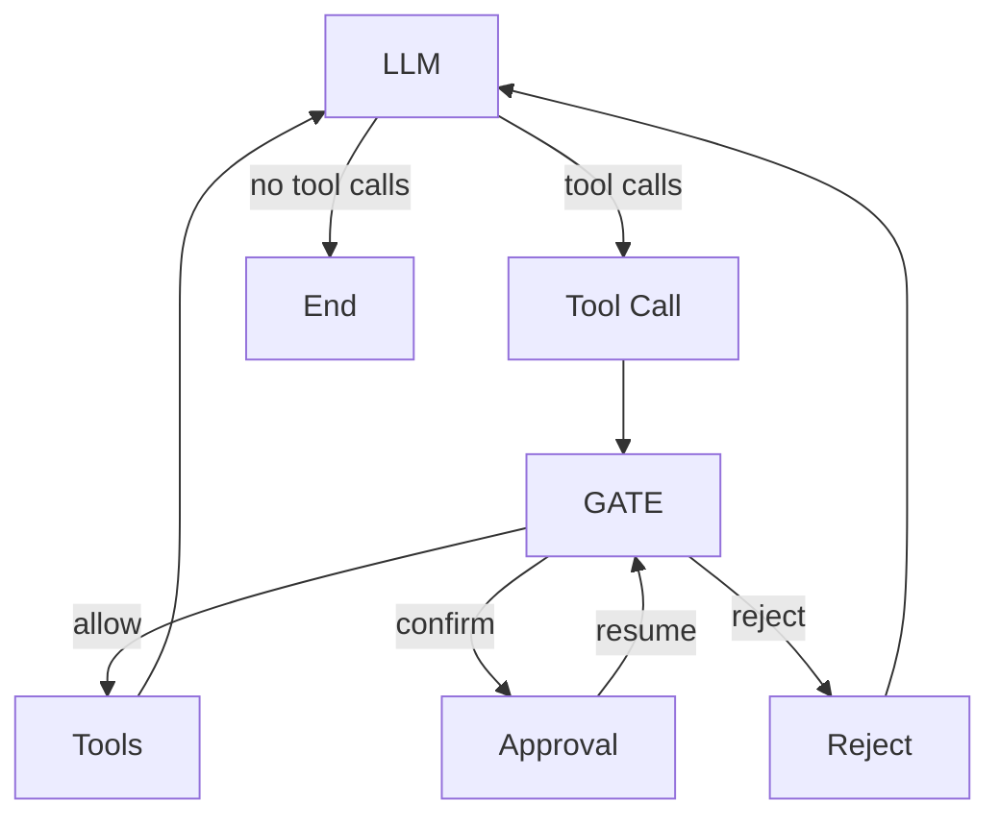

# Graph 与 Policy 解耦设计

## 设计目标

明确 Graph、Policy 和 Executor 的职责边界，实现流程编排与策略决策解耦。

- **Graph**：负责流程编排与状态转换。
- **Policy**：负责工具调用的准入决策。
- **Executor**：负责授权验证与工具执行。

## Graph 结构



| 节点 | 职责 |
|---|---|
| `llm` | 模型生成文本和工具调用 |
| `tool-call` | 整理工具调用批次 |
| `gate` | 调用 Policy，决定准入结果 |
| `tools` | 验证授权并执行工具 |
| `approval` | 用户审批、挂起与恢复 |
| `reject` | 处理拒绝结果 |
| `End` | 结束流程 |

## Policy 契约

Policy 是独立模块，不感知 Graph、Node 或 Route。

决策结果采用封闭的业务类型：

```ts
export type PolicyOutcome =
  | 'allow'
  | 'confirm'
  | 'reject';
```

```ts
export interface PolicyResult {
  calls: Array<{
    callId: string;
    decision: PolicyDecision;
    traces: PolicyTrace[];
  }>;
  outcome: PolicyOutcome;
}
```

Policy 只返回业务决策

`gate` 是 Graph 与 Policy 之间的适配层，也是唯一能够签发 Tool Authorization 的组件。