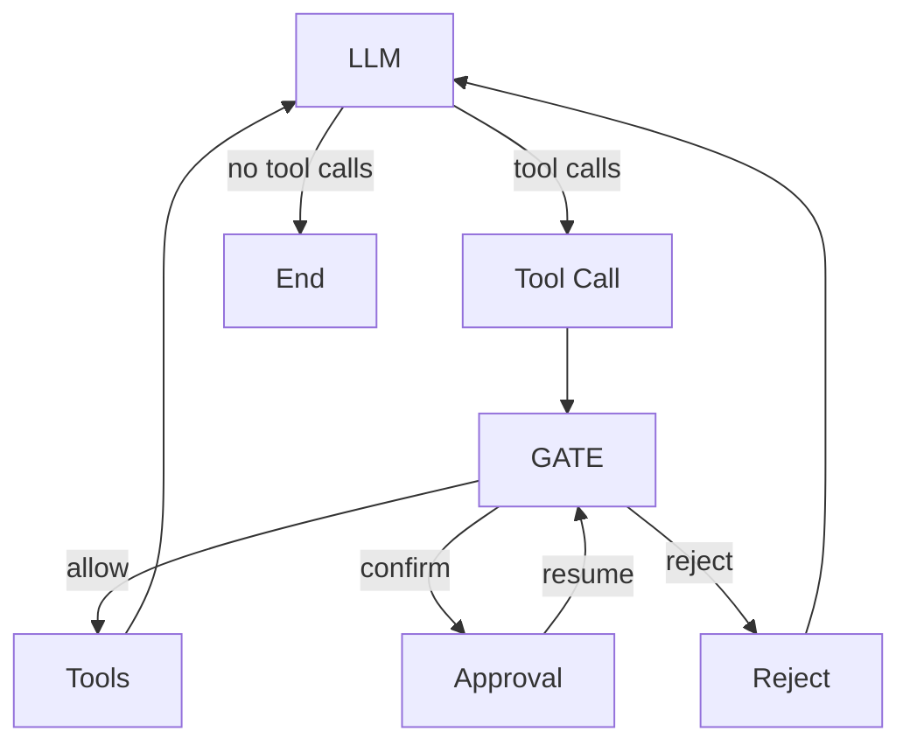

# Graph 与 Policy 解耦设计

## 设计目标

把流程编排与策略决策拆开，明确 Graph、Policy、Executor 的职责边界。

- **Graph**：编排流程，驱动状态转换。
- **Policy**：对工具调用做出准入决策。
- **Executor**：核验授权，并执行工具。

## Graph 结构



没有工具调用时，流程从 `LLM` 进入 `End`。有工具调用时，`Tool Call` 先整理本批调用，再交给 `GATE`。

`GATE` 调用 Policy，并按准入结果分流：`allow` 进入 `Tools`，`confirm` 进入 `Approval`，`reject` 进入 `Reject`。用户审批结束后，`Approval` 回到 `GATE` 重新决策。`Tools` 与 `Reject` 都回到 `LLM`。

| 节点 | 职责 |
|---|---|
| `LLM` | 生成文本和工具调用 |
| `Tool Call` | 整理本批工具调用 |
| `GATE` | 调用 Policy，并把准入结果映射为路由 |
| `Tools` | 核验授权并执行工具 |
| `Approval` | 挂起流程，等待用户审批后恢复 |
| `Reject` | 整理拒绝结果，交回模型 |
| `End` | 结束流程 |

`Tools` 由 Executor 承担。

## Policy 契约

Policy 是独立模块，不感知 Graph、Node 或 Route，只返回业务决策。准入结果是封闭枚举：

```ts
export type PolicyOutcome =
  | 'allow'
  | 'confirm'
  | 'reject';
```

一次评估同时给出每条调用的决策，以及本批的 `outcome`：

```ts
export interface PolicyResult {
  calls: Array<{
    callId: string;
    decision: PolicyDecision;
    traces: PolicyTrace[];
  }>;
  outcome: PolicyOutcome;
}
```

`GATE` 是 Graph 与 Policy 之间的适配层，也是唯一能够签发 Tool Authorization 的组件。Executor 只核验这份授权，再执行工具。
