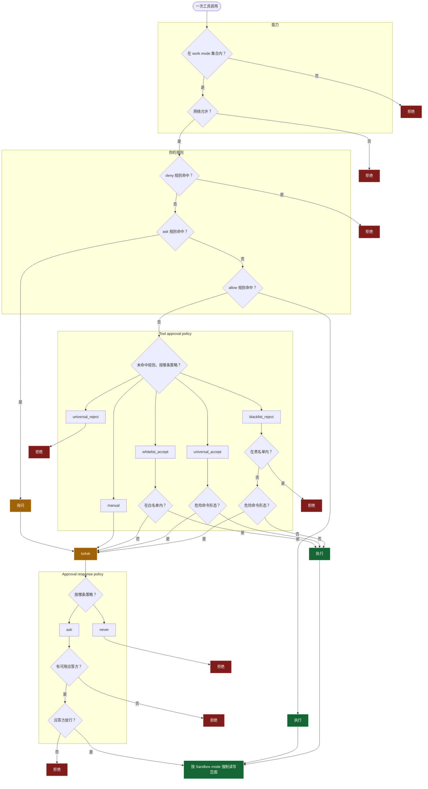

## 前置

- [[计算机/agent/提示词组织方式]]


## 运行时策略

一次工具调用按顺序经过能力、网络、用户规则、Tool approval policy、Approval response policy 和 Sandbox mode。拒绝在给出它的那一道结束。用户规则一旦命中，就由该规则给出结果：`deny` 拒绝，`ask` 询问，`allow` 执行。仅当三条都未命中时，Tool approval policy 才决定拒绝、询问或执行。该策略给出的询问进入 Approval response policy。规则或策略给出的执行进入 Sandbox mode，由沙箱限定这一次调用的读写范围。

这些策略各自持久保存。后一道只处理已经放行的调用，授予的能力保持在 Work mode 之内。

| 用户可见名               | 取值                                                                                     |
| ------------------------ | ---------------------------------------------------------------------------------------- |
| Work mode                | `chat`、`ro`、`sw`、`aw`、`pl`                                                           |
| Network access policy    | `on`、`off`                                                                              |
| User rule                | `deny`、`ask`、`allow` 三条列表                                                          |
| Tool approval policy     | `manual`、`whitelist_accept`、`blacklist_reject`、`universal_accept`、`universal_reject` |
| Approval response policy | `ask`、`never`                                                                           |
| Sandbox mode             | `workspace-read`、`read-only`、`workspace-write`、`danger-full-access`                   |

---



---

### Work mode

Work mode 划定本次会话的能力集合。工具在注册时声明自己的 capability，mode 只授予其中一部分；未授予的能力既不进模型请求，也不能执行。

| mode   | `ro` | `rw` | `rw_plan` | `shell_ro` | `shell_test` | `shell_rw` |
| ------ | ---- | ---- | --------- | ---------- | ------------ | ---------- |
| `chat` | –    | –    | –         | –          | –            | –          |
| `ro`   | ✓    | –    | –         | ✓          | –            | –          |
| `sw`   | ✓    | ✓    | –         | ✓          | ✓            | –          |
| `aw`   | ✓    | ✓    | ✓         | ✓          | ✓            | ✓          |
| `pl`   | ✓    | –    | ✓         | ✓          | –            | –          |

- `chat`（chat only）不暴露任何能力工具。
- `ro`（read-only）只读文件与只读 shell。
- `sw`（semi-write）可以写文件，可以运行只读 shell 与 scratch 测试 shell，但不提供可写工作区的 shell。
- `aw`（full access）授予全部能力。
- `pl`（plan）授予只读能力与计划文件写入；它只是一个能力集合，是否进入计划模式由 `dsh-plan-mode` 等插件单独决定。

### Network access policy

- on: 允许工具访问网络
- off: 拒绝工具访问网络

### User rule

```json
{
  "deny": [
  ],
  "ask": [
  ],
  "allow": [
}
```

### Tool approval policy

Tool approval policy 处理一次已经被 mode 放行的调用，决定它直接执行、先询问还是拒绝。

| 策略               | 直接执行                                     | 先询问         | 拒绝                                                       |
| ------------------ | -------------------------------------------- | -------------- | ---------------------------------------------------------- |
| `manual`           | –                                            | 全部调用       | –                                                          |
| `whitelist_accept` | 白名单能力，默认 `ro`、`shell_ro`、`rw_plan` | 其余调用       | –                                                          |
| `blacklist_reject` | 黑名单之外的能力                             | 仅危险命令形态 | 黑名单能力，默认 `rw`、`shell_test`、`shell_rw`、`rw_plan` |
| `universal_accept` | 全部调用                                     | 仅危险命令形态 | –                                                          |
| `universal_reject` | –                                            | –              | 全部调用                                                   |

### Approval response policy

Approval response policy 只处理已经发出的审批请求，取值只有两个：

- `ask`：把请求交给组合中的应答方。UI 应答方只回答自己拥有 agent 的请求，ACP 等其他应答方按组合各自裁决；没有可用应答方时请求失败关闭（按拒绝处理），不会默认放行。
- `never`：不询问任何人，所有审批请求直接判为拒绝。

### Sandbox mode

Sandbox mode 约束已经获准执行的读写。执行器在每次调用时解析本次调用的策略，由 OS 级沙箱强制：

- `workspace-read`：工作区只读，工作区之外不可读。
- `read-only`：文件读取放行，修改一律拒绝。
- `workspace-write`：工作区可写，工作区之外只读。
- `danger-full-access`：不施加文件沙箱限制。