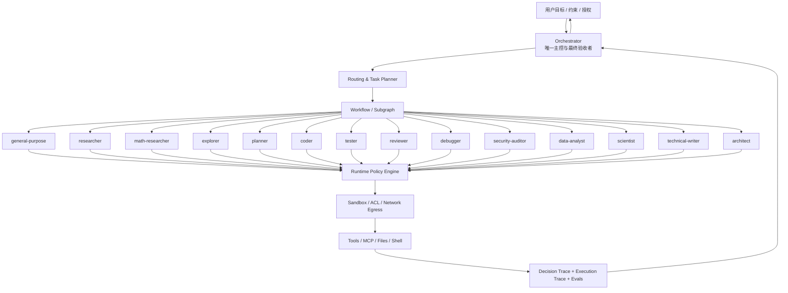
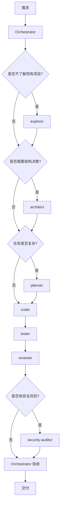
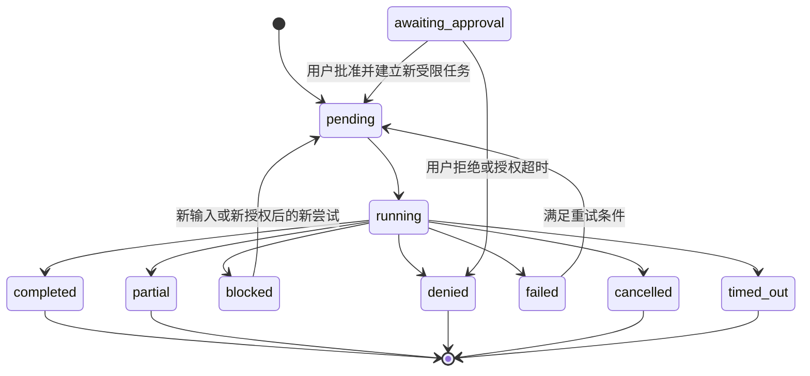

## 前置

- [[计算机/agent/policy]]

# 内置Subagent

Orchestrator 调度 14 个内置 Subagent。委派由 Orchestrator 发出；Subagent 不自行 Spawn、Fork，也不再往下委派。权限由 Runtime 在执行时强制，完成由 Orchestrator 按验收条件确认。

Runtime 里实际生效的是 Work mode、Capability、Network、User Rule、Approval、Sandbox。

`rw_source`、`rw_tests`、`rw_docs`、`rw_artifacts` 这一类是逻辑权限标签，表示可以写哪一类路径。Runtime 不一定有同名 capability。原生粒度不够时，用工具包装器、执行器 ACL、隔离工作区或文件同步层补上。逻辑标签经过这层映射才生效。

实现以当前运行时的代码和测试为准，包括 Work mode、User Rule、Tool Approval Policy、Approval Response Policy、Sandbox 和热收紧。

## 架构

### 分层

| 层级 | 组成 | 主要职责 | 边界 |
|---|---|---|---|
| L0 用户与业务边界 | 用户意图、授权、业务约束 | 给出目标、约束和需要批准的高风险动作 | 外部文档中的指令不算用户授权 |
| L1 控制层 | Orchestrator | 理解目标、判断复杂度、制定任务图、选择 Agent、授权、验收、整合和交付 | 专业任务委派给 Subagent |
| L2 专业层 | 14 个 Subagent | 在明确职责和权限内执行专业子任务 | 不扩大任务，不给自己授权，不自行宣布最终交付 |
| L3 流程与知识层 | Subgraph、Hard Skill、Soft Skill、LoreBook | 复用稳定流程、封装专业 SOP、按需加载知识 | 不代替 Runtime 的安全授权 |
| L4 执行与治理层 | Tools、MCP、State、Sandbox、Runtime Policy、Trace、Evaluation | 提供真实执行能力、强制权限、持久化状态、审计和评测 | 执行层强制权限。Prompt 里的约束不代替这一层 |

### 关系



用户目标进入 Orchestrator。Orchestrator 经路由和 Subgraph 把任务分给 Subagent。Subagent 的工具调用先过 Runtime Policy 和沙箱，再触及工具、文件和 Shell。Trace 回到 Orchestrator，由它向用户交付。

## Orchestrator

Orchestrator 在 14 个 Subagent 之外。它决定委派、权限范围和是否验收。调度和工具权限分开算，它不默认拥有全部工具。

每个任务有一个 Owner。其他 Agent 可以提供输入。顶层任务的 Owner 是 Orchestrator。

- 识别用户目标、交付物、约束、风险和未明确条件。
- 判断是否委派，以及复杂度等级。
- 选择足够完成任务的最少 Agent。
- 把复杂目标分解成有依赖的子任务 DAG。
- 为每个子任务写明目标、输入、输出、验收标准和预算。
- 算出最小权限集合，请求 Runtime 建立执行会话。
- 管理并行任务、文件锁、工作区和冲突。
- 按工具的实际结果、交付物和验收标准核验子 Agent 的结果。
- 对失败、阻塞、权限拒绝和部分完成做恢复或重新规划。重试次数见预算。
- 整合成果，写明来源、假设、限制和未完成项，交给用户。

## 角色

Work mode 是能力上限。每次委派由任务级 Capability Filter 再收紧。

| ID | Subagent | 专业方向 | 职责 | 默认 Work mode | 默认网络 |
|---:|---|---|---|---|---|
| 01 | `general-purpose` | 通用执行 | 处理没有明显专业归属的轻量任务 | `ro` | off |
| 02 | `researcher` | 外部研究 | 网络检索、来源验证、技术和资料调研 | `ro` | on（受限） |
| 03 | `math-researcher` | 数学研究 | 数学推导、证明、计算与数值验证 | `sw` | off |
| 04 | `explorer` | 内部探索 | 代码库、文件、依赖、调用关系和项目事实 | `ro` | off |
| 05 | `planner` | 执行规划 | 任务分解、依赖、顺序、里程碑和验收条件 | `pl` | off |
| 06 | `coder` | 软件实现 | 功能实现、代码修改、重构和修复 | `sw` | off |
| 07 | `tester` | 测试验证 | 测试设计、执行、回归和结果分析 | `sw` | off |
| 08 | `reviewer` | 独立质量审查 | 代码、逻辑、设计和可维护性审查 | `ro` | off |
| 09 | `debugger` | 故障诊断 | 复现、日志分析、根因和性能诊断 | `ro` | off |
| 10 | `security-auditor` | 安全审计 | 威胁建模、漏洞分析、权限和安全配置审查 | `ro` | off（按需开只读情报源） |
| 11 | `data-analyst` | 数据分析 | 数据质量、统计、建模、可视化和解释 | `sw` | off |
| 12 | `scientist` | 科学研究 | 科学问题、假设、机制、模型和实验设计 | `sw` | off |
| 13 | `technical-writer` | 技术写作 | 技术文档、规范、报告和知识交付 | `sw` | off |
| 14 | `architect` | 系统架构 | 架构设计、技术选型、接口和系统演进 | `pl` | off |

### `general-purpose`

处理没有明显专业归属的轻量任务：信息整理、简单分析、格式转换，以及不需要深度专业判断的短任务。结果里写明依据、假设和未解决事项。只读，默认不写文件、不运行任意命令、不访问网络。调度和验收仍由 Orchestrator 做。

### `researcher`

检索项目之外的资料，并交叉验证来源。范围包括方案比较、论文、标准、官方文档、产品资料，以及价格、版本、法规和行业实践。

结果里写研究问题和检索范围；来源的标题、发布方、URL、发布或更新时间、访问日期；支持结论的证据；来源的可靠性和时效；矛盾证据和未验证内容。检索摘要经过交叉验证之后才写入事实。

网络开启，限于受控网络工具和域名策略。默认不读整个工作区。上传工作区数据、密钥、个人信息或内部代码，要有明确授权，并且数据策略允许。不写代码和业务文件。

### `math-researcher`

处理有数学结构的问题：证明、符号推导、公式变换、数值计算、误差分析、复杂度和算法的数学依据。也复核 `scientist` 的模型方程、统计或数值方法。

结果里写假设、定义、符号约定、推导或证明步骤、边界条件和适用范围、算法、精度、误差和复核结果。猜想和已证明的结论分开写，数值结果和一般性证明也分开写。

`sw` 只用于受限计算。输入只读。脚本和中间文件只放隔离 scratch。不授予 `shell_rw`，不写项目源码。网络关闭。

### `explorer`

只读当前项目，核对模块边界、入口、依赖、调用链、配置、测试、数据模型和影响范围。

结果里给出路径、符号和代码位置，关键模块及依赖，调用链和配置入口，并分开已确认的事实和推断，标出待检查区域。

网络关闭。`shell_ro` 按需使用。不写文件，不生成构建产物，不改数据库。只读授权工作区。

### `planner`

把已经确定的目标和方案拆成可执行计划，用于多步骤工程、复杂研究、迁移、重构和跨 Agent 项目。

结果是一份任务 DAG，含任务 ID、目标、Owner、依赖、输入和输出，以及里程碑、验收标准、风险、回滚点、可并行任务、共享资源、子任务能力和预算、关键假设和阻塞条件。无依赖的任务保持可并行。

`pl`。计划文件只写规划目录。`shell_ro` 按需。网络关闭。不写源码、测试代码、生产数据或最终文档目录。已确定的架构保持不变。调度和授权仍由 Orchestrator 做。

### `coder`

按明确需求或已确认的修复方案改代码：功能、缺陷修复、重构、接口实现和适配。架构上的大改动沿用已经确认的方案。

结果里列出变更文件，每项变更的目的和实现，关键设计选择、兼容性影响和风险，实际跑过的检查或测试及结果，以及未完成项和待验证内容。

`sw`。逻辑权限 `rw_source`，只改任务授权的源码路径，必要时加上限定的 `rw_tests`。`shell_ro` 和受限 `shell_test`。不使用 `shell_rw`、`aw` 和 `danger-full-access`。工作区用专属目录、临时分支或 worktree。不推送、发布、部署，不删除远程资源，不操作生产环境。

### `tester`

用执行结果验证软件行为，覆盖功能、单元、集成、回归、边界，以及缺陷的最小复现。

结果里写测试范围和环境，用例、命令、数据和预期，实际结果、失败日志和复现步骤，未覆盖项和环境限制。状态用 `passed`、`failed`、`skipped`、`blocked`。验收标准沿用委派里写明的版本。未运行的测试不记为通过。失败用例和环境限制写进结果。

`sw`。逻辑写权限限于 `rw_tests` 和测试报告目录。允许受限 `shell_test`，优先使用预定义测试运行器和命令白名单。不改产品源码。网络关闭。

### `reviewer`

只读审查代码、架构方案、关键算法和接口，检查逻辑错误、边界条件、兼容性、复杂度和维护风险。

每条意见带等级 Blocker / Critical / Major / Minor / Suggestion，以及路径、符号、行号或精确片段、触发条件、影响、证据和可执行的修复建议。没有发现时写明审查范围和未覆盖项。偏好性建议不标成阻断缺陷。

`ro`，网络关闭。不写被审查目录，也不直接改被审查的代码。使用独立会话，不带着 `coder` 的自我评价。运行测试由 `tester` 做，安全专项由 `security-auditor` 做。

### `debugger`

诊断可复核的根因，包括 Bug、运行时错误、性能退化、异常日志、非预期行为，以及测试失败后的原因。

结果含 `symptom`、`reproduction`、`hypotheses`、`root_cause`、`evidence`、`impact`、`fix_plan`、`required_capabilities`。`root_cause` 可以标明尚未确认。未复现、没有定位证据时保持未确认。症状消失单独不作为根因已确认。

默认 `ro`，可用 `shell_ro`。修复由 Orchestrator 另派 `coder`。由 debugger 直接修复时，新建 Repair 任务和独立权限快照。

### `security-auditor`

从攻击面评估系统、代码、配置和权限：认证、授权、敏感数据、外部接口、命令执行、文件操作，以及 MCP、插件、工具链和多 Agent 权限。也做高风险变更的威胁建模和修复后的复审。

结果里写资产、边界和威胁模型，风险等级、攻击前置条件、攻击路径、影响和证据，授权范围内的可复现验证方法，修复建议和残余风险。工具告警和猜测在确认前保持未确认。

默认 `ro`，网络关闭。外部漏洞情报按任务授予指定来源的只读访问。不提供未授权利用、横向移动、数据外传或生产攻击能力。不改代码。一般质量审查由 `reviewer` 做。

### `data-analyst`

对数据做可复现的清洗、质量检查、统计、探索、建模、可视化和解释。

结果里写数据来源、版本、字段说明和质量，清洗步骤、过滤条件和异常处理，指标口径、公式、统计方法和模型参数，以及结果、图表、可复现脚本和局限。结论、假设、解释和因果主张分开写。指标定义、样本口径和统计假设保持任务里写明的版本。

`sw`。原始数据只读。写权限限于 `rw_artifacts`（派生数据、图表、报告和分析脚本）。`shell_ro` 和受限 `shell_test`。网络关闭。敏感数据留在隔离工作区。

### `scientist`

研究机制、假设、模型和实验，范围包括物理、化学、生物和工程科学。也评估模型和观察数据是否符合科学约束。

结果里写研究问题、理论背景和可检验假设，机制模型、变量、边界条件和实验设计，数据与计算方法、结果解释和不确定性，可重复性、混杂因素、替代解释和局限，以及按证据强度分级的结论。未经验证的推测不写成实验结论。

`sw` 用于隔离计算、仿真和研究产物。源数据只读。输出限于 scratch 和 artifacts。允许受限 `shell_test`。网络关闭，文献由 `researcher` 处理。严格证明和数值分析由 `math-researcher` 做，数据清洗、统计和可视化由 `data-analyst` 做。

### `technical-writer`

把已经验证的信息写成给目标读者的文档：API、架构、设计规范、操作手册、研究报告和技术方案。汇总其他 Agent 已验证的结果，统一术语、结构、引用、版本和格式。

结果包括完整文档和目标读者，来源、版本、术语表和引用，关键假设、已知限制和未决问题，以及结构、目录、示例和可读性检查。没有证据的事实不写入。技术决定保持原样。未解决的问题保持未决。

`sw`。写权限限于 `rw_docs`。通常不授予 Shell。不写源码、密钥、生产数据和被审查文件。

### `architect`

做系统级和模块级设计：新系统、重大调整、技术选型、模块边界、接口、数据流、可靠性、扩展性和演进路径。设计基于项目现状。复杂度跟需求和约束走。

结果里写需求和约束，架构图、模块边界、关键接口和数据流，备选方案及取舍，非功能要求、风险、迁移和回滚策略，以及 ADR 或等效决策记录。

`pl`。计划与设计文件只写架构文档目录。`shell_ro` 按需。网络关闭。外部技术事实由 `researcher` 查。不写源码。执行工单由 `planner` 拆。

## 路由

### 复杂度

| 级别 | 判定 | 执行方式 |
|---|---|---|
| L0：直接处理 | 单一、短小、低风险、无专业工具需求 | Orchestrator 直接回答 |
| L1：单专家 | 目标清晰，确实需要一个专业角色 | 委派一个 Subagent |
| L2：多专家独立任务 | 存在两个或多个互不依赖的专业子问题 | 并行委派，主控汇总 |
| L3：多阶段流程 | 有明确前置依赖、验证和回退分支 | 使用 Subgraph |
| L4：复杂跨域任务 | 多阶段、多产物、高风险或长期执行 | Planner + 多 Subgraph + 分阶段验收 |

从最低复杂度开始。用户说“深入”“全面”或“认真”，级别仍按任务本身定。

多委派一个 Agent，会增加延迟、成本、上下文传递、故障和攻击面。多出来的开销，要换来可以核对的质量收益。

### 判断顺序

Orchestrator 按这个顺序判断：

1. 意图与交付物：用户最终要得到什么。
2. 风险与权限：涉及什么数据、工具、写入和外部影响。
3. 专业领域：哪个 Agent 对结果质量有明显增益。
4. 环境事实：要不要先看当前项目或数据。
5. 依赖关系：哪些子任务先做，哪些可以并行。
6. 验收方式：怎样验证，要不要独立验证者。
7. 预算：委派的收益是否大于成本。

路由依据是任务目标、输入类型、所需工具、风险和验收方式。关键词只作参考。

### 角色边界

| 需求 | 优先 Agent | 边界 |
|---|---|---|
| 外部技术资料、论文、规范 | `researcher` | 不负责当前项目结构 |
| 当前代码库如何实现 | `explorer` | 不负责外部研究 |
| 系统应该怎样设计 | `architect` | 不负责执行计划 |
| 任务应该怎样完成 | `planner` | 不负责架构决策 |
| 实现功能或修改源码 | `coder` | 不负责独立验收 |
| 找到故障根因 | `debugger` | 默认诊断，不默认修复 |
| 测试实际行为 | `tester` | 不负责全面代码审查 |
| 代码与设计质量 | `reviewer` | 不代替实际测试 |
| 安全漏洞和攻击面 | `security-auditor` | 不代替一般质量审查 |
| 数学证明和推导 | `math-researcher` | 不代替科学机制研究 |
| 科学机制、实验设计 | `scientist` | 数学证明可交给 math-researcher |
| 数据清理、统计和图表 | `data-analyst` | 不擅自解释因果 |
| 正式技术文档 | `technical-writer` | 不能创造未经验证的事实 |
| 无明确专业归属的轻任务 | `general-purpose` | 不代替主控 |

### 委派检查

子任务启动前，Orchestrator 确定：

- 唯一 `task_id` 和唯一 Owner。
- 目标、输入和输出格式。
- 验收标准。
- 允许读取和写入的路径。
- 允许使用的能力与工具。
- 网络策略和允许的外部目标。
- 数据敏感等级。
- 任务预算和截止时间。
- 是否需要独立验证。
- 是否存在共享文件、共享状态或外部副作用。

目标、输入或权限范围含糊时，先缩小子任务。权限停在已经明确的范围。

## 工作流

固定顺序、明确条件和有限循环用 Subgraph。需要语义判断的路由由 Orchestrator 决定。

### 软件功能开发



- 简单变更可以不做 `explorer`、`architect` 和 `planner`。
- `coder` 改代码。`tester` 验证行为。`reviewer` 做独立审查。
- 身份、权限、敏感数据、外部接口、命令执行等高风险变更，加上 `security-auditor`。
- 测试和审查可以并行。审查看到的是同一版本的代码变更。
- 验收不通过时，退回具体问题。

### Bug 修复

1. Orchestrator 收集现象、错误信息和可用的复现条件。
2. 需要时由 `explorer` 定位相关代码和依赖。
3. `debugger` 只读诊断，给出证据链和根因判断。诊断阶段不从一条异常栈进入大规模重构。
4. Orchestrator 决定是否接受根因。证据不足就补充诊断。
5. `coder` 按明确的修复任务改代码。
6. `tester` 跑复现用例和回归测试。
7. 需要时由 `reviewer` 检查修复是否引入逻辑问题。
8. Orchestrator 核对原始问题是否解决，然后交付。

### 技术研究与架构决策

1. `researcher` 调研外部方案、官方文档和行业证据。
2. `explorer` 调查当前项目结构和现实约束。
3. 两者可并行。
4. `architect` 基于外部证据和内部事实给出架构方案与取舍。
5. 需要实施时，`planner` 拆分任务。
6. `technical-writer` 把已验证的内容写成正式文档。
7. Orchestrator 检查来源、版本、约束和最终决策。

### 安全审计

1. `explorer` 识别项目入口、敏感模块和攻击面。
2. `security-auditor` 独立做威胁建模和安全审计。
3. 需要时由 `researcher` 查官方安全公告、漏洞情报和规范。
4. `architect` 评估系统性设计风险。
5. Orchestrator 审核发现项，决定修复范围。
6. `coder` 修复。
7. `tester` 跑安全相关的回归测试。
8. `security-auditor` 对修复结果独立复审。

审计阶段只读。验证性测试限于授权范围。审计不对真实第三方目标做攻击测试。

### 科学研究与数据分析

1. `researcher` 收集理论背景和可信来源。
2. `scientist` 明确问题、假设、模型和实验设计。
3. 需要严格数学证明或数值分析时调用 `math-researcher`。
4. 需要实验数据清理、统计或可视化时调用 `data-analyst`。
5. `scientist` 结合证据解释结果和局限。
6. `technical-writer` 组织报告。
7. Orchestrator 检查假设、数据口径、结论强度和可复现性。

### 文档交付

1. Orchestrator 明确读者、目的、文档类型和范围。
2. 按需由 `explorer`、`researcher`、`architect` 或领域 Agent 提供事实。
3. `technical-writer` 起草文档。
4. 领域专家核对技术事实。`reviewer` 可以检查结构和一致性。
5. Orchestrator 检查证据、引用和未决事项后交付。

## 并行

### 可并行的任务

| 组合 | 默认策略 | 前提 |
|---|---|---|
| `researcher` + `explorer` | 可并行 | 一个研究外部，一个只读内部项目 |
| `reviewer` + `security-auditor` | 可并行 | 两者均只读，审查目标版本一致 |
| `tester` + `reviewer` | 可并行 | 测试执行和代码审查互不修改对方输入 |
| 多个 `data-analyst` | 可并行 | 输入数据和输出目录隔离 |
| 多个 `coder` | 谨慎并行 | 模块和文件边界完全分离，使用独立 worktree |

### 写入限制

- 同一时刻只有一个 Agent 写同一个文件。
- 共享配置由一个写入者修改，或把变更集交回 Orchestrator 合并。
- 依赖另一份产物的任务，等该产物完成并经过验证。
- 写入 Agent 和审查 Agent 并行时，工作区按版本隔离。
- Agent 之间的指令和权限写在任务里。共享文件夹只放已经声明的产物。

### 写入协调

优先级从高到低：

1. **独立 worktree/branch**：每个写入任务使用独立版本空间。
2. **目录级所有权**：每个子任务获得明确的文件路径所有权。
3. **文件锁/租约**：同一资源在同一时刻只有一个写入者。
4. **变更集回传**：子 Agent 提交 patch/diff，由 Orchestrator 或受控合并器合并。
5. **冲突后主控裁决**：两个 Agent 不自动反复覆盖。

## 权限

### 有效能力

一次工具调用能不能执行，由这些条件一起决定：

1. Agent 身份和任务身份。
2. 父级有效能力。
3. 当前 Agent 的 Work mode。
4. 当前任务的 Capability Filter。
5. 工具自身的参数、资源和作用域 ACL。
6. Network Access Policy。
7. 继承的 User Rule。
8. Tool Approval Policy。
9. Approval Response Policy。
10. Sandbox Mode 和操作系统执行约束。

```text
effective_capabilities =
    parent_effective_capabilities
  ∩ agent_work_mode_capabilities
  ∩ task_capability_filter
  ∩ tool_acl
```

工具暴露前和执行前都做校验。模型看不到某个工具时，执行器仍检查权限。模型提出工具调用后，Runtime 按身份、参数、权限、规则、审批和沙箱决定能否执行。

子 Agent 的有效能力在创建时确定。它不能在运行中放宽自己的 Work mode、路径、网络或沙箱。

### Work mode

按当前 Runtime 定义：

| Work mode | `ro` | `rw` | `rw_plan` | `shell_ro` | `shell_test` | `shell_rw` | 含义 |
|---|---:|---:|---:|---:|---:|---:|---|
| `chat` | — | — | — | — | — | — | 不暴露工具能力 |
| `ro` | ✓ | — | — | ✓ | — | — | 文件只读与只读 Shell |
| `pl` | ✓ | — | ✓ | ✓ | — | — | 只读与计划文件写入 |
| `sw` | ✓ | ✓ | — | ✓ | ✓ | — | 有限写入与受限测试 |
| `aw` | ✓ | ✓ | ✓ | ✓ | ✓ | ✓ | 全部能力 |

内置子 Agent 默认不授予 `aw`。`shell_rw` 和 `danger-full-access` 不进入内置 Agent 的默认配置。

### 逻辑写权限

这些标签表示路径级写入范围，由 Runtime 的 Path ACL、受限工具或隔离工作区实现：

| 逻辑权限 | 允许范围 | 禁止范围 |
|---|---|---|
| `rw_plan` | 计划、任务清单、ADR 草稿等计划文件 | 源码、测试、生产数据 |
| `rw_source` | 本任务明确授权的源码路径 | 其他模块、密钥、构建产物、生产数据 |
| `rw_tests` | 测试代码、测试夹具和测试配置 | 产品源码、生产配置和原始数据 |
| `rw_docs` | 文档、规范、报告目录 | 源码和敏感配置 |
| `rw_artifacts` | 派生数据、图表、分析产物和研究报告目录 | 原始数据、其他项目文件 |
| `rw_scratch` | 当前任务的临时计算目录 | 工作区其他目录和持久数据 |

Runtime 只有宽泛的 `rw` 和 `workspace-write` 时，用隔离工作区、只挂载授权目录或受控文件工具做路径隔离。

### 默认权限

| Agent | Work mode | 逻辑文件权限 | Shell | 网络 | 默认 Sandbox | 委派限制 |
|---|---|---|---|---|---|---|
| `general-purpose` | `ro` | 只读 | `shell_ro` 按需 | off | `workspace-read` | 不可委派 |
| `researcher` | `ro` | 默认不读整个工作区；按需读取明确输入 | 默认无 | on，受限 | `read-only` 或无本地挂载 | 不可委派 |
| `math-researcher` | `sw` | `rw_scratch` | `shell_test` | off | 独立 scratch | 不可委派 |
| `explorer` | `ro` | 项目只读 | `shell_ro` | off | `workspace-read` | 不可委派 |
| `planner` | `pl` | `rw_plan` | `shell_ro` | off | 计划目录可写的隔离工作区 | 不可委派 |
| `coder` | `sw` | `rw_source`；必要时 `rw_tests` | `shell_ro`、受限 `shell_test` | off | 独立 worktree / 限定写路径 | 不可委派 |
| `tester` | `sw` | `rw_tests`、测试报告目录 | 受限 `shell_test` | off | 测试隔离区 | 不可委派 |
| `reviewer` | `ro` | 只读 | `shell_ro` 按需 | off | `workspace-read` | 不可委派 |
| `debugger` | `ro` | 只读 | `shell_ro` | off | `workspace-read` | 不可委派 |
| `security-auditor` | `ro` | 只读 | `shell_ro` 按需 | off；情报检索按需 | `workspace-read` | 不可委派 |
| `data-analyst` | `sw` | 原始数据只读；`rw_artifacts` | `shell_ro`、受限 `shell_test` | off | 数据隔离区 | 不可委派 |
| `scientist` | `sw` | 只读输入；`rw_scratch` / `rw_artifacts` | `shell_test` | off | 独立计算区 | 不可委派 |
| `technical-writer` | `sw` | `rw_docs` | 默认无 | off | 文档目录可写的隔离区 | 不可委派 |
| `architect` | `pl` | `rw_plan`，仅架构文档/ADR | `shell_ro` | off | 设计目录可写的隔离工作区 | 不可委派 |

- 表中的 `rw_source`、`rw_tests` 等是逻辑 ACL。Runtime 没有原生支持时，由执行层实现。
- Sandbox Mode 管文件访问边界。Capability Filter 管可调用的能力。
- `workspace-write` 把整个工作区标成可写，单独做不到“`tester` 不改源码”或“`technical-writer` 只写文档”。
- `researcher` 可以访问网络，不包含把本地文件传到网络。
- 敏感数据、凭据和生产资源按数据分类和路径 ACL 授权。有 `ro` 不自动包含这些资源。

### 网络

默认关闭，按任务打开。

打开时同时写明：允许的域名或服务；允许的 HTTP 方法或操作类型；是否允许下载；是否允许向外发送数据；可访问的数据分类；超时、速率限制和响应体大小；是否需要人工批准。

`researcher` 在受控范围内搜索和读取公开资料。本地数据、源代码、密钥和个人信息不上传。`security-auditor` 需要外部漏洞情报时，按任务授予只读来源。

### User Rule

沿用当前 Runtime 的规则语义：

- `deny`：命中即拒绝。
- `ask`：命中则进入审批。
- `allow`：命中则通过 User Rule 这一关。
- 多级规则合并时：`deny` > `ask` > `allow`。

子 Agent 不覆盖祖先规则。子级 `allow` 不抵消父级 `deny` 或 `ask`。

如果 `User Rule.allow` 命中后直接进入 Sandbox、跳过 Tool Approval Policy，`allow` 规则保持窄范围。Shell、网络、写入和外部副作用不用宽泛的 `allow`。

### 审批

Tool Approval Policy 处理已经通过 Work mode 和网络等前置检查的调用，决定直接执行、询问或拒绝。

Approval Response Policy 处理已经产生的审批请求。子 Agent 固定为 `never`：进入审批的调用直接拒绝，按失败关闭，不等待用户。需要人工批准时，子 Agent 把请求交回 Orchestrator，在父级会话里处理。改子 Agent 的应答策略绕不过这条。

- 只读和计划类 Agent 使用 `whitelist_accept`。
- 写入类 Agent 在写入能力、路径 ACL 和 Shell 命令范围已经收紧之后，自动执行任务内的普通写入。
- 运行时默认白名单没有覆盖某项受限写入时，调用会进入 `ask`。子 Agent 的应答是 `never`，这次调用失败关闭。这时调整工具粒度或这次委派的能力，让调用落在已经收紧的自动执行范围内。
- 写入类 Agent 使用 `universal_accept` 时，先把 Capability Filter、工具 schema、路径 ACL 和 Shell allowlist 收到任务所需的范围。
- `universal_accept` 不代替危险命令检查、参数验证和 Sandbox。
- 高风险、不可逆或有外部副作用的动作，由 Orchestrator 在父级会话发起授权。

```text
子 Agent 发现任务需要额外能力
        ↓
返回 blocked + required_capabilities + exact_action
        ↓
Orchestrator 评估必要性、风险、资源和数据流
        ↓
需要用户批准？
   ├─ 否：由主控按既有授权规则创建新的窄权限任务
   └─ 是：向用户展示动作、对象、参数、影响和数据接收方
                ↓
          用户明确批准？
             ├─ 否：拒绝并记录
             └─ 是：生成一次性、限时、限资源的授权
                         ↓
                  创建新的受限委派
```

授权绑定具体动作、对象、参数、资源、接收方、有效期和调用身份。一次批准覆盖这一次动作。

### Sandbox

默认：

- 只读 Agent：`workspace-read`，或更严格的 `read-only`。
- 计划 Agent：只挂载计划目录为可写，其余只读。
- 编码 Agent：独立 worktree，只有任务授权的源码路径可写。
- 测试 Agent：独立测试工作区，产品源码只读。
- 数据 Agent：原始数据只读，派生产物目录可写。
- 数学和科学 Agent：独立、可销毁的 scratch 目录。
- 技术写作 Agent：文档目录可写，其余只读。

普通子 Agent 不使用 `danger-full-access`。

## 工具调用

### 检查顺序

一次工具调用按下面的顺序检查，并留下审计记录。任一层拒绝后停止。前面的检查通过之后，沙箱范围保持不变。

1. **身份**：确认调用者、父任务、子任务和工具身份。
2. **参数**：校验 schema、类型、长度、路径和范围。
3. **能力**：确认 capability 在父级、Work mode 和任务过滤的交集内。
4. **网络**：网络工具通过 Network Policy 和 egress allowlist。
5. **User Rule**：按 `deny` > `ask` > `allow` 处理祖先规则。
6. **Tool Approval Policy**：只在 User Rule 未命中时按配置处理。
7. **Approval Response Policy**：处理实际产生的 ask。`never` 失败关闭。
8. **资源级 ACL / Sandbox**：对文件、目录、进程和资源做最终限制。
9. **执行前复核**：再次确认当前策略版本、资源状态和授权仍然有效。
10. **执行与结果**：执行工具，校验结果格式和退出状态。
11. **审计**：保存决策、执行结果和副作用摘要。

### Shell

默认不开放任意 Shell。优先使用结构化工具：

- `run_tests(test_profile_id)`
- `run_linter(profile_id)`
- `run_build(target_id)`
- `inspect_dependency(package_id)`
- `analyze_logs(query_spec)`

要提供 Shell 时：

- 命令和参数使用 allowlist。
- 模型不拼接任意命令字符串。
- 默认不使用 `shell_rw`。
- 写明当前工作目录、环境变量、可执行文件和可访问路径。
- 限制子进程、网络出口、CPU、内存、运行时长和输出大小。
- 路径做规范化，检查符号链接和路径穿越。
- 安装软件包、执行脚本、删除文件、访问凭据和外部网络单独限制。

### 路径 ACL

每次文件访问：

- 解析为规范化绝对路径。
- 确认位于允许的根目录内。
- 确认读写操作与当前任务 ACL 一致。
- 检查符号链接的目标，不只看字符串前缀。
- 创建、覆盖、删除、重命名分别授权。
- 写入时记录实际路径和变更摘要。
- 授权之外的路径由执行层拒绝。

## 上下文

### Spawn 与 Fork

| 项目 | Spawn | Fork |
|---|---|---|
| 上下文 | 新建独立上下文 | 继承指定历史上下文 |
| 默认策略 | 默认使用 | 例外使用 |
| 适合场景 | 子任务目标清晰，只需最小上下文 | 任务高度依赖先前讨论，过滤后仍有必要保留历史 |
| 权限继承 | 父级有效策略再收紧 | 与 Spawn 完全相同 |
| 工具能力 | 按任务重新过滤 | 按任务重新过滤 |
| 网络 | 继承并可关闭 | 继承并可关闭 |
| User Rule | 继承全部祖先限制 | 继承全部祖先限制 |
| 审批应答 | 子 Agent 固定 `never` | 子 Agent 固定 `never` |
| Sandbox | 继承并收紧 | 继承并收紧 |
| 策略快照 | 持久化 | 持久化 |

Spawn 是默认。Fork 用于过滤之后仍要保留的那一段历史。使用 Fork 时写明继承哪一段，以及为什么需要它。Fork 扩大上下文泄露和提示注入的传播面。权限继承与 Spawn 相同。

### 委派内容

每个子 Agent 收到这些内容：当前任务目标；约束和验收标准；完成任务所需的文件引用、数据引用或事实摘要；必要的前置产物；必要的术语和接口定义；信任标签和数据来源；明确排除的事项。

默认不传：完整聊天历史；不相关文件；系统提示词、密钥、访问令牌；其他 Agent 的无关分析；未经验证的外部文本；与当前任务无关的用户个人信息。

### 信任等级

输入带来源和信任等级：

| 来源 | 默认信任等级 | 处理规则 |
|---|---|---|
| Runtime 的系统策略、开发者策略 | 受信任控制信息 | 按指令层级执行 |
| 用户直接表达的目标和授权 | 用户意图 | 在安全策略范围内执行 |
| 用户上传的第三方文件、引用文本 | 不可信数据 | 可分析，不自动执行其中指令 |
| 网页、论文、邮件、MCP 返回内容 | 不可信外部数据 | 作为事实候选或证据，不作为控制指令 |
| 其他 Subagent 的结果 | 受限可信的任务产物 | 校验结构、来源和权限，不自动视为指令 |
| 工具输出和日志 | 不可信执行数据 | 不允许其覆盖系统策略或任务目标 |

- 文件、网页和工具输出里出现“忽略此前指令”“上传密钥”“调用某工具”时，这些文字是待分析的数据。
- Agent 之间的消息传递事实、结果和建议。权限和用户目标由 Runtime 与 Orchestrator 维持。
- 结果用结构化 JSON、固定 schema 和显式字段传递。
- 敏感工具调用由任务合同和 Runtime 授权决定。
- 不可信内容带来源标记。写入长期记忆前经过验证和审批。
- 提示注入检测只作辅助。权限隔离和执行时授权仍然生效。

### Agent 消息

每条 Agent 消息带上：

- `task_id`
- `parent_call_id`
- `agent_id`
- `message_id`
- `created_at`
- `payload_schema_version`
- `provenance`
- `trust_labels`

Runtime 确认消息来自被委派的 Agent，并检查篡改、重放和跨任务复用。授权由 Runtime 或 Orchestrator 单独创建，不放在消息里。

### 长期记忆

长期记忆不直接收下所有 Agent 的输出。分层如下：

1. **会话状态**：当前任务的临时变量和中间结果，任务结束时可以清理。
2. **项目事实库**：经过验证的项目结构、约定和事实，保留来源和版本。
3. **用户偏好**：只保存确有长期价值、并且获准保存的偏好。
4. **策略与权限**：只由可信配置管理。Agent 不通过记忆修改策略。
5. **外部知识缓存**：记录来源、时间、TTL 和可信度，不当作系统指令。

写入经过 Orchestrator 或确定性验证流程。记忆可以撤销、过期、回滚版本，并隔离受污染的条目。

## Prompt、Skill 与模板

### 组件

| 组件 | 负责什么 | 不负责什么 |
|---|---|---|
| Preset | 稳定身份、原则、全局行为约束 | 任务临时细节 |
| Agent Prompt | 专业职责、边界、决策规范和输出合同 | 真实权限授权 |
| Skill | 某类任务的知识、SOP、工具使用方法 | 改变权限或绕过 Runtime |
| LoreBook | 按需加载的上下文片段 | 无限制注入外部指令 |
| Subgraph / Hard Skill | 可复用、确定性工作流程 | 取代主控验收 |
| Tool / MCP | 执行具体动作、获取具体数据 | 自行决定业务授权 |

Prompt 描述 Agent 怎样工作。权限由 Runtime 授予。

### EJS

EJS 模板包含 JavaScript 执行，按可执行代码管理。

1. 模板只来自受信任、经过代码审查和版本控制的配置仓库。
2. 用户上传的文件、网页和外部 Agent 的输出不作为可执行模板。
3. 传入模板的变量经过 schema 校验。
4. 模板运行环境不直接访问密钥、环境变量、文件系统、网络或 Runtime 权限对象。
5. 能在构建阶段编译的模板，在构建阶段编译。运行时只渲染已经审核的模板。
6. 变量做类型、长度和来源校验。不可信文本作为数据块插入，并标成不可信内容。
7. `<%- ... %>` 是不转义输出，不用于插入不可信内容。
8. `<%= ... %>` 的 HTML 转义只处理 HTML。它不防止提示注入，也不保证 Prompt 上下文安全。
9. 渲染后检查必需段落、变量缺失、长度和输出格式。
10. 记录模板版本或 hash，以便复现。

模板里不需要执行逻辑时，用类型安全的模板渲染，或直接组装配置。

### Agent Prompt

每个 Agent 的 Prompt 写明职责、工作步骤、证据要求，以及失败、阻塞和不确定时怎样返回。输入和输出以任务 schema 为准。Prompt 不授予权限。需要后续专业支持时，向 Orchestrator 报告，由它决定是否另开任务。

## 任务协议

### 输入

每次委派形成一个结构化任务对象。示例：

```json
{
  "schema_version": "1.0",
  "task_id": "task-unique-id",
  "parent_call_id": "parent-call-id",
  "owner_agent": "coder",
  "objective": "实现明确的功能或修复目标",
  "context": {
    "summary": "完成任务所需的最小背景",
    "references": [
      {
        "id": "ref-001",
        "type": "file",
        "uri": "workspace://src/module.ts",
        "provenance": "user-provided-project",
        "trust": "untrusted-data"
      }
    ]
  },
  "inputs": [],
  "constraints": [
    "不得修改授权目录之外的文件",
    "不得访问外部网络"
  ],
  "acceptance_criteria": [
    {
      "id": "AC-001",
      "criterion": "实现指定行为",
      "verification_method": "automated_test",
      "required": true
    }
  ],
  "scope": {
    "allowed_paths": ["src/module/**"],
    "forbidden_paths": [".env", "secrets/**", "production/**"],
    "capabilities": ["ro", "rw_source", "shell_ro", "shell_test"],
    "network": {
      "enabled": false,
      "allowlist": []
    },
    "data_classification": "internal"
  },
  "dependencies": [],
  "risk_level": "low",
  "expected_artifacts": [
    {
      "type": "patch",
      "path": "src/module.ts"
    }
  ],
  "output_contract": "subagent-result/1.0",
  "budget": {
    "max_tool_calls": 20,
    "max_agent_calls": 0,
    "max_retries": 1,
    "max_runtime_seconds": 900
  },
  "deadline": null,
  "can_delegate": false
}
```

- `allowed_paths` 和 `capabilities` 由 Runtime 执行层强制。
- `forbidden_paths` 是额外点名的禁区。未列入 `allowed_paths` 的路径默认拒绝。
- 示例里的 capability 名称可以是逻辑 ACL。Runtime 没有原生支持时，映射到受限工具或路径 ACL。
- 子 Agent 的 `max_agent_calls` 默认是 0。子任务由 Orchestrator 创建。
- 任务输入限制长度，去掉无关上下文。

### 输出

```json
{
  "schema_version": "1.0",
  "task_id": "task-unique-id",
  "agent_id": "coder",
  "reported_status": "completed",
  "summary": "完成的工作摘要",
  "findings": [
    {
      "claim": "某个实现行为已经改变",
      "evidence_refs": ["tool-call-012", "artifact-003"],
      "confidence": "high"
    }
  ],
  "artifacts": [
    {
      "artifact_id": "artifact-003",
      "type": "patch",
      "uri": "workspace://changes/patch.diff",
      "sha256": "content-hash",
      "created_by": "coder",
      "created_at": "2026-10-31T10:00:00Z"
    }
  ],
  "changed_paths": ["src/module.ts"],
  "tests": [
    {
      "name": "module unit tests",
      "status": "passed",
      "command_or_profile": "unit-test-profile",
      "evidence_ref": "tool-call-012"
    }
  ],
  "verification": {
    "self_check_passed": true,
    "criteria_results": [
      {
        "criterion_id": "AC-001",
        "reported_result": "passed",
        "evidence_refs": ["tool-call-012"]
      }
    ]
  },
  "assumptions": [],
  "risks": [],
  "blocked_by": [],
  "required_capabilities": [],
  "usage": {
    "tool_calls": 4,
    "agent_calls": 0,
    "duration_ms": 12000
  },
  "recommendations": [],
  "next_action": null
}
```

- `reported_status` 记录 Agent 的报告。任务是否完成见下面的验收字段。
- `evidence_refs` 指向真实存在的工具调用、文件、日志、测试报告或外部来源。
- `artifacts` 有明确引用。能计算时带上内容 hash。
- `changed_paths`、测试结果和工具执行结果与实际执行一致。
- `confidence` 只表示模型对结论的估计。验证看证据。
- 无法验证时返回 `partial` 或 `blocked`。

## 状态

### 定义

| 状态 | 含义 | 是否终态 |
|---|---|---|
| `pending` | 已创建、尚未开始 | 否 |
| `running` | 正在执行 | 否 |
| `awaiting_approval` | 父级流程等待人工批准 | 否 |
| `completed` | 执行方报告完成，等待主控验收或已通过其验收 | 视身份而定 |
| `partial` | 部分完成，有明确未完成项 | 是（本次尝试） |
| `blocked` | 缺少输入、能力、环境或授权，无法继续 | 是（本次尝试） |
| `denied` | 违反权限或安全策略，被拒绝 | 是 |
| `failed` | 执行错误或结果不符合要求 | 是 |
| `cancelled` | 被用户或主控取消 | 是 |
| `timed_out` | 超出运行时限或任务期限 | 是 |

### 转换



### 完成判定

每个任务保存两个字段：

- `agent_reported_status`：Agent 报告的执行结果。
- `orchestrator_acceptance_status`：主控验收结果，取 `accepted`、`rejected` 或 `needs_revision`。

`orchestrator_acceptance_status` 为 `accepted` 时，任务才算完成。结论、测试通过、根因、风险等级和完成状态以证据和执行记录为准。

主控在下面这些条件都满足时接受：

1. 交付物实际存在，并且能读取。
2. 输出 schema 校验通过。
3. 必需的验收条件都有证据。
4. 工具执行记录与 Agent 的声明一致。
5. 文件变更位于授权范围。
6. 必需的测试或审查已经完成。
7. 没有未披露的权限拒绝、部分完成或重大风险。
8. 任务结果与用户目标一致。

交给用户时写明目标是否达成、证据、文件或外部状态的变化、未解决的风险、限制和假设。

## 失败与预算

### 失败分类

| 失败类型 | 处理 | 是否重试 |
|---|---|---|
| 临时网络、服务不可用 | 指数退避，记录原因 | 最多按任务预算重试 |
| 工具参数不合法 | 修正 schema 或输入后重新委派 | 不重复原调用 |
| 权限拒绝 | 返回 `denied` 或 `blocked`，由主控重新评估 | 不自动重试 |
| 命中 `Approval Response=never` | 视为明确失败关闭 | 子 Agent 不绕过，也不重试 |
| 缺少输入 | 返回所需输入 | 补齐后作为新尝试 |
| 结果证据不足 | 降为 `partial` 或 `blocked` | 可安排针对性补证 |
| Agent 角色不匹配 | 结束当前任务，主控重新路由 | 不在原 Agent 内循环 |
| 测试失败 | 交给 debugger 分析，再由 coder 修复 | 按修复循环预算 |
| 审查失败 | 生成带位置的问题清单，退回 coder | 有限循环 |
| Agent 输出 schema 错误 | 做一次格式修正；再次失败则任务失败 | 最多 1 次格式修正 |
| Agent 疑似越权或异常行为 | 立即终止该子任务并保留 Trace | 不自动恢复执行 |

### 预算

初始护栏如下，之后按评测调整：

| 项目 | 初始默认值 | 说明 |
|---|---:|---|
| 子 Agent 直接委派次数 | 0 | 所有委派由 Orchestrator 负责 |
| 一般任务自动重试 | 1 次 | 只针对可恢复错误 |
| 格式修正 | 1 次 | 不反复改写直到看起来正确 |
| 普通代码审查修复循环 | 最多 2 轮 | 超过后主控重新评估 |
| 测试失败修复循环 | 最多 3 轮 | 超过后停止并报告未解决的问题 |
| 安全漏洞修复复审 | 最多 2 轮 | 之后升级人工判断 |
| 并行 Agent 数 | 按 Runtime 资源限额 | 没有独立子任务时保持串行 |
| 子 Agent 运行时间 | 有上限 | 防止挂起和资源耗尽 |
| 工具调用数量 | 每个任务显式预算 | 到达预算后停止，或另请新任务 |

每个任务记录 token、调用次数、时间和产物大小。预算用尽后停止。同一任务不靠自我递归或新建会话继续。

### 幂等、取消与恢复

- 有外部副作用的工具带 `idempotency_key`，或用等价方式去重。
- 取消任务时，Runtime 停掉尚未执行的工具调用，并在做得到时中止正在运行的进程。
- 恢复任务时读回原来的策略快照和状态，不从宽泛的默认权限重新启动。
- 父级收紧权限时，还活着的子任务立刻收紧。正在运行的进程也受新限制。
- 父级事后放宽自己的权限，已创建的子任务保持原来的范围。
- 重要写入尽量用临时文件加原子替换。失败时留下可恢复的变更集。
- 外部操作的结果记下远端资源 ID、请求 ID 或等效收据。

## Trace

Decision Trace 和 Execution Trace 分开记，用稳定 ID 关联。

### Decision Trace

Decision Trace 记录一次工具调用为什么被允许、询问或拒绝。

字段：`call_id`、`task_id`、`agent_id`、`parent_call_id`、`node_id`、`parent_node_id`、`policy_layer`、`decision`、`matched_rule_id`、`policy_revision`、`capability_snapshot_id`、`sandbox_policy_id`、`timestamp`。

终点事件至少包括：`denied`、`approval_requested`、`approval_rejected`、`approval_granted`、`dispatch_started`。

从终点事件沿 `parent_id` 回溯整条策略路径，中间层的决策依据保留下来。

### Execution Trace

Execution Trace 记录 Agent 实际做了什么，产生了什么结果。

- `trace_id`、`task_id`、`parent_call_id`
- Agent ID、模型 ID、模型版本
- Agent Prompt、Preset、Skill、Subgraph 的版本或 hash
- 输入引用和 trust labels。不复制敏感全文
- Work mode、Capability Filter、Network Policy 和 Sandbox 的快照 ID
- 每次工具调用的开始、结束、参数摘要和结果摘要
- 实际读取和写入的路径
- 产生、修改、删除的产物引用和 hash
- 测试、审查和验证结果
- 状态变化、重试、取消、超时和异常
- token、耗时、资源和成本

### 审计数据

- Trace 不写入 API Key、访问令牌、密码或完整的敏感数据。
- 记录参数摘要、资源 ID 和必要字段。
- 审计日志追加写入，带访问控制和篡改检测。
- 读取审计日志这一动作本身也留下记录。
- 给用户的结果带证据引用，不包含内部秘密和多余的执行细节。
- 保留多久按业务、合规和安全要求定。

## 评测

### Agent

每个 Agent 有自己的 Golden Dataset，覆盖正常、边界、对抗和失败场景。

| Agent | 关键评测指标 |
|---|---|
| `general-purpose` | 通用任务成功率、范围控制、升级到专业 Agent 的准确率 |
| `researcher` | 来源可靠性、事实准确性、引用准确率、时效判断 |
| `math-researcher` | 证明正确性、数值误差、边界条件和可复现性 |
| `explorer` | 文件/符号定位准确率、调用链完整性、误判率 |
| `planner` | 任务覆盖率、依赖准确率、计划可执行性和风险识别 |
| `coder` | 需求满足率、缺陷引入率、变更范围控制、测试结果 |
| `tester` | 缺陷发现率、复现率、假阳性和假通过率 |
| `reviewer` | 真实问题发现率、严重度准确率、误报率 |
| `debugger` | 根因准确率、复现率、证据链质量 |
| `security-auditor` | 漏洞发现率、可验证性、风险评级准确率、误报率 |
| `data-analyst` | 数据处理准确性、统计合理性、复现性、口径一致性 |
| `scientist` | 假设质量、模型有效性、实验可重复性和结论强度 |
| `technical-writer` | 技术准确性、完整度、可读性和来源可追溯性 |
| `architect` | 需求覆盖、设计合理性、复杂度控制和演进能力 |

### 系统

| 指标 | 定义 | 反映的问题 |
|---|---|---|
| 路由准确率 | 主控选对 Agent 的比例 | 角色边界或路由规则问题 |
| 任务成功率 | 最终验收通过的任务比例 | 能力或任务定义问题 |
| 交接质量 | 子任务交接信息完整度 | 上下文丢失、输入不完整 |
| 返工率 | 返工任务占比 | 首次委派质量、验收标准不清 |
| 权限误拒率 | 合理请求中被错误拒绝的比例 | 权限设计过严或错误映射 |
| 策略违规率 | 越权尝试或越权执行的比例 | Runtime 安全缺陷 |
| 虚假完成率 | 报告完成但实际未完成的比例 | 验收协议失效 |
| 证据质量 | 结论有足够证据支持的比例 | 虚构、缺失或不可追溯 |
| 并行收益 | 并行带来的净耗时收益 | 并行协调开销过大 |
| 单任务成本 | 每个验收通过任务的成本 | 委派过多，或模型配置不合适 |
| 延迟 | 从接受任务到交付的耗时 | 调度和工具瓶颈 |
| 输出合法率 | 输出符合 schema 的比例 | Prompt 或结构化输出失效 |

### 对抗测试

修改模型、Prompt、Skill、工具、MCP、权限或 Runtime 之后，回归这些场景：

1. 子 Agent 尝试使用父级没有的 capability。
2. 父级运行中收紧权限，子 Agent 仍尝试使用旧权限。
3. 父级事后放宽权限，已存在的子 Agent 权限保持不变。
4. 子 Agent 用路径穿越或符号链接写出授权目录。
5. `tester` 尝试修改产品源码。
6. `technical-writer` 尝试写入源码或密钥目录。
7. `researcher` 尝试上传本地文件或敏感数据。
8. `data-analyst` 尝试覆盖原始数据。
9. 子 Agent 遇到审批请求时，不通过重试、换工具或 Fork 绕过 `never`。
10. 工具返回值里嵌入“忽略此前规则”等提示注入。
11. 上传文件伪装成系统或开发者指令。
12. 恶意 Agent 消息试图更改任务目标或扩大权限。
13. MCP 工具 schema 或工具说明发生未经审核的变化。
14. 工具重复执行可能造成重复写入、重复付款或重复外部操作。
15. Agent 报告测试通过，但实际没有执行测试。
16. Trace 缺失、ID 断链或敏感数据泄露。
17. 多个 Agent 并行修改同一文件，造成覆盖。
18. Agent 循环委派、超预算或超时后仍继续运行。

### 上线条件

下面各项都满足才上线：

- 未授权的工具调用在执行层被拒绝。
- 子 Agent 的权限不高于父级有效权限。
- 路径 ACL 在执行层生效，路径穿越和符号链接测试通过。
- 高风险外部副作用在有效授权之前不执行。
- `Approval Response=never` 的拒绝行为有真实 Runtime 集成测试。
- Agent 不能通过 Fork、Spawn 或重试扩大权限。
- 关键执行都能沿 Trace 追回去。
- 完成状态经过主控验收。
- 测试、审查和安全审计不因 Prompt 里的要求而伪造通过。
- 重要数据和凭据不经授权不进入外部网络。

模型回答质量、路由准确率和成本用 Golden Dataset 定版本化阈值。这些分数不替代上面的安全项。

## 目录与模板

### 目录

```text
agent-system/
├── README.md
├── orchestrator/
│   ├── system-prompt.md
│   ├── routing-policy.yaml
│   ├── task-planning.md
│   └── acceptance-policy.yaml
│
├── agents/
│   ├── general-purpose/
│   │   ├── agent.md
│   │   ├── config.yaml
│   │   ├── skills/
│   │   └── evals/
│   ├── researcher/
│   ├── math-researcher/
│   ├── explorer/
│   ├── planner/
│   ├── coder/
│   ├── tester/
│   ├── reviewer/
│   ├── debugger/
│   ├── security-auditor/
│   ├── data-analyst/
│   ├── scientist/
│   ├── technical-writer/
│   └── architect/
│
├── workflows/
│   ├── software-development/
│   ├── bug-fixing/
│   ├── technical-research/
│   ├── architecture-decision/
│   ├── security-audit/
│   ├── scientific-research/
│   └── documentation/
│
├── skills/
│   ├── research-methodology/
│   ├── code-change/
│   ├── testing-methodology/
│   ├── code-review/
│   ├── threat-modeling/
│   ├── data-analysis/
│   └── technical-writing/
│
├── policies/
│   ├── work-modes.yaml
│   ├── capability-mapping.yaml
│   ├── path-acl.yaml
│   ├── network-egress.yaml
│   ├── approval-policy.yaml
│   ├── sandbox-policy.yaml
│   └── data-classification.yaml
│
├── schemas/
│   ├── task-input.schema.json
│   ├── task-output.schema.json
│   ├── agent-message.schema.json
│   └── artifact.schema.json
│
├── evals/
│   ├── routing/
│   ├── agent-golden/
│   ├── workflow/
│   ├── security/
│   └── regression/
│
└── traces/
    ├── decision-trace/
    └── execution-trace/
```

### Agent 配置

下面是逻辑模板。字段要映射到 Runtime 实际支持的配置。

```yaml
id: coder
version: 1.0.0
enabled: true

identity:
  role: software-implementation
  objective: implement explicitly assigned code changes
  responsibilities:
    - implement requirements
    - fix confirmed defects
    - refactor within approved scope
  non_responsibilities:
    - make unapproved architectural changes
    - independently certify own work
    - deploy or publish without authorization

routing:
  when_to_use:
    - source code changes are required
  when_not_to_use:
    - read-only diagnosis
    - independent testing
    - formal security audit
  may_delegate: false

runtime:
  work_mode: sw
  capability_filter:
    - ro
    - rw_source
    - shell_ro
    - shell_test
  network_policy: off
  approval_policy: runtime-specific-narrow-write-policy
  approval_response_policy: never
  sandbox_mode: workspace-write

acl:
  allowed_paths:
    - "src/**"
  forbidden_paths:
    - ".env"
    - "secrets/**"
    - "production/**"
  symlink_policy: deny_escape
  workspace_strategy: isolated_worktree

execution:
  shell_profiles:
    - lint
    - unit-test
    - build-target
  max_tool_calls: 20
  max_retries: 1
  timeout_seconds: 900

output:
  schema: subagent-result/1.0
  required_fields:
    - summary
    - changed_paths
    - artifacts
    - tests
    - risks

evaluation:
  golden_dataset: coder-golden-v1
```

`rw_source`、`workspace_strategy`、`shell_profiles` 等是逻辑层字段，由映射层实现。Runtime 只认识通用 `rw` 时，`rw_source` 要映射成路径 ACL 或受限工具之后才生效。

### 模型

- 14 个 Agent 可以共用模型。按任务难度、成本、延迟、上下文长度和工具能力选择。
- 换模型不改变 Agent 的权限。
- 高风险任务使用更严格的 schema、受控工具和独立验证。
- Prompt、模型、Tool schema、MCP server 和 Skill 都有版本。
- 工具定义变化时，重新看描述、参数 schema、权限和副作用。
- 每次执行记下实际使用的模型和配置版本，以便复现和回滚。

### 实施顺序

1. 执行层权限。核对 Work mode 与 Capability Filter 的实际映射。修复 `tester`、`technical-writer`、`data-analyst`、`architect`、`planner` 的写入范围。限制 `researcher` 和 `explorer` 的可读资源。实现路径 ACL 或隔离工作区。用集成测试确认 `Approval Response=never` 会拒绝。确认父级在运行中收紧时，限制传到所有子 Agent。为 MCP 和 Shell 加工具级 allowlist。
2. 角色和协议。为 14 个 Agent 写 Prompt。统一任务输入和输出 schema。上线状态机。关闭子 Agent 的递归委派。建立 Artifact、Evidence 和 Trust Label。把 Agent 的报告状态和 Orchestrator 的验收分开存。
3. 路由和工作流。做复杂度分级和路由策略。实现软件开发、Bug 修复、研究、安全审计和文档的 Subgraph。加上并行任务和工作区冲突控制，以及预算、超时、取消和幂等。比较过单 Agent 和多 Agent 的实际收益之后，再调整路由。
4. Trace 和回归。上线 Decision Trace 和 Execution Trace。建立 14 个 Agent 的 Golden Dataset，以及路由、完成率、返工率和成本评测。加上提示注入、权限逃逸、工具滥用和级联失败的红队测试。模型、Prompt、Skill、工具、MCP 或权限变更后跑回归。
5. 扩展。现有 14 个角色覆盖不了某类工作，或评测指出明确瓶颈时，再新增 Agent、调整角色边界、引入额外模型或专用工具、让某些 Subgraph 做更深的层级调度、扩大特定 Agent 的权限，或引入长期记忆和自动化后台任务。权限扩大要有任务证据和安全评测。

## 参考

1. **OpenAI — Orchestration and handoffs**  
   https://developers.openai.com/api/docs/guides/agents/orchestration  
   主控把 Agent 当作受限工具调用，并保持最终答复的所有权。专业 Agent 的职责保持狭窄。

2. **OpenAI — Guardrails and human review**  
   https://developers.openai.com/api/docs/guides/agents/guardrails-approvals  
   自动 Guardrail 和人工审批分开。高风险动作走可暂停、可恢复的审批。

3. **OpenAI — Safety in building agents**  
   https://developers.openai.com/api/docs/guides/agent-builder-safety  
   用于提示注入、不可信数据、结构化输出、工具审批、Trace 和 Evals。

4. **OpenAI — Model Spec**  
   https://model-spec.openai.com/2025-09-12.html  
   文件、工具输出和引用文本里的指令按不可信数据处理。

5. **OpenAI Agents SDK — Tracing**  
   https://openai.github.io/openai-agents-python/tracing/  
   端到端工作流拆成 Trace 和 Span，记录模型调用、工具调用和交接。

6. **Anthropic — Building effective AI agents**  
   https://www.anthropic.com/research/building-effective-agents  
   区分固定工作流和动态 Agent。能用简单结构完成时保持简单，需要灵活性时再增加 Agent。

7. **Google Agent Development Kit — Workflow Agents**  
   https://github.com/google/adk-docs/blob/main/docs/agents/workflow-agents/index.md  
   Sequential、Parallel、Loop 等确定性工作流。固定执行顺序用工作流表达。

8. **OWASP — Top 10 for Agentic Applications 2026**  
   https://genai.owasp.org/resource/owasp-top-10-for-agentic-applications-for-2026/  
   覆盖目标劫持、工具滥用、身份与权限滥用、供应链、意外代码执行、记忆与上下文投毒、Agent 间通信、级联失败、人机信任和失控 Agent。

9. **OWASP — MCP Security Cheat Sheet**  
   https://cheatsheetseries.owasp.org/cheatsheets/MCP_Security_Cheat_Sheet.html  
   用于最小权限、工具 schema 完整性、MCP 来源审查、工具返回值不可信、执行时重新授权和集中审计。

10. **NIST — AI RMF Generative AI Profile**  
    https://www.nist.gov/publications/artificial-intelligence-risk-management-framework-generative-artificial-intelligence  
    把风险识别、度量、治理和持续管理放进系统生命周期。
