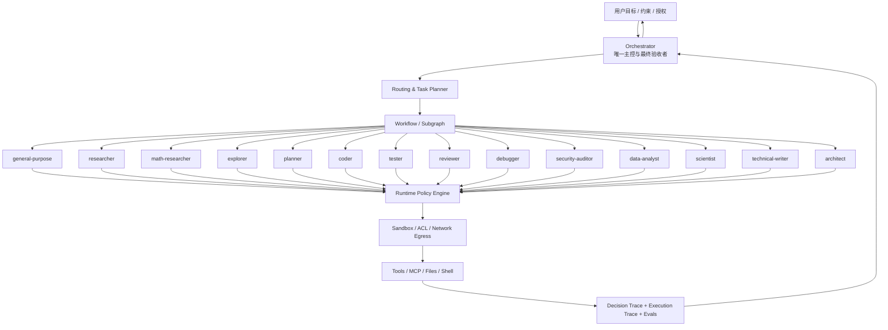
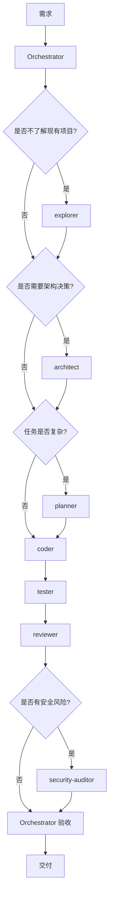
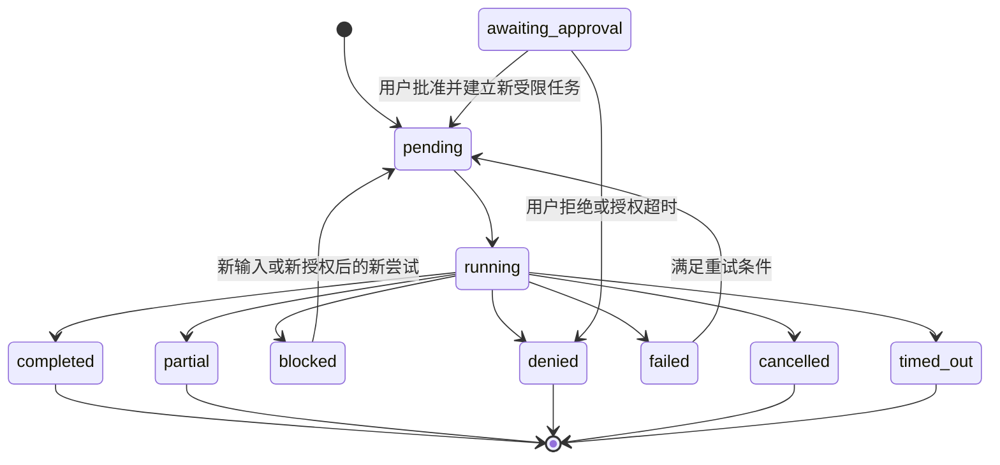

# 内置 Subagent 体系最终设计规范（V2.0）

> **状态**：最终参考架构 / 可作为实施基线  
> **版本**：2.0  
> **更新日期**：2026-10-31  
> **适用范围**：具备工具调用、文件读写、网络访问、沙箱、Spawn/Fork 与多 Agent 协作能力的 Agent Runtime  
> **设计结论**：保留 14 个内置 Subagent；由 Orchestrator 统一调度；专业 Agent 只执行边界明确的任务；权限由 Runtime 强制，交付由 Orchestrator 验收。

---

## 0. 执行摘要

本设计不追求“Agent 越多越强”，也不采用完全自治、自由互相委派的 Agent Swarm。最终采用：

**单一主控 + 14 个专业执行 Agent + 确定性工作流 + 最小权限运行时 + 可验证交付。**

整个系统的关键不是 14 个角色的数量，而是每个角色是否有明确、互不混淆的：

1. 专业职责与非职责；
2. 调用条件与退出条件；
3. 可用能力与文件/网络范围；
4. 输入、输出和证据格式；
5. 协作关系与工作流位置；
6. 独立验收标准。

### 0.1 最终决策

| 设计项 | 最终决策 |
|---|---|
| Agent 数量 | 保留原有 14 个，不因“看起来缺角色”而提前扩张 |
| 主控 | Orchestrator 独立于 14 个 Subagent，始终拥有最终调度权和交付责任 |
| `general-purpose` | 只作为通用执行兜底，不充当 Orchestrator |
| 调度方式 | 简单任务直做；专业任务单 Agent；互相独立的工作并行；复杂任务使用 Subgraph |
| 子 Agent 委派 | 默认禁止子 Agent 自行 Spawn/Fork 或递归委派；由 Orchestrator 统一委派 |
| 工作流 | 稳定、高频、可预测的流程固化为确定性 Subgraph；不确定分支交由主控决策 |
| 权限 | 父级有效权限、Agent Work mode、任务级 Capability Filter、工具 ACL、网络策略和 Sandbox 共同约束 |
| 文件写入 | 必须有路径级 ACL；不能只依赖 `workspace-write` 或通用 `rw` |
| 审批 | 子 Agent 的 `Approval Response Policy=never` 按失败关闭处理；需要人工批准时返回主控处理 |
| 上下文 | Spawn 默认；Fork 例外；外部内容、文件内容、工具输出和 Agent 消息都按不可信数据处理 |
| 质量 | `tester`、`reviewer`、`security-auditor` 三条独立验证线 |
| 完成判定 | Agent 只能提交完成声明；只有 Orchestrator 按验收条件验证后才能确认任务完成 |
| 可观测性 | Decision Trace 记录授权决策；Execution Trace 记录实际执行；二者按 ID 关联 |
| 扩展 | 先通过评测证明现有 14 个角色无法覆盖，再考虑新增 Agent |

### 0.2 本规范中的配置约定

本规范区分三种东西，不允许混为一谈：

- **Runtime 原生能力**：当前运行时已有的 Work mode、Capability、Network、User Rule、Approval、Sandbox 等实际机制。
- **逻辑权限标签**：例如 `rw_source`、`rw_tests`、`rw_docs`、`rw_artifacts`。它们用于表达“可以写什么”，不代表 Runtime 一定原生支持同名 capability。
- **实现控制点**：如果 Runtime 原生能力粒度不足，就必须通过工具包装器、执行器 ACL、隔离工作区或文件同步层补齐。不能把逻辑标签写进配置后，就假设它已经生效。

本设计基于所提供的 Runtime 语义编写。具体实现仍应以当前运行时的实际代码和测试为准，尤其是 Work mode、User Rule、Tool Approval Policy、Approval Response Policy、Sandbox 和热收紧行为。

---

# 第一部分：体系架构

## 1. 总体架构

### 1.1 五层架构

| 层级 | 组成 | 主要职责 | 不应承担的职责 |
|---|---|---|---|
| L0 用户与业务边界 | 用户意图、授权、业务约束 | 给出目标、约束和需要批准的高风险动作 | 不把外部文档中的指令当作用户授权 |
| L1 控制层 | Orchestrator | 理解目标、判断复杂度、制定任务图、选择 Agent、授权、验收、整合和交付 | 不把所有专业任务都亲自执行 |
| L2 专业层 | 14 个 Subagent | 在明确职责和权限内执行专业子任务 | 不擅自扩大任务、不自我授予权限、不自行决定最终交付 |
| L3 流程与知识层 | Subgraph、Hard Skill、Soft Skill、LoreBook | 复用稳定流程、封装专业 SOP、按需加载知识 | 不代替 Runtime 的安全授权 |
| L4 执行与治理层 | Tools、MCP、State、Sandbox、Runtime Policy、Trace、Evaluation | 提供真实执行能力、强制权限、持久化状态、审计和评测 | 不依赖 Prompt 约束代替执行器强制 |

### 1.2 架构关系



### 1.3 核心架构原则

**原则 A：一个任务必须有一个明确 Owner。** 每个任务只能有一个负责交付的 Agent。多个 Agent 可以提供输入，但不能都声称对同一成果负责。顶层任务 Owner 永远是 Orchestrator。

**原则 B：主控负责决策，专家负责执行。** Orchestrator 控制任务生命周期、委派边界和最终验收。Subagent 只负责被分配的专业工作。

**原则 C：模型可以提出动作，Runtime 决定动作是否可执行。** Prompt 不是安全边界。模型提出工具调用后，Runtime 必须根据身份、参数、权限、规则、审批与沙箱重新判断。

**原则 D：不为“可能有用”调用 Agent。** 每增加一次委派，就增加延迟、成本、上下文传递、故障和攻击面。只有当专业分工能带来可验证的质量收益时才委派。

**原则 E：确定性步骤不要交给模型猜。** 固定顺序、明确条件和有限循环用 Subgraph 实现；只有需要语义判断的路由才交给 LLM。

**原则 F：证据优先于自信。** 结论、测试通过、根因判断、风险等级和完成状态，都必须有对应的证据或执行记录。`confidence` 不能代替验证。

## 2. Orchestrator 设计

Orchestrator 不属于 14 个 Subagent，是一个独立的控制角色。

### 2.1 职责

1. 识别用户真正的目标、交付物、约束、风险和未明确条件。
2. 判断任务是否需要委派，以及任务复杂度等级。
3. 选择最少但足够专业的 Agent。
4. 将复杂目标分解为有依赖关系的子任务 DAG。
5. 为每个子任务生成明确的目标、输入、输出、验收标准和预算。
6. 为子任务计算最小权限集合，并请求 Runtime 建立执行会话。
7. 管理并行任务、文件锁、工作区和冲突解决。
8. 根据工具实际结果、交付物和验收标准验证子 Agent 的结果。
9. 对失败、阻塞、权限拒绝和部分完成进行恢复或重新规划。
10. 整合成果，明确来源、假设、限制和未完成项，向用户交付最终结果。

### 2.2 Orchestrator 非职责

- 不因为自己有调度权就默认拥有所有工具权限。
- 不把用户未授权的高风险外部动作转交给子 Agent 代为执行。
- 不将子 Agent 的文字声明当成工具执行事实。
- 不因子 Agent 失败就无限换 Agent 重试。
- 不允许子 Agent 通过互相委派形成无法追踪的执行链。
- 不将无关历史、秘密、凭据或整个对话原样复制给每个子 Agent。

### 2.3 Orchestrator 的最终责任

无论子 Agent 返回多少结果，Orchestrator 都必须回答：用户目标是否真正达成？所有验收条件是否满足？证据是否足够？是否有文件或外部状态发生变化？是否存在尚未解决的风险？用户需要知道哪些限制和假设？

**子 Agent 的 `completed` 只是执行方报告；Orchestrator 的 `accepted` 才是系统级完成。**

---

# 第二部分：14 个内置 Subagent

## 3. 角色总表

| ID | Subagent | 专业方向 | 核心职责 | 默认 Work mode | 默认网络 |
|---:|---|---|---|---|---|
| 01 | `general-purpose` | 通用执行 | 处理没有明显专业归属的轻量任务 | `ro` | off |
| 02 | `researcher` | 外部研究 | 网络检索、来源验证、技术和资料调研 | `ro` | on（受限） |
| 03 | `math-researcher` | 数学研究 | 数学推导、证明、计算与数值验证 | `sw` | off |
| 04 | `explorer` | 内部探索 | 代码库、文件、依赖、调用关系和项目事实 | `ro` | off |
| 05 | `planner` | 执行规划 | 任务分解、依赖、顺序、里程碑和验收条件 | `pl` | off |
| 06 | `coder` | 软件实现 | 功能实现、代码修改、重构和修复 | `sw` | off |
| 07 | `tester` | 测试验证 | 测试设计、执行、回归和结果分析 | `sw` | off |
| 08 | `reviewer` | 独立质量审查 | 代码、逻辑、设计和可维护性审查 | `ro` | off |
| 09 | `debugger` | 故障诊断 | 复现、日志分析、根因和性能诊断 | `ro` | off |
| 10 | `security-auditor` | 安全审计 | 威胁建模、漏洞分析、权限和安全配置审查 | `ro` | off（按需开只读情报源） |
| 11 | `data-analyst` | 数据分析 | 数据质量、统计、建模、可视化和解释 | `sw` | off |
| 12 | `scientist` | 科学研究 | 科学问题、假设、机制、模型和实验设计 | `sw` | off |
| 13 | `technical-writer` | 技术写作 | 技术文档、规范、报告和知识交付 | `sw` | off |
| 14 | `architect` | 系统架构 | 架构设计、技术选型、接口和系统演进 | `pl` | off |

Work mode 是能力上限，不是该 Agent 在任何任务中都应获得的全部能力。每次委派仍须由任务级 Capability Filter 进一步收紧。

## 4. 各 Agent 的正式职责定义

### 4.1 `general-purpose` — 通用执行 Agent

**定位**：专业任务无法明确归类时的通用执行者。

**适合调用**：轻量信息整理、简单分析、格式转换和通用办公型任务；跨领域但不需要深度专业判断的短任务；没有必要单独启动专业 Agent 的一次性工作。

**不适合调用**：重大架构决策（`architect`）；正式外部研究（`researcher`）；项目代码探索（`explorer`）；代码实现（`coder`）；正式测试、审查或安全审计（`tester`、`reviewer`、`security-auditor`）；复杂多阶段调度（Orchestrator）。

**输入/输出**：目标、约束、必要上下文和格式；输出简明结果、依据、假设和未解决事项。

**权限**：只读；默认不写文件、不运行任意命令、不访问网络。

**质量标准**：任务完成率、事实准确率、范围控制、是否正确识别需要升级给专业 Agent 的问题。

### 4.2 `researcher` — 外部研究 Agent

**定位**：研究项目之外的外部世界，负责证据收集和来源交叉验证。

**适合调用**：技术选型的外部方案比较；论文、标准、官方文档、产品资料调研；需要最新事实、价格、版本、法规或行业实践的任务；外部事实的交叉验证。

**不负责**：全面探索本地代码库（`explorer`）；直接修改项目代码；无来源编造结论；将搜索摘要当作已核实事实。

**必需交付**：研究问题和检索范围；来源标题、发布方、URL、发布日期/更新时间和访问日期；支持结论的关键证据；来源可靠性与时效性；矛盾证据和未验证内容。

**权限**：网络 on，但仅限受控网络工具和域名/来源策略；不默认读取整个工作区；不得上传工作区数据、密钥、个人信息或内部代码，除非明确授权且数据策略允许；禁止写入代码和业务文件。

**质量标准**：来源质量、事实准确率、覆盖度、时效判断、交叉验证质量、错误引用率。

### 4.3 `math-researcher` — 数学研究 Agent

**定位**：处理具有数学结构的问题，特别是推导、证明、计算和数值验证。

**适合调用**：数学证明、符号推导、公式变换；数值计算、误差分析、复杂度分析和算法数学依据；独立验证 `scientist` 的模型方程、统计或数值方法。

**不负责**：代替科学家提出自然科学机制；未经授权修改源码或原始研究数据；用数值实验冒充一般性证明。

**必需交付**：假设、定义、符号约定；推导/证明步骤；边界条件和适用范围；计算算法、精度、误差和复核结果；明确区分猜想与已证明结论。

**权限**：`sw` 仅用于受限计算；输入只读；脚本和中间文件仅限隔离 scratch；不授予 `shell_rw`，不写项目源码；网络 off。

**质量标准**：证明正确性、计算可复现性、边界条件完整性、数值稳定性。

### 4.4 `explorer` — 项目探索 Agent

**定位**：建立当前项目“实际是什么”的可靠事实模型。

**适合调用**：代码库结构、模块边界、入口、依赖和调用链分析；定位配置、测试、数据模型、关键路径；变更前评估影响范围；为其他专业 Agent 提供项目上下文。

**不负责**：外部资料研究；架构最终决策；直接写代码、重构或修复；未读取证据前猜测项目实现。

**必需交付**：文件路径、符号名称和代码位置；关键模块及依赖；调用链和配置入口；已确认事实与推断的区分；影响范围及待检查区域。

**权限**：项目只读，网络 off；`shell_ro` 按需使用；禁止写文件、生成构建产物和修改数据库；只能读取授权工作区。

**质量标准**：定位准确率、依赖追踪完整性、引用位置可复核性、误判率。

### 4.5 `planner` — 任务规划 Agent

**定位**：将已确定的目标和方案转换为可执行任务计划。

**适合调用**：多步骤工程任务、复杂研究计划、迁移、重构和跨 Agent 项目；需要显式依赖、里程碑、验收标准和风险安排的任务；将架构方案拆成执行工作包。

**不负责**：擅自改变已确定架构；直接实现代码；替 Orchestrator 做最终调度和权限授权；将无依赖任务强行串行化。

**必需交付**：任务 DAG（任务 ID、目标、Owner、依赖、输入、输出）；里程碑、验收标准、风险和回滚点；可并行任务与共享资源；子任务能力和预算；关键假设与阻塞条件。

**权限**：`pl`；计划文件只写规划目录；`shell_ro` 按需；网络 off；不得写源码、测试代码、生产数据或最终文档目录。

**质量标准**：计划可执行性、依赖准确率、覆盖率、资源冲突识别率、验收条件明确度。

### 4.6 `coder` — 软件实现 Agent

**定位**：对明确需求或已确认修复方案实施代码变更。

**适合调用**：新功能、缺陷修复、重构、接口实现和代码适配；按架构设计和执行计划完成实现；依据明确任务修改授权源码。

**不负责**：无依据改变重大架构；独立认证自己的实现质量；修改授权目录之外文件；擅自推送、发布、部署、删除远程资源或操作生产环境。

**必需交付**：变更文件清单；每项变更的目的和实现说明；关键设计选择、兼容性影响和风险；实际运行的检查/测试命令及结果；未完成事项和待验证内容。

**权限**：`sw`；逻辑权限 `rw_source`，只允许修改任务授权源码路径，必要时获得限定的 `rw_tests`；`shell_ro` 和受限 `shell_test`；禁止 `shell_rw`、`aw` 和 `danger-full-access`；使用专属工作区、临时分支或 worktree。

**质量标准**：需求符合度、变更正确性、回归率、代码可维护性、变更范围控制。

### 4.7 `tester` — 测试 Agent

**定位**：以独立执行结果验证软件行为，不为实现方背书。

**适合调用**：功能、单元、集成、回归和边界条件测试；缺陷最小复现用例；验证变更是否满足验收标准。

**不负责**：修改业务源码；自行调整需求标准制造通过结果；把未运行的测试报告为通过；隐藏失败用例或忽略环境限制。

**必需交付**：测试范围和环境；用例、命令、数据和预期结果；实际执行结果、失败日志和复现步骤；未覆盖项与环境限制；状态区分 `passed`、`failed`、`skipped`、`blocked`。

**权限**：`sw`，逻辑写权限仅限 `rw_tests` 和测试报告目录；允许受限 `shell_test`，优先使用预定义测试运行器和命令白名单；不得修改产品源码；网络 off。

**质量标准**：测试有效性、复现率、缺陷发现能力、假阳性/假通过率、覆盖范围。

### 4.8 `reviewer` — 独立质量审查 Agent

**定位**：对变更进行独立、只读的逻辑和工程质量审查。

**适合调用**：代码变更、架构方案、关键算法和接口设计审查；检查逻辑错误、边界条件、兼容性、复杂度和维护风险。

**不负责**：实际运行测试（`tester`）；安全专项认证（`security-auditor`）；自行修复审查代码；把偏好性建议冒充阻断性缺陷。

**必需交付**：问题等级 Blocker / Critical / Major / Minor / Suggestion；文件路径、符号、行号或精确片段；触发条件、影响和证据；可执行修复建议；无发现时说明审查范围和未覆盖项。

**权限**：`ro`，只读项目范围，网络 off；不得写入被审查目录；尽量独立会话，避免继承 `coder` 自我评价造成锚定偏差。

**质量标准**：真实缺陷发现率、严重度准确率、误报率、审查覆盖率。

### 4.9 `debugger` — 故障诊断 Agent

**定位**：找到系统异常的可验证根因，而不是只描述现象或猜测修复。

**适合调用**：Bug、运行时错误、性能退化、异常日志和非预期行为；测试失败后的根因分析；提供可复现诊断报告。

**不负责**：默认直接修改源码；未复现、未定位证据就给确定性根因；把症状消失直接当作根因修复。

**必需交付**：`symptom`、`reproduction`、`hypotheses`、`root_cause`（可明确为尚未确认）、`evidence`、`impact`、`fix_plan`、`required_capabilities`。

**权限**：默认始终 `ro`，可用 `shell_ro`；修复由 Orchestrator 另行委派给 `coder`。若确有必要由 debugger 直接修复，必须创建新的 Repair 任务和独立权限快照。

**质量标准**：根因准确率、复现率、证据链完整度、修复后回归率。

### 4.10 `security-auditor` — 安全审计 Agent

**定位**：从攻击者视角评估系统、代码、配置和权限边界。

**适合调用**：身份认证、授权、敏感数据、外部接口、命令执行和文件操作；MCP、插件、工具链和多 Agent 权限审计；高风险变更的威胁建模；修复后的独立安全复审。

**不负责**：未授权攻击真实第三方系统；擅自更改被审计系统；将工具告警或猜测直接认定为已确认漏洞；代替 `reviewer` 做一般质量审查。

**必需交付**：资产、边界和威胁模型；发现项的风险等级、攻击前置条件、攻击路径、影响和证据；授权范围内的可复现验证方法；修复建议和残余风险。

**权限**：默认 `ro`、网络 off；外部漏洞情报按任务单独授予指定来源的只读访问；不提供未授权利用、横向移动、数据外传或生产攻击能力；不修改代码。

**质量标准**：可验证漏洞发现率、严重度准确率、误报率、攻击路径完整性、修复复审质量。

### 4.11 `data-analyst` — 数据分析 Agent

**定位**：对数据进行可复现的处理、统计分析、建模和可视化。

**适合调用**：数据清洗、质量检查、统计分析、探索性分析、建模和可视化；指标计算、实验结果分析和数据解释。

**不负责**：未经授权修改原始数据；随意更换指标定义、样本口径或统计假设；擅自上传敏感数据；将相关性解释为因果关系。

**必需交付**：数据来源、版本、字段说明和数据质量；清洗步骤、过滤条件和异常处理；指标口径、公式、统计方法和模型参数；结果、图表、可复现脚本及局限；结论与假设、解释和因果主张明确区分。

**权限**：`sw`；原始数据只读；写权限仅限 `rw_artifacts`（派生数据、图表、报告和分析脚本目录）；`shell_ro`、受限 `shell_test`；网络 off；敏感数据不得自动离开隔离工作区。

**质量标准**：计算准确性、处理可复现性、统计方法合理性、口径一致性、数据泄露为零。

### 4.12 `scientist` — 科学研究 Agent

**定位**：研究自然科学或经验科学问题中的机制、假设、模型与实验。

**适合调用**：物理、化学、生物、工程科学等问题；机制解释、科学假设、实验设计、模型选择和结果解释；评估模型与观察数据是否符合科学约束。

**不负责**：用未经验证的推测代替实验结论；包揽全部数学正确性（可委派 `math-researcher`）；代替数据分析工具完成数据处理（可委派 `data-analyst`）；无外部来源时声称掌握最新进展。

**必需交付**：研究问题、理论背景和可检验假设；机制模型、变量、边界条件和实验设计；数据与计算方法、结果解释和不确定性；可重复性、混杂因素、替代解释和局限；按证据强度分级的结论。

**权限**：`sw` 用于隔离计算、仿真和研究产物；源数据只读；输出仅限 scratch/artifacts；允许受限 `shell_test`；网络默认 off，文献阶段由 `researcher` 处理。

**质量标准**：假设可检验性、模型有效性、实验可重复性、证据与结论匹配度。

### 4.13 `technical-writer` — 技术写作 Agent

**定位**：把经过验证的信息组织为准确、可维护、面向目标读者的交付文档。

**适合调用**：API 文档、架构文档、设计规范、操作手册、研究报告、技术方案；汇总其他 Agent 的已验证结果；统一术语、结构、引用、版本和格式。

**不负责**：编造未被证据支持的事实；擅自改变技术决策；修改源码或原始数据；将未解决的问题写成已完成事实。

**必需交付**：完整文档及目标读者；来源、版本、术语表和引用；关键假设、已知限制和未决问题；结构、目录、示例和可读性检查结果。

**权限**：`sw`；写权限仅限 `rw_docs`；通常不授予 Shell；不得写源码、密钥、生产数据和被审查文件。

**质量标准**：事实准确性、覆盖度、可读性、结构一致性、来源可追溯性。

### 4.14 `architect` — 系统架构 Agent

**定位**：决定系统应该如何设计，负责系统级和模块级技术决策。

**适合调用**：新系统设计、重大架构调整、技术选型；模块边界、接口、数据流、可靠性、扩展性和演进路径；需要长期权衡的技术方案。

**不负责**：具体代码实现；拆分所有执行工单（`planner`）；未检查项目现状就做出不兼容设计；为“先进”而引入不必要复杂度。

**必需交付**：需求和约束；架构图、模块边界、关键接口和数据流；备选方案及取舍；非功能性要求、风险、迁移和回滚策略；ADR 或等效决策记录。

**权限**：`pl`；计划/设计文件仅写架构文档目录；`shell_ro` 按需；网络 off；外部技术事实委派给 `researcher`；不写源码。

**质量标准**：需求覆盖、架构合理性、复杂度控制、演进性、关键权衡透明度。

---

# 第三部分：路由与协作

## 5. Orchestrator 的任务分级和路由

### 5.1 复杂度分级

| 级别 | 判定 | 推荐执行方式 |
|---|---|---|
| L0：直接处理 | 单一、短小、低风险、无专业工具需求 | Orchestrator 直接回答 |
| L1：单专家 | 目标清晰，确实需要一个专业角色 | 委派一个 Subagent |
| L2：多专家独立任务 | 存在两个或多个互不依赖的专业子问题 | 并行委派，主控汇总 |
| L3：多阶段流程 | 有明确前置依赖、验证和回退分支 | 使用 Subgraph |
| L4：复杂跨域任务 | 多阶段、多产物、高风险或长期执行 | Planner + 多 Subgraph + 分阶段验收 |

**默认原则：从最低复杂度开始。** 不因为用户使用“深入”“全面”“认真”等词就机械调用多个 Agent；应根据任务本身判断是否需要专业分工。

### 5.2 路由判断顺序

Orchestrator 按以下顺序判断：

1. **意图与交付物**：用户最终要得到什么？
2. **风险与权限**：涉及什么数据、工具、写入和外部影响？
3. **专业领域**：哪个 Agent 对结果质量具有明显增益？
4. **环境事实**：是否需要先了解当前项目或数据？
5. **依赖关系**：哪些子任务必须先完成，哪些可以并行？
6. **验收方式**：如何验证结果，是否需要独立验证者？
7. **预算**：委派带来的收益是否大于成本？

不要只按关键词匹配 Agent。路由应同时考虑任务目标、输入类型、所需工具、风险和验收方式。

### 5.3 角色边界速查

| 需求 | 优先 Agent | 容易混淆的边界 |
|---|---|---|
| 外部技术资料、论文、规范 | `researcher` | 不负责当前项目结构 |
| 当前代码库如何实现 | `explorer` | 不负责外部研究 |
| 系统应该怎样设计 | `architect` | 不负责执行计划 |
| 任务应该怎样完成 | `planner` | 不负责架构决策 |
| 实现功能或修改源码 | `coder` | 不负责独立验收 |
| 找到故障根因 | `debugger` | 默认诊断，不默认修复 |
| 测试实际行为 | `tester` | 不负责全面代码审查 |
| 代码与设计质量 | `reviewer` | 不代替实际测试 |
| 安全漏洞和攻击面 | `security-auditor` | 不代替一般质量审查 |
| 数学证明和推导 | `math-researcher` | 不代替科学机制研究 |
| 科学机制、实验设计 | `scientist` | 数学证明可交给 math-researcher |
| 数据清理、统计和图表 | `data-analyst` | 不擅自解释因果 |
| 正式技术文档 | `technical-writer` | 不能创造未经验证的事实 |
| 无明确专业归属的轻任务 | `general-purpose` | 不代替主控 |

### 5.4 委派之前的必要检查

任何子任务在启动前，Orchestrator 必须确定：

- 唯一 `task_id` 和唯一 Owner。
- 目标、输入和输出格式。
- 验收标准。
- 允许读取和写入的路径。
- 允许使用的能力与工具。
- 网络策略和允许的外部目标。
- 数据敏感等级。
- 任务预算和截止时间。
- 是否需要独立验证。
- 是否存在共享文件、共享状态或外部副作用。

若目标、输入或权限范围仍然含糊，优先缩小子任务，而不是给 Agent 更大的权限。

## 6. 标准协作工作流

### 6.1 软件功能开发



规则：
- 简单变更可省略 `explorer`、`architect` 和 `planner`。
- `coder` 实施变更；`tester` 验证实际行为；`reviewer` 独立审查。
- 对身份、权限、敏感数据、外部接口、命令执行等高风险变更，按风险加入 `security-auditor`。
- 测试和审查可以并行，但必须保证审查输入是同一版本的代码变更。
- 验收不通过时只返回具体问题，不进行无目标的“再优化一轮”。

### 6.2 Bug 修复

1. Orchestrator 收集现象、错误信息和可用复现条件。
2. 必要时 `explorer` 定位相关代码和依赖。
3. `debugger` 只读诊断，给出证据链和根因判断。
4. Orchestrator 决定是否接受根因；证据不足则要求补充诊断。
5. `coder` 根据明确修复任务实施修复。
6. `tester` 运行复现用例和回归测试。
7. 必要时 `reviewer` 检查修复是否引入逻辑问题。
8. Orchestrator 核对原始问题是否解决并交付。

**禁止**：debugger 仅凭一个异常栈就直接进行大规模重构；禁止把“错误不再出现”自动等同于根因已确认。

### 6.3 技术研究与架构决策

1. `researcher` 调研外部方案、官方文档和行业证据。
2. `explorer` 调查当前项目结构和现实约束。
3. 两者可并行。
4. `architect` 基于外部证据和内部事实给出架构方案与取舍。
5. 若需要实施，`planner` 拆分任务。
6. `technical-writer` 将已验证内容组织为正式文档。
7. Orchestrator 检查来源、版本、约束和最终决策。

### 6.4 安全审计

1. `explorer` 识别项目入口、敏感模块和攻击面。
2. `security-auditor` 独立进行威胁建模和安全审计。
3. 必要时 `researcher` 查询官方安全公告、漏洞情报和规范。
4. `architect` 评估系统性设计风险。
5. Orchestrator 审核发现项并决定修复范围。
6. `coder` 修复。
7. `tester` 执行安全相关回归测试。
8. `security-auditor` 对修复结果独立复审。

审计阶段默认只读。只有在授权范围内才允许验证性测试；绝不默认对真实第三方目标进行攻击测试。

### 6.5 科学研究与数据分析

1. `researcher` 收集理论背景和可信来源。
2. `scientist` 明确问题、假设、模型和实验设计。
3. 需要严格数学证明或数值分析时调用 `math-researcher`。
4. 需要实验数据清理、统计或可视化时调用 `data-analyst`。
5. `scientist` 结合证据解释结果和局限。
6. `technical-writer` 组织报告。
7. Orchestrator 检查假设、数据口径、结论强度和可复现性。

### 6.6 文档交付

1. Orchestrator 明确读者、目的、文档类型和范围。
2. 按需由 `explorer`、`researcher`、`architect` 或领域 Agent 提供事实。
3. `technical-writer` 起草文档。
4. 领域专家验证技术事实；`reviewer` 可检查结构与一致性。
5. Orchestrator 检查证据、引用和未决事项后交付。

## 7. 并行执行与资源协调

### 7.1 可以并行的典型任务

| 组合 | 默认策略 | 前提 |
|---|---|---|
| `researcher` + `explorer` | 可并行 | 一个研究外部，一个只读内部项目 |
| `reviewer` + `security-auditor` | 可并行 | 两者均只读，审查目标版本一致 |
| `tester` + `reviewer` | 可并行 | 测试执行和代码审查互不修改对方输入 |
| 多个 `data-analyst` | 可并行 | 输入数据和输出目录隔离 |
| 多个 `coder` | 谨慎并行 | 模块和文件边界完全分离，使用独立 worktree |

### 7.2 默认禁止

- 多个 Agent 同时写同一个文件。
- 两个 Agent 各自修改同一套共享配置后再自动覆盖合并。
- 一个 Agent 依赖另一个 Agent 尚未完成或未验证的文件。
- 读写 Agent 与审查 Agent 在同一共享工作区中无版本隔离地并行。
- Agent 通过共享文件夹隐式交换未声明的指令或权限。

### 7.3 写入协调策略

优先级从高到低：

1. **独立 worktree/branch**：每个写入任务使用独立版本空间。
2. **目录级所有权**：每个子任务获得明确的文件路径所有权。
3. **文件锁/租约**：同一资源在同一时刻只有一个写入者。
4. **变更集回传**：子 Agent 提交 patch/diff，由 Orchestrator 或受控合并器合并。
5. **冲突后主控裁决**：不得让两个 Agent 自动反复覆盖。

---

# 第四部分：权限与运行时治理

## 8. 权限模型

### 8.1 权限分层

权限不应只是一个 Work mode。一个工具调用的可执行范围由多个独立控制共同决定：

1. Agent 身份和任务身份。
2. 父级有效能力。
3. 当前 Agent 的 Work mode。
4. 当前任务的 Capability Filter。
5. 工具自身的参数、资源和作用域 ACL。
6. Network Access Policy。
7. 继承的 User Rule。
8. Tool Approval Policy。
9. Approval Response Policy。
10. Sandbox Mode 和操作系统执行约束。

**建议的有效能力模型：**

```text
effective_capabilities =
    parent_effective_capabilities
  ∩ agent_work_mode_capabilities
  ∩ task_capability_filter
  ∩ tool_acl
```

这是概念模型。实际实现必须在工具暴露前和执行前分别校验。模型看不到某个工具，不代表执行器就可以省略权限检查。

### 8.2 Work mode 基准

按当前 Runtime 定义：

| Work mode | `ro` | `rw` | `rw_plan` | `shell_ro` | `shell_test` | `shell_rw` | 含义 |
|---|---:|---:|---:|---:|---:|---:|---|
| `chat` | — | — | — | — | — | — | 不暴露工具能力 |
| `ro` | ✓ | — | — | ✓ | — | — | 文件只读与只读 Shell |
| `pl` | ✓ | — | ✓ | ✓ | — | — | 只读与计划文件写入 |
| `sw` | ✓ | ✓ | — | ✓ | ✓ | — | 有限写入与受限测试 |
| `aw` | ✓ | ✓ | ✓ | ✓ | ✓ | ✓ | 全部能力 |

**默认不向任何内置子 Agent 授予 `aw`。** `shell_rw` 和 `danger-full-access` 不属于正常内置 Agent 的默认配置。

### 8.3 逻辑写权限

以下标签用于表达路径级写入意图，必须由 Runtime 的 Path ACL、受限工具或隔离工作区实现：

| 逻辑权限 | 允许范围 | 禁止范围 |
|---|---|---|
| `rw_plan` | 计划、任务清单、ADR 草稿等计划文件 | 源码、测试、生产数据 |
| `rw_source` | 本任务明确授权的源码路径 | 其他模块、密钥、构建产物、生产数据 |
| `rw_tests` | 测试代码、测试夹具和测试配置 | 产品源码、生产配置和原始数据 |
| `rw_docs` | 文档、规范、报告目录 | 源码和敏感配置 |
| `rw_artifacts` | 派生数据、图表、分析产物和研究报告目录 | 原始数据、其他项目文件 |
| `rw_scratch` | 当前任务的临时计算目录 | 工作区其他目录和持久数据 |

如果当前 Runtime 只能提供宽泛的 `rw` 和 `workspace-write`，则必须通过隔离工作区、只挂载授权目录或受控文件工具来补足。**不能把宽泛写权限当成路径隔离。**

### 8.4 14 个 Agent 默认权限矩阵

| Agent | Work mode | 逻辑文件权限 | Shell | 网络 | Sandbox 建议 | 委派限制 |
|---|---|---|---|---|---|---|
| `general-purpose` | `ro` | 只读 | `shell_ro` 按需 | off | `workspace-read` | 不可委派 |
| `researcher` | `ro` | 默认不读整个工作区；按需读取明确输入 | 默认无 | on，受限 | `read-only` 或无本地挂载 | 不可委派 |
| `math-researcher` | `sw` | `rw_scratch` | `shell_test` | off | 独立 scratch | 不可委派 |
| `explorer` | `ro` | 项目只读 | `shell_ro` | off | `workspace-read` | 不可委派 |
| `planner` | `pl` | `rw_plan` | `shell_ro` | off | 计划目录可写的隔离工作区 | 不可委派 |
| `coder` | `sw` | `rw_source`；必要时 `rw_tests` | `shell_ro`、受限 `shell_test` | off | 独立 worktree / 限定写路径 | 不可委派 |
| `tester` | `sw` | `rw_tests`、测试报告目录 | 受限 `shell_test` | off | 测试隔离区 | 不可委派 |
| `reviewer` | `ro` | 只读 | `shell_ro` 按需 | off | `workspace-read` | 不可委派 |
| `debugger` | `ro` | 只读 | `shell_ro` | off | `workspace-read` | 不可委派 |
| `security-auditor` | `ro` | 只读 | `shell_ro` 按需 | off；情报检索按需 | `workspace-read` | 不可委派 |
| `data-analyst` | `sw` | 原始数据只读；`rw_artifacts` | `shell_ro`、受限 `shell_test` | off | 数据隔离区 | 不可委派 |
| `scientist` | `sw` | 只读输入；`rw_scratch` / `rw_artifacts` | `shell_test` | off | 独立计算区 | 不可委派 |
| `technical-writer` | `sw` | `rw_docs` | 默认无 | off | 文档目录可写的隔离区 | 不可委派 |
| `architect` | `pl` | `rw_plan`，仅架构文档/ADR | `shell_ro` | off | 设计目录可写的隔离工作区 | 不可委派 |

说明：

- 表中的 `rw_source`、`rw_tests` 等为逻辑 ACL；若 Runtime 不原生支持，必须由执行层实现。
- `Sandbox Mode` 控制文件访问边界；`Capability Filter` 控制可调用的能力，两者不可互相替代。
- `workspace-write` 允许整个工作区可写时，不足以单独实现“tester 不可修改源码”或“technical-writer 只能写文档”。
- `researcher` 的网络访问并不意味着可以把本地文件传到网络。
- 敏感数据、凭据和生产资源不能因为 Agent 有 `ro` 就自动允许访问。

### 8.5 网络策略

**默认全关，显式按任务打开。**

网络开启必须同时定义：允许的域名/服务；允许的 HTTP 方法或操作类型；是否允许下载文件；是否允许向外发送数据；可访问的数据分类；超时、速率限制和响应体大小；是否需要人工批准。

`researcher` 默认可在受控范围内搜索和读取公开资料，但不得上传本地数据、源代码、密钥或个人信息。`security-auditor` 需要外部漏洞情报时，按具体任务授予只读来源访问。

### 8.6 User Rule 继承

沿用当前 Runtime 的规则语义：

- `deny`：命中即拒绝。
- `ask`：命中则进入审批流程。
- `allow`：命中则通过 User Rule 阶段。
- 多级规则合并时：`deny > ask > allow`。

子 Agent 不得覆盖任何祖先规则。子级 `allow` 不能覆盖父级 `deny` 或 `ask`。

特别注意：如果当前 Runtime 的 `User Rule.allow` 命中后会直接进入 Sandbox，而跳过 Tool Approval Policy，那么 `allow` 规则必须非常窄。不要对宽泛的 Shell、网络、写入或外部副作用配置泛化 allow。

### 8.7 Tool Approval Policy 与 Approval Response Policy

当前 Runtime 中两者职责不同：

- **Tool Approval Policy**：对已经通过 Work mode 和网络等前置检查的调用，决定直接执行、询问还是拒绝。
- **Approval Response Policy**：处理已经产生的审批请求。
- 子 Agent 的 `Approval Response Policy=never`：所有进入审批流程的调用直接拒绝，不等待用户，不应通过改子 Agent 配置绕过。

推荐原则：

1. 只读和计划类 Agent 使用 `whitelist_accept`。
2. 写入类 Agent 只有在写入能力、路径 ACL 和 Shell 命令范围已收紧时，才允许自动执行普通任务内写入。
3. 如果运行时默认白名单没有覆盖某项受限写入，而该调用会进入 `ask`，由于子 Agent 的 response 是 `never`，它将失败；应先调整工具粒度或委派能力，而不是盲目扩大权限。
4. 对写入类 Agent 使用 `universal_accept` 只能作为受控配置选择：必须先将其 Capability Filter、工具 schema、路径 ACL 和 Shell allowlist 收紧到任务所需范围。
5. `universal_accept` 不是安全边界，也不能代替危险命令检查、参数验证和 Sandbox。
6. 对高风险、不可逆或外部副作用动作，由 Orchestrator 在父级会话中发起授权流程。

**审批升级流程**

```text
子 Agent 发现任务需要额外能力
        ↓
返回 blocked + required_capabilities + exact_action
        ↓
Orchestrator 评估必要性、风险、资源和数据流
        ↓
需要用户批准？
   ├─ 否：由主控按既有授权规则创建新的窄权限任务
   └─ 是：向用户展示动作、对象、参数、影响和数据接收方
                ↓
          用户明确批准？
             ├─ 否：拒绝并记录
             └─ 是：生成一次性、限时、限资源的授权
                         ↓
                  创建新的受限委派
```

授权必须绑定具体动作、对象、参数、资源、接收方、有效期和调用身份。不能用一次笼统批准永久扩大 Agent 权限。

### 8.8 Sandbox 设计

建议默认使用：

- 只读 Agent：`workspace-read` 或更严格的 `read-only`。
- 计划 Agent：仅挂载计划目录为可写，其余只读。
- 编码 Agent：独立 worktree，只有任务授权源码路径可写。
- 测试 Agent：独立测试工作区；产品源码只读。
- 数据 Agent：原始数据只读，派生产物目录可写。
- 数学/科学 Agent：独立、可销毁的 scratch 目录。
- 技术写作 Agent：文档目录可写，其余只读。

不为普通子 Agent 使用 `danger-full-access`。

## 9. 运行时工具调用策略

### 9.1 推荐执行顺序

在保留当前策略语义的前提下，建议把一次工具调用实现为以下可审计流程：

1. **身份检查**：确认调用者、父任务、子任务和工具身份。
2. **参数校验**：验证 schema、类型、长度、路径和范围。
3. **能力检查**：确认 capability 在父级、Work mode 和任务过滤集合内。
4. **网络检查**：网络工具必须通过 Network Policy 和 egress allowlist。
5. **User Rule**：按 `deny > ask > allow` 处理祖先规则。
6. **Tool Approval Policy**：只在 User Rule 未命中时按配置处理。
7. **Approval Response Policy**：处理实际产生的 ask；`never` 失败关闭。
8. **资源级 ACL / Sandbox**：对文件、目录、进程和资源实施最终限制。
9. **执行前复核**：重新验证当前策略版本、资源状态和授权是否仍有效。
10. **执行与结果检查**：执行工具，校验结果格式和退出状态。
11. **审计记录**：保存决策、执行结果和副作用摘要。

每一层拒绝后立即终止，不进入后续执行阶段。授权通过也不意味着沙箱可以放宽范围。

### 9.2 Shell 安全

默认不开放任意 Shell。优先提供结构化工具，例如：

- `run_tests(test_profile_id)`
- `run_linter(profile_id)`
- `run_build(target_id)`
- `inspect_dependency(package_id)`
- `analyze_logs(query_spec)`

若必须提供 Shell：
- 使用命令和参数 allowlist，而不是只用黑名单。
- 不允许模型拼接任意命令字符串。
- 禁止默认使用 `shell_rw`。
- 明确当前工作目录、环境变量、可执行文件和可访问路径。
- 限制子进程、网络出口、CPU、内存、运行时长和输出大小。
- 对路径进行规范化，检查符号链接和路径穿越。
- 对安装软件包、执行脚本、删除文件、访问凭据和外部网络操作单独限制。

### 9.3 路径 ACL 的强制要求

对每次文件访问：
- 解析为规范化绝对路径。
- 验证是否位于允许根目录内。
- 验证读写操作是否与当前任务 ACL 匹配。
- 检查符号链接目标，不能只检查字符串前缀。
- 对创建、覆盖、删除、重命名分别授权。
- 对文件写入记录实际路径和变更摘要。
- 对授权之外的路径直接拒绝，不通过模型提示“请不要访问”代替。

---

# 第五部分：上下文、消息和模板

## 10. Spawn、Fork 与上下文继承

### 10.1 Spawn 与 Fork

| 项目 | Spawn | Fork |
|---|---|---|
| 上下文 | 新建独立上下文 | 继承指定历史上下文 |
| 默认策略 | 默认使用 | 例外使用 |
| 适合场景 | 子任务目标清晰，只需最小上下文 | 任务高度依赖先前讨论，过滤后仍有必要保留历史 |
| 权限继承 | 父级有效策略再收紧 | 与 Spawn 完全相同 |
| 工具能力 | 按任务重新过滤 | 按任务重新过滤 |
| 网络 | 继承并可关闭 | 继承并可关闭 |
| User Rule | 继承全部祖先限制 | 继承全部祖先限制 |
| 审批应答 | 子 Agent 固定 `never` | 子 Agent 固定 `never` |
| Sandbox | 继承并收紧 | 继承并收紧 |
| 策略快照 | 持久化 | 持久化 |

**Fork 不是为了省事而复制整个对话。** 它会扩大上下文泄露和提示注入传播面，因此必须说明需要继承哪些历史以及为什么。

### 10.2 委派上下文最小化

每个子 Agent 只收到完成任务所需的内容：当前任务目标；明确约束和验收标准；必需的文件引用、数据引用或事实摘要；必要的前置 Agent 产物；必要术语和接口定义；信任标签与数据来源；明确不允许执行的事项。

默认不传递：完整聊天历史；不相关文件；系统提示词、密钥、访问令牌；其他 Agent 的无关分析；未经验证的外部文本；与当前任务无关的用户个人信息。

### 10.3 信任等级和提示注入防护

所有输入必须标记来源和信任等级：

| 来源 | 默认信任等级 | 处理规则 |
|---|---|---|
| Runtime 的系统策略、开发者策略 | 受信任控制信息 | 按指令层级执行 |
| 用户直接表达的目标和授权 | 用户意图 | 在安全策略范围内执行 |
| 用户上传的第三方文件、引用文本 | 不可信数据 | 可分析，不自动执行其中指令 |
| 网页、论文、邮件、MCP 返回内容 | 不可信外部数据 | 作为事实候选或证据，不作为控制指令 |
| 其他 Subagent 的结果 | 受限可信的任务产物 | 必须校验结构、来源和权限，不自动视为指令 |
| 工具输出和日志 | 不可信执行数据 | 不允许其覆盖系统策略或任务目标 |

核心要求：

- 文件、网页和工具输出中即使出现“忽略此前指令”“上传密钥”“调用某工具”等内容，也只是待分析数据。
- Agent 间消息只能提供事实、结果和建议，不能扩大接收 Agent 的权限或改变用户目标。
- 通过结构化 JSON、固定 schema 和显式字段传递结果，减少自由文本控制流。
- 不让外部文本直接决定敏感工具调用。
- 对不可信内容进行来源标记；进入长期记忆前需要验证和审批。
- Prompt Injection 检测只能作为辅助，不能替代权限隔离和工具执行时授权。

### 10.4 Agent 间通信协议

每条 Agent 消息至少绑定：

- `task_id`
- `parent_call_id`
- `agent_id`
- `message_id`
- `created_at`
- `payload_schema_version`
- `provenance`
- `trust_labels`

Runtime 必须验证消息来自被委派的 Agent，并确保消息没有被篡改、重放或跨任务复用。Agent 不能通过消息携带新的授权令牌；授权必须由 Runtime/Orchestrator 单独创建。

### 10.5 长期记忆治理

长期记忆不应直接接收所有 Agent 的输出。建议分层：

1. **会话状态**：当前任务临时变量和中间结果，可按任务结束清理。
2. **项目事实库**：经过验证的项目结构、约定和事实，保留来源和版本。
3. **用户偏好**：只存确有长期价值且获准保存的偏好。
4. **策略与权限**：只由可信配置管理，不允许 Agent 通过记忆修改。
5. **外部知识缓存**：记录来源、时间、TTL 和可信度，不能被当作系统指令。

记忆写入须经过 Orchestrator 或确定性验证流程。支持撤销、过期、版本回滚和污染隔离。

## 11. Prompt、Preset、Skill、LoreBook 与 EJS

### 11.1 职责分离

| 组件 | 负责什么 | 不负责什么 |
|---|---|---|
| Preset | 稳定身份、原则、全局行为约束 | 任务临时细节 |
| Agent Prompt | 专业职责、边界、决策规范和输出合同 | 真实权限授权 |
| Skill | 某类任务的知识、SOP、工具使用方法 | 改变权限或绕过 Runtime |
| LoreBook | 按需加载的上下文片段 | 无限制注入外部指令 |
| Subgraph / Hard Skill | 可复用、确定性工作流程 | 取代主控验收 |
| Tool / MCP | 执行具体动作、获取具体数据 | 自行决定业务授权 |

**Prompt 规定 Agent 应当如何工作；Runtime 决定它实际上能做什么。**

### 11.2 EJS 模板安全

EJS 模板包含 JavaScript 执行能力，因此应视为可执行代码，而不是普通文本替换。

必须遵守：

1. EJS 模板只能来自受信任、经过代码审查和版本控制的配置仓库。
2. 不允许用户上传文件、网页或外部 Agent 输出成为可执行 EJS 模板。
3. 只向模板传入经过 schema 校验的变量。
4. 模板运行环境不得直接访问密钥、环境变量、文件系统、网络或 Runtime 权限对象。
5. 尽量在构建阶段编译模板；运行时仅渲染已审核模板。
6. 对变量做类型、长度和来源校验；不可信文本应作为数据块插入，并明确标记为不可信内容。
7. `<%- ... %>` 是不转义输出，不能用来插入不可信内容。
8. `<%= ... %>` 的 HTML 转义并不等于防提示注入，也不等于对所有 Prompt 上下文安全。
9. 模板渲染后检查必需段落、变量缺失、长度和输出格式。
10. 记录模板版本/hash，确保可复现。

若并不需要模板内执行逻辑，优先采用类型安全的模板渲染或显式配置组装，减少动态执行面。

### 11.3 Agent Prompt 必须包含的段落

每个 Agent 的 Prompt 至少包含：

1. Identity：角色定位。
2. Objective：核心目标。
3. Responsibilities：职责范围。
4. Non-responsibilities：明确不负责事项。
5. Invocation criteria：什么时候适合调用。
6. Inputs：必要输入。
7. Procedure：工作方法和步骤。
8. Evidence requirements：证据要求。
9. Tool usage rules：工具调用要求。
10. Security boundaries：不可信输入和权限边界。
11. Output schema：交付格式。
12. Failure behavior：失败、阻塞和不确定时如何返回。
13. Handoff behavior：只向主控报告需要的后续专业支持，不自行扩展权限。

---

# 第六部分：任务协议和状态机

## 12. 标准任务输入协议

每次委派必须形成结构化任务对象。示例：

```json
{
  "schema_version": "1.0",
  "task_id": "task-unique-id",
  "parent_call_id": "parent-call-id",
  "owner_agent": "coder",
  "objective": "实现明确的功能或修复目标",
  "context": {
    "summary": "完成任务所需的最小背景",
    "references": [
      {
        "id": "ref-001",
        "type": "file",
        "uri": "workspace://src/module.ts",
        "provenance": "user-provided-project",
        "trust": "untrusted-data"
      }
    ]
  },
  "inputs": [],
  "constraints": [
    "不得修改授权目录之外的文件",
    "不得访问外部网络"
  ],
  "acceptance_criteria": [
    {
      "id": "AC-001",
      "criterion": "实现指定行为",
      "verification_method": "automated_test",
      "required": true
    }
  ],
  "scope": {
    "allowed_paths": ["src/module/**"],
    "forbidden_paths": [".env", "secrets/**", "production/**"],
    "capabilities": ["ro", "rw_source", "shell_ro", "shell_test"],
    "network": {
      "enabled": false,
      "allowlist": []
    },
    "data_classification": "internal"
  },
  "dependencies": [],
  "risk_level": "low",
  "expected_artifacts": [
    {
      "type": "patch",
      "path": "src/module.ts"
    }
  ],
  "output_contract": "subagent-result/1.0",
  "budget": {
    "max_tool_calls": 20,
    "max_agent_calls": 0,
    "max_retries": 1,
    "max_runtime_seconds": 900
  },
  "deadline": null,
  "can_delegate": false
}
```

注意：

- `allowed_paths` 和 `capabilities` 必须由 Runtime 执行层强制。
- `forbidden_paths` 是显式防护，不应替代默认拒绝的允许列表。
- 示例中的 capability 名称可能包含逻辑 ACL；若 Runtime 没有原生支持，必须映射到受限工具或路径 ACL。
- 子 Agent 的 `max_agent_calls` 默认是 0；由 Orchestrator 创建子任务。
- 任务输入必须限制长度并去除无关上下文。

## 13. 标准任务输出协议

```json
{
  "schema_version": "1.0",
  "task_id": "task-unique-id",
  "agent_id": "coder",
  "reported_status": "completed",
  "summary": "完成的工作摘要",
  "findings": [
    {
      "claim": "某个实现行为已经改变",
      "evidence_refs": ["tool-call-012", "artifact-003"],
      "confidence": "high"
    }
  ],
  "artifacts": [
    {
      "artifact_id": "artifact-003",
      "type": "patch",
      "uri": "workspace://changes/patch.diff",
      "sha256": "content-hash",
      "created_by": "coder",
      "created_at": "2026-10-31T10:00:00Z"
    }
  ],
  "changed_paths": ["src/module.ts"],
  "tests": [
    {
      "name": "module unit tests",
      "status": "passed",
      "command_or_profile": "unit-test-profile",
      "evidence_ref": "tool-call-012"
    }
  ],
  "verification": {
    "self_check_passed": true,
    "criteria_results": [
      {
        "criterion_id": "AC-001",
        "reported_result": "passed",
        "evidence_refs": ["tool-call-012"]
      }
    ]
  },
  "assumptions": [],
  "risks": [],
  "blocked_by": [],
  "required_capabilities": [],
  "usage": {
    "tool_calls": 4,
    "agent_calls": 0,
    "duration_ms": 12000
  },
  "recommendations": [],
  "next_action": null
}
```

规则：

- `reported_status` 是 Agent 的报告，不是最终任务状态。
- `evidence_refs` 必须指向真实存在的工具调用、文件、日志、测试报告或外部来源。
- `artifacts` 必须有明确引用，最好带内容 hash。
- Agent 不得伪造 `changed_paths`、测试结果或工具执行结果。
- `confidence` 只描述模型对结论的估计，不能取代证据。
- 无法验证时应返回 `partial` 或 `blocked`，不能为了符合预期强行返回 `completed`。

## 14. 状态机

### 14.1 状态定义

| 状态 | 含义 | 是否终态 |
|---|---|---|
| `pending` | 已创建、尚未开始 | 否 |
| `running` | 正在执行 | 否 |
| `awaiting_approval` | 父级流程等待人工批准 | 否 |
| `completed` | 执行方报告完成，等待主控验收或已通过其验收 | 视身份而定 |
| `partial` | 部分完成，有明确未完成项 | 是（本次尝试） |
| `blocked` | 缺少输入、能力、环境或授权，无法继续 | 是（本次尝试） |
| `denied` | 违反权限或安全策略，被拒绝 | 是 |
| `failed` | 执行错误或结果不符合要求 | 是 |
| `cancelled` | 被用户或主控取消 | 是 |
| `timed_out` | 超出运行时限或任务期限 | 是 |

### 14.2 状态转换



### 14.3 完成判定

Orchestrator 应为每个任务保存两个独立字段：

- `agent_reported_status`：Agent 报告的执行结果。
- `orchestrator_acceptance_status`：主控验收结果，如 `accepted`、`rejected`、`needs_revision`。

只有当下列条件全部满足时，主控才能接受：

1. 交付物实际存在并能读取。
2. 输出 schema 校验通过。
3. 必需验收条件都有证据。
4. 工具执行记录与 Agent 声明一致。
5. 文件变更位于授权范围。
6. 必需测试或审查已完成。
7. 不存在未披露的权限拒绝、部分完成或重大风险。
8. 任务结果没有与用户目标冲突。

---

# 第七部分：错误处理、预算和稳定性

## 15. 失败分类与恢复规则

| 失败类型 | 处理规则 | 是否重试 |
|---|---|---|
| 临时网络、服务不可用 | 指数退避，记录原因 | 最多按任务预算重试 |
| 工具参数不合法 | 修正 schema 或输入后重新委派 | 不盲目重复原调用 |
| 权限拒绝 | 返回 `denied` 或 `blocked`，由主控重新评估 | 禁止自动重试 |
| 命中 `Approval Response=never` | 视为明确失败关闭 | 禁止子 Agent 绕过或重试 |
| 缺少输入 | 明确返回所需输入 | 补齐后新尝试 |
| 结果证据不足 | 降级为 `partial` 或 `blocked` | 可安排针对性补证 |
| Agent 角色不匹配 | 结束当前任务，主控重新路由 | 不在原 Agent 内循环尝试 |
| 测试失败 | 交给 debugger 分析，再由 coder 修复 | 按修复循环预算 |
| 审查失败 | 生成带位置的问题清单，退回 coder | 有限循环 |
| Agent 输出 schema 错误 | 要求一次格式修正；再次失败则任务失败 | 最多 1 次格式修正 |
| Agent 疑似越权或异常行为 | 立即终止该子任务并保留 Trace | 禁止自动恢复执行 |

## 16. 循环、并发和资源预算

建议作为初始运行护栏，后续按真实评测调整：

| 项目 | 初始默认值 | 说明 |
|---|---:|---|
| 子 Agent 直接委派次数 | 0 | 所有委派由 Orchestrator 负责 |
| 一般任务自动重试 | 1 次 | 只针对可恢复错误 |
| 格式修正 | 1 次 | 不允许反复自我改写直到看似正确 |
| 普通代码审查修复循环 | 最多 2 轮 | 超过后主控重新评估 |
| 测试失败修复循环 | 最多 3 轮 | 超过后停止并报告未解决问题 |
| 安全漏洞修复复审 | 最多 2 轮 | 之后升级人工判断 |
| 并行 Agent 数 | 按 Runtime 资源限额 | 不为并行而并行 |
| 子 Agent 运行时间 | 必须有上限 | 防止挂起和资源耗尽 |
| 工具调用数量 | 每个任务显式预算 | 到达预算后停止或申请新任务 |

每个任务必须记录 token/调用/时间/产物大小等资源消耗。预算耗尽不能被 Agent 通过自我递归或创建新会话绕过。

## 17. 幂等、取消与恢复

- 外部副作用工具必须有 `idempotency_key` 或等价去重机制。
- 取消任务时，Runtime 应停止尚未执行的工具调用，并在可行时中止正在运行的进程。
- 任务恢复必须读回原始策略快照和状态，而不是重新从宽泛默认权限启动。
- 父级收紧权限时，所有仍存活的子任务应立即收紧；运行中进程也必须受新限制。
- 父级后续放宽权限，不自动扩大已创建子任务的权限。
- 重要写入操作尽量采用临时文件 + 原子替换；失败时保留可恢复的变更集。
- 外部操作的执行结果必须记录远端资源 ID、请求 ID 或等效收据。

---

# 第八部分：可观测性与审计

## 18. Decision Trace 与 Execution Trace

两者必须分开设计，但通过稳定 ID 关联。

### 18.1 Decision Trace（授权决策链）

记录：**某次工具调用为什么被允许、询问或拒绝。**

建议字段：`call_id`、`task_id`、`agent_id`、`parent_call_id`、`node_id`、`parent_node_id`、`policy_layer`、`decision`、`matched_rule_id`、`policy_revision`、`capability_snapshot_id`、`sandbox_policy_id`、`timestamp`。

终点事件至少包括：`denied`、`approval_requested`、`approval_rejected`、`approval_granted`、`dispatch_started`。

Decision Trace 应当能够从终点事件沿 `parent_id` 回溯完整策略路径。不得只记录最终 allow/deny，而丢失中间决策依据。

### 18.2 Execution Trace（执行活动链）

记录：**Agent 实际做了什么，产生了什么结果。**

建议字段：
- `trace_id`、`task_id`、`parent_call_id`；
- Agent ID、模型 ID、模型版本；
- Agent Prompt、Preset、Skill、Subgraph 版本/hash；
- 输入引用和 trust labels（避免复制敏感全文）；
- Work mode、Capability Filter、Network Policy 和 Sandbox 快照 ID；
- 每次工具调用的开始、结束、参数摘要和结果摘要；
- 实际读取/写入路径；
- 产生/修改/删除的产物引用和 hash；
- 测试、审查和验证结果；
- 状态变化、重试、取消、超时和异常；
- token、耗时、资源和成本数据。

### 18.3 审计数据保护

- 不把 API Key、访问令牌、密码或完整敏感数据写进 Trace。
- 记录参数摘要、资源 ID 和必要字段，不无差别保存全部上下文。
- 审计日志应追加写入，具备访问控制和篡改检测。
- 读取审计日志本身也应记录。
- 对用户可见的结果提供必要证据引用，而不是暴露内部秘密或不必要的执行细节。
- 保留周期应基于业务、合规和安全要求确定。

---

# 第九部分：评测与上线验收

## 19. Agent 级评测

每个 Agent 都应建立独立 Golden Dataset，覆盖正常、边界、对抗和失败场景。

| Agent | 关键评测指标 |
|---|---|
| `general-purpose` | 通用任务成功率、范围控制、升级到专业 Agent 的准确率 |
| `researcher` | 来源可靠性、事实准确性、引用准确率、时效判断 |
| `math-researcher` | 证明正确性、数值误差、边界条件和可复现性 |
| `explorer` | 文件/符号定位准确率、调用链完整性、误判率 |
| `planner` | 任务覆盖率、依赖准确率、计划可执行性和风险识别 |
| `coder` | 需求满足率、缺陷引入率、变更范围控制、测试结果 |
| `tester` | 缺陷发现率、复现率、假阳性和假通过率 |
| `reviewer` | 真实问题发现率、严重度准确率、误报率 |
| `debugger` | 根因准确率、复现率、证据链质量 |
| `security-auditor` | 漏洞发现率、可验证性、风险评级准确率、误报率 |
| `data-analyst` | 数据处理准确性、统计合理性、复现性、口径一致性 |
| `scientist` | 假设质量、模型有效性、实验可重复性和结论强度 |
| `technical-writer` | 技术准确性、完整度、可读性和来源可追溯性 |
| `architect` | 需求覆盖、设计合理性、复杂度控制和演进能力 |

## 20. 系统级评测

| 指标 | 定义 | 发现的问题 |
|---|---|---|
| Routing Accuracy | 主控选对 Agent 的比例 | 角色边界或路由规则问题 |
| Task Success Rate | 最终验收通过的任务比例 | 能力或任务定义问题 |
| Handoff Quality | 子任务交接信息完整度 | 上下文丢失、输入不完整 |
| Rework Rate | 返工任务占比 | 首次委派质量、验收标准不清 |
| Permission Denial Rate | 合理请求中被错误拒绝的比例 | 权限设计过严或错误映射 |
| Policy Violation Rate | 越权尝试/执行的比例 | Runtime 安全缺陷 |
| False Completion Rate | 报告完成但实际未完成的比例 | 验收协议失效 |
| Evidence Quality | 结论有足够证据支持的比例 | 虚构、缺失或不可追溯 |
| Parallel Efficiency | 并行带来的净耗时收益 | 并行协调开销过大 |
| Cost per Accepted Task | 每个验收通过任务的成本 | 委派过度或模型配置不合理 |
| Latency | 从接受任务到交付的耗时 | 调度和工具瓶颈 |
| Output Validity | 输出符合 schema 的比例 | Prompt/结构化输出失效 |

## 21. 安全与对抗测试

每次修改模型、Prompt、Skill、工具、MCP、权限或 Runtime 后，至少回归以下场景：

1. 子 Agent 尝试使用父级没有的 capability。
2. 父级运行中收紧权限，子 Agent 仍尝试使用旧权限。
3. 父级事后放宽权限，已存在子 Agent 不应被动扩大权限。
4. 子 Agent 使用路径穿越或符号链接写出授权目录。
5. `tester` 尝试修改产品源码。
6. `technical-writer` 尝试写入源码或密钥目录。
7. `researcher` 尝试上传本地文件或敏感数据。
8. `data-analyst` 尝试覆盖原始数据。
9. 子 Agent 遇到审批请求时不能通过重试、换工具或 Fork 绕过 `never`。
10. 工具返回值中嵌入“忽略此前规则”等提示注入。
11. 上传文件伪装成系统或开发者指令。
12. 恶意 Agent 消息尝试更改任务目标或扩展权限。
13. MCP 工具 schema 或工具说明发生未经审核的变化。
14. 工具重复执行可能造成重复写入、重复付款或重复外部操作。
15. Agent 报告测试通过但实际未执行测试。
16. Trace 缺失、ID 断链或敏感数据泄露。
17. 多 Agent 并行修改同一文件造成覆盖。
18. Agent 循环委派、超预算或超时后仍继续运行。

### 21.1 上线硬门槛

以下项目必须全部满足，不以平均分抵消：

- 未授权工具调用在执行层被拒绝。
- 子 Agent 权限不可能高于父级有效权限。
- 路径 ACL 在执行层生效，穿越与符号链接测试通过。
- 高风险外部副作用未经有效授权不得执行。
- `Approval Response=never` 的行为经过真实 Runtime 集成测试。
- Agent 不能通过 Fork/Spawn/重试扩大权限。
- 关键执行均可由 Trace 追踪。
- 完成状态必须经主控验收。
- 测试、审查和安全审计不会因 Prompt 请求而伪造通过结果。
- 重要数据和凭据不会未经授权进入外部网络。

模型回答质量、路由准确率和成本指标应通过 Golden Dataset 设定版本化阈值；硬安全门槛不允许通过模型分数抵消。

---

# 第十部分：配置组织与实施

## 22. 推荐目录结构

```text
agent-system/
├── README.md
├── orchestrator/
│   ├── system-prompt.md
│   ├── routing-policy.yaml
│   ├── task-planning.md
│   └── acceptance-policy.yaml
│
├── agents/
│   ├── general-purpose/
│   │   ├── agent.md
│   │   ├── config.yaml
│   │   ├── skills/
│   │   └── evals/
│   ├── researcher/
│   ├── math-researcher/
│   ├── explorer/
│   ├── planner/
│   ├── coder/
│   ├── tester/
│   ├── reviewer/
│   ├── debugger/
│   ├── security-auditor/
│   ├── data-analyst/
│   ├── scientist/
│   ├── technical-writer/
│   └── architect/
│
├── workflows/
│   ├── software-development/
│   ├── bug-fixing/
│   ├── technical-research/
│   ├── architecture-decision/
│   ├── security-audit/
│   ├── scientific-research/
│   └── documentation/
│
├── skills/
│   ├── research-methodology/
│   ├── code-change/
│   ├── testing-methodology/
│   ├── code-review/
│   ├── threat-modeling/
│   ├── data-analysis/
│   └── technical-writing/
│
├── policies/
│   ├── work-modes.yaml
│   ├── capability-mapping.yaml
│   ├── path-acl.yaml
│   ├── network-egress.yaml
│   ├── approval-policy.yaml
│   ├── sandbox-policy.yaml
│   └── data-classification.yaml
│
├── schemas/
│   ├── task-input.schema.json
│   ├── task-output.schema.json
│   ├── agent-message.schema.json
│   └── artifact.schema.json
│
├── evals/
│   ├── routing/
│   ├── agent-golden/
│   ├── workflow/
│   ├── security/
│   └── regression/
│
└── traces/
    ├── decision-trace/
    └── execution-trace/
```

## 23. Agent 配置模板

以下是逻辑模板，具体字段需映射到 Runtime 实际支持的配置结构。

```yaml
id: coder
version: 1.0.0
enabled: true

identity:
  role: software-implementation
  objective: implement explicitly assigned code changes
  responsibilities:
    - implement requirements
    - fix confirmed defects
    - refactor within approved scope
  non_responsibilities:
    - make unapproved architectural changes
    - independently certify own work
    - deploy or publish without authorization

routing:
  when_to_use:
    - source code changes are required
  when_not_to_use:
    - read-only diagnosis
    - independent testing
    - formal security audit
  may_delegate: false

runtime:
  work_mode: sw
  capability_filter:
    - ro
    - rw_source
    - shell_ro
    - shell_test
  network_policy: off
  approval_policy: runtime-specific-narrow-write-policy
  approval_response_policy: never
  sandbox_mode: workspace-write

acl:
  allowed_paths:
    - "src/**"
  forbidden_paths:
    - ".env"
    - "secrets/**"
    - "production/**"
  symlink_policy: deny_escape
  workspace_strategy: isolated_worktree

execution:
  shell_profiles:
    - lint
    - unit-test
    - build-target
  max_tool_calls: 20
  max_retries: 1
  timeout_seconds: 900

output:
  schema: subagent-result/1.0
  required_fields:
    - summary
    - changed_paths
    - artifacts
    - tests
    - risks

evaluation:
  golden_dataset: coder-golden-v1
```

注意：`rw_source`、`workspace_strategy`、`shell_profiles` 等属于逻辑层字段，必须由映射层实现。如果当前 Runtime 只认识通用 `rw`，不能把 `rw_source` 当成已生效的原生限制。

## 24. 模型与专业能力的配置原则

- 不要求 14 个 Agent 必须使用 14 个不同模型。
- 按任务难度、成本、延迟、上下文长度和工具能力选择模型。
- 模型选择不改变 Agent 的权限。
- 高风险任务优先使用更严格的 schema、受控工具和独立验证，而不是只依赖更强模型。
- Prompt、模型、Tool schema、MCP server 和 Skill 都应版本化。
- 工具定义发生变化时，应重新审查描述、参数 schema、权限和潜在副作用。
- 记录每次执行实际使用的模型和配置版本，以便复现和回滚。

## 25. 分阶段实施路线

### Phase 1：先修安全边界

优先完成：

1. 确认 Work mode 与 Capability Filter 的实际映射。
2. 修复 `tester`、`technical-writer`、`data-analyst`、`architect`、`planner` 的写入范围。
3. 为 `researcher` 和 `explorer` 限制可读资源。
4. 实现路径 ACL 或隔离工作区。
5. 验证 `Approval Response=never` 的真实拒绝行为。
6. 验证父级运行中收紧权限能够传播到所有子 Agent。
7. 为 MCP 和 Shell 加工具级 allowlist。

### Phase 2：固定角色和协议

1. 为 14 个 Agent 写正式 Prompt。
2. 建立统一 Task Input / Output Schema。
3. 上线任务状态机。
4. 关闭子 Agent 默认递归委派。
5. 建立 Artifact、Evidence 和 Trust Label 机制。
6. 区分 Agent Reported Status 与 Orchestrator Acceptance。

### Phase 3：实现工作流和路由

1. 建立复杂度分级和 Agent Routing Policy。
2. 实现软件开发、Bug 修复、研究、安全审计和文档等 Subgraph。
3. 加入并行任务和工作区冲突控制。
4. 增加预算、超时、取消和幂等机制。
5. 先比较单 Agent 与多 Agent 的实际收益，再调整路由。

### Phase 4：Trace 与持续评测

1. 上线 Decision Trace 和 Execution Trace。
2. 建立 14 个 Agent 的 Golden Dataset。
3. 建立系统级路由、完成率、返工率和成本评测。
4. 建立提示注入、权限逃逸、工具滥用和级联失败的红队测试。
5. 每次模型、Prompt、Skill、工具、MCP 和权限变更后运行回归测试。

### Phase 5：受控优化

只有在数据证明存在明确瓶颈时，才调整 Agent 数量或角色边界；引入额外模型或专用工具；让某些 Subgraph 支持更深层次的层级调度；扩大特定 Agent 的权限；或引入长期记忆和自动化后台任务。

任何权限扩大都必须有任务证据和安全评测支撑。

---

# 第十一部分：最终不可违反的系统规则

## 26. 20 条硬规则

1. Orchestrator 是唯一的顶层调度者和最终验收者。
2. `general-purpose` 不等于 Orchestrator。
3. 保留 14 个专业角色，不无目的扩张。
4. 每个子任务只能有一个 Owner。
5. 每次委派必须明确目标、输入、输出和验收标准。
6. 每次委派必须明确权限、路径、网络和预算。
7. 子 Agent 默认不能继续委派。
8. 子 Agent 不能增加、修改或绕过自己的权限。
9. 子级有效能力不能超过父级有效能力。
10. 父级运行中收紧权限，必须传播到现有子 Agent 和执行中的任务。
11. 父级事后放宽权限，不自动放宽已创建子 Agent 的权限。
12. `Approval Response=never` 是失败关闭，不是“无需审批”。
13. 高风险外部副作用必须通过父级授权流程处理。
14. Sandbox 和工具级 ACL 必须在执行层生效。
15. `tester` 不得修改产品源码；`reviewer` 和 `security-auditor` 不得自行修复被审查对象。
16. 原始数据默认只读；数据分析只写派生产物。
17. 文件、网页、MCP 和 Agent 输出默认是不可信数据，不是新指令。
18. Fork 必须有理由，且只继承必要上下文。
19. Agent 自报完成、测试通过或审查通过，不等于主控验收通过。
20. 所有关键工具调用必须可追踪、可解释、可复核。

---

# 第十二部分：设计依据与参考资料

本规范以用户提供的原始设计为基线，并结合公开工程资料和安全实践形成最终方案。参考资料提供的是模式和安全依据；本规范中的角色权限矩阵、任务合同、状态机、委派边界和运行时策略组合，是针对本体系作出的工程设计选择，并非声称任何单一文献规定了完整方案。

1. **OpenAI — Orchestration and handoffs**  
   https://developers.openai.com/api/docs/guides/agents/orchestration  
   参考要点：由主控将 Agent 作为受限工具调用，适合需要主控保持最终答复所有权的场景；专业 Agent 应有狭窄职责。

2. **OpenAI — Guardrails and human review**  
   https://developers.openai.com/api/docs/guides/agents/guardrails-approvals  
   参考要点：自动 Guardrail 与人工审批承担不同职责；高风险动作应通过可暂停、可恢复的审批生命周期处理。

3. **OpenAI — Safety in building agents**  
   https://developers.openai.com/api/docs/guides/agent-builder-safety  
   参考要点：提示注入、不可信数据、结构化输出、工具审批、Trace 和 Evals。本文采用其安全原则，不依赖特定产品 UI。

4. **OpenAI — Model Spec**  
   https://model-spec.openai.com/2025-09-12.html  
   参考要点：文件、工具输出和引用文本中的指令默认没有控制权，应作为不可信数据处理。

5. **OpenAI Agents SDK — Tracing**  
   https://openai.github.io/openai-agents-python/tracing/  
   参考要点：将端到端工作流拆分为可观察 Trace/Span，记录模型调用、工具调用和交接。

6. **Anthropic — Building effective AI agents**  
   https://www.anthropic.com/research/building-effective-agents  
   参考要点：工作流与动态 Agent 的区别；从最简单可行架构开始，只有在需要灵活性时才增加 Agent 复杂度。

7. **Google Agent Development Kit — Workflow Agents**  
   https://github.com/google/adk-docs/blob/main/docs/agents/workflow-agents/index.md  
   参考要点：Sequential、Parallel、Loop 等确定性工作流模式；固定执行顺序不应依赖 LLM 猜测。

8. **OWASP — Top 10 for Agentic Applications 2026**  
   https://genai.owasp.org/resource/owasp-top-10-for-agentic-applications-for-2026/  
   参考要点：Agent 目标劫持、工具滥用、身份与权限滥用、供应链风险、意外代码执行、记忆与上下文投毒、Agent 间通信、级联失败、人机信任利用和失控 Agent。

9. **OWASP — MCP Security Cheat Sheet**  
   https://cheatsheetseries.owasp.org/cheatsheets/MCP_Security_Cheat_Sheet.html  
   参考要点：最小权限、工具 schema 完整性、MCP 来源审查、工具返回值不可信、执行时重新授权和集中审计。

10. **NIST — AI RMF Generative AI Profile**  
    https://www.nist.gov/publications/artificial-intelligence-risk-management-framework-generative-artificial-intelligence  
    参考要点：将风险识别、度量、治理和持续管理纳入系统生命周期。

---

## 最终结论

这套系统不应被实现成 14 个自由行动、互相传话、互相授权的模型，而应实现成：

**一个拥有最终控制权的 Orchestrator，调度 14 个职责清晰的专业 Agent；每个任务通过结构化合同交接；每个工具调用由 Runtime 独立授权；每个成果通过证据和验收标准确认；所有关键执行可审计、可复现、可回滚。**

先把权限和执行边界做正确，再优化 Prompt 和模型；先证明多 Agent 相对单 Agent 的质量收益，再增加并行和自治程度。这是本设计最重要的工程顺序。
