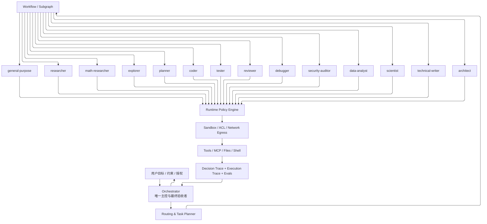

## 架构

### 分层

| 层级 | 组成 | 主要职责 |
| ----------------- | ----------------------------------------------- | -------------------------------------------------------------------- |
| L0 用户与业务边界 | 用户意图、授权、业务约束 | 给出目标、约束和需要批准的高风险动作 |
| L1 控制层 | Orchestrator | 理解目标、判断复杂度、制定任务图、选择 Agent、授权、验收、整合和交付 |
| L2 专业层 | 14 个 Subagent | 在明确职责和权限内执行专业子任务 |
| L3 流程与知识层 | Subgraph、Hard Skill、Soft Skill、LoreBook | 复用稳定流程、封装专业 SOP、按需加载知识 |
| L4 执行与治理层 | Tools、Runtime Policy、State、Trace、Evaluation | 提供真实执行能力、强制权限、持久化状态、审计和评测 |

Orchestrator 调度 14 个内置 Subagent。委派由 Orchestrator 发出；Subagent 不自行 Spawn、Fork，也不再往下委派。权限由 Runtime 在执行时强制，完成由 Orchestrator 按验收条件确认。

### 关系

用户目标进入 Orchestrator。Orchestrator 经路由和 Subgraph 把任务分给 Subagent。Subagent 的工具调用先过 Runtime Policy 和沙箱，再触及工具、文件和 Shell。Trace 回到 Orchestrator，由它向用户交付。

## Orchestrator

Orchestrator 在 14 个 Subagent 之外。它决定委派、权限范围和是否验收。调度和工具权限分开算，它不默认拥有全部工具。

每个任务有一个 Owner。其他 Agent 可以提供输入。顶层任务的 Owner 是 Orchestrator。

- 识别用户目标、交付物、约束、风险和未明确条件。
- 判断是否委派，以及复杂度等级。
- 选择足够完成任务的最少 Agent。
- 把复杂目标分解成有依赖的子任务 DAG。
- 为每个子任务写明目标、输入、输出、验收标准和预算。
- 算出最小权限集合，请求 Runtime 建立执行会话。
- 管理并行任务、文件锁、工作区和冲突。
- 按工具的实际结果、交付物和验收标准核验子 Agent 的结果。
- 对失败、阻塞、权限拒绝和部分完成做恢复或重新规划。重试次数见预算。
- 整合成果，写明来源、假设、限制和未完成项，交给用户。

## 角色

Work mode 是能力上限。每次委派由任务级 Capability Filter 再收紧。

| ID | Subagent | 专业方向 | 职责 | 默认 Work mode | 默认网络 |
| ---: | ------------------ | ------------ | -------------------------------------- | -------------- | ----------------------- |
| 01 | `general-purpose` | 通用执行 | 处理没有明显专业归属的轻量任务 | `ro` | off |
| 02 | `researcher` | 外部研究 | 网络检索、来源验证、技术和资料调研 | `ro` | on（受限） |
| 03 | `math-researcher` | 数学研究 | 数学推导、证明、计算与数值验证 | `sw` | off |
| 04 | `explorer` | 内部探索 | 代码库、文件、依赖、调用关系和项目事实 | `ro` | off |
| 05 | `planner` | 执行规划 | 任务分解、依赖、顺序、里程碑和验收条件 | `pl` | off |
| 06 | `coder` | 软件实现 | 功能实现、代码修改、重构和修复 | `sw` | off |
| 07 | `tester` | 测试验证 | 测试设计、执行、回归和结果分析 | `sw` | off |
| 08 | `reviewer` | 独立质量审查 | 代码、逻辑、设计和可维护性审查 | `ro` | off |
| 09 | `debugger` | 故障诊断 | 复现、日志分析、根因和性能诊断 | `ro` | off |
| 10 | `security-auditor` | 安全审计 | 威胁建模、漏洞分析、权限和安全配置审查 | `ro` | off（按需开只读情报源） |
| 11 | `data-analyst` | 数据分析 | 数据质量、统计、建模、可视化和解释 | `sw` | off |
| 12 | `scientist` | 科学研究 | 科学问题、假设、机制、模型和实验设计 | `sw` | off |
| 13 | `technical-writer` | 技术写作 | 技术文档、规范、报告和知识交付 | `sw` | off |
| 14 | `architect` | 系统架构 | 架构设计、技术选型、接口和系统演进 | `pl` | off |
