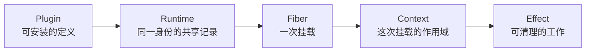
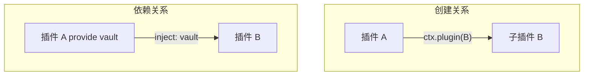
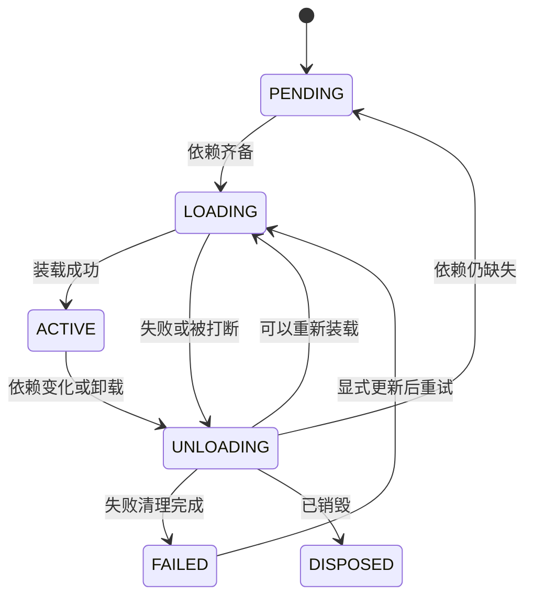

## 生命周期对象

Cordis 把“插件是什么”和“这次挂载”分开：



| 概念    | 含义                       |
| ------- | -------------------------- |
| Plugin  | 可安装的定义               |
| Runtime | 同一插件身份的共享记录     |
| Fiber   | 一次挂载及其状态           |
| Context | 这次挂载的作用域           |
| Effect  | Fiber 拥有的一项可清理工作 |

一个 Runtime 可以对应多次挂载。每次挂载都有自己的配置、Fiber、Context 和 effects。

## Fiber 与 Context

Fiber 记录一次挂载，Context 是插件代码进入这次挂载的入口。两者互相持有引用。

|        | Fiber                            | Context                     |
| ------ | -------------------------------- | --------------------------- |
| 保存   | 配置、状态、依赖快照和 effects   | 当前 Fiber 及其继承的作用域 |
| 使用者 | 安装、等待或销毁这次挂载的调用方 | 插件内部代码                |


插件通过 Context 读取服务、安装子插件和登记 effect。Context 再询问 `ctx.fiber`：依赖快照决定哪些服务可见，登记的工作则归这个 Fiber 所有。服务实现本身不存放在 Context 上。

### 常见成员

调用方主要使用 Fiber：

| 成员                                 | 作用                           |
| ------------------------------------ | ------------------------------ |
| `ctx`                                | 这次挂载的 Context             |
| `state`、`config`、`inject`、`name`  | 状态、源配置、依赖和显示名     |
| `dispose()`、`update()`、`restart()` | 销毁、更换配置、按当前配置重载 |

插件代码主要使用 Context：

| 成员                          | 作用                       |
| ----------------------------- | -------------------------- |
| `fiber`、`root`               | 当前 Fiber、根 Context     |
| `plugin()`、`effect()`        | 挂载子插件、登记可清理工作 |
| `on()`、`emit()`、`provide()` | 监听或发出事件、提供服务   |
| `ctx.服务名`                  | 读取当前 Fiber 可见的服务  |

## 子插件与依赖

A 创建子插件 B，和 B 依赖 A 提供的服务，是两种关系。



A 在自己的回调里调用 `ctx.plugin(B)` 时，B 的 Fiber 成为 A 的一个 effect，B 的 Context 从 A 的 Context 扩展出来。A 卸载时会卸载 B。这决定 B 由谁创建、随谁销毁。

B 的 `inject` 写的是服务名。A `provide` 了这个名字后，B 等到该服务进入 `ACTIVE` 才装载；服务消失或更换时，B 卸载并在新条件满足后重载。A 与 B 可以挂在同一个父级下，B 不必由 A 创建。

两种关系可以同时存在：A 创建 B，同时 B 显式 `inject` A 提供的服务。只创建子插件，不会让 B 自动等待或使用 A 的服务。

## Fiber 状态

一次挂载在六个状态之间转换。依赖决定它能否运行；cleanup 发生在离开运行状态之后。



| 状态      | 含义                      |
| --------- | ------------------------- |
| PENDING   | 已登记，正在等待依赖      |
| LOADING   | 正在执行 setup            |
| ACTIVE    | 已就绪，effects 存活      |
| UNLOADING | 正在执行 cleanup          |
| FAILED    | 装载失败，等待显式恢复    |
| DISPOSED  | 已销毁，不能再创建 effect |

依赖消失或更换时，`ACTIVE` 先进入 `UNLOADING`，再根据新条件回到 `PENDING` 或 `LOADING`。`FAILED` 不会因为依赖刷新而自动重试。

## 副作用、effect 与 cleanup

- **副作用**：计算之外，对外部世界产生的可观察交互，例如注册监听器、启动定时器或打开连接。
- **effect**：Cordis 用来拥有并管理一项副作用的生命周期单元。
- **cleanup**：关闭资源、撤销注册，使这项工作不再影响未来。

> effect = setup + cleanup + 拥有它的 Fiber

```ts
const dispose = ctx.effect(() => {
  const timer = setInterval(tick, 1000)
  return () => clearInterval(timer)
})
```

`ctx.effect()` 立即执行 setup，并在手动 `dispose()` 或 Fiber 卸载时执行 cleanup。disposer 是执行 cleanup 的函数；dispose 是触发这次清理的动作。没有登记 cleanup 的外部资源不会被自动撤销。
