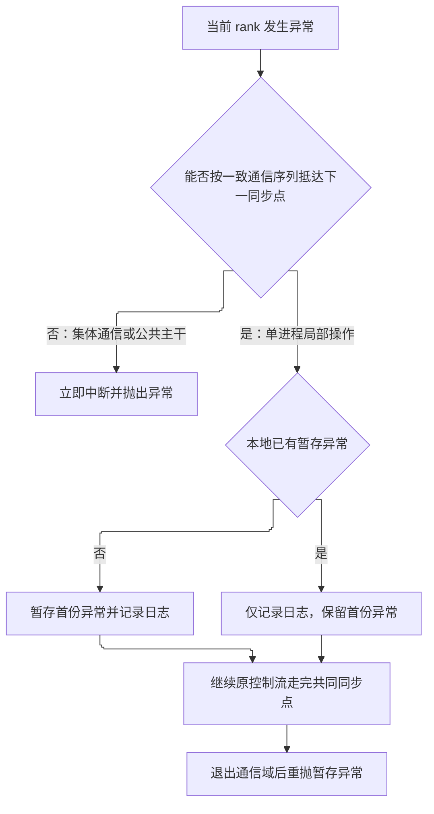
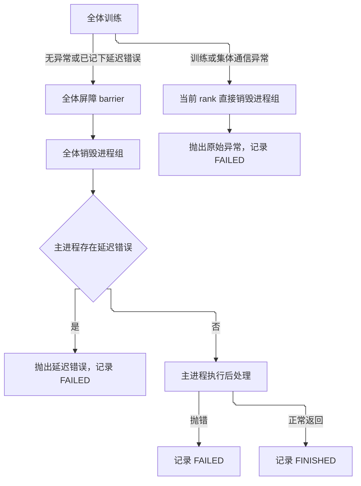

- [1. 延迟错误的原理](#1-延迟错误的原理)
  - [1.1. 定义与根因保留](#11-定义与根因保留)
  - [1.2. 判别准则：何时延迟，何时立即抛出](#12-判别准则何时延迟何时立即抛出)
  - [1.3. 从局部异常到全局一致停止](#13-从局部异常到全局一致停止)
- [2. 应用](#2-应用)
  - [2.1. 用在训练循环](#21-用在训练循环)
  - [2.2. 用在检查点保存](#22-用在检查点保存)
  - [2.3. 用在实验收尾与状态一致性](#23-用在实验收尾与状态一致性)
    - [2.3.1. 最终抛出时机](#231-最终抛出时机)
    - [2.3.2. 观测范围与状态一致性](#232-观测范围与状态一致性)
    - [2.3.3. 受控退出与紧急退出分流](#233-受控退出与紧急退出分流)

在分布式训练中，延迟错误（Deferred Error）是一种针对单进程局部异常的容错与受控退出机制：主进程独有的操作发生异常时，先将异常暂存在进程内，让各进程按原定顺序走完后续集体同步点，待进程组销毁后再将异常抛出。

## 1. 延迟错误的原理


主流分布式训练采用 **SPMD（Single Program, Multiple Data，单程序多数据）** 执行模型。每个工作进程（rank）运行同一份程序，却同时承担两类性质截然不同的操作：

- **对称的集体通信**：如反向传播中的梯度归约（`all_reduce`）、分片状态聚集（`all_gather`）以及显式屏障（`barrier`）。底层通信库要求全体 rank 按严格一致的顺序成组调用；任一 rank 缺席或调用次序错位，其余 rank 就会在通信原语上阻塞（hang），直至进程组超时。
- **非对称的局部操作**：如向外部系统上报指标、写入检查点元数据、执行单进程监控钩子。这类操作通常只在主进程（Rank 0）上运行，不涉及跨进程通信。

两类操作交织在同一控制流中。如果主进程在非对称局部操作中立即抛出异常并退出，调用栈会直接跨过后续所有同步点，而其余 rank 毫不知情，照常进入下一步的梯度归约或屏障等待，最终导致整个作业挂起，原始报错也常被铺天盖地的超时日志淹没。


### 1.1. 定义与根因保留

延迟错误将“异常捕获”与“控制流中断”解耦：

- **本地暂存**：包裹主进程局部操作，捕获异常并保存在当前进程内存中，不立即中断控制流。若后续局部操作再次出错，**仅保留第一份异常**，防止连锁派生的次生错误覆盖最初的根因；本地日志照常记录以便排障。
- **延后重抛**：提供显式的重抛入口，在全体进程安全退出分布式通信域之后，取出暂存异常重新抛出并清空状态；在没有暂存异常的进程上，该操作为空操作。

### 1.2. 判别准则：何时延迟，何时立即抛出

一个异常应当延迟还是立即抛出，取决于唯一判据：**异常发生后，当前 rank 还能否与其余 rank 按完全一致的通信序列抵达下一个共同同步点。**

- **可延迟**：异常发生在单进程局部操作中，底层通信通道完好，各 rank 所处的通信轮次也未错开。记下异常后继续往下走，能够正常闭合本轮及收尾阶段的集体通信。
- **立即抛出**：异常发生在集体通信内部（如梯度同步、分片模型保存）或全体共同的计算主干中。此时通信本身已经受损，或者其余 rank 正停留在当前这次集体通信里等待；若当前 rank 吞下异常继续走向下一道屏障，它的通信序号就会超前，反而自己也卡死在新屏障上，导致原始异常无法暴露。



### 1.3. 从局部异常到全局一致停止

暂存异常只存在于出错进程自己的地址空间中，其余 rank 的本地状态仍为空。因此，主进程**不能单凭“本地存在延迟错误”就直接 `break` 退出循环**，否则下一步集体通信依然缺人。

要让所有进程在同一轮迭代边界整齐停下，需要在全体 rank 都会经过的位置插入一次轻量级的全局状态同步，将单点的“本地异常”转化为全体可见的“全局停止标志”（例如分布式触发器或对布尔错误标志做跨进程归约）：

1. 任一进程检测到本地存在延迟错误时，置位停止标志。
2. 在约定的同步检查点，全体进程共同读取归约后的全局标志（单进程训练时直接检查本地状态即可）。
3. 一旦全局标志为真，所有 rank 在当前迭代步结束后同步退出循环。

## 2. 应用

### 2.1. 用在训练循环

一次迭代通常包含前向计算、可选钩子、反向传播、参数更新和步末日志。局部操作可能出现在集体通信之前，也可能出现在集体通信之后；延迟错误将这两处异常统一收敛到步末的同步检查点。

- **通信前的局部操作**：例如反向传播前仅在主进程运行的监控或采样钩子。此处出错时先记入延迟错误，主进程不中断当前步骤，继续参与随后的 `backward()`，保证本步全体的梯度归约完整闭合。
- **通信后的局部操作**：例如步末或验证阶段的指标上报。此处出错时同样记入延迟错误，紧接着进入步末的停止标志同步。

当全体 rank 在同一步检测到全局停止标志并 `break` 离开内层循环后，**外层循环末尾若仍有包含集体通信或屏障的收尾逻辑（如周期性或末次保存），全体仍须按原控制流走完，不能在循环中途直接 `return`**。只有按既有顺序把已编排的同步点逐一走完，才能无阻塞地退回顶层。

```python
for epoch in epochs:
    for step in steps:
        forward()
        if is_main_process:
            try_or_defer(local_op_before_comm)        # 通信前局部操作：出错暂存，继续参与集体通信
        collective_comm()                             # 集体通信（如梯度同步）：失败立即抛出
        if is_main_process:
            try_or_defer(local_op_after_comm)         # 通信后局部操作：出错暂存
        if sync_should_stop(has_deferred_error()):    # 全体同步停止标志，同一步对齐退出
            break
    cleanup_or_save()                                 # 含集体通信与屏障，退出内层循环后仍须共同走完
    if sync_should_stop(has_deferred_error()):
        break
```

### 2.2. 用在检查点保存

在参数分片训练（如 FSDP、DeepSpeed ZeRO）中，模型与优化器状态分散在各个 GPU 上，保存检查点同时包含“跨进程集体通信”与“主进程局部文件操作”。应用延迟错误时，必须按通信边界将保存流程拆分为四个阶段：

1. **目录准备与前置屏障**：主进程在共享文件系统上创建临时目录，随后全体执行第一道 `barrier()`，确保其余 rank 开始写入前目录已经可见。
2. **集体状态落盘（立即抛出）**：全体 rank 共同调用分布式状态保存接口，内部通过集体通信汇聚或分片写出张量。一旦此处抛错，通信已经中断，各 rank 必须立即向上抛出原始异常，绝不能延迟。
3. **局部元数据与原子替换（延迟错误）**：分片状态落盘后，集体通信已经结束。随后写入训练进度元数据、将临时目录原子重命名为正式目录、清理历史旧检查点等操作均由主进程独立完成。此阶段若发生 I/O 异常，记入延迟错误而不中断流程。
4. **收尾屏障**：无论第三阶段成功还是记入了延迟错误，主进程都照常抵达末尾的 `barrier()`，释放正在等待的其余 rank；随后由下一处全局停止检查统一终止训练。

```python
def save_checkpoint():
    if is_main_process:
        prepare_temp_dir()
    barrier()                                         # 确保共享目录已就绪

    save_distributed_state()                          # 全体参与集体通信；异常立即向上抛出

    if is_main_process:
        try_or_defer(write_metadata_and_rename)       # 主进程局部 I/O；异常暂存，不跳过末尾屏障

    barrier()                                         # 全体汇合后再离开保存阶段
```

### 2.3. 用在实验收尾与状态一致性

训练函数返回后，作业通常还要经历跨进程收尾、进程组销毁以及主进程独有的下游后处理（如离线评估、生成采样）。延迟错误在这一阶段完成最终重抛，并与外部实验追踪器（Reporter）的状态生命周期对齐。

#### 2.3.1. 最终抛出时机

延迟错误的重抛点必须严格位于 **`barrier()` 与 `destroy_process_group()` 之后、`post_train()` 之前**：

- **在销毁进程组之后**：确保全体 rank 已经走完最后一道屏障并各自释放了底层通信资源，此时主进程抛出异常不会再造成任何跨进程死锁。
- **在后处理之前**：既然训练阶段已经留下了未解决的错误，实验整体已处于失败状态，应当立即阻断耗时的下游后处理任务。

#### 2.3.2. 观测范围与状态一致性

实验追踪上下文（如 MLflow、W&B 的 run 上下文）负责在退出时根据上下文中是否捕获到异常，将实验最终状态标记为成功（`FINISHED`）或失败（`FAILED`）。若上下文仅包裹训练循环本身，训练一返回状态就会被提前固化为 `FINISHED`；此后无论抛出延迟错误还是后处理崩溃，都会出现“进程异常退出、实验记录却显示成功”的状态分裂。

因此，主进程上的追踪上下文必须包裹**从训练开始直至后处理结束的完整生命周期**，使整个实验收尾构成一个原子的状态观测区间。

#### 2.3.3. 受控退出与紧急退出分流



将上述分流写成顶层调度伪代码（非主进程走相同的训练、屏障与销毁路径，但不开启追踪上下文，也不执行后处理）：

```python
with reporter_context(enabled=is_main_process):       # 包裹完整生命周期：无异常记 FINISHED，有异常记 FAILED
    try:
        train()
    except Exception:
        suppress_errors(destroy_process_group)        # 紧急退出：不进屏障，吞掉销毁自身的次生异常
        raise                                         # 保留并抛出原始训练异常

    barrier()
    destroy_process_group()

    if is_main_process:
        raise_if_deferred_error()                     # 进程组销毁后重抛延迟错误，阻断后处理
        post_train()
```