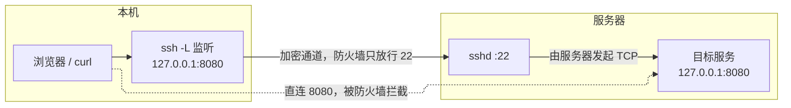
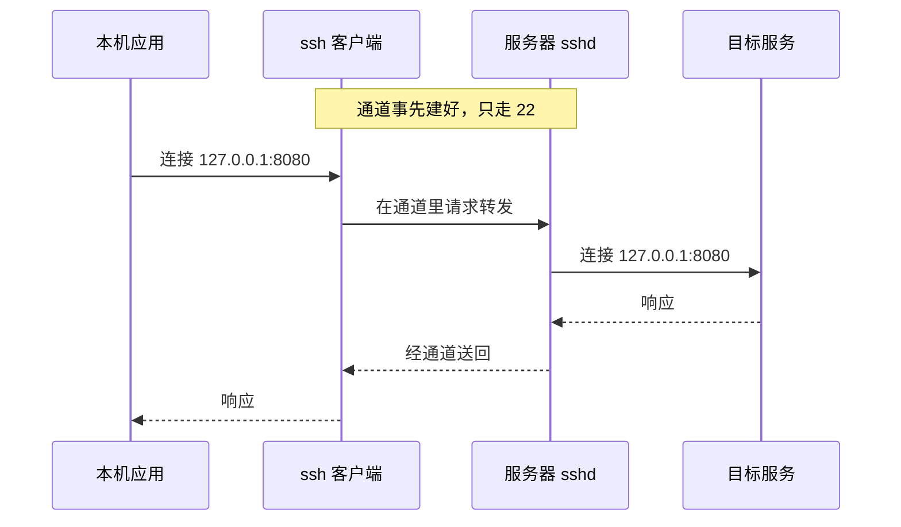
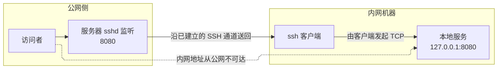
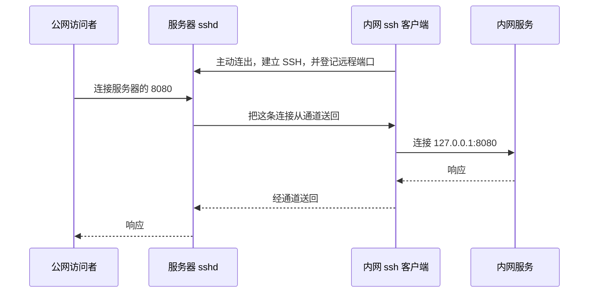

---
tags:
  - 网络
---

# ssh

- [ssh](#ssh)
  - [1. 基本用法](#1-基本用法)
  - [2. 本地转发 -L](#2-本地转发--l)
  - [3. 远程转发 -R](#3-远程转发--r)
  - [4. Agent 转发](#4-agent-转发)
  - [5. 经代理连接 SSH](#5-经代理连接-ssh)
  - [6. 用 SSH 做 SOCKS 代理](#6-用-ssh-做-socks-代理)
  - [7. 22 端口被封时访问 GitHub](#7-22-端口被封时访问-github)

## 1. 基本用法

```bash
ssh user@server
```

常连的机器写在 `~/.ssh/config` 里。`Host` 是自己起的名字，`HostName` 是要连的地址。

```
Host lab
    HostName 192.0.2.10
    User alice
    Port 22
    IdentityFile ~/.ssh/id_ed25519
```

```bash
ssh lab
```

## 2. 本地转发 -L

服务器上的服务听在 `127.0.0.1:8080`，防火墙只放行 22。本机直接访问这个 8080 会被丢掉。`-L` 在本机听一个端口，流量走 SSH 通道，由服务器去连目标。

```bash
ssh -N -L [绑定地址:]本地端口:目标主机:目标端口 user@server
```

绑定地址可以不写，这时只听本机回环。局域网里别的机器也要用这条转发，写成 `0.0.0.0`。

`-N` 不执行远程命令。`-f` 在转发建好后把 ssh 放到后台。

`目标主机:目标端口` 在服务器上解析，连接也由服务器发出。这里的 `127.0.0.1` 是服务器自己的回环。

```bash
ssh -N -L 8080:127.0.0.1:8080 user@server
```

本机打开 `http://127.0.0.1:8080`。

实线是转发，虚线是被防火墙丢掉的直连。





目标在服务器能访问的另一台机器上时，中间那段换成那台机器的地址，名字也在服务器上解析。

```bash
ssh -N -L 8080:10.0.0.8:80 user@server
```

监听绑到所有地址。局域网里能连上你这台机器 8080 的人，都能通过这条隧道到达目标。

```bash
ssh -N -L 0.0.0.0:8080:127.0.0.1:8080 user@server
```

`~/.ssh/config` 里写成 `LocalForward 8080 127.0.0.1:8080`，之后 `ssh -N lab` 会带上。

## 3. 远程转发 -R

服务在一台没有公网地址的机器上。在这台机器上执行 `-R`，它连到有公网地址的服务器，让服务器听一个端口。别人连的是服务器，数据沿通道回来，由这台机器去连本地服务。这台机器只要能向外连上服务器的 22。

```bash
ssh -N -R [绑定地址:]远程端口:目标主机:目标端口 user@server
```

绑定地址是服务器听这个远程端口用的地址，可以不写。不写时服务器只听自己的回环。

`目标主机:目标端口` 在跑这条命令的机器上解析，连接也由它发出。`127.0.0.1:8080` 就是这台机器上的服务。

```bash
ssh -N -R 8080:127.0.0.1:8080 user@server
```

别人访问服务器的 8080。虚线是从公网直接访问内网。





## 4. Agent 转发

在服务器上用本机的密钥，比如 clone 私有仓库。私钥留在本机的 ssh-agent 里。服务器只拿到一个套接字，`ssh` 或 `git` 要签名时把请求发回本机。

```bash
eval "$(ssh-agent -s)"
ssh-add ~/.ssh/id_ed25519
ssh -A user@server
```

agent 已经在跑的话，只需要 `ssh-add`。

只给这一台开：

```
Host lab
    HostName 192.0.2.10
    Port 22
    User alice
    IdentityFile ~/.ssh/id_ed25519
    ForwardAgent yes
```

别写进 `Host *`，也别对不信任的机器开。会话还在时，那台服务器可以用这个套接字，以你的密钥去连别的机器。

## 5. 经代理连接 SSH

本机要经过本地代理才能连上 SSH 服务器时，用 `ProxyCommand`。下面是 SOCKS5，`nc -X 5`，代理在 `127.0.0.1:7890`。`%h`、`%p` 会换成要连的主机和端口。端口改成自己代理实际听的。

```
Host lab
    HostName 192.0.2.10
    User alice
    IdentityFile ~/.ssh/id_ed25519
    ProxyCommand nc -X 5 -x 127.0.0.1:7890 %h %p
```

中间是一台 SSH 跳板时用 `ProxyJump`，命令行是 `-J`。先登录跳板，再从跳板连到目标。

```bash
ssh -J alice@bastion alice@10.0.0.8
```

```
Host internal
    HostName 10.0.0.8
    User alice
    ProxyJump bastion

Host bastion
    HostName bastion.example
    User alice
    IdentityFile ~/.ssh/id_ed25519
```

## 6. 用 SSH 做 SOCKS 代理

`-D` 在本机开一个 SOCKS 代理。目标不写在命令里，每个连接的目的地由应用程序告诉 ssh，再由服务器去连。`-L` 的目标是命令里定死的。

```bash
ssh -N -D 1080 user@server
```

SOCKS 指到 `127.0.0.1:1080`。域名也交给服务器解析：

```bash
curl --socks5-hostname 127.0.0.1:1080 https://example.com
```

## 7. 22 端口被封时访问 GitHub

连 `github.com` 的 22 超时：

```
ssh: connect to host github.com port 22: Connection timed out
```

在 `~/.ssh/config` 里改走 443：

```
Host github.com
    Hostname ssh.github.com
    Port 443
    User git
```

`Could not resolve hostname` 是解析失败，改端口没用。
